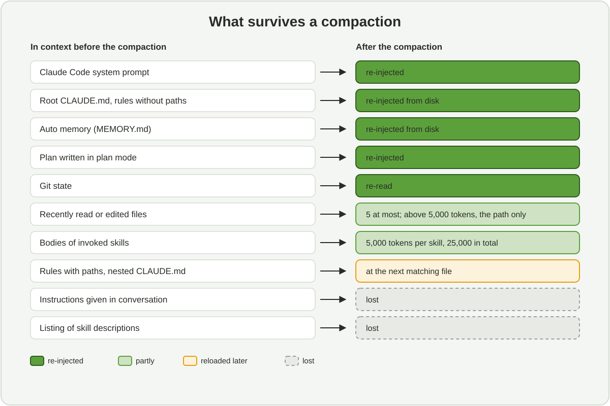
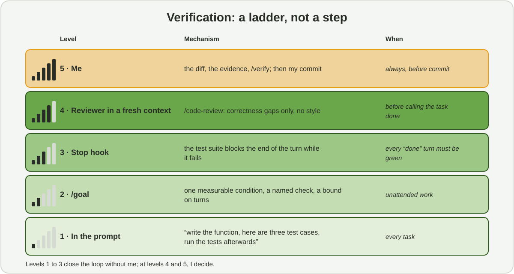


In late September I described my working method with Claude Code in five rules. One month
later, three things have moved: Anthropic's doctrine on what to write to the agent, the
default permission mode, and the verification tools. Here is what I keep, what I change, and
the files that go with it.


*Reading time: about 27 minutes. This article complements
[the first version]() without replacing it: the
principles are explained in detail there, here I only cover what changes. Every feature is
introduced the first time it appears.*



The first version held in five rules: context is the scarce resource, CLAUDE.md is short, I
explore and plan before coding, nothing is finished without proof, and I remain responsible
for every line. None of them has become false. But the way to hold them has changed, because
the tool and its documentation have changed. I re-read the official Claude Code
documentation (version 2.1.312, as of 27 October 2026), Anthropic's post of 24 July on the
new rules of context engineering for Claude 5 models, and the July field guide on finding
your unknowns with Fable. This article draws the consequences for a data scientist who codes
in the terminal and commits by hand.


**In short.** The five rules remain, and each takes a more precise form:

1. **Context is measured, not guessed**: `/context` at the start of a task, and I know what survives a compaction.
2. **CLAUDE.md describes criteria, not prohibitions**: judgment for style, mechanisms for what must never happen.
3. **Before planning, I surface my unknowns**: blind spots, interview, throwaway prototype, references rather than descriptions.
4. **Verification is a ladder**: in the prompt, then `/goal`, a `Stop` hook, a reviewer in a fresh context, and me.
5. **I remain the owner of the code, and it is written in the configuration**: `deny` rules, hooks, manual commit.


## 1. What has changed since September

The table sums up the six changes that moved my practice. The following sections take them
one by one.

| Topic | In September | As of 29 October 2026 |
|---|---|---|
| **Context philosophy** | Explicit rules, examples, a CLAUDE.md that gathers everything there is to know | Anthropic removed more than 80% of Claude Code's system prompt for the 5 models, with no measured loss. Doctrine: judgment over rules, interfaces over examples, progressive disclosure. `/doctor` proposes the cuts |
| **Permission mode** | Manual by default, allowlists, sandbox | *Auto mode* is the starting mode of interactive sessions: a classifier reviews non-trivial actions. `deny` rules remain the only hard guarantee |
| **Memory** | CLAUDE.md and the `#` shortcut | Auto memory on by default, path-scoped rules in `.claude/rules/`, audit with `/doctor prompt-audit` |
| **Verification** | Tests and human review | `/goal` (an end condition evaluated at every turn), `Stop` hooks of type `prompt` or `agent`, `/code-review` in a fresh subagent, `/verify` |
| **Parallelism** | Subagents, experimental agent teams | Subagents in the background by default, forks with `/subtask`, dynamic workflows written in JavaScript |
| **Models** | The 4 lineage | The 5 lineage: Opus 5.5 by default, Sonnet 5.5, Haiku 5.5, Fable 5.1; a one-million-token context; effort levels from `low` to `max` |

The common thread fits in one sentence: **the lever is no longer writing good prompts, but
assembling the right context at the right moment, and delegating hard rules to deterministic
mechanisms.** Everything else follows.

## 2. Context: measure, don't guess

### What comes in before my first question

What I type is only a small part of what the model sees. The rest is assembled by Claude
Code, and each piece has its own cost and behaviour. I only knew this roughly; the
documentation now details it, and that changes how instructions should be filed.

| Element | When it loads | What I take from it |
|---|---|---|
| Claude Code system prompt | Always | About 4,000 tokens, heavily reduced for the 5 models |
| CLAUDE.md (user, project) and rules without `paths` | Always, at every request | Permanent cost: every line is paid at every turn |
| Auto memory (`MEMORY.md`) | Always | The first 200 lines or 25 KB, whichever comes first |
| Skills | The description only | The body arrives only on invocation; the listing is budgeted at about 1% of the window |
| MCP servers | Tool names only | Schemas stay deferred until use |
| Rules with `paths`, subfolder CLAUDE.md | At the first matching file | A local convention costs nothing until its area is touched |
| Hooks | Never | Zero cost, unless the hook returns content |

The practical consequence: **what must be true at every session goes to the top of the
hierarchy, what is only needed sometimes moves down** to a skill or a path-scoped rule. That
is the principle of progressive disclosure, and section 4 gives the placement table.

### What survives a compaction

When the window fills up, Claude Code summarises the history (`/autocompact` sets the
threshold). The summary is useful, but lossy, and I did not know precisely what was lost.
The figure shows what I retained.



Two lines of this figure changed how I work.

- **Instructions given in conversation are lost.** "Don't push to `main`", said out loud at
  the start of a session, does not survive. A conversational limit is not a rule: if it
  matters, it goes into a `deny` rule or a hook.
- **Skill bodies come back truncated**, 5,000 tokens per skill and 25,000 in total, oldest
  evicted first. So the essentials of a `SKILL.md` go at the top of the file, and details in
  side files.

I am adding a compaction instruction to my CLAUDE.md files, along the lines of: *"on
compaction, keep the list of modified files, the test commands and the modelling decisions
taken"*. And for a long useful session, `/compact` with a targeted instruction, or `/rewind`
then "summarise from here" to compact only a part.

### The cues I use

The thresholds below are not dogma. They are signals that trigger a precise action, and
several are new.

| Signal | What I do |
|---|---|
| Start of a complex task | `/context`: check that the expected CLAUDE.md is loaded, spot a greedy MCP server or skill |
| Change of topic | `/clear`. A clean session beats a long session full of corrections |
| Two failed corrections on the same point | `/clear`, then a first message that includes what I learned |
| Side question with no follow-up | `/btw`: the answer stays out of the history, zero context growth |
| Broad exploration of a repository | An `Explore` subagent, or a strictly scoped search |
| Context beyond 50 to 60% on a 200,000-token model, or visible noise on one million | Write the state to a file, commit, `/clear`, restart by reading that file |
| The agent ignores a CLAUDE.md rule | The file is too long or ambiguous: prune, clarify, or convert to a hook |

The one-million-token context of the 5 models does not change these reflexes. Size is not
what protects, relevance is: degradation with noise is still real, it just arrives later.

## 3. From rulebook to judgment

Anthropic's post of 24 July lays out six "before / now" shifts for Claude 5 models. They have
been built into `/doctor`, the diagnostic command. Here is each one, with what it changes in
my files.

| Before | Now | What I change |
|---|---|---|
| Give rules | Let the agent judge | "Never write comments", "functions under 30 lines" become criteria: "code that looks like the surrounding code", "reproducibility first", "no abstraction that was not asked for" |
| Give examples | Design interfaces | A script whose signature speaks, `backtest.py --horizon 14 --quantiles 0.1,0.5,0.9`, says more than a paragraph of examples, and does not constrain exploration |
| Put everything at the top | Progressive disclosure | Short CLAUDE.md; the verification procedure in a skill; infrastructure conventions in a rule limited to `infra/**` |
| Repeat yourself | Describe once | Not the same instruction in CLAUDE.md, in the skill and in the prompt. A tool's usage goes in its description, once |
| Memory in CLAUDE.md | Auto memory | Claude records my corrections and preferences itself; CLAUDE.md keeps what is shared with a team |
| Simple specs | Rich references | A spec can be a test suite, a function from another repository to port, an HTML mockup, a rubric that a verifying agent will apply |

The stated reason: absolute rules create conflicts between the system prompt, the skills and
the day's request, and the arbitration costs quality; examples constrain exploration more
than they steer it.

### Guardrails and style rules are not the same thing

This is the nuance I do not want to lose. "Let the agent judge" concerns preferences and
conventions. It does not remove guardrails. The right split is: **judgment for style and
technical decisions; deterministic mechanisms for what must never happen**, such as touching
`data/raw/`, pushing to `main`, running `terraform apply` in production. Rules that cost more
than they protect are removed; the others move into the infrastructure. Section 7 shows mine.

### Auditing your setup

Three commands do what I used to do by hand.

- `/doctor`: for a versioned CLAUDE.md, proposes cuts on what can be derived from the code
  (tree, dependencies, architecture overview) and keeps the pitfalls, the reasons and the
  conventions that differ from the defaults.
- `/doctor prompt-audit`: looks for instructions written for older models, references to
  files or commands that no longer exist, and contradictions between CLAUDE.md, rules, skills
  and subagents. Nothing is changed until you apply.
- `/skill-doctor`: the context cost and actual usage of every skill.

My CLAUDE.md files run from 29 to 66 lines depending on the repository. The longest is this
blog's, because it describes overridden templates and content conventions that nothing in
the code explains. The test I apply line by line has not changed: *if I remove it, will the
agent get it wrong?* And I added a non-regression test for rules, suggested by the
documentation: a harmless, checkable instruction at the end of the file. If it stops being
followed, the instruction budget is saturated.

## 4. Where each instruction goes

The question "where do I write this?" comes up on every project. Claude Code loads ten
layers, in a fixed order: organisation CLAUDE.md, personal CLAUDE.md, personal rules,
project CLAUDE.md, project rules without paths, rules with paths, a git-ignored
`CLAUDE.local.md`, subfolder CLAUDE.md, auto memory, skills. The files are concatenated, not
ranked: two contradictory instructions give an arbitrary choice. Hence a placement table,
which I keep up to date.

| If it is… | Then it goes in… |
|---|---|
| A fact true at every session, not derivable from the code: build command, required environment variable, pitfall | The project's CLAUDE.md, under 200 lines |
| A convention valid for only part of the tree | A rule with `paths:` in `.claude/rules/` |
| A multi-step procedure, knowledge used occasionally | A skill, 50 to 300 lines; beyond that, split into `reference.md`, `examples.md`, `scripts/` |
| A workflow with side effects that I want to launch myself | A skill with `disable-model-invocation: true`: zero cost until I call it |
| A correction I already made in conversation | Auto memory captures it; if it is a team rule, I add it explicitly to CLAUDE.md |
| Something that must happen every time, without exception | A hook, or a `deny` / `ask` rule in `settings.json` |
| Access to data or an external tool | An MCP server, or more often a CLI: `gcloud`, `bq`, `gh`, `mlflow` |
| A setup to reproduce on a second repository | A plugin |

### Auto memory: using it without being ruled by it

In September I described memory as short notes the agent writes when I give it a lasting
instruction. It is now on by default, and structured in four types: *user* (my role, my
preferences), *feedback* (corrections, validated approaches), *project* (work in progress,
decisions), *reference* (where to find information outside the repository). It lives per
repository, in `~/.claude/projects/<project>/memory/`, shared between worktrees, never synced
to the cloud.

This blog's memory holds about ten notes today. Three of them were written after a
correction on my part, and that is their value:

- **articles aim for 30 minutes on Hugo's reading-time counter**; a 40-minute article was
  judged too long and brought back to 30, by condensing the prose and never the figures;
- **the research duration announced in an introduction comes from the commit dates of the
  associated repository**, not from the initial plan: "one day of research" became "three
  weeks" after reading the `git log`;
- **never a co-author line in a commit**.

I re-read these notes from time to time with `/memory`, and I delete the ones that are no
longer true. At a client with confidentiality constraints, memory can be disabled per
project. One point that surprised me: **subagents do not inherit the main memory**, except
forks. If a rule must reach them, it is repeated in the delegation prompt.

### Skills: a procedure, not a manual

Commands and skills have merged: a `.claude/commands/x.md` file and a
`.claude/skills/x/SKILL.md` folder both create `/x`. I only write skills now. Two real
examples, from my repositories.

The first prepares a commit without making it. It exists because I want to remain the sole
contributor of these repositories: the agent checks that the staged diff covers one topic,
runs the fast checks, and proposes a message in the *Conventional Commits* format. Its
description says when to call it, and that is what the agent reads:

```markdown
---
name: prepare-commit
description: Prepare a commit for the maintainer to run: check the staged diff
  covers one topic, run checks, and propose a Conventional Commit message. Use
  when the user asks to commit, prepare a commit, or write a commit/PR message.
---
Claude never runs `git commit` or `git push` in this repo: the maintainer must
be the sole GitHub contributor.

1. Run `git status` and `git diff --staged` […]
2. If the staged diff mixes topics, stop and propose how to split it.
3. Run `make check-fast` and report. Do not propose a commit while it fails.
```

The second frames a database migration, and starts with the failing test. The rest is the
conventions the agent cannot guess: money as `Numeric(14, 2)`, half-open `timestamptz` UTC
intervals, never a `Float`.

Sizing: under 500 lines for `SKILL.md`, the essentials at the top because of truncation on
compaction, scripts in `scripts/` where they are executed without ever entering the context.

## 5. Surfacing the unknowns before planning

This is the clearest addition to my loop. The July field guide on Fable describes the
quality of the agent's work as limited first by how the user clarifies their unknowns: what
they know and say, what they know they don't know, what they will only recognise on seeing
it, and what they have not thought of. In data science the fourth category is the most
expensive: it is sales censored by stock-outs, the variable computed after the fact, the
calendar that changes mid-history.

September's loop had five beats. It has six.



In plan mode, the agent reads and answers without changing anything. I scope the
exploration ("read `forecast/cv/` and `features/base.py`, explain how rolling origins are
computed") or delegate it to a subagent if it is broad.


Before writing a line: a "blind spots" pass (*"what considerations have I probably not
thought of for this capacity-constrained pricing?"*); then, for any non-trivial feature, an
interview, one question at a time, prioritising those whose answer would change the
architecture, ending in a `SPEC.md`. The next session, a clean one, executes the spec.


I ask for a plan and annotate it in the editor (`Ctrl+G`), then "address all my notes,
don't implement yet". The plan survives compaction. For a change that fits in one sentence,
I skip this step.


Asking explicitly for verification: "implement from the plan, write the `rolling_origin`
tests, run `make test-fast` and fix". And an **implementation notes** file, where the agent
records its deviations and conservative choices.


The ladder of section 6.


After reviewing the diff. Before signing a change I did not write, I ask for an
*explainer* and get **quizzed**: "what happens if the series has fewer than 14 points?". If
I cannot answer, I am not ready to commit.



Two practices from the guide seemed counter-intuitive, then useful. The **throwaway
prototype before the real code**: a dashboard mockup or a fifty-line notebook reveals the
criteria one can only formulate on seeing them. And **references rather than
descriptions**: pointing at existing code, even in another language, a test suite or an
HTML mockup. Code is the language the agent reads best; a mockup is a better spec than a
paragraph.

## 6. Verification: a ladder, not a step

"Nothing is finished without proof" remains the rule. What has changed is that the
documentation now offers an official gradation of the means to hold it, and several rungs
are new.



### In the prompt

Every request contains the means to prove it is fulfilled: "write the function, here are
three test cases, run the tests afterwards". That was already the case in September. It
remains the most profitable rung, because it costs nothing to set up.

### `/goal`: an end condition evaluated at every turn

New. `/goal "make test exits 0 and MASE on backtest <= 0.82, or stop after 20 turns"` hands a
small model the job of judging the condition after every turn; the agent continues until
"reached" or "impossible". The rules that work: **one measurable condition, a named check, a
bound on turns.** It is the tool for unattended work, coupled with auto mode. I have not used
it on a real task yet; the first documented session (condition, turns, evidence) is the first
item on my November list.

### The `Stop` hook: a deterministic gate

This one I have had from the start, and it bears the rule's name. On my mentoring
repository, which holds several Python projects, it re-runs `pytest` in every project whose
`src/` or `tests/` changed since the last commit, and refuses to hand back control while a
test fails:

```bash
#!/usr/bin/env bash
# Stop: "nothing is finished without proof". For every project whose src/ or
# tests/ changed since the last commit, run pytest; if a test fails, Claude
# cannot stop.
input=$(cat)
[[ $(jq -r '.stop_hook_active // false' <<<"$input") == "true" ]] && exit 0
# … detection of modified projects via git status --porcelain …
for p in "${!projets[@]}"; do
  sortie=$(cd "$p" && uv run --quiet pytest -q 2>&1); code=$?
  # 5 = no test collected: nothing to prove, not a failure
  (( code != 0 && code != 5 )) && echecs+=$'\n'"### $p"$'\n'"$(tail -n 25 <<<"$sortie")"
done
[[ -n "$echecs" ]] && jq -n --arg r "Tests fail: fix before finishing.$echecs" \
  '{decision: "block", reason: $r}'
```

The detail that matters: `pytest`'s return code 5 (no test collected) is not a failure,
otherwise a freshly initialised project could never hand back control. And the hook reads
`stop_hook_active` so as not to block itself. `Stop` hooks now come in three types:
`command`, `prompt` (a yes / no question put to a model, "are all tasks complete?") and
`agent` (a multi-turn subagent, experimental). I stay with `command`: a passing test suite is
proof; a model's "yes" is not.

### The reviewer in a fresh context

An agent that has just written code is badly placed to criticise it. `/code-review` launches
a fresh subagent that only sees the diff; `/code-review ultra` launches several in the cloud.
My home-made reviewer is a file in `.claude/agents/`, read-only, which reports by decreasing
severity: correctness (units, timezone-naive dates, half-open intervals, look-ahead in
anything date-based), numbers without provenance, respect of layers, missing tests, and
several topics mixed in one diff. Its last line is the most important: *"if nothing is wrong,
say so plainly; no style nits that `ruff` already enforces"*.

A reviewer ordered to find gaps will find some, even on sound work. I ask it to report only
what touches correctness or the stated requirements, and to treat the rest as optional.
Otherwise one drifts into over-engineering: abstraction layers, defensive code, tests of
impossible cases.

### Me

`/verify` builds and launches the application to confirm that a change works in the real
product, not only in the tests. Then I re-read the diff in VS Code and ask for the evidence,
test output and command run, rather than assertions of success. It also works for sessions I
did not watch.

### Test first, in two sessions

The agent still writes the implementation first by default, and the wording that works has
not changed: "write a test that **fails** for X, implement nothing, run it and show me the
failure", then "implement the minimum to make it pass, without touching the test". The
documentation now recommends a structural variant that I am keeping for the functions that
matter: **two sessions**. Session A writes the tests; session B implements, without having
seen the discussion about the test. The implementation cannot "bleed" into the test logic.
With two terminals and `--worktree`, it is five minutes of setup.

## 7. Guardrails: auto mode and what must never happen

### Permission modes

Since version 2.1.283, interactive sessions start in **auto mode**: everything runs, under
the control of a background classifier (Sonnet 5 by default) that reviews non-trivial
actions. By default it blocks `curl | bash`, sending sensitive data outside, production
deployments and migrations, `git push --force`, `git reset --hard`, `terraform destroy`,
granting IAM permissions, displaying secrets. After three consecutive blocks, it pauses and
asks again.

| Mode | What runs without asking | When I use it |
|---|---|---|
| `default` (manual) | Reads only | First contact with a client repository, real data |
| `acceptEdits` | Reads, edits, file commands inside the working directory | Local refactors I follow on screen |
| `plan` | Reads; no edit until the plan is approved | Exploration and planning |
| `auto` | Everything, under the classifier's control | Everyday work, `/goal`, unattended runs |
| `dontAsk` | Only what is pre-approved; everything else is refused | `claude -p` batches in a loop |
| `bypassPermissions` | Everything, with no control | An isolated container without internet, nowhere else |

What stays true whatever the mode: **`deny` rules apply everywhere, even in bypass**;
protected paths (`.git`, `.claude`, `.mcp.json`, `.bashrc`) are never auto-approved; and `rm`
on the root, the home or the working directory can be allowed by no rule. The documentation
says it itself: auto mode reduces prompts, it does not guarantee safety. Hence a sandbox
(`/sandbox`) or a devcontainer on top, for defence in depth.

### My configuration

On my application repositories, `settings.json` carries the same `deny` list, and it says
what I do not delegate:

```json
"permissions": {
  "deny": [
    "Bash(git commit:*)", "Bash(git push:*)", "Bash(git rebase:*)",
    "Bash(git reset --hard:*)", "Bash(gh pr merge:*)",
    "Read(./.env)", "Read(./.env.*)",
    "Edit(./data/**)", "Write(./data/**)"
  ]
}
```

The commit is mine, merging a pull request too, secrets are never read, data is never
modified by the agent. Three hooks complete the list, because the agent can also modify files
through the shell:

- a `PreToolUse` on `Bash`, which inspects only `git` invocations and refuses co-author
  trailers, `--no-verify` and any change to `core.hooksPath`;
- a `PreToolUse` on edits, which refuses `data/raw/` with a readable reason (*"raw data is
  downloaded and verified by SHA-256 by the project's code; write to `data/processed/`"*);
- a `PostToolUse` that runs `ruff format` on every modified Python file, from the `uv`
  project that contains it.

This blog, on the other hand, has neither `settings.json` nor hooks. The stakes are low, the
proof is the build, and when I explicitly ask for a commit and a push, the agent does them,
without a co-author line. **The level of guardrail follows the stakes**, not a general rule:
at a client, I start in manual mode, enable the blocking of reads outside the working
directory, and add `ask` rules as checkpoints on `git push`, `terraform apply`, `dvc push` and
deployments.

### Unattended

`claude -p "…"` runs without an interface, in CI for instance. Two changes since September:
non-interactive mode now starts in manual (version 2.1.302), so the wanted mode must be
stated; and `--bare` ignores local hooks, skills, MCP servers and CLAUDE.md, to make the run
reproducible. My read-only pull request review:

```bash
claude -p "…" --output-format json --allowedTools "Read,Grep,Glob" --max-turns 10 \
  --permission-mode dontAsk --bare
```

## 8. Delegating: subagents, forks, workflows

September's section 7 table still holds, with three more mechanisms. I give it as a
decision table.

| Need | Mechanism | Why that one |
|---|---|---|
| The agent gets a convention wrong twice | CLAUDE.md | Permanent fact, not derivable from the code |
| The same prompt retyped a third time | Skill | On demand, with scripts executed without entering the context |
| A side task floods the conversation | Subagent | Isolated context; only the summary comes back |
| The same processing on dozens of items, or results to cross-check | Dynamic workflow | A script decides, not the agent turn by turn; the context only keeps the final result |
| Something must happen every time | Hook | Deterministic |
| A second repository needs the same setup | Plugin | Bundles skills, hooks, subagents and MCP; testable with `claude plugin eval` |

### What has changed for subagents

They run **in the background by default**, `/tasks` shows what is running, and a subagent
only sees its own system prompt, the task, the CLAUDE.md hierarchy and the git state. Not
the history, not the memory, not the output style; the `Explore` and `Plan` subagents even
skip CLAUDE.md. **Forks** are new: `/subtask` creates a subagent that inherits the whole
conversation and reuses the prompt cache, often cheaper than a blank subagent when context
matters. A blank `Explore` is only worthwhile if the clean window is the goal. And the agent
rarely delegates on its own: I ask ("use a subagent to…") or write it in CLAUDE.md.

The useful fields in a subagent definition: `model` (`haiku` for cheap exploration, `opus`
or `fable` for review), `effort`, `memory: project`, `maxTurns`, `isolation: worktree`. My
read-only statistician from September has not changed by a line.

### Dynamic workflows

A workflow is a JavaScript script that the agent writes and a runtime executes in the
background: `agent(prompt, {schema})`, `pipeline()`, `parallel()`. Intermediate results stay
in the script's variables; the main context only receives the conclusion. It is triggered by
"use a workflow" or the `ultracode` keyword, and `/workflows` lets you follow, pause and save
a script to replay it.

The cases that concern me: an audit of temporal leaks across a whole repository, with
adversarial verification (one agent finds, another tries to refute); the migration of dozens
of notebooks into modules. I have not used it on a real repository yet, and I will start on a
small slice. Agent teams remain experimental; I do not use them.

### Models and effort

The 5 lineage replaces the 4 lineage. My main setting is Fable 5.1, for long sessions and
ambiguous root causes; Opus 5.5, the default, is enough for planning and review; Haiku 5.5
suits read-only subagents and the `/goal` evaluator. The `opusplan` alias (Opus in plan mode,
Sonnet in execution) is a good cost / quality compromise. For effort, I start low and go up
if the answer is shallow; `max` stays reserved for architecture decisions and hard debugging.

## 9. On the job: forecasting, MLOps, GCP

### The `.claude/` tree of a forecasting project

Here is how I lay out a forecasting repository today, applying the placement table of
section 4:

```text
.claude/
├── CLAUDE.md                    # < 200 lines: goal, commands, pitfalls, way of working, compaction
├── rules/
│   ├── temporal-safety.md       # no paths: golden anti-leak rule, splits, horizons
│   ├── infra.md                 # paths: ["infra/**", "*.tf"]
│   ├── notebooks.md             # paths: ["notebooks/**"]: throwaway, no business logic
│   └── serving.md               # paths: ["src/serving/**"]: FastAPI, latency, schemas
├── skills/
│   ├── verify-forecast/         # tests + backtest + comparison to baseline
│   ├── eda/                     # reproducible EDA (scripts/profile.py)
│   ├── new-experiment/          # disable-model-invocation: branch + config + MLflow run
│   └── causal-check/            # DAG, sanity checks before any causal conclusion
├── agents/
│   ├── data-explorer.md         # haiku, read-only, bq query --dry_run
│   ├── forecast-reviewer.md     # opus, read-only
│   └── terraform-engineer.md    # plan / validate, never apply
├── hooks/
│   └── protect-data.sh          # PreToolUse: blocks data/raw/, models/, .env
└── settings.json                # deny / ask / allow permissions, hooks, sandbox
```

What is **not** in CLAUDE.md: the tree (derivable), the dependency list (in
`pyproject.toml`), the theory of MASE (the model knows it), the detailed verification steps
(in the skill). The `verify-forecast` skill fits in four steps: the fast suite must be green,
otherwise stop; run the reference backtest; compare MASE and pinball to the figures in the
versioned `baseline.json`; report the deltas, the modified files and the commands run. And
one clause that comes from practice: *do not conclude "improvement" if the empirical
coverage of the 0.9 quantile leaves [0.85, 0.95]*.

### What the agent really did

The new point on the MLOps side is the traceability of the sessions themselves. MLflow
provides `mlflow autolog claude`, which installs hooks that trace every tool call as a
*span*, with tokens and cost. For a data scientist this is a trace of truth: what the agent
did, in order, with inputs and outputs, readable after the fact and queryable from the
command line. It is the second item on my November list.

For the rest, September's choices hold: BigQuery read-only (every query is a billed job),
`bq --dry_run` in the allowlist and real execution under `ask`; Terraform in a `generate`,
`validate`, `plan`, read, fix loop, with a rule limited to `infra/**` for the prohibitions
(no `0.0.0.0/0`, mandatory encryption, least privilege), `apply` under `ask` and `destroy`
under `deny`. And still no Claude Code as a production orchestrator: dynamic workflows serve
one-off bulk processing, Prefect or Airflow serve production.

### Mockups as specs

Claude Design has been integrated into Claude Code since 16 September (`/design`); the
standalone site closes on 14 December 2026, and projects are migrated before then. For my
use, the point is the "rich references" rule: a forecasting dashboard mockup, with quantile
bands and drift alerts, shown to the client before writing a line of front-end, then given to
the agent as the spec. It complements Figma, it does not replace it.

## 10. What I keep, what I add

To stay honest about the real state of my practice on 29 October, here is where I stand.

| | In place | In progress | To come |
|---|---|---|---|
| **Files** | CLAUDE.md of 29 to 66 lines; skills; statistician and reviewer subagents; memory per repository | Compaction instruction in every CLAUDE.md; a pass of `/doctor` and `prompt-audit` | Path-scoped rules (`infra/**`, `notebooks/**`) on the next forecasting project |
| **Guardrails** | `deny` on commit, push, rebase, merge, `.env`, `data/`; `PreToolUse`, `PostToolUse`, `Stop` hooks | Sandbox for everyday work in auto mode | Manual mode and blocking of reads outside the directory at a client |
| **Verification** | In the prompt; test `Stop` hook; reviewer in a fresh context; test first | Systematic `/code-review` before commit; implementation notes and quiz | One complete documented `/goal` session; two-session tests on a function that matters |
| **Delegation** | Read-only subagents | Forks with `/subtask` | First dynamic workflow on a slice: temporal leak audit |
| **Traceability** | Manual commits, README "what I correct relative to the plan" | | MLflow tracing of sessions on one project |

What I do not delegate has not moved: the choice of the question, the protocol fixed before
the results, the interpretation, irreversible operations, publication. The difference is that
these rules no longer rest on my vigilance alone: three of them are in a `settings.json`.

The signals that make me change course gained three lines.

| Signal | What I do |
|---|---|
| The agent ignores a rule despite insistence | Prune CLAUDE.md; convert to a hook if it is an "always / never" |
| Quality drops during a session | `/context`; document and `/clear` |
| A subagent comes back with a wall of text | Tighten its description and the requested output format |
| I retype the same procedure | A skill |
| Auto mode blocks repeatedly | Read the rule named in the reason; adjust a precise `allow` rule, or report the false positive |
| I cannot explain a change | Do not commit; ask for an *explainer* and a quiz; re-read the diff |

## Conclusion

In September I concluded that Claude Code had made my way of working more demanding. One
month later, the demand has moved. It bears less on what I write to the agent, since the 5
models do without most rules, and more on what I put around it: a context that is measured
and filed in layers, mechanisms that do not depend on its judgment, and verification in
several levels of which I am the last.

If I had to keep one sentence from this revision, it would be this one: **a limit said in
conversation is not a rule.** What must never happen goes into a file the agent cannot
ignore. The rest, it judges better than my lists of prohibitions.

The tools change every week; ten minutes a month on the changelog and a `/doctor` are enough
to keep up. What does not change: in the end, the code bears my name.

---

**Further reading**

- [Best practices for Claude Code](https://code.claude.com/docs/en/best-practices), the
  canonical reference, updated in place.
- T. Shihipar, [The new rules of context engineering for Claude 5 generation models](https://claude.com/blog/the-new-rules-of-context-engineering-for-claude-5-generation-models),
  Anthropic, 24 July 2026: the current doctrine, to re-read before any CLAUDE.md overhaul.
- T. Shihipar, [A field guide to Claude Fable 5: finding your unknowns](https://claude.com/resources/articles/a-field-guide-to-claude-fable-finding-your-unknowns),
  Anthropic, 6 July 2026: interviews, prototypes, implementation notes, quizzes.
- [A harness for every task: dynamic workflows in Claude Code](https://claude.com/blog/a-harness-for-every-task-dynamic-workflows-in-claude-code),
  Anthropic, June 2026.
- Documentation: [How Claude remembers your project](https://code.claude.com/docs/en/memory),
  [Explore the context window](https://code.claude.com/docs/en/context-window),
  [Choose a permission mode](https://code.claude.com/docs/en/permission-modes),
  [Automate actions with hooks](https://code.claude.com/docs/en/hooks-guide),
  [Keep Claude working toward a goal](https://code.claude.com/docs/en/goal).
- [MLflow × Claude Code](https://mlflow.org/blog/mlflow-claude-code/): session tracing.
