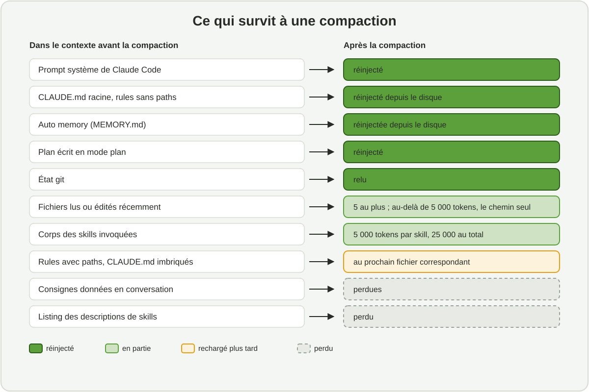
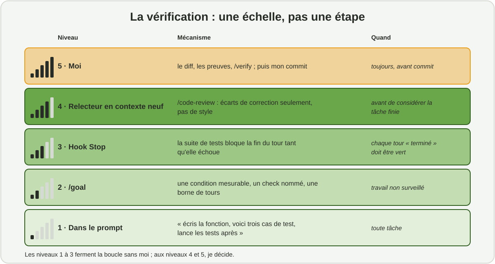


Fin septembre, je décrivais ma méthode de travail avec Claude Code en cinq règles. Un mois
plus tard, trois choses ont bougé : la doctrine d'Anthropic sur ce qu'il faut écrire à
l'agent, le mode de permission par défaut, et les outils de vérification. Voici ce que je
garde, ce que je change, et les fichiers qui vont avec.


*Temps de lecture : environ 30 minutes. Cet article complète
[la première version]() sans la remplacer : les
principes y sont expliqués en détail, ici je ne reprends que ce qui change. Chaque
fonctionnalité est présentée la première fois qu'elle apparaît.*



La première version tenait en cinq règles : le contexte est la ressource rare, le CLAUDE.md
est court, j'explore et je planifie avant de coder, rien n'est fini sans preuve, et je reste
responsable de chaque ligne. Aucune n'est devenue fausse. Mais la façon de les tenir a
changé, parce que l'outil et la documentation ont changé. J'ai relu la documentation
officielle de Claude Code (version 2.1.312, au 27 octobre 2026), le billet d'Anthropic du
24 juillet sur les nouvelles règles du *context engineering* pour les modèles Claude 5, et le
guide de juillet sur la façon de lever ses inconnues avec Fable. Cet article en tire les
conséquences pour un data scientist qui code dans le terminal et commite lui-même.


**En bref.** Les cinq règles restent, et chacune prend une forme plus précise :

1. **Le contexte se mesure, il ne se devine pas** : `/context` au début d'une tâche, et je sais ce qui survit à une compaction.
2. **Le CLAUDE.md décrit des critères, pas des interdits** : le jugement pour le style, les mécanismes pour ce qui ne doit jamais arriver.
3. **Avant de planifier, je lève mes inconnues** : angles morts, interview, prototype jetable, références plutôt que descriptions.
4. **La vérification est une échelle** : dans le prompt, puis `/goal`, un hook `Stop`, un relecteur en contexte neuf, et moi.
5. **Je reste propriétaire du code, et c'est écrit dans la configuration** : règles `deny`, hooks, commit manuel.


## 1. Ce qui a changé depuis septembre

Le tableau résume les six changements qui ont fait bouger ma pratique. Les sections
suivantes les reprennent un par un.

| Sujet | En septembre | Au 29 octobre 2026 |
|---|---|---|
| **Philosophie du contexte** | Règles explicites, exemples, un CLAUDE.md qui rassemble tout ce qu'il faut savoir | Anthropic a retiré plus de 80 % du prompt système de Claude Code pour les modèles 5, sans perte mesurée. Doctrine : jugement plutôt que règles, interfaces plutôt qu'exemples, divulgation progressive. `/doctor` propose les coupes |
| **Mode de permission** | Manuel par défaut, listes d'autorisation, sandbox | L'*auto mode* est le mode de départ des sessions interactives : un classifieur revoit les actions non triviales. Les règles `deny` restent la seule garantie dure |
| **Mémoire** | CLAUDE.md et le raccourci `#` | Mémoire automatique activée par défaut, règles par chemin dans `.claude/rules/`, audit avec `/doctor prompt-audit` |
| **Vérification** | Tests et revue humaine | `/goal` (condition de fin évaluée à chaque tour), hooks `Stop` de type `prompt` ou `agent`, `/code-review` en sous-agent frais, `/verify` |
| **Parallélisme** | Sous-agents, équipes d'agents expérimentales | Sous-agents en arrière-plan par défaut, forks avec `/subtask`, workflows dynamiques écrits en JavaScript |
| **Modèles** | Lignée 4 | Lignée 5 : Opus 5.5 par défaut, Sonnet 5.5, Haiku 5.5, Fable 5.1 ; contexte d'un million de tokens ; niveaux d'effort de `low` à `max` |

Le fil conducteur tient en une phrase : **le levier n'est plus d'écrire de bons prompts, mais
d'assembler le bon contexte au bon moment, et de déléguer les règles dures à des mécanismes
déterministes.** Tout le reste en découle.

## 2. Le contexte : mesurer, pas deviner

### Ce qui entre avant ma première question

Ce que je tape n'est qu'une petite part de ce que le modèle voit. Le reste est assemblé par
Claude Code, et chaque pièce a un coût et un comportement propres. Je ne le savais qu'en
gros ; la documentation le détaille désormais, et cela change la façon de ranger ses
instructions.

| Élément | Quand il charge | Ce que j'en retiens |
|---|---|---|
| Prompt système de Claude Code | Toujours | Environ 4 000 tokens, fortement réduit pour les modèles 5 |
| CLAUDE.md (utilisateur, projet) et rules sans `paths` | Toujours, à chaque requête | Coût permanent : chaque ligne se paie à chaque tour |
| Mémoire automatique (`MEMORY.md`) | Toujours | Les 200 premières lignes ou 25 ko, au premier atteint |
| Skills | La description seulement | Le corps n'arrive qu'à l'invocation ; le listing est budgété à environ 1 % de la fenêtre |
| Serveurs MCP | Les noms d'outils seulement | Les schémas restent différés jusqu'à l'usage |
| Rules avec `paths`, CLAUDE.md de sous-dossier | Au premier fichier correspondant | Une convention locale ne coûte rien tant qu'on ne touche pas à sa zone |
| Hooks | Jamais | Coût nul, sauf si le hook renvoie du contenu |

La conséquence pratique : **ce qui doit être vrai à chaque session va en haut de la
hiérarchie, ce qui ne sert que parfois descend** vers une skill ou une règle par chemin.
C'est le principe de divulgation progressive, et la section 4 en donne la table de
placement.

### Ce qui survit à une compaction

Quand la fenêtre se remplit, Claude Code résume l'historique (`/autocompact` règle le
seuil). Le résumé est utile, mais avec perte, et je ne savais pas précisément laquelle. La
figure montre ce que j'ai retenu.



Deux lignes de cette figure ont changé ma façon de faire.

- **Les consignes données en conversation sont perdues.** « Ne pousse pas sur `main` »,
  dit à l'oral au début d'une session, ne survit pas. Une limite conversationnelle n'est pas
  une règle : si elle compte, elle va dans une règle `deny` ou un hook.
- **Le corps des skills revient tronqué**, 5 000 tokens par skill et 25 000 au total, la plus
  ancienne éliminée d'abord. Donc l'essentiel d'un `SKILL.md` va en tête de fichier, et les
  détails dans des fichiers annexes.

J'ajoute à mes CLAUDE.md une consigne de compaction, du type : *« lors d'une compaction,
conserver la liste des fichiers modifiés, les commandes de test et les décisions de
modélisation prises »*. Et pour une longue session utile, `/compact` avec une instruction
cible, ou `/rewind` puis « résumer à partir d'ici » pour ne compacter qu'une partie.

### Les repères que j'utilise

Les seuils ci-dessous ne sont pas des dogmes. Ce sont des signaux qui déclenchent un geste
précis, et plusieurs sont nouveaux.

| Signal | Ce que je fais |
|---|---|
| Début d'une tâche complexe | `/context` : vérifier que le CLAUDE.md attendu est bien chargé, repérer un serveur MCP ou une skill gourmands |
| Changement de sujet | `/clear`. Une session propre bat une longue session pleine de corrections |
| Deux corrections ratées sur le même point | `/clear`, puis un premier message qui intègre ce que j'ai appris |
| Question annexe sans suite | `/btw` : la réponse reste hors historique, zéro croissance du contexte |
| Exploration large d'un dépôt | Un sous-agent `Explore`, ou une recherche strictement cadrée |
| Contexte au-delà de 50 à 60 % sur un modèle à 200 000 tokens, ou bruit visible sur un million | Documenter l'état dans un fichier, commiter, `/clear`, repartir en lisant ce fichier |
| L'agent ignore une règle du CLAUDE.md | Le fichier est trop long ou ambigu : élaguer, préciser, ou convertir en hook |

Le million de tokens de contexte des modèles 5 ne change pas ces réflexes. Ce n'est pas la
taille qui protège, c'est la pertinence de ce qui est dedans : la dégradation avec le bruit
reste réelle, elle arrive seulement plus tard.

## 3. Du règlement au jugement

Le billet d'Anthropic du 24 juillet expose six bascules « avant / maintenant » pour les
modèles Claude 5. Elles ont été intégrées dans `/doctor`, la commande de diagnostic. Voici
chacune, avec ce qu'elle change dans mes fichiers.

| Avant | Maintenant | Ce que je change |
|---|---|---|
| Donner des règles | Laisser l'agent juger | « Jamais de commentaires », « fonctions de moins de 30 lignes » deviennent des critères : « du code qui ressemble au code environnant », « la reproductibilité d'abord », « pas d'abstraction non demandée » |
| Donner des exemples | Concevoir des interfaces | Un script dont la signature parle, `backtest.py --horizon 14 --quantiles 0.1,0.5,0.9`, en dit plus qu'un paragraphe d'exemples, et il ne contraint pas l'exploration |
| Tout mettre en haut | Divulgation progressive | CLAUDE.md court ; la procédure de vérification dans une skill ; les conventions d'infrastructure dans une règle limitée à `infra/**` |
| Se répéter | Décrire une fois | Pas la même instruction dans le CLAUDE.md, dans la skill et dans le prompt. L'usage d'un outil va dans sa description, une seule fois |
| La mémoire dans le CLAUDE.md | Mémoire automatique | Claude note lui-même mes corrections et préférences ; le CLAUDE.md garde ce qui se partage avec une équipe |
| Des specs simples | Des références riches | Une spec peut être une suite de tests, une fonction d'un autre dépôt à porter, une maquette HTML, une grille qu'un agent vérificateur appliquera |

La raison donnée : les règles absolues créent des conflits entre le prompt système, les
skills et la demande du jour, et l'arbitrage coûte en qualité ; les exemples contraignent
l'exploration plus qu'ils ne l'orientent.

### Garde-fous et règles de style ne sont pas la même chose

C'est la nuance que je ne veux pas perdre. « Laisser l'agent juger » concerne les préférences
et les conventions. Cela ne supprime pas les garde-fous. La bonne séparation est : **le
jugement pour le style et les décisions techniques ; des mécanismes déterministes pour ce
qui ne doit jamais arriver**, comme toucher `data/raw/`, pousser sur `main`, lancer
`terraform apply` en production. On retire les règles qui coûtent plus qu'elles ne
protègent, et on déplace les autres dans l'infrastructure. La section 7 montre les miennes.

### Auditer son setup

Trois commandes font ce que je faisais à la main.

- `/doctor` : pour un CLAUDE.md versionné, propose des coupes sur ce qui est dérivable du
  code (arborescence, dépendances, vue d'architecture) et garde les pièges, les raisons et
  les conventions qui diffèrent des défauts.
- `/doctor prompt-audit` : cherche les instructions écrites pour d'anciens modèles, les
  références à des fichiers ou commandes qui n'existent plus, et les contradictions entre
  CLAUDE.md, rules, skills et sous-agents. Rien n'est modifié tant qu'on n'applique pas.
- `/skill-doctor` : le coût en contexte et l'usage réel de chaque skill.

Mes CLAUDE.md font entre 29 et 66 lignes selon le dépôt. Le plus long est celui de ce blog,
parce qu'il décrit des gabarits surchargés et des conventions de contenu que rien dans le
code n'explique. Le test que j'applique ligne par ligne n'a pas changé : *si je l'enlève,
l'agent se trompera-t-il ?* Et j'ai ajouté un test de non-régression des règles, suggéré par
la documentation : une consigne anodine et vérifiable en fin de fichier. Si elle cesse d'être
suivie, le budget d'instructions est saturé.

## 4. Où va chaque consigne

La question « où est-ce que j'écris ça ? » revient à chaque projet. Claude Code charge dix
couches, dans un ordre fixe : CLAUDE.md d'organisation, CLAUDE.md personnel, règles
personnelles, CLAUDE.md du projet, règles du projet sans chemin, règles avec chemin,
`CLAUDE.local.md` ignoré par git, CLAUDE.md de sous-dossier, mémoire automatique, skills.
Les fichiers sont concaténés, pas hiérarchisés : deux instructions contradictoires donnent
un choix arbitraire. D'où une table de placement, que je tiens à jour.

| Si c'est… | Alors ça va dans… |
|---|---|
| Un fait vrai à chaque session, non déductible du code : commande de build, variable d'environnement requise, piège | Le CLAUDE.md du projet, moins de 200 lignes |
| Une convention valable pour une partie de l'arbre seulement | Une règle avec `paths:` dans `.claude/rules/` |
| Une procédure en plusieurs étapes, un savoir utilisé parfois | Une skill, de 50 à 300 lignes ; au-delà, scinder en `reference.md`, `examples.md`, `scripts/` |
| Un workflow à effets de bord que je veux lancer moi-même | Une skill avec `disable-model-invocation: true` : coût nul tant que je ne l'appelle pas |
| Une correction que j'ai déjà faite en conversation | La mémoire automatique la capte ; si c'est une règle d'équipe, je l'ajoute explicitement au CLAUDE.md |
| Quelque chose qui doit se produire à chaque fois, sans exception | Un hook, ou une règle `deny` / `ask` dans `settings.json` |
| Un accès à des données ou à un outil externe | Un serveur MCP, ou plus souvent une CLI : `gcloud`, `bq`, `gh`, `mlflow` |
| Un setup à reproduire sur un second dépôt | Un plugin |

### La mémoire automatique : l'utiliser sans la subir

En septembre, je décrivais la mémoire comme de courtes notes que l'agent écrit quand je lui
donne une consigne durable. Elle est maintenant active par défaut, et structurée en quatre
types : *user* (mon rôle, mes préférences), *feedback* (corrections, approches validées),
*project* (travaux en cours, décisions), *reference* (où trouver l'information hors dépôt).
Elle vit par dépôt, dans `~/.claude/projects/<projet>/memory/`, partagée entre worktrees,
jamais synchronisée vers le cloud.

Celle de ce blog contient aujourd'hui une dizaine de notes. Trois d'entre elles ont été
écrites après une correction de ma part, et c'est leur intérêt :

- **les articles visent 30 minutes au compteur de lecture de Hugo** ; un article à 40 minutes
  a été jugé trop long et ramené à 30, en condensant la prose et jamais les figures ;
- **la durée de veille annoncée dans une introduction vient des dates de commit du dépôt
  associé**, pas du plan de départ : « une journée de veille » est devenu « trois semaines »
  après lecture du `git log` ;
- **jamais de ligne de co-auteur dans un commit**.

Je relis ces notes de temps en temps avec `/memory`, et je supprime celles qui ne sont plus
vraies. Chez un client avec des contraintes de confidentialité, la mémoire se désactive par
projet. Un point qui m'a surpris : **les sous-agents n'héritent pas de la mémoire
principale**, sauf les forks. Si une règle doit les atteindre, elle se répète dans le prompt
de délégation.

### Les skills : une procédure, pas un manuel

Les commandes et les skills ont fusionné : un fichier `.claude/commands/x.md` et un dossier
`.claude/skills/x/SKILL.md` créent tous deux `/x`. Je n'écris plus que des skills. Deux
exemples réels, tirés de mes dépôts.

La première prépare un commit sans le faire. Elle existe parce que je veux rester le seul
contributeur de ces dépôts : l'agent vérifie que le diff indexé ne couvre qu'un sujet, lance
les contrôles rapides, et propose un message au format *Conventional Commits*. Sa
description dit quand l'appeler, et c'est ce que l'agent lit :

```markdown
---
name: prepare-commit
description: Prepare a commit for the maintainer to run: check the staged diff
  covers one topic, run checks, and propose a Conventional Commit message. Use
  when the user asks to commit, prepare a commit, or write a commit/PR message.
---
Claude never runs `git commit` or `git push` in this repo: the maintainer must
be the sole GitHub contributor.

1. Run `git status` and `git diff --staged` […]
2. If the staged diff mixes topics, stop and propose how to split it.
3. Run `make check-fast` and report. Do not propose a commit while it fails.
```

La seconde encadre une migration de base de données, et commence par le test qui échoue.
Le reste, ce sont les conventions que l'agent ne peut pas deviner : montants en
`Numeric(14, 2)`, intervalles en `timestamptz` UTC semi-ouverts, jamais de `Float`.

Dimensionnement : moins de 500 lignes pour `SKILL.md`, l'essentiel en tête à cause de la
troncature à la compaction, les scripts dans `scripts/` où ils sont exécutés sans jamais
entrer dans le contexte.

## 5. Lever les inconnues avant de planifier

C'est l'ajout le plus net à ma boucle. Le guide de juillet sur Fable décrit la qualité du
travail de l'agent comme limitée d'abord par la façon dont l'utilisateur clarifie ses
inconnues : ce qu'il sait et dit, ce qu'il sait ne pas savoir, ce qu'il ne reconnaîtra qu'en
le voyant, et ce à quoi il n'a pas pensé. En data science, la quatrième catégorie est la
plus coûteuse : c'est la censure des ventes par les ruptures de stock, la variable calculée
après coup, le calendrier qui change en cours d'historique.

La boucle de septembre comptait cinq temps. Elle en compte six.



En mode plan, l'agent lit et répond sans rien modifier. Je cadre l'exploration (« lis
`forecast/cv/` et `features/base.py`, explique comment les origines glissantes sont
calculées ») ou je la délègue à un sous-agent si elle est large.


Avant d'écrire une ligne : une passe « angles morts » (*« quelles considérations n'ai-je
probablement pas envisagées pour ce pricing sous contrainte de capacité ? »*) ; puis, pour une
fonctionnalité non triviale, une interview, une question à la fois, en priorisant celles dont
la réponse changerait l'architecture, qui se termine par un `SPEC.md`. La session suivante,
propre, exécute la spec.


Je demande un plan et je l'annote dans l'éditeur (`Ctrl+G`), puis « traite toutes mes notes,
n'implémente pas encore ». Le plan survit à la compaction. Pour un changement descriptible en
une phrase, je saute cette étape.


En demandant explicitement la vérification : « implémente d'après le plan, écris les tests de
`rolling_origin`, lance `make test-fast` et corrige ». Et un fichier de **notes
d'implémentation**, où l'agent consigne ses déviations et ses choix conservateurs.


L'échelle de la section 6.


Après revue du diff. Avant de signer un changement que je n'ai pas écrit, je demande un
*explainer* et je me fais **quizzer** : « que se passe-t-il si la série a moins de 14
points ? ». Si je ne sais pas répondre, je ne suis pas prêt à commiter.



Deux pratiques du guide m'ont paru contre-intuitives, puis utiles. Le **prototype jetable
avant le vrai code** : une maquette de dashboard ou un notebook de cinquante lignes révèle
les critères qu'on ne sait formuler qu'en les voyant. Et les **références plutôt que les
descriptions** : pointer un code existant, même dans un autre langage, une suite de tests ou
une maquette HTML. Le code est le langage que l'agent lit le mieux ; une maquette est une
meilleure spec qu'un paragraphe.

## 6. La vérification : une échelle, pas une étape

« Rien n'est fini sans preuve » reste la règle. Ce qui a changé, c'est que la documentation
propose maintenant une gradation officielle des moyens de la tenir, et que plusieurs
barreaux sont nouveaux.



### Dans le prompt

Toute demande contient le moyen de prouver qu'elle est remplie : « écris la fonction, voici
trois cas de test, lance les tests après ». C'était déjà le cas en septembre. Ça reste le
barreau le plus rentable, parce qu'il ne coûte rien à mettre en place.

### `/goal` : une condition de fin évaluée à chaque tour

Nouveau. `/goal "make test exits 0 and MASE on backtest <= 0.82, or stop after 20 turns"`
confie à un petit modèle le soin de juger la condition après chaque tour ; l'agent continue
jusqu'à « atteint » ou « impossible ». Les règles qui marchent : **une seule condition
mesurable, un check nommé, une borne de tours.** C'est l'outil du travail non surveillé,
couplé à l'auto mode. Je ne l'ai pas encore utilisé sur une tâche réelle ; la première
session documentée (condition, tours, preuves) est le premier point de ma liste de novembre.

### Le hook `Stop` : une porte déterministe

Celui-là, je l'ai depuis le début, et il porte le nom de la règle. Sur mon dépôt de mentorat,
qui contient plusieurs projets Python, il relance `pytest` dans chaque projet dont `src/` ou
`tests/` a changé depuis le dernier commit, et refuse de rendre la main tant qu'un test
échoue :

```bash
#!/usr/bin/env bash
# Stop : « rien n'est fini sans preuve ». Pour chaque projet dont src/ ou tests/
# a changé depuis le dernier commit, lance pytest ; si un test échoue, Claude ne
# peut pas s'arrêter.
input=$(cat)
[[ $(jq -r '.stop_hook_active // false' <<<"$input") == "true" ]] && exit 0
# … détection des projets modifiés via git status --porcelain …
for p in "${!projets[@]}"; do
  sortie=$(cd "$p" && uv run --quiet pytest -q 2>&1); code=$?
  # 5 = aucun test collecté : rien à prouver, pas un échec
  (( code != 0 && code != 5 )) && echecs+=$'\n'"### $p"$'\n'"$(tail -n 25 <<<"$sortie")"
done
[[ -n "$echecs" ]] && jq -n --arg r "Des tests échouent : corriger avant de terminer.$echecs" \
  '{decision: "block", reason: $r}'
```

Le détail qui compte : le code de retour 5 de `pytest` (aucun test collecté) n'est pas un
échec, sinon un projet tout juste initialisé ne pourrait jamais rendre la main. Et le hook
lit `stop_hook_active` pour ne pas se bloquer lui-même. Les hooks `Stop` existent maintenant
en trois types : `command`, `prompt` (une question oui / non posée à un modèle, « toutes les
tâches sont-elles complètes ? ») et `agent` (un sous-agent multi-tours, expérimental). Je
reste sur `command` : une suite de tests qui passe est une preuve ; une réponse « oui » d'un
modèle n'en est pas une.

### Le relecteur en contexte neuf

Un agent qui vient d'écrire du code est mal placé pour le critiquer. `/code-review` lance un
sous-agent frais qui ne voit que le diff ; `/code-review ultra` en lance plusieurs dans le
cloud. Mon relecteur maison est un fichier dans `.claude/agents/`, en lecture seule, qui
rapporte par gravité décroissante : la justesse (unités, dates sans fuseau, intervalles
semi-ouverts, regard vers le futur dans tout ce qui touche aux dates), les chiffres sans
provenance, le respect des couches, les tests manquants, et le mélange de sujets dans un
même diff. Sa dernière ligne est la plus importante : *« si rien n'est faux, dis-le
simplement ; pas de remarques de style que `ruff` impose déjà »*.

Un relecteur sommé de trouver des écarts en trouvera, même sur un travail sain. Je lui
demande de ne signaler que ce qui touche à la justesse ou aux exigences énoncées, et de
traiter le reste comme optionnel. Sinon on dérive vers la sur-ingénierie : couches
d'abstraction, code défensif, tests de cas impossibles.

### Moi

`/verify` construit et lance l'application pour confirmer qu'un changement marche dans le
vrai produit, pas seulement dans les tests. Puis je relis le diff dans VS Code et je demande
les preuves, sortie de test et commande lancée, plutôt que des assertions de succès. Ça
marche aussi pour les sessions que je n'ai pas regardées.

### Le test d'abord, en deux sessions

L'agent écrit toujours l'implémentation d'abord par défaut, et la formulation qui marche n'a
pas changé : « écris un test qui **échoue** pour X, n'implémente rien, lance-le et montre-moi
l'échec », puis « implémente le minimum pour le faire passer, sans toucher au test ». La
documentation recommande désormais une variante structurelle que je retiens pour les
fonctions qui comptent : **deux sessions**. La session A écrit les tests ; la session B
implémente, sans avoir vu la discussion sur le test. L'implémentation ne peut pas « saigner »
dans la logique de test. Avec deux terminaux et `--worktree`, c'est cinq minutes de mise en
place.

## 7. Les garde-fous : l'auto mode et ce qui ne doit jamais arriver

### Les modes de permission

Depuis la version 2.1.283, les sessions interactives démarrent en **auto mode** : tout
s'exécute, sous contrôle d'un classifieur en arrière-plan (Sonnet 5 par défaut) qui revoit
les actions non triviales. Il bloque par défaut le `curl | bash`, l'envoi de données sensibles
à l'extérieur, les déploiements et migrations de production, `git push --force`,
`git reset --hard`, `terraform destroy`, l'octroi de permissions IAM, l'affichage de
secrets. Après trois blocages consécutifs, il se met en pause et redemande.

| Mode | Ce qui s'exécute sans demander | Quand je l'utilise |
|---|---|---|
| `default` (manuel) | Les lectures seulement | Premier contact avec un dépôt client, données réelles |
| `acceptEdits` | Lectures, éditions, commandes de fichiers dans le répertoire de travail | Refactors locaux que je suis à l'écran |
| `plan` | Lectures ; aucune édition tant que le plan n'est pas approuvé | Exploration et plan |
| `auto` | Tout, sous contrôle du classifieur | Le travail courant, `/goal`, les runs non surveillés |
| `dontAsk` | Uniquement ce qui est pré-approuvé ; le reste est refusé | Les lots `claude -p` en boucle |
| `bypassPermissions` | Tout, sans contrôle | Un conteneur isolé sans internet, jamais ailleurs |

Ce qui reste vrai quel que soit le mode : **les règles `deny` s'appliquent partout, même en
bypass** ; les chemins protégés (`.git`, `.claude`, `.mcp.json`, `.bashrc`) ne sont jamais
auto-approuvés ; et `rm` sur la racine, le home ou le répertoire de travail ne peut être
autorisé par aucune règle. La documentation le dit elle-même : l'auto mode réduit les
demandes, il ne garantit pas la sécurité. D'où un sandbox (`/sandbox`) ou un devcontainer en
plus, pour la défense en profondeur.

### Ma configuration

Sur mes dépôts applicatifs, `settings.json` porte la même liste `deny`, et elle dit ce que je
ne délègue pas :

```json
"permissions": {
  "deny": [
    "Bash(git commit:*)", "Bash(git push:*)", "Bash(git rebase:*)",
    "Bash(git reset --hard:*)", "Bash(gh pr merge:*)",
    "Read(./.env)", "Read(./.env.*)",
    "Edit(./data/**)", "Write(./data/**)"
  ]
}
```

Le commit est à moi, la fusion d'une pull request aussi, les secrets ne sont jamais lus, les
données ne sont jamais modifiées par l'agent. Trois hooks complètent la liste, parce que
l'agent peut aussi modifier des fichiers via le shell :

- un `PreToolUse` sur `Bash`, qui n'inspecte que les invocations de `git` et refuse les
  en-têtes de co-auteur, `--no-verify` et tout changement de `core.hooksPath` ;
- un `PreToolUse` sur les éditions, qui refuse `data/raw/` avec une raison lisible (*« les
  données brutes sont téléchargées et vérifiées par SHA-256 par le code du projet ; écrire
  dans `data/processed/` »*) ;
- un `PostToolUse` qui lance `ruff format` sur chaque fichier Python modifié, depuis le
  projet `uv` qui le contient.

Ce blog, lui, n'a ni `settings.json` ni hook. L'enjeu est faible, la preuve est le build, et
quand je demande explicitement un commit et un push, l'agent les fait, sans ligne de
co-auteur. **Le niveau de garde-fou suit l'enjeu**, pas une règle générale : chez un client,
je démarre en mode manuel, j'active le blocage des lectures hors du répertoire de travail,
et j'ajoute des règles `ask` comme points de contrôle sur `git push`, `terraform apply`,
`dvc push` et les déploiements.

### Sans surveillance

`claude -p "…"` tourne sans interface, dans la CI par exemple. Deux changements depuis
septembre : le mode non interactif démarre désormais en manuel (version 2.1.302), il faut
préciser le mode voulu ; et `--bare` ignore hooks, skills, serveurs MCP et CLAUDE.md
locaux, pour rendre le run reproductible. Ma revue de pull request en lecture seule :

```bash
claude -p "…" --output-format json --allowedTools "Read,Grep,Glob" --max-turns 10 \
  --permission-mode dontAsk --bare
```

## 8. Déléguer : sous-agents, forks, workflows

Le tableau de la section 7 de septembre reste valable, avec trois mécanismes de plus. Je le
donne sous forme de décision.

| Besoin | Mécanisme | Pourquoi celui-là |
|---|---|---|
| L'agent se trompe deux fois sur une convention | CLAUDE.md | Fait permanent, non déductible du code |
| Le même prompt retapé une troisième fois | Skill | À la demande, avec des scripts exécutés sans entrer dans le contexte |
| Une tâche annexe inonde la conversation | Sous-agent | Contexte isolé ; seul le résumé remonte |
| Le même traitement sur des dizaines d'éléments, ou des résultats à recouper | Workflow dynamique | Un script décide, pas l'agent tour par tour ; le contexte ne garde que le résultat final |
| Quelque chose doit arriver à chaque fois | Hook | Déterministe |
| Un second dépôt a besoin du même setup | Plugin | Emballe skills, hooks, sous-agents et MCP ; testable avec `claude plugin eval` |

### Ce qui a changé pour les sous-agents

Ils tournent **en arrière-plan par défaut**, `/tasks` montre ce qui tourne, et un sous-agent
ne voit que son propre prompt système, la tâche, la hiérarchie des CLAUDE.md et l'état git.
Pas l'historique, pas la mémoire, pas le style de sortie ; les sous-agents `Explore` et `Plan`
sautent même le CLAUDE.md. Les **forks** sont nouveaux : `/subtask` crée un sous-agent qui
hérite de toute la conversation et réutilise le cache de prompt, souvent moins cher qu'un
sous-agent vierge quand le contexte compte. Un `Explore` vierge n'a d'intérêt que si la
fenêtre propre est le but. Et l'agent délègue rarement de lui-même : je le demande (« utilise
un sous-agent pour… ») ou je l'inscris dans le CLAUDE.md.

Les champs utiles dans la définition d'un sous-agent : `model` (`haiku` pour l'exploration
bon marché, `opus` ou `fable` pour la revue), `effort`, `memory: project`, `maxTurns`,
`isolation: worktree`. Mon statisticien de septembre, en lecture seule, n'a pas changé d'une
ligne.

### Les workflows dynamiques

Un workflow est un script JavaScript que l'agent écrit et qu'un runtime exécute en
arrière-plan : `agent(prompt, {schema})`, `pipeline()`, `parallel()`. Les résultats
intermédiaires restent dans les variables du script ; le contexte principal ne reçoit que la
conclusion. Il se déclenche par « utilise un workflow » ou le mot-clé `ultracode`, et
`/workflows` permet de suivre, mettre en pause et sauvegarder un script pour le rejouer.

Les cas qui me concernent : un audit de fuites temporelles sur tout un dépôt, avec
vérification adverse (un agent trouve, un autre tente de réfuter) ; la migration de
dizaines de notebooks vers des modules. Je ne l'ai pas encore utilisé sur un vrai dépôt, et
je commencerai par une petite tranche. Les équipes d'agents restent expérimentales ; je ne
les utilise pas.

### Modèles et effort

La lignée 5 remplace la lignée 4. Mon réglage principal est Fable 5.1, pour les sessions
longues et les causes racines ambiguës ; Opus 5.5, le défaut, suffit à la planification et
à la revue ; Haiku 5.5 convient aux sous-agents en lecture seule et à l'évaluateur de
`/goal`. L'alias `opusplan` (Opus en mode plan,
Sonnet en exécution) est un bon compromis coût / qualité. Pour l'effort, je commence bas et
je monte si la réponse est superficielle ; `max` reste réservé aux décisions d'architecture
et au débogage difficile.

## 9. Côté métier : forecasting, MLOps, GCP

### L'arborescence `.claude/` d'un projet de prévision

Voici comment je range un dépôt de forecasting aujourd'hui, en appliquant la table de
placement de la section 4 :

```text
.claude/
├── CLAUDE.md                    # < 200 lignes : objectif, commandes, pièges, façon de travailler, compaction
├── rules/
│   ├── temporal-safety.md       # sans paths : règle d'or anti-fuite, splits, horizons
│   ├── infra.md                 # paths: ["infra/**", "*.tf"]
│   ├── notebooks.md             # paths: ["notebooks/**"] : jetable, pas de logique métier
│   └── serving.md               # paths: ["src/serving/**"] : FastAPI, latence, schémas
├── skills/
│   ├── verify-forecast/         # tests + backtest + comparaison au baseline
│   ├── eda/                     # EDA reproductible (scripts/profile.py)
│   ├── new-experiment/          # disable-model-invocation : branche + config + run MLflow
│   └── causal-check/            # DAG, sanity checks avant toute conclusion causale
├── agents/
│   ├── data-explorer.md         # haiku, lecture seule, bq query --dry_run
│   ├── forecast-reviewer.md     # opus, lecture seule
│   └── terraform-engineer.md    # plan / validate, jamais apply
├── hooks/
│   └── protect-data.sh          # PreToolUse : bloque data/raw/, models/, .env
└── settings.json                # permissions deny / ask / allow, hooks, sandbox
```

Ce qui n'est **pas** dans le CLAUDE.md : l'arborescence (déductible), la liste des
dépendances (dans `pyproject.toml`), la théorie du MASE (le modèle la connaît), les étapes
détaillées de vérification (dans la skill). La skill `verify-forecast` tient en quatre
étapes : la suite rapide doit être verte, sinon s'arrêter ; lancer le backtest de référence ;
comparer MASE et pinball aux chiffres du `baseline.json` versionné ; rapporter les deltas,
les fichiers modifiés et les commandes exécutées. Et une clause qui vient de la pratique :
*ne pas conclure « amélioration » si la couverture empirique du quantile 0,9 sort de
[0,85 ; 0,95]*.

### Ce que l'agent a vraiment fait

Le point nouveau côté MLOps, c'est la traçabilité des sessions elles-mêmes. MLflow fournit
`mlflow autolog claude`, qui installe des hooks traçant chaque appel d'outil comme un *span*,
avec tokens et coût. Pour un data scientist, c'est une trace de vérité : ce que l'agent a
fait, dans l'ordre, avec entrées et sorties, relisible après coup et interrogeable en ligne de
commande. C'est le second point de ma liste de novembre.

Pour le reste, les choix de septembre tiennent : BigQuery en lecture seule (chaque requête
est un job facturé), `bq --dry_run` dans la liste d'autorisation et l'exécution réelle en
`ask` ; Terraform en boucle `generate`, `validate`, `plan`, lecture, correction, avec une
règle limitée à `infra/**` pour les interdits (pas de `0.0.0.0/0`, chiffrement obligatoire,
moindre privilège), `apply` en `ask` et `destroy` en `deny`. Et toujours pas de Claude Code
comme orchestrateur de production : les workflows dynamiques servent aux traitements en
masse ponctuels, Prefect ou Airflow à la production.

### Les maquettes comme spec

Claude Design est intégré à Claude Code depuis le 16 septembre (`/design`) ; le site
autonome ferme le 14 décembre 2026, et les projets se migrent avant. Pour mon usage,
l'intérêt est la règle des « références riches » : une maquette de dashboard de prévisions,
avec bandes de quantiles et alertes de dérive, montrée au client avant d'écrire une ligne de
front, puis donnée à l'agent comme spec. C'est un complément de Figma, pas un remplacement.

## 10. Ce que je garde, ce que j'ajoute

Pour rester honnête sur l'état réel de ma pratique au 29 octobre, voici où j'en suis.

| | En place | En cours | À venir |
|---|---|---|---|
| **Fichiers** | CLAUDE.md de 29 à 66 lignes ; skills ; sous-agents statisticien et relecteur ; mémoire par dépôt | Consigne de compaction dans chaque CLAUDE.md ; passage de `/doctor` et `prompt-audit` | Règles par chemin (`infra/**`, `notebooks/**`) sur le prochain projet de prévision |
| **Garde-fous** | `deny` sur commit, push, rebase, merge, `.env`, `data/` ; hooks `PreToolUse`, `PostToolUse`, `Stop` | Sandbox pour le travail quotidien en auto mode | Mode manuel et blocage des lectures hors répertoire chez un client |
| **Vérification** | Dans le prompt ; hook `Stop` de tests ; relecteur en contexte neuf ; test d'abord | `/code-review` systématique avant commit ; notes d'implémentation et quiz | Une session `/goal` complète documentée ; tests en deux sessions sur une fonction qui compte |
| **Délégation** | Sous-agents en lecture seule | Forks avec `/subtask` | Premier workflow dynamique sur une tranche : audit de fuites temporelles |
| **Traçabilité** | Commits manuels, README « ce que je corrige par rapport au plan » | | Tracing MLflow des sessions sur un projet |

Ce que je ne délègue pas n'a pas bougé : le choix de la question, le protocole fixé avant les
résultats, l'interprétation, les opérations irréversibles, la publication. La différence,
c'est que ces règles ne reposent plus seulement sur ma vigilance : trois d'entre elles sont
dans un `settings.json`.

Les signaux qui me font changer de cap ont gagné trois lignes.

| Signal | Ce que je fais |
|---|---|
| L'agent ignore une règle malgré l'insistance | Élaguer le CLAUDE.md ; convertir en hook si c'est un « toujours / jamais » |
| La qualité chute en cours de session | `/context` ; documenter et `/clear` |
| Un sous-agent revient avec un pavé | Resserrer sa description et le format de sortie demandé |
| Je retape la même procédure | Une skill |
| L'auto mode bloque à répétition | Lire la règle nommée dans le motif ; ajuster une règle `allow` précise, ou signaler le faux positif |
| Je ne sais pas expliquer un changement | Ne pas commiter ; demander un *explainer* et un quiz ; relire le diff |

## Conclusion

En septembre, je concluais que Claude Code avait rendu ma façon de travailler plus exigeante.
Un mois plus tard, l'exigence s'est déplacée. Elle porte moins sur ce que j'écris à l'agent,
puisque les modèles 5 se passent de la plupart des règles, et davantage sur ce que je mets
autour : un contexte mesuré et rangé par couches, des mécanismes qui ne dépendent pas de son
jugement, et une vérification en plusieurs niveaux dont je suis le dernier.

Si je ne devais garder qu'une phrase de cette révision, ce serait celle-ci : **une limite
dite en conversation n'est pas une règle.** Ce qui ne doit jamais arriver va dans un fichier
que l'agent ne peut pas ignorer. Le reste, il le juge mieux que mes listes d'interdits.

Les outils changent chaque semaine ; dix minutes par mois sur le journal des modifications
et un `/doctor` suffisent à suivre. Ce qui ne change pas : à la fin, le code est à mon nom.

---

**Pour aller plus loin**

- [Best practices for Claude Code](https://code.claude.com/docs/en/best-practices), la
  référence canonique, mise à jour en place.
- T. Shihipar, [The new rules of context engineering for Claude 5 generation models](https://claude.com/blog/the-new-rules-of-context-engineering-for-claude-5-generation-models),
  Anthropic, 24 juillet 2026 : la doctrine actuelle, à relire avant chaque refonte de CLAUDE.md.
- T. Shihipar, [A field guide to Claude Fable 5: finding your unknowns](https://claude.com/resources/articles/a-field-guide-to-claude-fable-finding-your-unknowns),
  Anthropic, 6 juillet 2026 : interviews, prototypes, notes d'implémentation, quiz.
- [A harness for every task: dynamic workflows in Claude Code](https://claude.com/blog/a-harness-for-every-task-dynamic-workflows-in-claude-code),
  Anthropic, juin 2026.
- Documentation : [How Claude remembers your project](https://code.claude.com/docs/en/memory),
  [Explore the context window](https://code.claude.com/docs/en/context-window),
  [Choose a permission mode](https://code.claude.com/docs/en/permission-modes),
  [Automate actions with hooks](https://code.claude.com/docs/en/hooks-guide),
  [Keep Claude working toward a goal](https://code.claude.com/docs/en/goal).
- [MLflow × Claude Code](https://mlflow.org/blog/mlflow-claude-code/) : le tracing des
  sessions.
