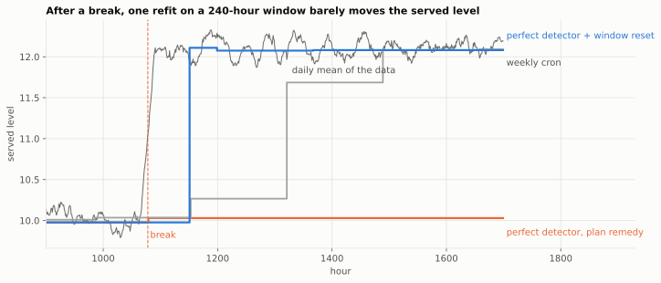
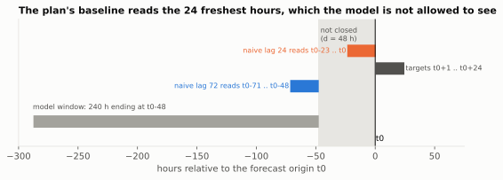
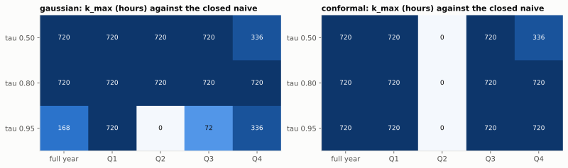




How often should a forecasting model be retrained? The question looks operational. Digging into
it, I found that it depends on what the service is expected to deliver: a low error, a recent
model, forecasts that don't change without reason. These three expectations don't lead to the same
frequency.


*Reading time: about 31 minutes. Every formula is followed by its intuition, so you can skim the
maths without losing the thread.*



This article distils my **active research for week 44** (October 2026). I started from a detailed
work plan, with its scripts, its numbers and its conclusions. I first re-ran every script
verbatim: each one reproduces its numbers to the printed digit. Then I checked every **reading** of
those numbers. Several don't hold, and that is where I learned the most. I also went back to the
primary sources (weight licences on the Hub, paper bodies rather than abstracts) and tested
everything on real data, under a protocol written before the results. It is all reproducible in the
[W44_retraining_frequency](https://github.com/gwils28/W44_retraining_frequency) repository.


**In short.** The main results, with their scope:

1. **On a simulated bench, a perfect break detector scores a MASE of 1.37, against 0.98 for a
   fixed weekly retrain.** The gap comes mostly from the window the model is refitted on after
   detection. With a window that restarts at the break, plus a weekly retrain, the same detection
   does better than continuous retraining, on 5 seeds out of 5, with 1% of its refits.
2. **Retraining less often reduces how often published forecasts are revised, but makes each
   revision larger.** From continuous to monthly, the mean jump grows 224-fold in the analytical
   model.
3. **The freshness budget depends on the served quantile by a factor of 2 in simulation**, not 7
   as the plan stated. On real data, the pre-registered decision rule is inconclusive.
4. **The data closing lag changes three measurements**: the backtest error (underestimated by
   about 6%), the baseline and the trigger.
5. **A before/after dashboard shows 197% of the real effect for a retrain that does nothing**,
   because of regression to the mean. The trigger threshold also makes it possible to estimate the
   effect at the threshold, with a regression discontinuity design.


## 1. The problem: choosing a retraining frequency

At each **origin** \(t_0\), a forecast service publishes forecasts for the next \(H\) steps. The
model behind them was fitted on a history window of length \(w\), at some point in time. The
operational question is: **every how many steps \(k\) should it be refitted?** \(k = 1\) is
continuous retraining; with hourly data, \(k = 24\) is daily, \(k = 168\) weekly and \(k = 720\)
monthly.

What we expect from the service can be described along three axes:

| Axis | The expectation | What it implies for the frequency |
|---|---|---|
| **Accuracy** | the average error stays low | retrain often (a recent model tracks the level better) |
| **Freshness** | the served model is never more than X hours old | a bound on \(k\), which may depend on what is served |
| **Stability** | the published forecast doesn't change without reason | depends on the measure chosen: size or frequency of revisions |

On top of that comes cost: every refit uses compute, which matters across a park of hundreds of
thousands of series.

One last parameter appears throughout the article: the **closing lag** \(d\). Data can't be used as
soon as it exists. Electricity readings, sales and invoices get consolidated, corrected and
validated before they become available. Here, \(d = 48\) hours: a model "retrained now", at time
\(t\), is fitted on a window that ends at \(t - 48\).

| Notation | Meaning | Value on the bench |
|---|---|---|
| \(k\) | cadence: steps between two refits | 1 to 720 hours |
| \(w\) | length of the fitting window | 240 hours |
| \(d\) | data closing lag | 48 hours |
| \(H\) | forecast horizon | 24 hours |
| \(\tau\) | served quantile level | 0.50 · 0.80 · 0.95 |

This parameter \(d\) comes into play at three points of the analysis: the backtest, the baseline
and the trigger.

## 2. What recent work says

I read five recent works and set one aside. For each, I looked for the numbers in the body of the
paper, not in the abstract, which sometimes contains none.

**Marco Zanotti's two papers** set the frame. The first
([arXiv 2505.00356](https://arxiv.org/abs/2505.00356)) studies ten global models on the M5 and VN1
retail data, from continuous retraining to none at all. The second
([arXiv 2506.05776](https://arxiv.org/abs/2506.05776)) introduces a **stability** measure for
probabilistic forecasts, the *Scaled Multi-Quantile Change* (SMQC). What the paper bodies say:

- for point forecasts, **never retraining degrades the error by less than 5%** on these datasets;
  monthly retraining cuts compute time by about 75%;
- **probabilistic** forecasts are more sensitive: the optimal frequency is about **2 weeks on M5**,
  against **3 to 4 weeks** for point forecasts;
- stability follows no simple rule: on VN1, retraining less often makes NBEATSx and CatBoost
  **more** stable but the MLP and linear regression **less** stable. On M5, almost nothing moves.

Probabilistic forecasts therefore seem to call for somewhat more frequent retraining than point
forecasts, with a moderate effect. This comes back in part 6.

**Harrison Katz** ([arXiv 2604.06438](https://arxiv.org/abs/2604.06438)) treats retraining as a
**costly decision**. The monitored quantity is a "learning debt": the Kullback-Leibler divergence
between a continuously updated shadow posterior and the frozen posterior of the deployed model. You
retrain when the expected regret of waiting exceeds the cost of the refit. The policy does better
than a tuned calendar in 72 scenario cells out of 72, and better than a tuned CUSUM in 58 out of 72,
with a mean relative objective of **0.975** against CUSUM. The gap with a well-tuned CUSUM is
therefore small; the main contribution is a threshold expressed **in units of cost**. The paper
itself calls it a "proof-of-concept" on simulation, "not a universal replacement for drift
detection".

**PILOT** (Kwak, Jung, Park, [arXiv 2609.39789](https://arxiv.org/abs/2609.39789)) learns a
retraining trigger. The abstract gives no gain figure. I kept one design choice: **the trigger's
training label is a future quantity** (the coming rise in error), while **the deployed trigger only
reads errors that are already closed**. This separation keeps the trigger from using data that
isn't available at decision time. Part 4 shows the effect of that kind of leak on a CUSUM.

**Timestral** (Mistral, 15 October 2026) is a family of time series *foundation models* (5M, 28M,
123M and 209M parameters) that **runs on CPU**, at 140 ms for the largest on 8 threads. It is mostly
relevant to serving; I come back to it in part 8, in particular for its licence.

**Set aside: DriftGuard** ([arXiv 2601.08928](https://arxiv.org/abs/2601.08928)). It claims "97.8%
detection recall within 4.2 days" and "up to 417 return on investment", with no unit. Without a
unit I couldn't interpret the second number, and I didn't use the paper as a source.

## 3. The bench

To compare retraining policies you need a setting where the truth is known. So I simulated a
**park of 120 hourly series** over 2,400 steps, served at horizon 24 by a deliberately simple
model: the window mean plus a 24-hour daily profile, fitted on \(w = 240\) hours.

The series undergo **two drifts of different kinds**:

- sudden **level breaks**, drawn from a Poisson process (3.7 per series on average, 448 in total);
- a **slow drift** of the seasonal amplitude, sinusoidal.

Ten policies are compared: never; a calendar with \(k \in \{1, 24, 48, 168, 720\}\); a two-sided
CUSUM on the realised error; Katz's KL debt at two thresholds; and a **perfect detector**, which
knows the exact date of every break and retrains on it. We measure accuracy (MASE), cost (refits per
series) and stability (part 5).

| Policy | MASE | Refits / series |
|---|---|---|
| never | 1.6003 | 0 |
| monthly calendar (\(k = 720\)) | 1.2520 | 2 |
| weekly calendar (\(k = 168\)) | 0.9829 | 12 |
| daily calendar (\(k = 24\)) | 0.9042 | 85 |
| continuous (\(k = 1\)) | **0.8915** | 2,063 |
| CUSUM on realised error | 0.9189 | 92.5 |
| KL debt (threshold 2) | 0.9546 | 30.3 |
| **perfect detector** | **1.3685** | 3.7 |

### Effect of the closing lag on the backtest

First check: what happens if the backtest ignores \(d\), i.e. fits the model on data that would not
yet be closed in production?

 doesn't reflect the new level (12.05). A backtest without the lag (d = 0) would have served 10.24.")

Without the lag, MASE is **underestimated by about 6%** for every policy: +6.3% daily, +5.6% weekly,
+6.2% for CUSUM. Since the gap is roughly the same everywhere, **the ranking of policies doesn't
change**: the whole curve shifts. A uniform gap is hard to spot, since it doesn't affect
comparisons. It does change the error level being reported.

## 4. The case of the perfect break detector

This result surprised me. A detector that knows **every** break, with no false alarm and no delay,
and retrains 3.7 times per series at each break, scores a MASE of **1.3685**. A fixed weekly retrain
scores **0.9829**. The perfect detector comes second to last, ahead only of the policy that never
retrains.

The work plan offered an explanation: the slow seasonal drift is not a break, so a break detector
doesn't correct it. I tested that explanation; the checks below show that it accounts for only a
small part of the gap.

### Three checks

**(a) Without seasonal drift, the gap remains.** With level breaks only (same breaks, no slow
drift), weekly scores 0.9425 and the perfect detector **1.2620**. Only one kind of drift is left, the
one the detector spots without error, and the gap is still 34%.

**(b) The refit window doesn't contain the break.** The detector fires at the break time \(t\). But
because of \(d\), the fitting window ends at \(t - 48\): it contains **no** point after the break.
The refit is fitted on the old regime. Delaying the refit improves the score, slowly:

| Refit delay after the break | 0 | 48 | 120 | 168 | 288 (\(= d + w\)) |
|---|---|---|---|---|---|
| MASE | 1.3685 | 1.3699 | 1.2071 | 1.1384 | 1.1110 |

48 hours after the break, the window still holds only one post-break point out of 240. A 240-step
mean is barely affected.



**(c) Changing what follows the detection.** I kept the same detection and changed the refit:
after a break at \(c\), refit at \(c + d + 24\), \(c + d + 72\) and \(c + d + 240\), on a window that
**starts at the break** instead of covering the old regime.

| Policy | MASE | Refits / series |
|---|---|---|
| weekly | 0.9829 | 12.0 |
| continuous | 0.8915 | 2,063 |
| perfect detector, plan's refit | 1.3685 | 3.7 |
| perfect detector + restarted window | 0.9489 | 10.2 |
| **perfect detector + restarted window + weekly** | **0.8789** | **22.2** |

The last row does better than continuous retraining, with 1% of its refits. Since this is a single
draw, I re-ran the experiment on five seeds and compared the policies **per seed** (each sees the
same series):


On this bench, then, the issue is not the detection but what follows it. Two choices are involved:
when to refit, and on which window. With a fixed window, detection adds little. On its own, it
doesn't handle the slow drift. Combined with a window that restarts at the break and a weekly
retrain, it gives the best score on the bench.


**Limit.** This result assumes a **perfect** detector. With a real CUSUM restarting the window at
its estimate of the break date, MASE **gets worse** (1.0445 vs 0.9179 without the restart), and
instability is multiplied by 7: false alarms shrink the window to a few noisy cycles. Restarting the
window therefore seems useful mainly when the break is known from another source (a price change, a
store opening, a dated incident). I did not tune the CUSUM variant afterwards, so as not to pick a
variant after seeing its result.


### CUSUM and unclosed errors

In the plan, CUSUM stood out for its targeting: **40.9%** of its refits came within 72 hours of a
break, against 12.2% for a calendar, 3.4 times more. But that CUSUM read the error of the forecast
for \(t\) **at time \(t\)**, while the bench assumes observations only close at \(t + 48\). The
trigger was therefore using data that the model itself could not use.

With errors closed at the same lag, MASE barely changes (0.9179 vs 0.9189), but targeting drops to
**20.0%**: 1.6 times the calendar, not 3.4. About half the advantage came from that leak. This is
the separation PILOT makes: the deployed trigger only reads closed errors.

The indicator itself deserves a remark. "Share of refits within 72 hours of a break" also counts
refits that cannot correct anything: with \(d = 48\), a refit less than 48 hours after a break
doesn't see it. That is partly why the perfect detector reaches 100% on this indicator while having
one of the worst MASE scores. On this bench, detection recall says nothing about the accuracy
achieved.

## 5. Stability of published forecasts

When a user checks tomorrow's forecast on Monday, then again on Tuesday, they expect it to change
only if something has changed. Every refit **revises** the published forecast. *Churn* is the
average size of those revisions per time step.

One might expect that retraining less often makes the service more stable. That holds for the
**frequency** of revisions, not for their **size**.

. Clause B: a visible revision on at most 1% of hours (left of the vertical line). No point lies in the lower-left quadrant.")

Monthly retraining publishes jumps whose 95th percentile is **293% of the scale**, on 0.1% of
origins. Continuous retraining publishes jumps of 1.3%, on 12.6% of origins. The two usual ways of
stating a stability requirement, "no revision above X%" and "at most N revisions a month", **rank
the policies in opposite orders**. On this bench, no cadence meets both at once.

**Mean** churn, often monitored, has a limitation: it is exactly zero for a model that is never
retrained. It doesn't tell a stable model from a frozen one.

### An analytical model: the local level

To understand where this opposition comes from, I took the simplest possible model, where
everything can be computed by hand: a **local level**. The series is a level that follows a random
walk, plus noise:

$$
y_t = L_t + \varepsilon_t, \qquad L_t = L_{t-1} + u_t, \qquad u_t \sim \mathcal N(0, q), \quad \varepsilon_t \sim \mathcal N(0, \sigma^2).
$$

The service publishes the mean of the last \(w\) observations, re-estimated every \(k\) steps. The
served model has mean age \(\bar a = (k-1)/2\). Its mean squared error decomposes exactly:

$$
\text{MSE}(k, w) = \underbrace{\sigma^2\left(1 + \tfrac{1}{w}\right)}_{\text{noise}} +
  q\Big[\underbrace{(\bar a + 1)}_{\text{model age}} + \underbrace{\tfrac{(w-1)(2w-1)}{6w}}_{\text{window lag}}\Big].
$$

The last term is the **centroid lag**: a mean over \(w\) steps estimates the level as it was
\((w-1)/2\) steps ago, not the current level. Setting the derivative in \(w\) to zero gives the
optimal window:

$$
w^\star = \sqrt{\frac{3\,(\sigma^2 + q/6)}{q}} \approx 27.4 \quad (\sigma = 1,\ q = 0.004).
$$

**The intuition.** The two parameters act on two **additive** terms. The window sets its own lag,
the cadence sets the model's age. Retraining more often doesn't reduce the lag of a window that is
too long. A trend illustrates this: on \(y_t = 0.01\,t + \text{noise}\) with \(w = 240\), going from
monthly to continuous removes 75% of the bias. The remaining 25% comes entirely from the window,
and no cadence reduces it. This bias is a matter of model specification (a trend term, a weighting)
rather than retraining frequency.

For stability, the variance of the jump \(R\) between two re-estimations \(k\) steps apart (with
\(a = \min(k, w)\) and \(b = \max(k, w)\)) splits into two terms:

$$
\operatorname{Var}(R) = \underbrace{\frac{2a\,\sigma^2}{w^2}}_{\text{estimation fluctuation}} +
  \underbrace{\frac{q}{w^2}\left[a^2(b - a + 1) + \frac{(a-1)\,a\,(2a-1)}{3}\right]}_{\text{real level movement}}.
$$

The first term is **noise**: the window slid, a few noisy observations came in and out, and the
forecast moves although the level didn't change. The second is **information**: the level really
moved. The **noise share** is the ratio of the first term to the total variance, i.e. the share of
published revisions that doesn't reflect a change in the level.

I checked these formulas against a 300,000-step Monte Carlo simulation on eight configurations: the
MSE agrees within 0.6%, the jump variance within 1.8%, a gap smaller than the Monte Carlo error
itself measured over five seeds.

| Cadence \(k\) | Mean jump | Churn per step | Jump vs \(k = 1\) | Churn vs \(k = 1\) | Noise share |
|---|---|---|---|---|---|
| 1 | 0.0057 | 0.00572 | ×1 | ×1 | 67.6% |
| 24 | 0.0802 | 0.00334 | ×14 | ×0.58 | 8.2% |
| 168 | 0.4830 | 0.00288 | ×84 | ×0.50 | 1.6% |
| 720 | 1.2787 | 0.00178 | **×224** | **×0.31** | 0.3% |

From continuous to monthly, **the published jump grows 224-fold while churn per step only falls
3.2-fold**. In this model, retraining less often does little to reduce total instability: it is
published less often, but in larger jumps.

 and the optimal window (w* = 27).")

At continuous cadence on a 240-step window, **two thirds** of the revision variance comes from
estimation noise. With the optimal window \(w^\star = 27\), it is **95%**. The shorter the window,
the higher that share. In other words, at continuous cadence, most published revisions reflect
fluctuations of the estimate rather than a change in the level.


**A correction to the plan.** The plan stated that churn per step reaches a constant floor, beyond
which the cadence would have no effect. That only holds for \(k \ll w\). At \(k = w\), churn is 82%
of that "floor", and beyond it keeps falling as \(\sqrt{q/k}\): at \(k = 720\) it is already below
it. The cadence therefore still affects churn, weakly (×0.47 from \(k = 1\) to \(k = 240\)) but
measurably.


## 6. Model freshness and the served quantile

A probabilistic service doesn't publish one value but **quantiles**: the median (\(\tau = 0.50\)) to
plan, the 0.95 quantile to size stock or capacity. Each one is scored with the **pinball loss**:

$$
\rho_\tau(y, \hat q) = \begin{cases} \tau\,(y - \hat q) & \text{if } y \ge \hat q,\\ (1 - \tau)\,(\hat q - y) & \text{otherwise.}\end{cases}
$$

**The intuition.** At the 0.95 quantile, a forecast that is too low costs 19 times more than one
that is too high by the same amount. The loss is minimal when 95% of observations fall below the
forecast.

The question for this part: **at what age does a model stop doing better than a naive baseline?** I
call \(k_{\max}\) the largest cadence at which the model still does better than the **seasonal
naive** ("tomorrow will be like today at the same hour"). That is the **freshness budget** that
could go into a service contract.

### The starting result

On 200 simulated series, with gaussian quantiles (mean plus \(z_\tau\) times the in-window residual
standard deviation), the plan found:

| | \(\tau = 0.50\) | \(\tau = 0.80\) | \(\tau = 0.95\) |
|---|---|---|---|
| \(k_{\max}\) | 168 h | 120 h | **24 h** |
| degradation from \(k = 1\) to \(k = 720\) | +41% | +52% | **+97%** |

The 0.95 quantile would thus need a model seven times more recent than the median, which would argue
for a separate freshness budget per quantile. While checking this result, I found two effects that
explain most of it.

### Coverage of gaussian quantiles

A well-calibrated 0.95 quantile is exceeded 5% of the time. This one covers **90.9%** of
observations when the model is recent, and **83.5%** when it is a month old.

: 91% coverage for a recent model, 84% at one month. Conformal on closed errors (blue): stable around 92%, whatever the age.")

The standard deviation is measured **inside the window**, on in-sample residuals. It doesn't account
for out-of-sample error growing with the model's age. The "+97% at the 0.95 quantile" therefore
mostly reflects a **calibration failure**, more than a freshness cost.

An alternative: place the quantiles at the empirical quantile of the model's own **closed** errors,
per series and per lead time, over the last 240 origins, recomputed every 24 hours. This is a form of
**conformal** prediction. The degradation from \(k = 1\) to \(k = 720\) then becomes +19%, +19% and
+21% for the three quantiles, nearly the same. Coverage at the 0.95 quantile stays between 0.915 and
0.923 at every cadence. It doesn't reach 0.95: the conformal guarantee assumes exchangeable errors,
which level breaks violate.

### The data the baseline reads



At origin \(t_0\), the plan's seasonal naive copies \(y_{t_0-23}, \dots, y_{t_0}\). The model, on the
other hand, only has access to data closed at \(t_0 - 48\). The comparison gives the baseline **48
hours of data** the model doesn't have. The comparable baseline under \(d = 48\) is the lag-72 naive
(same hour, three days earlier), and it is clearly worse.

This is the reverse of the backtest in part 3: here, ignoring the lag favours the baseline.

### Results after correction

| Quantiles | Baseline | \(k_{\max}\) 0.50 | 0.80 | 0.95 | Ratio 0.50 / 0.95 |
|---|---|---|---|---|---|
| gaussian | lag-24 naive (plan) | 168 | 120 | 24 | **7.0** |
| gaussian | closed naive | 168 | 168 | 72 | 2.3 |
| conformal | lag-24 naive (plan) | 168 | 168 | 36 | 4.7 |
| **conformal** | **closed naive** | **336** | **336** | **168** | **2.0** |

With both corrections, the freshness budget still depends on the served quantile, but **by a factor
of 2**, stable over five seeds. This result points in the same direction and has the same order of
magnitude as Zanotti's: probabilistic forecasts call for somewhat more frequent retraining than
point forecasts (2 weeks against 3 to 4 on M5), not seven times more.

**Stability also depends on how the quantiles are computed.** With gaussian quantiles, only
continuous retraining meets "jump p95 ≤ 10%" at the 0.95 quantile. With conformal quantiles,
**every** cadence meets it (2.9% to 8.4%), but recalibration publishes a visible revision on 19% to
45% of origins. The opposition between size and frequency of revisions from part 5 shows up again.

## 7. Real data: Monash Electricity

The previous results come from simulated data. To compare them with real data, I re-ran the
analysis on **Monash Electricity Hourly**: 321 hourly electricity consumption series, 2012 to 2014,
under a CC-BY-4.0 licence.

### The protocol

Before running a single computation, I wrote and committed a protocol: the series kept, the
evaluation period, the baselines, the metrics **and the decision rule**. Seven series were excluded
for more than 10% zeros (one of them entirely zero). That leaves 314 series and 8,760 hourly origins
in 2014, with a pinball loss scaled series by series.

The pre-registered decision rule: with conformal quantiles, compare \(k_{\max}\) at the median and at
the 0.95 quantile **against the lag-24 naive**. The plan's hypothesis (the freshness budget depends
on the quantile) is **supported** if the ratio is at least 4 over the year and in at least 3
quarters out of 4, and **contradicted** if it is 1 or less over the year.

### Comparison with the baselines

| | \(\tau = 0.50\) | \(\tau = 0.80\) | \(\tau = 0.95\) | coverage 0.95 |
|---|---|---|---|---|
| lag-24 naive (reads unclosed data) | **0.5001** | 0.4269 | **0.1941** | 0.945 |
| lag-72 naive (closed) | 0.6410 | 0.5303 | 0.2343 | 0.938 |
| lag-168 naive (closed, weekly) | 0.5586 | 0.4654 | 0.2190 | 0.932 |
| gaussian model, \(k = 1\) | 0.5461 | 0.4289 | 0.2054 | 0.909 |
| gaussian model, \(k = 720\) | 0.6294 | 0.4900 | 0.2442 | 0.895 |
| conformal model, \(k = 1\) | 0.5932 | 0.4713 | 0.2175 | 0.909 |
| conformal model, \(k = 720\) | 0.6334 | 0.4877 | 0.2208 | 0.909 |

, and better than the closed lag-72 naive (upper dashed line).")

### Applying the decision rule

**Applied as written, the pre-registered rule is inconclusive.** Against the lag-24 naive, the model
**never** does better at the median, at any cadence, in any quarter: \(k_{\max} = 0\) and the ratio
is undefined. The hypothesis is neither supported nor contradicted.

I added the comparison with the closed naive afterwards, because part 6 showed that the lag-24 naive
reads unclosed data. **That is a deviation from the protocol, and I report it as such.** Against
this baseline, with conformal quantiles, the model stays better up to 720 hours at every quantile:
the ratio is 1.0 and the hypothesis is **contradicted**. I report both results; only the first
follows the pre-registered protocol.

What these data show:

1. **Against a baseline that reads the most recent data, no cadence does better.** On this
   electricity consumption, the lag-24 naive is strong enough that its 48 extra hours of data are
   enough to beat the model, whatever the cadence. Ignoring the lag for the baseline leads to
   concluding that the model adds nothing; ignoring it for the model makes it look better than it
   is (+12.8% at the 0.95 quantile, daily).
2. **Against the closed baseline, the quantile dependence is weak with calibrated quantiles, and
   unstable without.** With gaussian quantiles I got 720 / 720 / 168, then 336 / 336 / 168 just by
   shifting the refit calendar by 240 hours. A value that moves by a factor of 2 with that shift
   alone seems too fragile to me to serve as a contractual threshold.
3. **The second quarter is an exception.** From April to June 2014, the model is worse than the
   closed naive at every cadence with conformal quantiles. A single freshness budget, measured over
   the year, hides this variation.



4. **Neither method is calibrated**: about 91% coverage for a 0.95 quantile, at every cadence.
   Conformal keeps coverage stable as the model ages, but not at its nominal level: over a year of
   consumption data, errors are not exchangeable.
5. **The weekly cycle matters for a sixth of the series.** The median series has a flat average
   week, but 52 series (17%) have weekends at least 10% lower. On those series, the weekly naive does
   clearly better than the lag-72 naive. The model, with its 24-hour profile, doesn't capture that
   cycle either. For those series, adding a weekly profile would probably help more than changing
   the cadence.

## 8. The forecast service in production

The previous parts are about the model. This one is about the system that serves it.

### The Open Inference Protocol and time

The ecosystem's standard inference protocol, the **Open Inference Protocol V2** (KServe, Seldon,
MLServer, Triton), describes requests and responses made of tensors. I re-read it field by field: it
has **no field for time**. No `as_of`, no horizon, no quantile levels. There is a `model_version`,
but no training date and no feature version. The only extension point, `parameters`, is described by
the specification as "*Currently no parameters are defined*". What goes in there is therefore
server-specific.

A practical consequence: **two identical requests sent on two different dates are the same request**
as far as the protocol is concerned. A cache keyed on `(series, horizon)` returns the same forecast a
month later, and after a retrain. While writing the corresponding test, I found that my own cache
key, in the contract, was missing the training date. With a key that is too wide, the cache can keep
serving an old forecast without any signal, which can hide, for example, a retrain that never
happened.

One solution is to put this information **above** the protocol, in a **forecast gateway** that adds
`as_of`, horizon, quantiles, training date and versions, and builds the cache key from all of them.
The same gateway can refuse to serve a model older than the freshness budget of the requested
quantile, and fall back to the closed naive.

On the tooling side, two observations when checking installation on Python 3.13. `mlserver`, the
protocol's reference implementation, hasn't had a stable release since June 2025 and declares
`Requires-Python <3.13`. Yet `pip install mlserver` **does not fail**: it installs version 1.3.5,
from July 2023, the last one without a declared bound, without any warning. And `uv` installs 1.7.1
without enforcing the upper bound. In both cases nothing signals the problem; it is therefore worth
checking the version actually installed and the declared bounds, not just whether the installation
succeeded. KServe, which is maintained, implements the same protocol.

### Serving cost of a foundation model on CPU

Timestral makes a CPU-served foundation model conceivable. From the published latencies,
refreshing 500,000 series daily with the 209M uses **€163** of CPU a month. But if everything must be
recomputed in a 30-minute nightly window, it takes 39 8-vCPU machines, which cost **€7,862** a month
if they stay allocated.

, not on CPU-seconds consumed.")

That is a factor of 48. The cost then depends on the compute window more than on the cadence, unless
the platform can release machines between windows. And at €1 of decision loss per series per month,
with a refit every 6 hours, a TSFM only needs to do 0.13% better than the classic model to cover its
compute cost. In this scenario compute weighs little; accuracy on the data at hand and the licence
weigh more.

### The Timestral weights licence

Timestral's code is under Apache-2.0, but the weights are not. The `LICENSE` file in the four Hub
repositories is a "Modified MIT License" containing an important clause: **no rights** of use if the
consolidated monthly revenue of the company, **or of the user's employer**, exceeds 20 million
dollars, derivatives and fine-tunes included. For a consultant, that means the client's revenue.
Chronos-2's weights, on the other hand, really are under Apache-2.0: this restriction is specific to
Timestral.

The weights licence is therefore found on the Hub, not on the code repository's badge, and how it
applies depends on the client.

### A checkable service contract

I gathered these elements in a contract file, `forecast_service.yaml`, checked by a deterministic
**deployment gate** before anything goes to production. Six rules: the licence is valid **for this
client**, the compute window holds, the cadence stays within the freshness budget of every quantile,
**a single** stability requirement is chosen, the retraining effect is measurable, and the closing
lag applies to the backtest, the baseline **and** the trigger.

```text
PASS  G1 weights licence     ALLOW under the cap (Modified MIT), re-check monthly
PASS  G2 compute window      1 workers needed, 2 provisioned
PASS  G3 freshness budget    cadence 24 vs tightest budget 168
FAIL  G4 stability clause    jump p95 0.540 vs clause 0.1
PASS  G5 measurable effect   holdout 5%, rdd logging True
PASS  G6 closing lag         d = 48, missing: none

BLOCKED (fail_closed)
```

The candidate (Timestral-28M, 20,000 series, daily refit) is **blocked**: a daily refit publishes
jumps of 54% of the scale at the 95th percentile for the 0.95 quantile, above the 10% threshold.
With the frequency requirement instead (4.2% of origins revised, against a 15% cap), it passes. The
choice between the two is a business one; the deployment gate simply makes it explicit.

## 9. Measuring the effect of a retrain

Last question: once the policy is in place, **how do you know whether retraining improved the
forecasts?** A common answer is a dashboard comparing the error before and after each refit.

That dashboard is biased **by construction**. The refit fires when the recent error exceeds a
threshold. A high error comes partly from a real problem and partly from chance. After the refit,
chance doesn't necessarily repeat, and the error drops **even if the refit changed nothing**. This
is **regression to the mean**. The measurement is exact; the selection rule produces the gap.

To put a number on it, I simulated 400,000 series, each with a bias linked to the model's age, and a
refit that removes 30% of that bias. True effect on the triggered series, measured by
randomisation: **−0.1053**.

| Design | Estimate | Reading |
|---|---|---|
| before/after dashboard | −0.3119 | about three times the real effect |
| **placebo**: same dashboard, refit with no effect | **−0.2072** | **197% of the real effect, with no change at all** |
| A/B among triggered series | −0.0993, CI [−0.1141, −0.0844] | the interval contains the real effect |
| A/B, placebo | +0.0066, CI [−0.0102, +0.0234] | zero is in the interval |

About **66%** of the improvement shown by the dashboard comes from regression to the mean. The gap
also depends on the threshold:

, the larger the placebo effect.")

The **stricter** the threshold, the **larger** the placebo effect: 85% of the real effect when 64% of
the park triggers, **284%** when only 1.3% does. A strict threshold selects the series whose recent
error owes most to chance, and whose error therefore drops the most on its own.

### The holdout group and its cost

The classic approach is a **holdout group**: leave a small random share of triggered series without
a refit, and compare. With a 5% holdout, the A/B estimates the effect within ±0.035. The plan put
the cost of that holdout at 0.0057 of extra error "on the park". That is actually the cost **per
triggered series**. Since only 20% of series trigger, the cost per park series is **0.0012**, five
times less.

### Regression discontinuity at the threshold

The plan concluded that refitting 100% of triggered series makes the effect "incalculable by
construction". That is true for the **average** effect. But a deterministic threshold rule matches
the setting of a **regression discontinuity design** (RDD): series just below and just above the
threshold are comparable, and only the refit tells them apart. A local linear regression on each side
measures the jump at the threshold.

 the refit. The jump at the threshold (−0.063, standard error 0.003) is the refit's effect at that point.")

With no holdout at all, the RDD recovers **−0.059 to −0.064** for a true effect of **−0.0625** at
the threshold, and the corresponding placebo is close to zero. It needs no holdout group, only a log
of the variable that triggers the refit.

It has a limit: it measures the effect **at the threshold**, not the average effect on triggered
series (−0.1053), because series far above the threshold carry more bias and gain more from the
refit. The two designs answer two different questions:

- "should we lower the threshold a little?" is a question for the RDD;
- "what does the retraining policy buy on average?" needs the holdout group.

In the contract, I therefore required one or the other: a permanent holdout group, or logging the
trigger variable.

## 10. What I take away

These observations hold for the setups studied here: a simulated bench, a simple analytical model,
one year of electricity consumption. I present them as such.

1. **The three expectations don't lead to the same frequency.** On the bench, continuous retraining
   gives the best accuracy but publishes revisions on 12.6% of origins; monthly retraining publishes
   rarely, but in jumps of 293% of the scale.
2. **On the bench, detection matters less than what follows it.** The same perfect detector goes from
   a MASE of 1.37 to 0.88 depending on the refit window and the calendar that goes with it. With a
   real CUSUM, restarting the window makes things worse instead: the value of this approach depends
   on how reliable detection is.
3. **The closing lag changed three measurements**: the backtest error (about 6%), the comparison with
   the baseline on real data, and CUSUM's targeting (from 40.9% to 20.0%).
4. **Size and frequency of revisions move in opposite directions**, and mean churn doesn't tell a
   stable model from a frozen one.
5. **In the local level model, the window and the cadence act on two distinct terms of the error.**
   I only checked this separation in that model; with breaks (part 4), the two choices interact.
6. **The freshness gap between quantiles came largely from calibration and the baseline.** After
   correction: a factor of 2 in simulation, around 1 on real data.
7. **On the electricity data, the freshness budget varies strongly by quarter**, from 720 hours to
   zero.
8. **A before/after comparison overestimates the effect of a threshold-triggered retrain**, all the
   more so as the threshold is strict. A holdout group or an RDD at the threshold can estimate the
   effect, each for a different question.

**Open questions.** I did not test a real detector more precise than CUSUM, nor a restarted window
with a minimum length. Transferring Timestral's published latencies to an hourly park is not
measured. And I did not look into why the second quarter of 2014 is an exception.


**A question to check your understanding.** *A service retrains a model when its error crosses a
threshold. The dashboard shows −30% error after each refit. The threshold is raised to save compute,
and the displayed gain moves to −45%. How should this be read?* A stricter threshold selects series
whose recent error owes more to chance, and regression to the mean grows (part 9). The displayed gain
therefore doesn't support a conclusion. Estimating the real effect requires a holdout group, or an RDD
at the threshold if the trigger variable is logged, and an "after" error measured on closed data.


**Next.** Part 9 was about a selection effect tied to threshold triggering. The same mechanism shows
up in other interventions, for instance a promotion launched after a demand dip. My next research
week will be about **causal inference for time series**: synthetic control, effects of a dated
intervention, placebos in space and in time.

## Reproduce and go further

The code, the seven notebooks and the 55 tests are in the
[gwils28/W44_retraining_frequency](https://github.com/gwils28/W44_retraining_frequency) repository
(Python 3.13, versions pinned with `uv`). Every table in this article comes from a `uv run w44 …`
command, with fixed seeds. The real dataset is checked against its sha256 before use, and the
protocol for it was committed before the results.

**Sources**

- Zanotti, [*On the retraining frequency of global models in retail demand forecasting*](https://arxiv.org/abs/2505.00356), Machine Learning with Applications (DOI 10.1016/j.mlwa.2025.100769).
- Zanotti, [*Analyzing the retraining frequency of global forecasting models: towards more stable forecasting systems*](https://arxiv.org/abs/2506.05776), arXiv, 2026.
- Katz, [*Cost-sensitive retraining via posterior learning debt*](https://arxiv.org/abs/2604.06438), arXiv, 2026.
- Kwak, Jung, Park, [*Pseudo-Label-Triggered Retraining from Forecast Errors for Online Time Series Forecasting*](https://arxiv.org/abs/2609.39789), arXiv, 2026.
- Mistral AI, [*Timestral*](https://mistral.ai/news/timestral/), announcement of 15 October 2026, and the weights licence on the Hub (`mistralai/Timestral-*`).
- [Open Inference Protocol V2](https://docs.seldon.ai/seldon-core-2/user-guide/v2), specification.
- Data: Godahewa *et al.*, [Monash Electricity Hourly](https://zenodo.org/records/4656140), Zenodo, CC-BY-4.0.
