


To forecast the speed on a freeway one hour ahead, should you look at what is happening at the
neighbours? Intuition says yes: a traffic jam spreads. A whole family of models is built on that
principle, by handing the neural network the road map. I wanted to check what that map actually
brings, against a simple model that does not see it, and what it costs.


*Reading time: about 30 minutes. Every formula is followed by its intuition, so you can skim the
maths without losing the thread. The repository and its figures are in French; each caption
explains what the figure shows.*



This article distils **five weeks of hands-on research** (21 May to 26 June 2026) into
spatio-temporal forecasting: forecasting many series linked by a network (road sensors, electricity
meters, warehouses). The plan: read the founding paper (DCRNN) and the one that challenges it
(STID), review spatio-temporal foundation models, rewrite and compare two models on a reference
dataset, then draw an architecture decision for a logistics case, forecasting travel times for a
route-dispatch service. Everything is reproducible in the
[spatio-temporal-forecasting](https://github.com/gwils28/spatio-temporal-forecasting) repository,
where the figures come from, and its [documentation site](https://gwils28.github.io/spatio-temporal-forecasting/)
covers each point in more depth.


**In short.** The main results, on the 207 freeway sensors of Los Angeles (METR-LA):

1. **The graph model (Graph WaveNet) and the graph-free model (STID) make the same mean error at
   60 minutes**: 3.53 against 3.54 mph. By the criterion set before the results, the graph does
   not win its bet.
2. **The graph costs an order of magnitude more**: × 10 in training, × 119 in latency on a batch
   of 64 situations.
3. **Yet it helps where it matters**: −4% error at 15 minutes, −23% at the onset of jams, rare
   situations (2.4% of the test set) that the mean washes out.
4. **The graph and STID's learned "identities" do the same job**: removing either costs about
   22% error, but the identities are nine times cheaper.
5. **The learned graph does not look like the road map.**
6. **The main lesson is about the protocol**: I had fixed a statistical metric in advance instead
   of a business one. Weighted towards congestion, the error would reverse the conclusion.


## 1. The problem: forecasting on a sensor network

### Series that are not independent

The dataset is **METR-LA**: **207 inductive loop sensors** buried in the freeways of Los Angeles,
measuring the mean vehicle speed every 5 minutes from 1 March to 27 June 2012, i.e. 34,272 time
steps per sensor. Speeds are in **mph** (65 mph, a typical free-flow speed, is about 105 km/h).

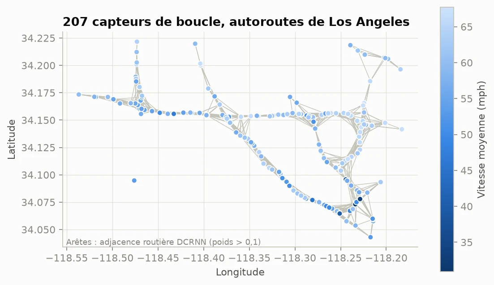

Each sensor could be forecast on its own. But these series sit on a road network, and what happens
at one sensor often happens, a few minutes later or earlier, at its neighbours. Hence the name
**spatio-temporal forecasting**: a time dimension (the past of each series) and a space dimension
(the position of the sensors relative to each other).

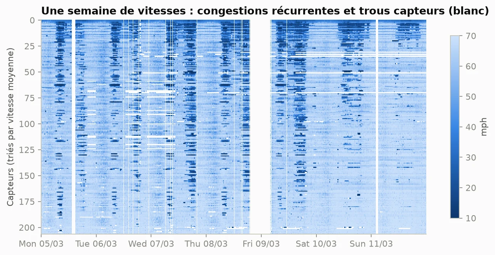

Jams come back **at the same hours** and **on the same sensors**, weekends look different, and
several sensors slow down at the same time (the vertical blocks).

### The task

The standard task in the literature: from **the last hour** (12 steps of 5 minutes) of all
sensors, forecast **the next hour**, mainly at 15, 30 and 60 minutes. The error is measured as
**MAE** (*mean absolute error*): the average gap, in mph, between forecast and observed speed. An
MAE of 3.5 means being off by 3.5 mph on average, about 5.6 km/h.

## 2. Two ways of using space

### The bet of graph models

Since 2018, the dominant answer in research has been the **STGNN** (*spatio-temporal graph neural
network*). The network is represented as a **graph** (one node per sensor, one weighted edge per
road link) and the neural network passes information along the edges: to forecast a sensor, it
looks at its own past **and** at its neighbours'. The graph boils down to an **adjacency matrix**
\(W\) of 207 × 207 cells, where \(W_{ij}\) is larger the closer \(j\) is to \(i\) by road, and zero
when they are not linked.

. Middle, the number of neighbours per sensor. Right, the number of sensors reached in K hops.")

The graph is **sparse** (about ten neighbours per sensor) and **directed**: a freeway has a
direction of travel. Road distances \(d_{ij}\) become weights through a Gaussian kernel,
\(W_{ij} = \exp(-d_{ij}^2/\sigma^2)\), set to zero below 0.1: the closer two sensors are by road,
the closer the weight is to 1.

### The graph is a hypothesis, not data

That sentence framed the project. Nobody measures a graph: you **build** one.

| Source | Construction | Strengths | Weaknesses |
|---|---|---|---|
| Geographic | straight-line distance | available everywhere | two lanes in opposite directions wrongly become "neighbours" |
| Road network (METR-LA) | distance along the road, directed | encodes the direction of traffic | needs a clean road reference; frozen |
| Correlation | similarity of past series | captures non-geographic links | derived from data: leakage if badly split |
| Learned | a matrix learned with the rest of the model | no prior | opaque, and may learn noise |

Each construction is a **bet** on the usefulness of linked nodes, and that bet costs compute,
latency and code to maintain. Hence the question of the project: **does a graph model beat a good
graph-free model by a margin that justifies that cost?**

### The counterpoint: STID

In 2022, a short CIKM paper took the field from the other side. **STID** (*Spatial-Temporal
IDentity*) uses **no graph at all**: it is a plain dense network (an MLP) that forecasts each
sensor separately. Its only trick: on top of the one-hour window, it receives three **learned
identities**, vectors that say **which sensor** and **which moment** (time of day, day of week).
On PEMS-BAY (325 sensors in the San Francisco Bay Area), the paper reports this:

| PEMS-BAY, MAE (mph) | 15 min | 30 min | 60 min | Seconds per epoch |
|---|---|---|---|---|
| DCRNN (2018, graph) | 1.31 | 1.67 | 1.99 | 351.4 |
| Graph WaveNet (2019, graph) | **1.30** | 1.63 | 1.95 | 112.0 |
| **STID** (2022, no graph) | **1.30** | **1.62** | **1.89** | **15.8** |

The graph-free model matches or beats the graph models, with an epoch seven times shorter than
Graph WaveNet's. That result was worth checking on another network, with my own measurements.

. STID takes the opposite stance in 2022. Since then, a third branch pre-trains foundation models on hundreds of cities.")

## 3. What the sources say

I read the texts at the source, checking every figure quoted. A common belief fell on day one:
**the STID paper does not evaluate METR-LA**; the figures that circulate come from BasicTS, the
toolkit of the same authors.

- **DCRNN** (ICLR 2018), the founding paper, published METR-LA, its graph and the protocol everyone
  has used since. It models traffic as a **diffusion** over the graph, downstream **and** upstream,
  inside a recurrent network: accurate, but slow.
- **Graph WaveNet** (IJCAI 2019) keeps that diffusion, replaces recurrence with faster **dilated
  temporal convolutions**, and adds a **learned** graph. That is what lets you ask where the
  graph's gain comes from, hence my choice.
- **STID** (CIKM 2022) makes a diagnosis: a simple model lacks the ability to **tell samples
  apart** (section 6).
- **Foundation models** form the third branch: UrbanFM (2026) is pre-trained on more than a hundred
  cities to forecast an unseen city *zero-shot* (without training), and **without a road graph**.
  Its gains announced in the abstract (39% to 70%) stayed "to be confirmed" in my notes. For a
  logistics network, the promise is serving a node with no history.

## 4. The data and its traps

### A 2019 file pandas no longer reads

`pd.read_hdf("metr-la.h5")` fails: the file, written in 2019, is no longer read by recent pandas
versions. I read it block by block with `h5py`, checking that the sensor order is **identical** to
that of the adjacency matrix. An offset of one row would give each sensor another sensor's
neighbours, without any visible error.

### A zero is not a traffic jam

**8.1% of values are 0.** They could pass for complete standstills; the distribution says
otherwise.

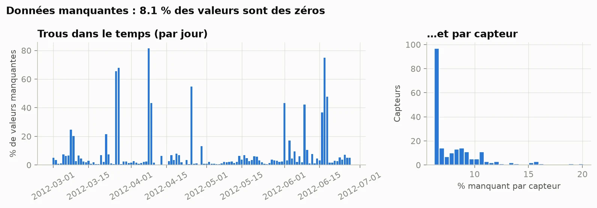

The zeros arrive in whole days, over a large part of the network: they are collection **outages**.
They are therefore **excluded** from the error, in training as in evaluation, but the models still
receive them **as input**, as they would in production.

### Time matters as much as space

 and weekends (orange). The band covers 80% of sensors. On weekdays, two peaks around 8 am and 5 pm; at weekends, a slight dip in the early afternoon.")

Speed depends strongly on the **time of day** and the **day of week**. A model that only sees a
one-hour window has to guess where it is in that cycle. That observation explains much of what
follows.

### Does the graph carry signal? A test before any model

For a neighbour to help, it has to **change before** the sensor being forecast; otherwise its
information arrives at the same time and adds nothing. I wanted to check this before training
anything.

The test: for each directed edge (upstream to downstream), compute the **cross-correlation** of
the speed changes of the two sensors, for lags from −30 to +30 minutes, and note the lag where it
peaks.

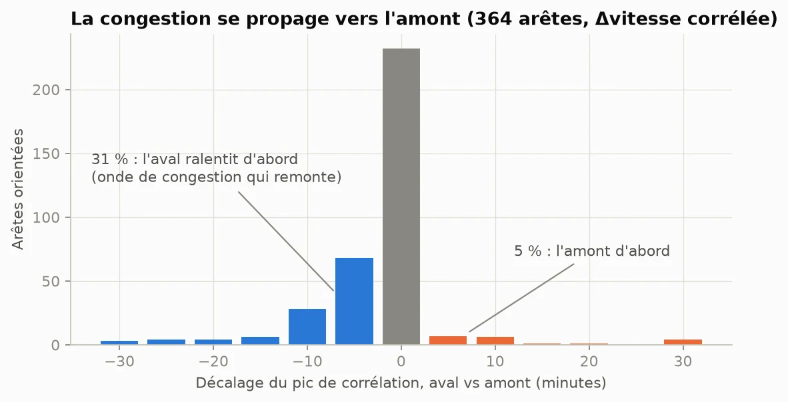

Three readings:

- **64% of edges peak at 0**: at a 5-minute resolution, both sensors change together. The
  neighbour gives no head start.
- **31% peak at a negative lag**: the **downstream** sensor slows down **before** the upstream one.
  This is the congestion shock wave travelling **against** the flow. A jam forms ahead, the queue
  grows backwards, and the sensor further up the road slows down in turn.
- **Only 5%** show propagation in the direction of traffic.

This test supports DCRNN's choice of diffusing information **in both directions**: looking only
upstream would miss most of the signal. It also hints at a **modest** gain: a third of the edges
carry a usable head start, enough for the graph to help, not enough to guarantee it beats a model
that already knows "who" it is forecasting. (The first version of this figure coloured lag 0 like
the negative lags, inflating upstream propagation; I redid it.)

## 5. The graph's mechanism: diffusion convolution

The core of DCRNN and Graph WaveNet is the **diffusion convolution**. I describe it step by step,
because it is what makes the graph useful.

### From random walk to weighted average

The adjacency matrix is normalised row by row: \(P = D_O^{-1} W\), where \(D_O\) is the diagonal
matrix of row sums. Each row of \(P\) then sums to 1, and \(P_{ij}\) reads as **the probability of
going from sensor \(i\) to sensor \(j\) in one step** of a random walk on the graph.

Applying \(P\) to a signal \(X\) (the speed of each sensor) replaces each value by the **weighted
average of its direct neighbours**. Applying \(P^2\) averages over the neighbours' neighbours, and
so on. A diffusion convolution **learns to mix** these averages:

$$
H = \sum_{k=0}^{K} \Big( P_f^{\,k} X\,\Theta_{k,f} + P_b^{\,k} X\,\Theta_{k,b} \Big)
\quad\text{with}\quad P_f = D_O^{-1}W,\;\; P_b = D_I^{-1}W^\top
$$

In words: for each sensor, compute its own value (\(k = 0\)), the average of its neighbours one
step away (\(k = 1\)), two steps away (\(k = 2\)), **in both directions** (\(P_f\) downstream,
\(P_b\) upstream, built on the transposed matrix), and the model learns the weights \(\Theta\) that
combine them. It is the graph equivalent of a convolution filter on an image: instead of
neighbouring pixels, sensors that are neighbours by road.

 and diffused. Top, downstream; bottom, upstream. Dot size and colour give the share of the impulse that reached each sensor after k steps.")

After one step, the information has only reached a few sensors on the same axis; after three, it
has crossed an interchange and moves onto another axis. The two directions do **not** give the
same result: that is the direction of traffic, encoded in a directed graph.

### In the code

`nconv` applies a transition matrix to a tensor (batch, channels, sensors, time); the loop stacks
the successive powers, and a 1×1 convolution plays the role of the weights \(\Theta\):

```python
def nconv(x, a):
    # x: (B, C, N, T); a: (N, N)  →  Σ_v x[..., v, :] · a[v, w]
    return torch.einsum("ncvl,vw->ncwl", x, a)

class DiffusionGCN(nn.Module):
    def forward(self, x, supports):
        out = [x]                                     # k = 0: the sensor itself
        for a in supports:                            # P_f, P_b, and the learned matrix
            x1 = nconv(x, a); out.append(x1)          # k = 1: direct neighbours
            for _ in range(2, self.order + 1):
                x1 = nconv(x1, a); out.append(x1)     # k = 2..K: neighbours of neighbours
        return self.mlp(torch.cat(out, dim=1))        # Θ: 1×1 convolution
```

### The learned graph

Graph WaveNet adds a third matrix to \(P_f\) and \(P_b\), a **learned** one:

$$
\tilde{A} = \mathrm{softmax}\big(\mathrm{ReLU}(E_1 E_2^\top)\big), \qquad E_1, E_2 \in \mathbb{R}^{207 \times 10}
$$

\(E_1\) and \(E_2\) hold one 10-dimensional vector per sensor, randomly initialised and adjusted
by training. Their product gives a score for each pair of sensors, which the *softmax* turns into
probabilities: the model invents its own neighbourhood. Keep this detail in mind: **one learned
vector per sensor is exactly STID's idea**. Graph WaveNet uses it to **route information** between
sensors; STID, to **tell the model which sensor it is dealing with**.

## 6. Sample indistinguishability

This is the concept I learned the most from in this project, and it fits in one figure.

, on two different sensors: 717446 on a Monday at 1:10 am, 764101 on a Wednesday at 5:55 am. One hour later, the first still runs at 67 mph, the second has dropped to 13 mph.")

The observed hour overlaps; the next hour diverges. The first sensor is in the middle of the night,
the second is approaching the morning rush. A model that only receives these 12 values **cannot**
know which case it is facing: to it, the samples are **indistinguishable**. So it predicts the same
thing for both, a compromise that is wrong in both cases.

These twins are not textbook cases: out of 6,000 randomly drawn windows, about 36,000 pairs have
inputs differing by less than 1 mph, and **5.4% of them diverge by more than 10 mph at 60 minutes**.
These are typically congestion onsets, the cases that matter for a dispatch service.

### Two ways of resolving the ambiguity


flowchart LR
  Q["Ambiguous window<br/>(same input, different futures)"] --> G["Graph model: look at the neighbours<br/>'downstream is already slowing'"]
  Q --> I["STID: say who and when<br/>'sensor 764101, Wednesday 5:55 am'"]
  G --> R["Disambiguated future"]
  I --> R


- The **graph** resolves it through **present context**: if downstream sensors are already
  slowing, the jam is coming.
- The **identity** resolves it through **statistical memory**: this sensor, at this time, on this
  day, usually slows down.

The second is far cheaper: a table looked up once, instead of passing information over the graph
at every layer.

### STID's architecture


flowchart LR
  X["Last hour<br/>(12 steps: speed, time, day)"] --> E["Projection<br/>→ 32 dimensions"]
  E --> C(("concatenation<br/>128 dim."))
  NE["Sensor identity<br/>(207 vectors)"] --> C
  TE["Time-of-day identity<br/>(288 five-minute slots)"] --> C
  DE["Day-of-week identity<br/>(7 vectors)"] --> C
  C --> M["3 residual<br/>MLP blocks"]
  M --> Y["12 forecast steps"]


That is all: **118,000 parameters**, no adjacency matrix, no exchange between sensors. Each
identity is a vector of 32 numbers, learned like any other weight. A unit test pins the intuition
down before any training: given the same window on two sensors, STID without identity predicts the
same thing; with identity, the predictions differ.

Graph WaveNet has **301,000 parameters**: eight layers alternating a temporal convolution and a
diffusion convolution over three supports (downstream, upstream, learned graph). Both models are
rewritten in plain PyTorch (about 100 and 150 lines) so that every line can be read, tested, and
one piece removed at a time.

## 7. The protocol, fixed before the results

Before writing any code, I fixed the protocol in `SPEC.md`, with one rule: **it is not changed to
accommodate a number**, much like the pre-registration of a clinical study.

### Split and metrics

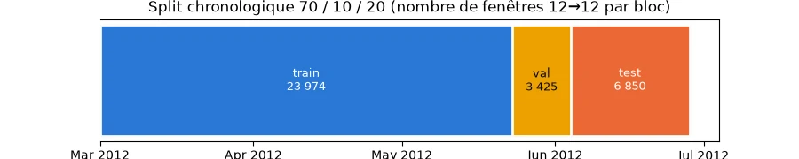

| Choice | Value | Why |
|---|---|---|
| Split | chronological 70 / 10 / 20 | never learn from the future |
| Normalisation | fitted on training only | do not read test statistics |
| Zeros | excluded from loss and metrics | a zero is an outage |
| Selection | best validation error; test read once | no implicit optimisation on the test |
| Hyperparameters | those of the papers and BasicTS, no search | favour neither model |
| Seeds | one (budget) | acknowledged limit, discussed below |

The error is **masked**: it is only computed where a real measurement exists.

$$
\text{MAE} = \frac{\sum_{i} m_i\,|\hat y_i - y_i|}{\sum_i m_i}, \qquad m_i = \mathbb{1}[y_i \neq 0]
$$

The mask \(m_i\) is 0 on outages; a test checks that a forecast of 999 mph on a gap changes
nothing. I also report the **RMSE**, which penalises large errors more, and the **MAPE**, the error
as a percentage of the true speed. The three will tell different stories.

### The experimental plan

Ten configurations, organised so that each comparison isolates a single piece:

| Family | Configurations | What they measure |
|---|---|---|
| No learning | historical average (per sensor and slot), persistence (the last value stays) | the lower bounds |
| STID | full; without sensor identity; without temporal identities; without any identity | what each identity is worth |
| Graph WaveNet | road + learned; road only; learned only; no graph | where the graph's gain comes from |

Without a graph, Graph WaveNet becomes a purely temporal network that handles each sensor
separately: this is the control that says whether a gain comes from the graph or merely from the
temporal architecture.

### The decision criterion


The graph "wins its bet" if **both** conditions hold:

1. Graph WaveNet beats STID by at least **3% MAE at 60 minutes** (about 0.1 mph, beyond the
   seed-to-seed noise reported by BasicTS);
2. and that gain disappears when the graph is removed.

Otherwise, the default recommendation is STID.


Why 60 minutes? It is the most useful horizon for planning a delivery round. We will see that this
criterion, sensible on paper, weighed heavily.

### Three sanity checks before comparing

Comparing two badly trained models says nothing. Each building block was checked against a
published figure:

1. **The historical average gives an MAE of 4.19**, against 4.16 in the DCRNN paper. Split, mask
   and metric are aligned with the literature.
2. **STID gives 2.80 / 3.17 / 3.54** at 15, 30 and 60 minutes, against about 2.82 / 3.19 / 3.55 in
   BasicTS. The implementation is validated.
3. **Graph WaveNet gives 2.69 / 3.07 / 3.53**, exactly the figures of the original paper.

So the comparison is between two properly trained models. The eight training runs took about three
hours on a laptop GPU.

## 8. Results: the average first

| Model (test) | 15 min | 30 min | 60 min | Mean over 12 steps |
|---|---|---|---|---|
| Historical average | 4.19 | 4.19 | 4.19 | 4.19 |
| Persistence | 3.71 | 4.61 | 6.14 | 4.67 |
| **STID** (no graph) | 2.80 | 3.17 | 3.54 | 3.11 |
| **Graph WaveNet** (road + learned) | **2.69** | **3.07** | **3.53** | **3.04** |

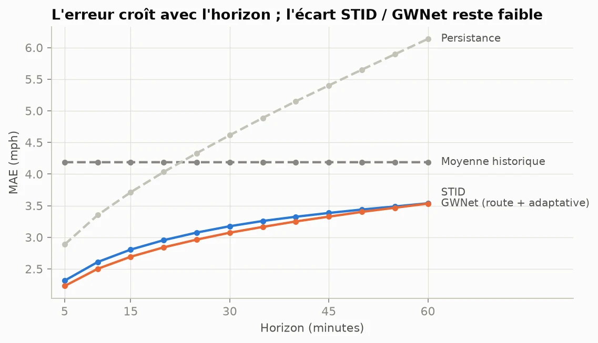

**Persistence** ("in an hour, the speed of now") beats the **historical average** ("the usual speed
of this sensor in this slot") up to about twenty minutes. Both learned models do far better than
these bounds, and their gap narrows until it disappears: **3.53 against 3.54 at 60 minutes**.

. The dotted line marks the 3% threshold of the criterion. Only the full version exceeds it, and only up to about 30 minutes. Without a graph, the gap widens with the horizon.")

The graph helps **at short range**: at 15 minutes, the state of the neighbours is the freshest
information. At 60 minutes, the statistical memory of the identities catches up with the spatial
context.

### Three metrics, three stories

| Graph WaveNet vs STID | 15 min | 30 min | 60 min |
|---|---|---|---|
| MAE | −4.0% | −3.2% | **−0.1%** |
| RMSE | −7.9% | −7.1% | −3.7% |
| MAPE | −9.8% | −11.1% | **−10.8%** |

The first sign that the mean hides something: at 60 minutes, the MAE does not move, but the MAPE
drops by 11%. The MAPE **divides by the true speed**: a 10 mph error weighs six times more at
10 mph than at 60 mph. It therefore amplifies errors made **in jams**. Graph WaveNet is wrong less
often when traffic is jammed, and slightly more when it flows.

## 9. Results: where the average does not look

### By traffic regime

I classified each test situation by the last observed speed and the true speed one hour later,
with two thresholds (40 and 55 mph); intermediate situations (16% of the test set) are left
unclassified.

| Regime (60-min MAE, mph) | Share of test | Historical average | STID | Graph WaveNet | Graph WaveNet without graph |
|---|---|---|---|---|---|
| Stable free flow | 70.9% | 2.33 | **1.61** | 1.84 | 1.74 |
| Congestion onset | 2.4% | 18.24 | 23.29 | **17.88** | 35.03 |
| Established congestion | 8.3% | 11.23 | 7.19 | **5.77** | 7.19 |
| Recovery | 2.5% | **8.42** | 9.78 | 11.65 | 19.49 |

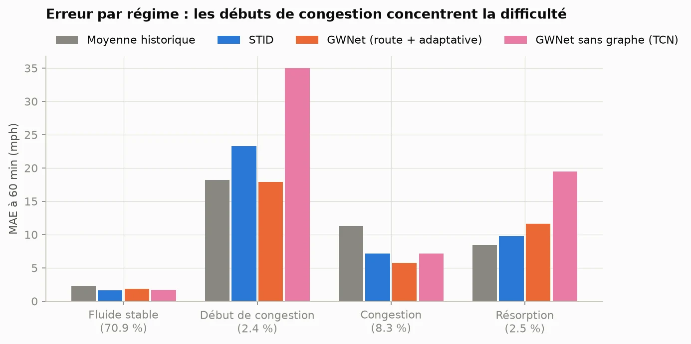

To me, this is the most useful result of the project:

- **At the onset of a jam** (2.4% of the test set), STID is off by 23 mph, **more than the
  historical average** (18 mph): it predicts that the free-flowing road will stay so. Graph
  WaveNet, which sees downstream slowing, comes down to 17.9 mph.
- **In established congestion** (8.3%), Graph WaveNet has 20% less error.
- **In free flow** (71%) and **in recovery**, STID is better: Graph WaveNet anticipates slowdowns
  that do not come, or is late to see the recovery.

The mean is dominated by free flow, where STID wins. The graph's gain hides in rare situations.

### An example

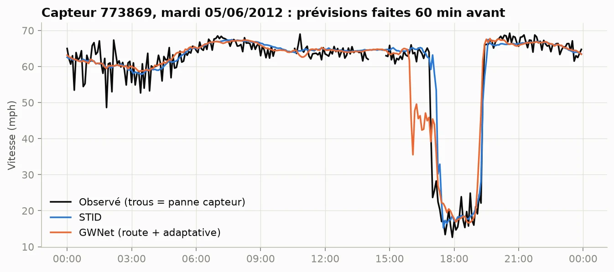

The trade-off in miniature: around 5 pm, speed collapses from 65 to 20 mph. Graph WaveNet (orange)
anticipates the drop, but also raises a **false alarm** around 4 pm. STID (blue) reacts later,
without a false alarm. Warned early at the risk of being wrong, or rarely but late: you would not
pick the same model.

### By sensor and by hour

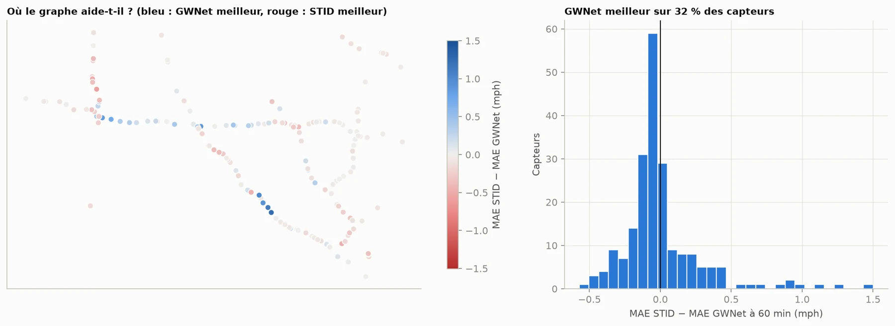

Graph WaveNet is better on only **32% of sensors** at 60 minutes, but its gains are larger than
its losses, and they form **contiguous segments** on the map, consistent with a signal travelling
along a stretch of road. Whether these are the upstream ends of jams remains a lead to check.

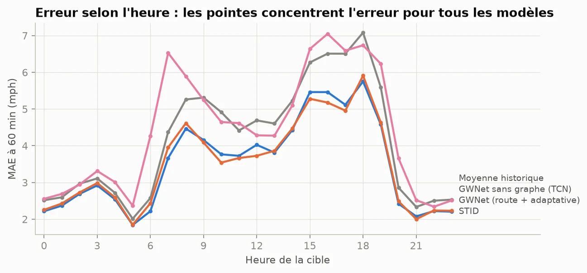

STID is better at the start of the morning rush (7 to 8 am), when congestion is **recurrent** and
thus carried by the time-of-day identity. Graph WaveNet wins between 10 am and noon and between
3 and 5 pm. My hypothesis, unverified: these slots contain more **non-recurrent** congestion
(incidents), which only the neighbours can announce. An identity only knows the routine.

## 10. Ablations: where does performance come from?

An **ablation** removes one piece of a model and measures what is lost: it is how you find out what
makes the model work, rather than assuming it.

### Removing STID's identities

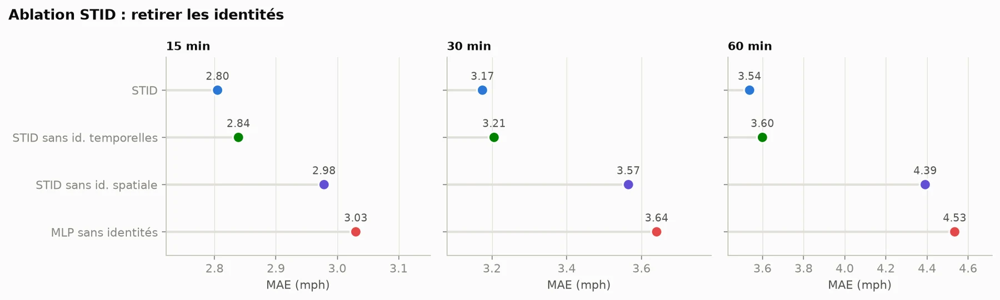

1. **The sensor identity is decisive**: without it, the 60-minute MAE goes from 3.54 to **4.39**
   (+24%), the same ranking as in the STID paper.
2. **The gap grows with the horizon** (+6% at 15 minutes): at short range the recent window is
   enough, at long range you need to know **who** you are forecasting.
3. **Temporal identities add little here** (3.54 → 3.60), because the input already contains the
   time and day as raw values, as in the reference configuration. I noted it so as not to
   over-interpret this number.
4. **Without any identity, the network does worse than the historical average** at 60 minutes
   (4.53 against 4.19). This struck me: the supposedly naive historical average is indexed by
   sensor and slot, and holds exactly the information the bare network lacks.

### Removing Graph WaveNet's graph

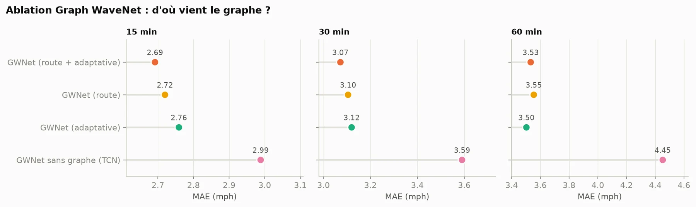

1. **The graph is essential to Graph WaveNet**: without it, 4.45 at 60 minutes (+26%), because
   nothing else in its architecture tells sensors apart.
2. **Road or learned graph, it does not matter at 60 minutes** (3.55, 3.50, 3.53 with both): gaps
   that one more seed could shift.
3. **At short range, the road helps**: at 15 minutes, 2.72 against 2.76 for the learned graph
   alone, and 2.69 with both. The real map carries the neighbours' immediate information.

The second condition of the criterion is met (the gain comes from the graph), not the first (it
does not exceed STID).

### Two levers, same effect

Side by side, the two ablations give a result I did not expect to be this clear.

 and with it (filled dot). STID's identities and Graph WaveNet's graph both cut the error by about 22%, but the latter costs nine times more compute per epoch.")

| | Without the lever | With | Gain | Seconds per epoch |
|---|---|---|---|---|
| STID: identities | 4.53 | 3.54 | −22% | 5.8 |
| Graph WaveNet: graph | 4.45 | 3.53 | −21% | 53.8 |

The two "bare" models are as bad as each other, the two complete models as good as each other.
**The graph and the identities do the same job**: telling samples apart. The graph does it
indirectly, through the neighbours' context; the identity directly, through a learned vector. That
is STID's thesis, and it is what I observed on METR-LA.

### What STID learned without being told

What do these identities contain? I projected the learned vectors onto their first two principal
components (a PCA summarises 32 numbers into two axes that keep the most variation).

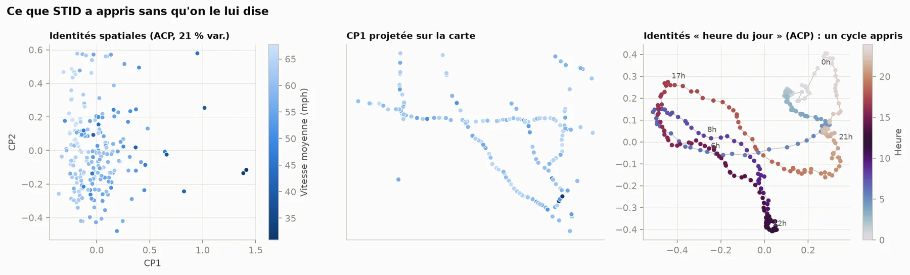

- **Sensors**: the first component correlates with mean speed (−0.73), and chronically congested
  sensors cluster on the same stretches. STID learned a **functional geography** of the network
  without ever seeing the graph.
- **Time slots**: they draw a **closed loop**, from midnight to midnight, with bends at rush hours.
  Nobody told the model that 11:55 pm comes before midnight: it rediscovered the periodicity of
  traffic.

### Does the learned graph look like the road?

Since the learned graph does as well as the road map, one could hope it **recovers** the map, and
use it to show operators which stretches influence each other.

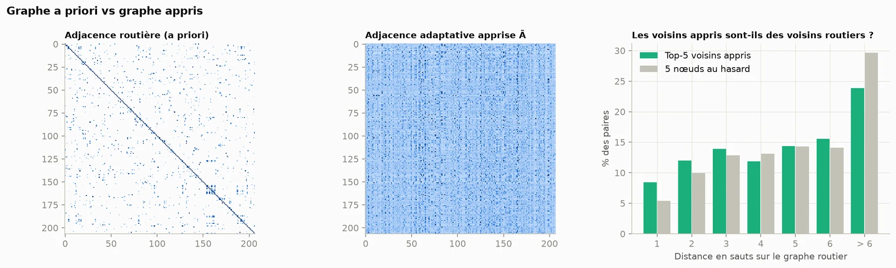

**Not really.**

- The learned matrix is **dense and diffuse**: the largest weight in a row has a median of 0.014,
  barely three times the uniform weight (1/207 ≈ 0.005).
- It has a **column structure**: some sensors are "listened to" by almost all the others, more
  like a summary of the network's overall state than a topology.
- Among each sensor's 5 most-weighted neighbours, **20%** are within two road hops, against **16%**
  for 5 randomly drawn sensors.

A learned adjacency is thus a **model parameter**, to be versioned and monitored as such, not an
interpretable map of the network.

## 11. The cost of complexity

The other half of the question remains: what the graph costs.

| Model | Parameters | Seconds per epoch | Minutes to best model | Latency, 1 situation | Latency, batch of 64 | GPU memory | 60-min MAE |
|---|---|---|---|---|---|---|---|
| STID | 118 k | 5.8 | 8.3 | 0.17 ms | 0.59 ms | 44 MB | 3.54 |
| Graph WaveNet | 301 k | 53.8 | 82.7 | 1.92 ms | 70.1 ms | 1,352 MB | 3.53 |
| Ratio | × 2.5 | × 9 | × 10 | × 11 | **× 119** | × 30 | — |

.")

. STID reaches its plateau in a few minutes; Graph WaveNet keeps improving slowly.")

- **Training**: 8 minutes against 83. Negligible for a weekly retrain, less so for a
  hyperparameter search or a per-region retrain over thousands of nodes.
- **Inference**: at 2 ms per situation, Graph WaveNet holds real time, but the **× 119** gap on a
  batch makes recomputing the whole network every 5 minutes two orders of magnitude more expensive.
- **Scaling**: the learned graph is a **dense** \(N \times N\) matrix. On 5,000 nodes, that is
  25 million coefficients per layer, a cost that grows with the square of \(N\). STID stays linear.

Two training runs shared the GPU: absolute times are pessimistic, but both families suffered the
same contention, and it is the **ratios** that matter. Those of the STID paper (× 7 per epoch, on
another machine) point the same way.

## 12. The verdict, and what I would change


**By the criterion fixed before the results:**

1. MAE gain at 60 minutes: **0.1%**, far from the required 3% → condition not met;
2. gain attributable to the graph: without the graph, Graph WaveNet loses 26% → condition met.

**Decision: STID by default.** Graph WaveNet remains a legitimate challenger if the business
metric values congestion.


I did not change that verdict, but the regime results showed me where the protocol went wrong.
Fixing the metric **before** the results was right: it is what prevents picking, after the fact,
the number that suits. But I fixed a **statistical** metric (the benchmarks' mean error) instead of
a **business** one.

For a dispatch service, a 20 mph error at the onset of a jam costs a late delivery; 0.2 mph on a
free-flowing freeway costs nothing. With an error weighted by the cost of a delay, **the
conclusion would reverse**. Choosing the right metric required asking the business beforehand, not
the data afterwards. I record the lesson rather than correct the verdict; the next iteration will
test this weighted criterion on fresh data (PEMS-BAY), so as not to choose it knowing the result.

**Limits.**

- **A single seed** per configuration. A 0.1% gap is within noise. The 4% gap at 15 minutes and
  the 20% gap in congestion are probably robust, but this is not demonstrated.
- **A single network** of 207 sensors, over four months of 2012.
- **The temporal identities** are redundant with the time and day input channels, which probably
  underestimates their own contribution.

## 13. What I would do on a logistics network

The last block transposed these results to a logistics operator forecasting travel times over a
few thousand nodes (hubs, road segments, delivery zones), every 5 minutes, for a dispatch service
with a tight latency budget.


flowchart LR
  S1["Fleet telemetry<br/>and road sensors"] --> Q["5-min aggregation<br/>plausibility checks<br/>missing-value mask"]
  S3["Network reference<br/>hubs, segments"] --> GB["Graph builder<br/>directed, versioned"]
  Q --> T1["STID<br/>(champion)"]
  Q --> T2["Graph model<br/>(challenger)"]
  GB --> T2
  T1 --> AB{"Rolling backtest<br/>on the business metric"}
  T2 --> AB
  AB --> B["Batch scoring<br/>every 5 min"]
  B --> C[("Forecast cache<br/>node × horizon")]
  C --> D["Dispatch / ETA"]
  C --> M["Monitoring: error per node<br/>against the historical average"]


The choices that follow from what I observed:

- **STID as the default model**, always trained, because it sets the bar in a few minutes. A graph
  model only goes to production if it beats it **on the business metric**, beyond seed noise, with
  an ablation that attributes the gain to the graph.
- **The road map rather than the learned graph**, when a graph is justified: it is explainable and
  remains valid for a new node.
- **Batch scoring every 5 minutes**, served from a cache: the dispatch service never calls the
  model live, and the overall compute cost (where the × 119 weighs) matters more than latency.
- **Silent sensors are flagged, never forecast at zero**, with a fallback to the slot's historical
  average beyond half an hour of silence.
- **A new hub is where the graph becomes interesting again**: STID has no identity for a node it
  has never seen. A graph model can lean on its road neighbours, a foundation model can serve
  zero-shot until a local model beats it, and a new node's identity could be initialised from its
  neighbours'.

## 14. What I take away

These observations hold for 207 freeway sensors, four months of history, one seed per
configuration and the hyperparameters of the reference papers.

1. **A well-designed graph-free model sets a high bar**: STID reaches in 8 minutes the level of a
   graph model trained for 83. Without it, I would have credited the graph with a gain that is not
   its own.
2. **The graph and the identities are interchangeable on average**, because they solve the same
   problem: sample indistinguishability, the concept I learned the most from.
3. **They are not in rare situations**: the graph sees the jam coming at the neighbours, the
   identity only knows the routine. Measuring by regime changed how I read the results.
4. **The learned graph does as well as the road, but does not look like it.**
5. **Fixing the metric before the results was not enough**: it is the choice of metric, taken from
   benchmark habit rather than business cost, that decided the verdict.
6. **Signal can be tested before the model**: the cross-correlation on the edges announced a modest
   graph gain before any training.


**A question to check your understanding.** *An STGNN gets 5% less error than STID on a new
network. Can you conclude that the graph is useful?* Not yet. The ablation is missing: if the STGNN
**without its graph** does as well, the gain comes from its temporal architecture (section 10). The
breakdown by regime is missing: 5% gained in free flow is not worth 5% gained at jam onsets
(section 9). And the cost is missing (section 11).


## Reproduce and go further

The code, tests and results are in the
[gwils28/spatio-temporal-forecasting](https://github.com/gwils28/spatio-temporal-forecasting)
repository (Python 3.12, versions locked by `uv`): 24 unit tests in under a second, eight training
runs in about three hours, and every table and figure generated from the results versioned in
`results/`. Decisions made before the code are in `SPEC.md`, deviations from the plan in
`docs/notes/implementation.md`. The
[project site](https://gwils28.github.io/spatio-temporal-forecasting/) (in French) goes further: a
full reading of DCRNN, notes on foundation models, an exploration notebook and a dated log,
mistakes included.

Open leads: three seeds on STID and Graph WaveNet, the regime-weighted criterion tested on
PEMS-BAY, and STID with a node identity initialised from the topology, for new hubs.

**Sources**

- Li, Yu, Shahabi and Liu, [*Diffusion Convolutional Recurrent Neural Network: Data-Driven Traffic Forecasting*](https://arxiv.org/abs/1707.01926), ICLR 2018, and the [DCRNN repository](https://github.com/liyaguang/DCRNN) that METR-LA and its graph come from.
- Wu, Pan, Long, Jiang and Zhang, [*Graph WaveNet for Deep Spatial-Temporal Graph Modeling*](https://arxiv.org/abs/1906.00121), IJCAI 2019.
- Shao, Zhang, Wang, Wei and Xu, [*Spatial-Temporal Identity: A Simple yet Effective Baseline for Multivariate Time Series Forecasting*](https://arxiv.org/abs/2208.05233), CIKM 2022, and the [BasicTS](https://github.com/GestaltCogTeam/BasicTS) toolkit.
- Liang et al., [*Foundation Models for Spatio-Temporal Data Science: A Tutorial and Survey*](https://arxiv.org/abs/2503.13502), arXiv, 2025.
- Chen, Wu, Chen, Zhou and Liang, [*UrbanFM: Scaling Urban Spatio-Temporal Foundation Models*](https://arxiv.org/abs/2602.20677), arXiv, February 2026.
