


Pour prévoir la vitesse sur une autoroute dans une heure, faut-il regarder ce qui se passe chez
les voisins ? L'intuition dit oui : un bouchon se propage. Toute une famille de modèles en a fait
son principe, en donnant au réseau de neurones la carte des routes. J'ai voulu vérifier ce que
cette carte rapporte vraiment, face à un modèle simple qui ne la voit pas, et ce qu'elle coûte.


*Temps de lecture : environ 30 minutes. Les formules sont suivies de leur intuition : on peut les
survoler sans perdre le fil.*



Cet article restitue **cinq semaines de veille active** (du 21 mai au 26 juin 2026) sur la
prévision spatio-temporelle : prévoir de nombreuses séries reliées par un réseau (capteurs
routiers, compteurs électriques, entrepôts). Le plan : lire l'article fondateur (DCRNN) et celui
qui le conteste (STID), faire le point sur les modèles de fondation, réécrire et comparer deux
modèles sur un jeu de référence, puis en tirer une décision d'architecture pour un cas logistique,
la prévision des temps de parcours d'un service de répartition des tournées. Tout est reproductible
dans le dépôt [spatio-temporal-forecasting](https://github.com/gwils28/spatio-temporal-forecasting),
dont viennent les figures, et son [site de documentation](https://gwils28.github.io/spatio-temporal-forecasting/)
reprend chaque point plus en détail.


**En bref.** Les principaux résultats, sur les 207 capteurs autoroutiers de Los Angeles (METR-LA) :

1. **Le modèle à graphe (Graph WaveNet) et le modèle sans graphe (STID) font la même erreur
   moyenne à 60 minutes** : 3,53 contre 3,54 mph. Selon le critère fixé avant les résultats, le
   graphe ne gagne pas son pari.
2. **Le graphe coûte un ordre de grandeur de plus** : × 10 en entraînement, × 119 en latence sur
   un lot de 64 situations.
3. **Il aide pourtant là où ça compte** : −4 % d'erreur à 15 minutes, −23 % au début des
   bouchons, des situations rares (2,4 % du test) que la moyenne efface.
4. **Le graphe et les « identités » apprises de STID font le même travail** : retirer l'un ou
   l'autre coûte environ 22 % d'erreur, mais les identités coûtent neuf fois moins cher.
5. **Le graphe appris ne ressemble pas à la carte routière.**
6. **La leçon principale porte sur le protocole** : j'avais fixé à l'avance une métrique
   statistique au lieu d'une métrique métier. Pondérée vers la congestion, l'erreur inverserait
   la conclusion.


## 1. Le problème : prévoir sur un réseau de capteurs

### Des séries qui ne sont pas indépendantes

Le jeu de données s'appelle **METR-LA**. Ce sont **207 capteurs à boucle magnétique** enfouis
dans les autoroutes de Los Angeles, qui mesurent la vitesse moyenne des véhicules toutes les
5 minutes, du 1er mars au 27 juin 2012 : 34 272 pas de temps par capteur. Les vitesses sont en
**mph** (miles par heure ; 1 mph vaut environ 1,6 km/h, et 65 mph, la vitesse fluide typique,
font environ 105 km/h).

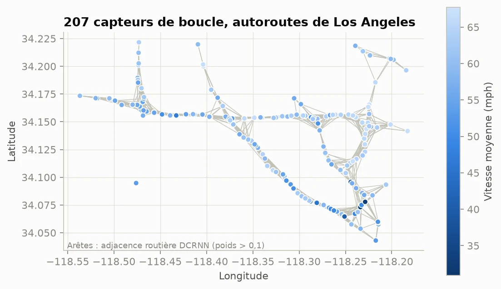

On pourrait prévoir chaque capteur séparément. Mais ces séries sont posées sur un réseau routier,
et ce qui arrive à un capteur arrive souvent, quelques minutes plus tard ou plus tôt, à ses
voisins. D'où le nom de **prévision spatio-temporelle** : une dimension de temps (le passé de
chaque série) et une dimension d'espace (la position des capteurs entre eux).

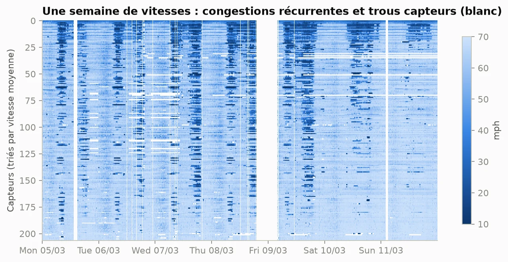

Les bouchons reviennent **aux mêmes heures** et **sur les mêmes capteurs**, le week-end n'a pas la
même allure, et plusieurs capteurs ralentissent en même temps (les blocs verticaux).

### La tâche

La tâche standard de la littérature : à partir de **la dernière heure** (12 pas de 5 minutes) de
tous les capteurs, prévoir **l'heure suivante**, surtout à 15, 30 et 60 minutes. L'erreur est
mesurée en **MAE** (*mean absolute error*) : l'écart moyen, en mph, entre vitesse prévue et
observée. Une MAE de 3,5 signifie qu'on se trompe en moyenne de 3,5 mph, environ 5,6 km/h.

## 2. Deux façons d'utiliser l'espace

### Le pari des modèles à graphe

Depuis 2018, la réponse dominante de la recherche s'appelle **STGNN** (*spatio-temporal graph
neural network*). On représente le réseau comme un **graphe** (un capteur par nœud, une liaison
routière par arête pondérée) et le réseau de neurones fait circuler l'information le long des
arêtes : pour prévoir un capteur, il regarde son passé **et** celui de ses voisins. Le graphe se
résume dans une **matrice d'adjacence** \(W\) de 207 × 207 cases, où \(W_{ij}\) est d'autant plus
grand que \(j\) est proche de \(i\) par la route, et nul s'ils ne sont pas reliés.

. Au centre, le nombre de voisins par capteur. À droite, le nombre de capteurs atteints en K sauts.")

Le graphe est **creux** (une dizaine de voisins par capteur) et **orienté** : une autoroute a un
sens de circulation. Les distances routières \(d_{ij}\) deviennent des poids par un noyau gaussien,
\(W_{ij} = \exp(-d_{ij}^2/\sigma^2)\), mis à zéro sous 0,1 : plus deux capteurs sont proches sur la
route, plus le poids est proche de 1.

### Le graphe est une hypothèse, pas une donnée

C'est la phrase qui a cadré le projet. Personne ne mesure un graphe : on le **fabrique**.

| Source | Construction | Forces | Faiblesses |
|---|---|---|---|
| Géographique | distance à vol d'oiseau | disponible partout | deux voies en sens opposé sont « voisines » à tort |
| Réseau routier (METR-LA) | distance sur la route, orientée | encode le sens de circulation | demande un référentiel routier propre ; figé |
| Corrélation | similarité des séries passées | capture des liens non géographiques | dérivé des données : fuite possible si mal découpé |
| Appris | une matrice apprise avec le reste du modèle | aucun a priori | opaque, et peut apprendre du bruit |

Chaque construction est un **pari** sur l'utilité des nœuds reliés, et ce pari coûte en calcul,
en latence et en code à maintenir. D'où la question du projet : **un modèle à graphe bat-il un bon
modèle sans graphe, d'une marge qui justifie ce coût ?**

### Le contre-pied : STID

En 2022, un court article de CIKM a pris le domaine à revers. **STID** (*Spatial-Temporal
IDentity*) n'utilise **aucun graphe** : c'est un simple réseau dense (un MLP) qui prévoit chaque
capteur séparément. Sa seule astuce : en plus de la fenêtre d'une heure, il reçoit trois
**identités apprises**, des vecteurs qui disent **quel capteur** et **quel moment** (heure, jour de
la semaine). Sur PEMS-BAY (325 capteurs de la baie de San Francisco), l'article publie ceci :

| PEMS-BAY, MAE (mph) | 15 min | 30 min | 60 min | Secondes par époque |
|---|---|---|---|---|
| DCRNN (2018, graphe) | 1,31 | 1,67 | 1,99 | 351,4 |
| Graph WaveNet (2019, graphe) | **1,30** | 1,63 | 1,95 | 112,0 |
| **STID** (2022, sans graphe) | **1,30** | **1,62** | **1,89** | **15,8** |

Le modèle sans graphe égale ou bat les modèles à graphe, avec une époque sept fois plus courte
que Graph WaveNet. Ce résultat valait d'être vérifié sur un autre réseau, avec mes propres mesures.

. STID prend le contre-pied en 2022. Depuis, une troisième branche pré-entraîne des modèles de fondation sur des centaines de villes.")

## 3. Ce que disent les sources

J'ai lu les textes à la source, en vérifiant chaque chiffre cité. Une idée reçue est tombée dès
le premier jour : **l'article STID n'évalue pas METR-LA** ; les chiffres qui circulent viennent de
BasicTS, la boîte à outils des mêmes auteurs.

- **DCRNN** (ICLR 2018), l'article fondateur, a publié METR-LA, son graphe et le protocole repris
  depuis par tous. Il modélise le trafic comme une **diffusion** sur le graphe, vers l'aval **et**
  l'amont, dans un réseau récurrent : précis, mais lent.
- **Graph WaveNet** (IJCAI 2019) garde cette diffusion, remplace la récurrence par des
  **convolutions temporelles dilatées**, plus rapides, et ajoute un graphe **appris**. C'est ce qui
  permet de se demander d'où vient le gain du graphe, d'où mon choix.
- **STID** (CIKM 2022) pose un diagnostic : il manque à un modèle simple de pouvoir **distinguer
  les échantillons** (section 6).
- **Les modèles de fondation** forment la troisième branche : UrbanFM (2026) est pré-entraîné sur
  plus de cent villes pour prévoir en *zero-shot* (sans entraînement) une ville jamais vue, et
  **sans graphe routier**. Ses gains annoncés dans le résumé (39 % à 70 %) sont restés « à
  confirmer » dans mes notes. Pour un réseau logistique, la promesse est de servir un nœud sans
  historique.

## 4. Les données et leurs pièges

### Un fichier de 2019 que pandas ne relit plus

`pd.read_hdf("metr-la.h5")` échoue : le fichier, écrit en 2019, n'est plus relu par les versions
récentes de pandas. Je l'ai lu bloc par bloc avec `h5py`, en vérifiant que l'ordre des capteurs
est **identique** à celui de la matrice d'adjacence. Un décalage d'un rang donnerait à chaque
capteur les voisins d'un autre, sans aucune erreur visible.

### Un zéro n'est pas un embouteillage

**8,1 % des valeurs valent 0.** On pourrait y voir des bouchons totaux ; la distribution dit autre
chose.

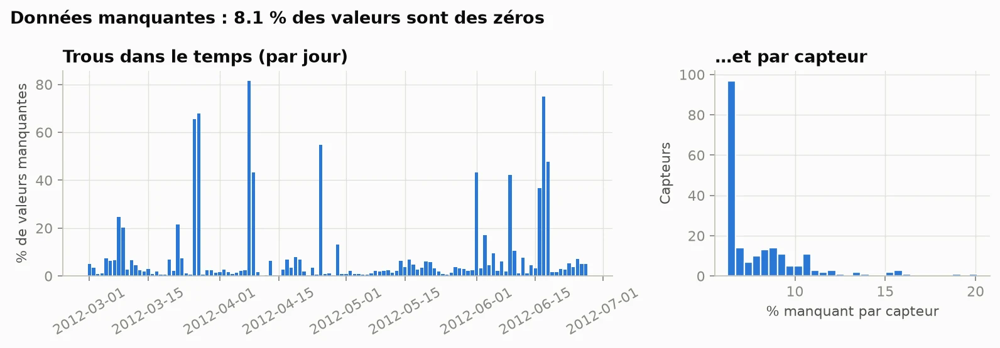

Les zéros arrivent par journées entières, sur une grande partie du réseau : ce sont des **pannes**
de collecte. Ils sont donc **exclus** du calcul de l'erreur, à l'entraînement comme à l'évaluation,
mais les modèles les reçoivent quand même **en entrée**, comme ils les recevraient en production.

### Le temps compte autant que l'espace

 et le week-end (orange). La bande couvre 80 % des capteurs. En semaine, deux pointes vers 8 h et 17 h ; le week-end, un creux léger en début d'après-midi.")

La vitesse dépend fortement de l'**heure** et du **jour**. Un modèle qui ne voit qu'une fenêtre
d'une heure doit deviner où il se trouve dans ce cycle. Ce constat explique une bonne partie de ce
qui suit.

### Le graphe porte-t-il du signal ? Un test avant tout modèle

Pour qu'un voisin aide à prévoir, il faut qu'il **change avant** le capteur qu'on prévoit ; sinon,
son information arrive en même temps et n'apporte rien. J'ai voulu le vérifier avant d'entraîner
quoi que ce soit.

Le test : pour chaque arête orientée (de l'amont vers l'aval), calculer la **corrélation croisée**
des variations de vitesse des deux capteurs, pour des décalages de −30 à +30 minutes, et noter le
décalage où elle est la plus forte.

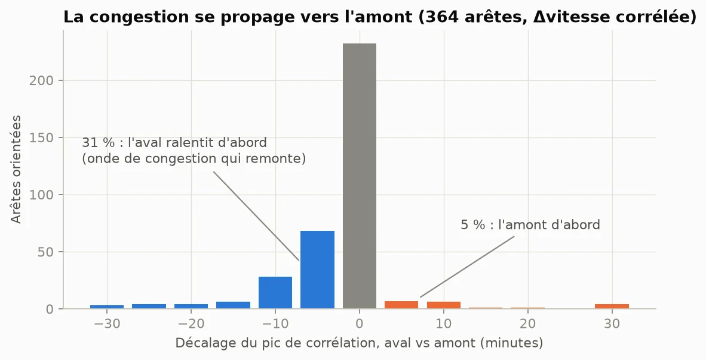

Trois lectures :

- **64 % des arêtes ont leur pic à 0** : à la résolution de 5 minutes, les deux capteurs changent
  en même temps. Le voisin n'apporte aucune avance.
- **31 % ont un pic négatif** : le capteur **en aval** ralentit **avant** celui en amont. C'est
  l'onde de choc de congestion, qui **remonte** le flux. Un bouchon se forme devant, puis la file
  s'allonge vers l'arrière, et le capteur situé plus haut sur la route ralentit à son tour.
- **5 % seulement** montrent une propagation dans le sens de la circulation.

Ce test justifie le choix de DCRNN de diffuser l'information **dans les deux sens** : regarder
seulement l'amont raterait l'essentiel du signal. Il laisse aussi prévoir un gain **modeste** :
un tiers des arêtes portent une avance exploitable, assez pour que le graphe aide, pas assez pour
garantir qu'il batte un modèle qui saurait déjà « qui » il prévoit. (La première version de cette
figure colorait le décalage 0 comme les négatifs, ce qui gonflait la propagation amont ; je l'ai
refaite.)

## 5. Le mécanisme du graphe : la convolution par diffusion

Le cœur de DCRNN et de Graph WaveNet est la **convolution par diffusion**. Je la décris pas à
pas, parce que c'est elle qui rend le graphe utile.

### De la marche au hasard à la moyenne pondérée

On normalise la matrice d'adjacence ligne par ligne : \(P = D_O^{-1} W\), où \(D_O\) est la
matrice diagonale des sommes de lignes. Chaque ligne de \(P\) somme alors à 1, et \(P_{ij}\) se lit
comme **la probabilité d'aller du capteur \(i\) au capteur \(j\) en un pas** de marche au hasard sur
le graphe.

Appliquer \(P\) à un signal \(X\) (la vitesse de chaque capteur) remplace chaque valeur par la
**moyenne pondérée de ses voisins directs**. Appliquer \(P^2\), c'est faire la moyenne sur les
voisins des voisins, et ainsi de suite. Une convolution par diffusion **apprend à mélanger** ces
moyennes :

$$
H = \sum_{k=0}^{K} \Big( P_f^{\,k} X\,\Theta_{k,f} + P_b^{\,k} X\,\Theta_{k,b} \Big)
\quad\text{avec}\quad P_f = D_O^{-1}W,\;\; P_b = D_I^{-1}W^\top
$$

En mots : pour chaque capteur, on calcule sa propre valeur (\(k = 0\)), la moyenne de ses
voisins à un pas (\(k = 1\)), à deux pas (\(k = 2\)), **dans les deux sens** (\(P_f\) vers l'aval,
\(P_b\) vers l'amont, construite sur la matrice transposée), et le modèle apprend les poids
\(\Theta\) qui combinent tout ça. C'est l'équivalent, sur un graphe, d'un filtre de convolution
sur une image : au lieu de pixels voisins, des capteurs voisins par la route.

 et on la diffuse. En haut, vers l'aval ; en bas, vers l'amont. La taille et la couleur des points donnent la part de l'impulsion arrivée sur chaque capteur après k pas.")

Après un pas, l'information n'a touché que quelques capteurs du même axe ; après trois, elle a
passé une intersection et part sur un autre axe. Les deux directions ne donnent **pas** le même
résultat : c'est le sens de circulation, encodé dans un graphe orienté.

### Dans le code

`nconv` applique une matrice de transition à un tenseur (lot, canaux, capteurs, temps) ; la
boucle empile les puissances successives, et une convolution 1×1 joue le rôle des poids
\(\Theta\) :

```python
def nconv(x, a):
    # x : (B, C, N, T) ; a : (N, N)  →  Σ_v x[..., v, :] · a[v, w]
    return torch.einsum("ncvl,vw->ncwl", x, a)

class DiffusionGCN(nn.Module):
    def forward(self, x, supports):
        out = [x]                                     # k = 0 : le capteur lui-même
        for a in supports:                            # P_f, P_b, et la matrice apprise
            x1 = nconv(x, a); out.append(x1)          # k = 1 : voisins directs
            for _ in range(2, self.order + 1):
                x1 = nconv(x1, a); out.append(x1)     # k = 2..K : voisins de voisins
        return self.mlp(torch.cat(out, dim=1))        # Θ : convolution 1×1
```

### Le graphe appris

Graph WaveNet ajoute une troisième matrice à \(P_f\) et \(P_b\), **apprise** :

$$
\tilde{A} = \mathrm{softmax}\big(\mathrm{ReLU}(E_1 E_2^\top)\big), \qquad E_1, E_2 \in \mathbb{R}^{207 \times 10}
$$

\(E_1\) et \(E_2\) contiennent un vecteur de dimension 10 par capteur, initialisé au hasard et
ajusté par l'entraînement. Leur produit donne un score par paire de capteurs, que le *softmax*
transforme en probabilités : le modèle invente son propre voisinage. Retenez ce détail : **un
vecteur appris par capteur, c'est exactement l'idée de STID**. Graph WaveNet s'en sert pour **faire
circuler l'information** entre capteurs ; STID, pour **dire au modèle de quel capteur il s'agit**.

## 6. L'indistinguabilité des échantillons

C'est le concept qui m'a le plus appris dans ce projet, et il tient en une figure.

, sur deux capteurs différents : 717446 un lundi à 1 h 10, 764101 un mercredi à 5 h 55. Une heure plus tard, le premier roule toujours à 67 mph, le second est tombé à 13 mph.")

L'heure observée se superpose ; l'heure suivante diverge. Le premier capteur est en pleine nuit,
le second à l'approche de la pointe du matin. Un modèle qui ne reçoit que ces 12 valeurs ne peut
**pas** savoir lequel des deux cas il traite : les échantillons sont, pour lui,
**indistinguables**. Il prédit donc la même chose pour les deux, un compromis faux dans les deux
cas.

Ces jumeaux ne sont pas des cas d'école : sur 6 000 fenêtres tirées au hasard, environ 36 000
paires ont des entrées qui diffèrent de moins de 1 mph, et **5,4 % d'entre elles divergent de plus
de 10 mph à 60 minutes**. Ce sont typiquement des débuts de congestion, les cas qui comptent pour
un service de répartition.

### Deux façons de lever l'ambiguïté


flowchart LR
  Q["Fenêtre ambiguë<br/>(même entrée, futurs différents)"] --> G["Modèle à graphe : regarder les voisins<br/>« l'aval ralentit déjà »"]
  Q --> I["STID : dire qui et quand<br/>« capteur 764101, mercredi 5 h 55 »"]
  G --> R["Futur désambiguïsé"]
  I --> R


- Le **graphe** lève l'ambiguïté par le **contexte présent** : si les capteurs en aval ralentissent
  déjà, le bouchon arrive.
- L'**identité** la lève par la **mémoire statistique** : ce capteur, à cette heure, ce jour-là,
  ralentit habituellement.

La seconde est bien moins chère : une table consultée une fois, au lieu d'un passage
d'information sur le graphe à chaque couche.

### L'architecture de STID


flowchart LR
  X["Dernière heure<br/>(12 pas : vitesse, heure, jour)"] --> E["Projection<br/>→ 32 dimensions"]
  E --> C(("concaténation<br/>128 dim."))
  NE["Identité du capteur<br/>(207 vecteurs)"] --> C
  TE["Identité de l'heure<br/>(288 créneaux de 5 min)"] --> C
  DE["Identité du jour<br/>(7 vecteurs)"] --> C
  C --> M["3 blocs MLP<br/>résiduels"]
  M --> Y["12 pas prévus"]


C'est tout : **118 000 paramètres**, aucune matrice d'adjacence, aucun échange entre capteurs.
Chaque identité est un vecteur de 32 nombres, appris comme n'importe quel poids. Un test unitaire
fixe l'intuition avant tout entraînement : avec la même fenêtre sur deux capteurs, STID sans
identité prédit la même chose ; avec identité, les prédictions diffèrent.

Graph WaveNet compte **301 000 paramètres** : huit couches qui alternent une convolution temporelle
et une convolution par diffusion sur trois supports (aval, amont, graphe appris). Les deux modèles
sont réécrits en PyTorch pur (100 et 150 lignes environ) pour pouvoir lire chaque ligne, la tester
et retirer une pièce à la fois.

## 7. Le protocole, fixé avant les résultats

Avant d'écrire du code, j'ai fixé le protocole dans `SPEC.md`, avec une règle : **on ne le
modifie pas pour accommoder un chiffre**, à la manière d'un pré-enregistrement d'étude clinique.

### Le découpage et les métriques

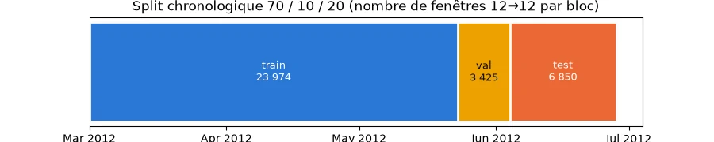

| Choix | Valeur | Pourquoi |
|---|---|---|
| Découpage | chronologique 70 / 10 / 20 | ne jamais apprendre sur le futur |
| Normalisation | ajustée sur l'entraînement seulement | ne pas lire les statistiques du test |
| Zéros | exclus de la perte et des métriques | un zéro est une panne |
| Sélection | meilleure erreur de validation ; test lu une fois | pas d'optimisation implicite sur le test |
| Hyperparamètres | ceux des articles et de BasicTS, sans recherche | ne favoriser aucun des deux modèles |
| Graines | une seule (budget) | limite assumée, discutée plus bas |

L'erreur est **masquée** : on ne la calcule que là où une vraie mesure existe.

$$
\text{MAE} = \frac{\sum_{i} m_i\,|\hat y_i - y_i|}{\sum_i m_i}, \qquad m_i = \mathbb{1}[y_i \neq 0]
$$

Le masque \(m_i\) vaut 0 sur les pannes ; un test vérifie qu'une prédiction de 999 mph sur un trou
ne change rien. Je rapporte aussi le **RMSE**, qui pénalise davantage les grosses erreurs, et le
**MAPE**, l'erreur en pourcentage de la vitesse réelle. Les trois diront des choses différentes.

### Le plan d'expérience

Dix configurations, organisées pour que chaque comparaison isole une seule pièce :

| Famille | Configurations | Ce qu'elles mesurent |
|---|---|---|
| Sans apprentissage | moyenne historique (par capteur et créneau), persistance (la dernière valeur reste) | les bornes basses |
| STID | complet ; sans identité du capteur ; sans identités temporelles ; sans aucune identité | ce que vaut chaque identité |
| Graph WaveNet | route + appris ; route seule ; appris seul ; sans graphe | d'où vient le gain du graphe |

Sans graphe, Graph WaveNet devient un réseau temporel pur qui traite chaque capteur séparément :
c'est le contrôle qui dit si un gain vient du graphe ou seulement de l'architecture temporelle.

### Le critère de décision


Le graphe « gagne son pari » si **les deux** conditions tiennent :

1. Graph WaveNet bat STID d'au moins **3 % de MAE à 60 minutes** (environ 0,1 mph, au-delà du
   bruit entre graines rapporté par BasicTS) ;
2. et ce gain disparaît quand on retire le graphe.

Sinon, la recommandation par défaut est STID.


Pourquoi 60 minutes ? C'est l'horizon le plus utile pour planifier une tournée. On verra que ce
critère, raisonnable sur le papier, a pesé lourd.

### Trois contrôles de cohérence avant de comparer

Comparer deux modèles mal entraînés ne dit rien. Chaque brique a été vérifiée contre un chiffre
publié :

1. **La moyenne historique donne 4,19 de MAE**, contre 4,16 dans l'article DCRNN. Le découpage, le
   masque et la métrique sont alignés sur la littérature.
2. **STID donne 2,80 / 3,17 / 3,54** à 15, 30 et 60 minutes, contre environ 2,82 / 3,19 / 3,55
   dans BasicTS. L'implémentation est validée.
3. **Graph WaveNet donne 2,69 / 3,07 / 3,53**, exactement les chiffres de l'article original.

La comparaison porte donc sur deux modèles correctement entraînés. Les huit entraînements ont
pris environ trois heures sur une carte graphique d'ordinateur portable.

## 8. Les résultats : la moyenne d'abord

| Modèle (test) | 15 min | 30 min | 60 min | Moyenne sur 12 pas |
|---|---|---|---|---|
| Moyenne historique | 4,19 | 4,19 | 4,19 | 4,19 |
| Persistance | 3,71 | 4,61 | 6,14 | 4,67 |
| **STID** (sans graphe) | 2,80 | 3,17 | 3,54 | 3,11 |
| **Graph WaveNet** (route + appris) | **2,69** | **3,07** | **3,53** | **3,04** |

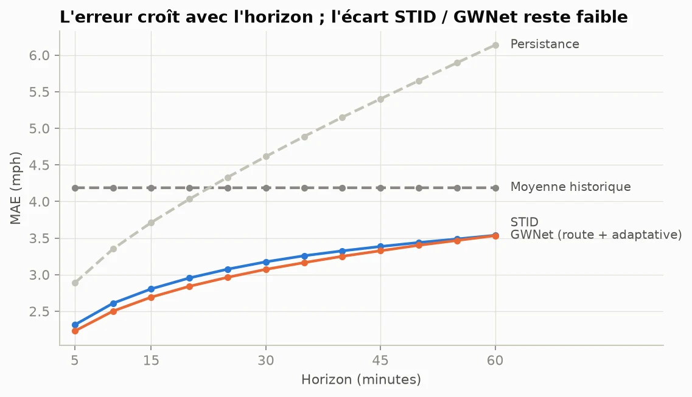

La **persistance** (« dans une heure, la vitesse de maintenant ») bat la **moyenne historique**
(« la vitesse habituelle de ce capteur à ce créneau ») jusqu'à une vingtaine de minutes. Les deux
modèles appris font nettement mieux que ces bornes, et leur écart se resserre jusqu'à disparaître :
**3,53 contre 3,54 à 60 minutes**.

. La ligne pointillée marque le seuil de 3 % du critère. Seule la version complète le dépasse, et seulement jusqu'à 30 minutes environ. Sans graphe, l'écart se creuse avec l'horizon.")

Le graphe aide **à court terme** : à 15 minutes, l'état des voisins est l'information la plus
fraîche. À 60 minutes, la mémoire statistique des identités rattrape le contexte spatial.

### Trois métriques, trois histoires

| Écart de Graph WaveNet sur STID | 15 min | 30 min | 60 min |
|---|---|---|---|
| MAE | −4,0 % | −3,2 % | **−0,1 %** |
| RMSE | −7,9 % | −7,1 % | −3,7 % |
| MAPE | −9,8 % | −11,1 % | **−10,8 %** |

Premier signal que la moyenne cache quelque chose : à 60 minutes, la MAE ne bouge pas, mais le
MAPE baisse de 11 %. Le MAPE **divise par la vitesse réelle** : une erreur de 10 mph pèse six fois
plus à 10 mph qu'à 60 mph. Il amplifie donc les erreurs commises **dans les bouchons**. Graph
WaveNet se trompe moins quand ça bouchonne, et un peu plus quand ça roule.

## 9. Les résultats : là où la moyenne ne regarde pas

### Par régime de trafic

J'ai classé chaque situation du test selon la dernière vitesse observée et la vitesse réelle une
heure plus tard, avec deux seuils (40 et 55 mph) ; les situations intermédiaires (16 % du test) ne
sont pas classées.

| Régime (MAE à 60 min, mph) | Part du test | Moyenne historique | STID | Graph WaveNet | Graph WaveNet sans graphe |
|---|---|---|---|---|---|
| Fluide stable | 70,9 % | 2,33 | **1,61** | 1,84 | 1,74 |
| Début de congestion | 2,4 % | 18,24 | 23,29 | **17,88** | 35,03 |
| Congestion installée | 8,3 % | 11,23 | 7,19 | **5,77** | 7,19 |
| Résorption | 2,5 % | **8,42** | 9,78 | 11,65 | 19,49 |

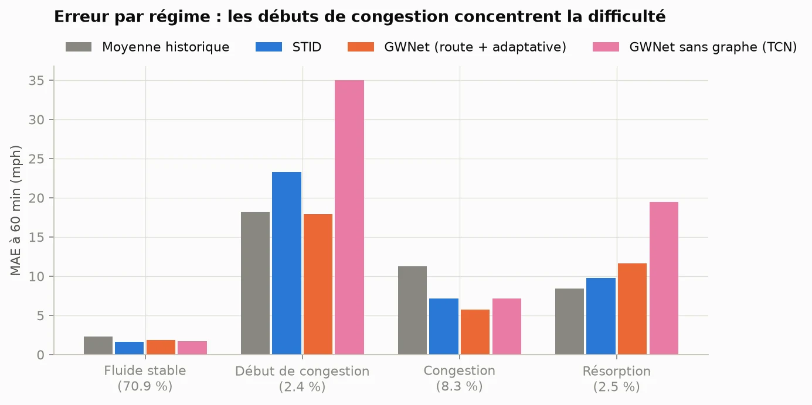

C'est, à mes yeux, le résultat le plus utile du projet :

- **Au début d'un bouchon** (2,4 % du test), STID se trompe de 23 mph, **plus que la moyenne
  historique** (18 mph) : il prédit que la route fluide le restera. Graph WaveNet, qui voit l'aval
  ralentir, descend à 17,9 mph.
- **En congestion installée** (8,3 %), Graph WaveNet fait 20 % d'erreur en moins.
- **En trafic fluide** (71 %) et **en résorption**, STID est meilleur : Graph WaveNet anticipe des
  ralentissements qui n'arrivent pas, ou tarde à voir la reprise.

La moyenne est dominée par le trafic fluide, où STID gagne. Le gain du graphe se cache dans les
situations rares.

### Un exemple

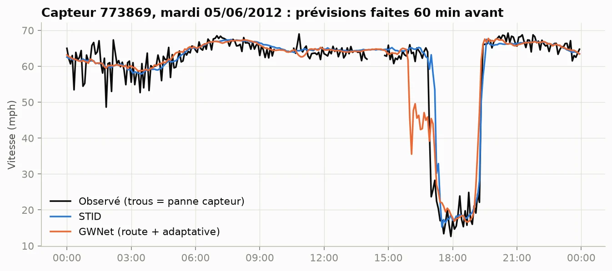

Le compromis en miniature : vers 17 h, la vitesse s'effondre de 65 à 20 mph. Graph WaveNet
(orange) anticipe la chute, mais déclenche aussi une **fausse alerte** vers 16 h. STID (bleu)
réagit plus tard, sans fausse alerte. Être prévenu tôt quitte à se tromper, ou rarement mais tard :
on ne choisit pas le même modèle.

### Par capteur et par heure

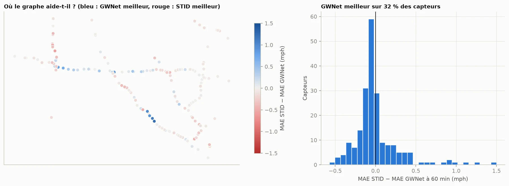

Graph WaveNet n'est meilleur que sur **32 % des capteurs** à 60 minutes, mais ses gains sont plus
gros que ses pertes, et ils forment des **segments contigus** sur la carte, cohérents avec un signal
qui se propage le long d'un tronçon. Que ce soit l'amont des bouchons reste une piste à vérifier.

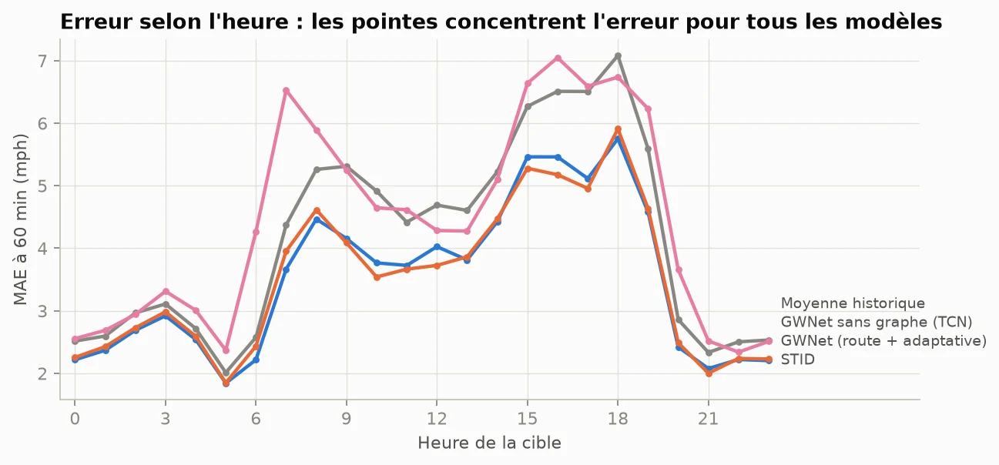

STID est meilleur au démarrage de la pointe du matin (7 h à 8 h), quand la congestion est
**récurrente**, donc portée par l'identité de l'heure. Graph WaveNet gagne entre 10 h et 12 h et
entre 15 h et 17 h. Mon hypothèse, non vérifiée : ces créneaux contiennent plus de congestions
**non récurrentes** (incidents), que seuls les voisins peuvent annoncer. Une identité ne connaît que
l'habitude.

## 10. Les ablations : d'où vient la performance ?

Une **ablation** retire une pièce d'un modèle et mesure ce qu'on perd : c'est ce qui permet de
savoir ce qui le fait marcher, plutôt que de le supposer.

### Retirer les identités de STID

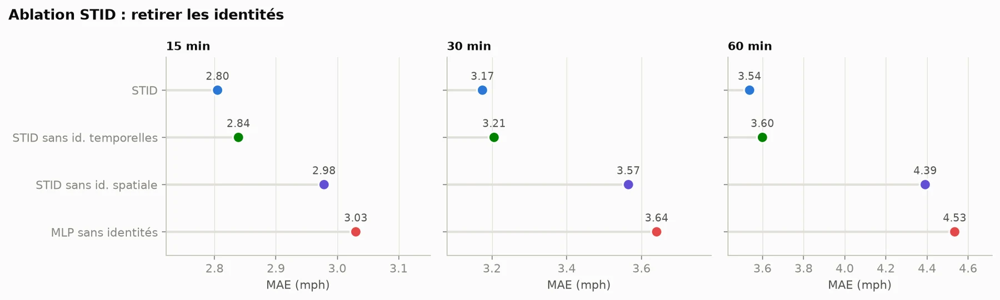

1. **L'identité du capteur est décisive** : sans elle, la MAE à 60 minutes passe de 3,54 à
   **4,39** (+24 %), la même hiérarchie que dans l'article STID.
2. **L'écart grandit avec l'horizon** (+6 % à 15 minutes) : à court terme la fenêtre récente
   suffit, à long terme il faut savoir **qui** l'on prévoit.
3. **Les identités temporelles apportent peu ici** (3,54 → 3,60), parce que l'entrée contient
   déjà l'heure et le jour en valeurs brutes, comme dans la configuration de référence. Je l'ai
   noté pour ne pas sur-interpréter ce chiffre.
4. **Sans aucune identité, le réseau fait moins bien que la moyenne historique** à 60 minutes
   (4,53 contre 4,19). Ce point m'a frappé : la moyenne historique, réputée naïve, est indexée par
   capteur et par créneau, et contient précisément l'information qui manque au réseau nu.

### Retirer le graphe de Graph WaveNet

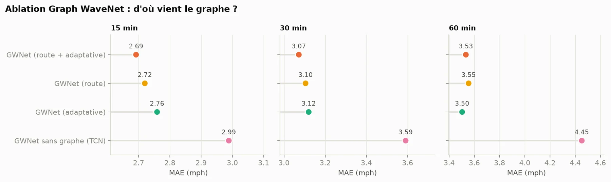

1. **Le graphe est indispensable à Graph WaveNet** : sans lui, 4,45 à 60 minutes (+26 %), car
   rien d'autre dans son architecture ne distingue les capteurs.
2. **Route ou graphe appris, peu importe à 60 minutes** (3,55, 3,50, 3,53 avec les deux) : des
   écarts qu'une graine de plus pourrait déplacer.
3. **À court terme, la route aide** : à 15 minutes, 2,72 contre 2,76 pour le graphe appris seul, et
   2,69 avec les deux. La carte réelle transporte l'information immédiate des voisins.

La seconde condition du critère est remplie (le gain vient du graphe), pas la première (il ne
dépasse pas STID).

### Deux leviers, même effet

Côte à côte, les deux ablations donnent un résultat que je n'attendais pas avec cette netteté.

 et avec (point plein). Les identités de STID et le graphe de Graph WaveNet réduisent l'erreur d'environ 22 %, mais le second coûte neuf fois plus de calcul par époque.")

| | Sans le levier | Avec | Gain | Secondes par époque |
|---|---|---|---|---|
| STID : identités | 4,53 | 3,54 | −22 % | 5,8 |
| Graph WaveNet : graphe | 4,45 | 3,53 | −21 % | 53,8 |

Les deux modèles « nus » sont aussi mauvais l'un que l'autre, les deux modèles complets aussi bons
l'un que l'autre. **Le graphe et les identités font le même travail** : distinguer les
échantillons. Le graphe y parvient indirectement, par le contexte des voisins ; l'identité
directement, par un vecteur appris. C'est la thèse de STID, et c'est ce que j'ai observé sur
METR-LA.

### Ce que STID a appris sans qu'on le lui dise

Que contiennent ces identités ? J'ai projeté les vecteurs appris sur leurs deux premières
composantes principales (une ACP résume 32 nombres en deux axes qui gardent le plus de variation).

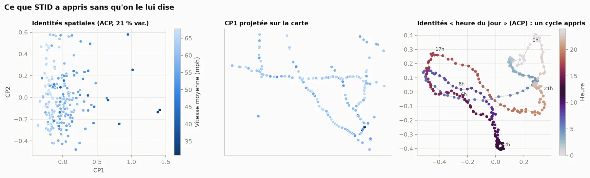

- **Capteurs** : la première composante est corrélée à la vitesse moyenne (−0,73), et les capteurs
  chroniquement congestionnés se regroupent sur les mêmes tronçons. STID a appris une **géographie
  fonctionnelle** du réseau sans jamais voir le graphe.
- **Créneaux horaires** : ils tracent une **boucle fermée**, de minuit à minuit, avec des
  inflexions aux pointes. Personne n'a dit au modèle que 23 h 55 précède 0 h 00 : il a redécouvert
  la périodicité du trafic.

### Le graphe appris ressemble-t-il à la route ?

Puisque le graphe appris fait aussi bien que la carte routière, on pourrait espérer qu'il la
**retrouve**, et s'en servir pour expliquer aux opérateurs quels tronçons s'influencent.

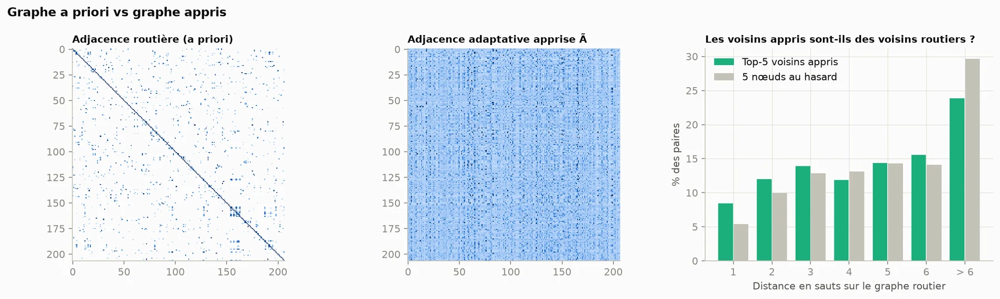

**Pas vraiment.**

- La matrice apprise est **dense et diffuse** : le poids maximal d'une ligne vaut 0,014 en
  médiane, à peine trois fois le poids uniforme (1/207 ≈ 0,005).
- Elle a une **structure en colonnes** : certains capteurs sont « écoutés » par presque tous les
  autres, comme un résumé de l'état général du réseau plutôt qu'une topologie.
- Parmi les 5 voisins les plus pondérés de chaque capteur, **20 %** sont à deux sauts routiers ou
  moins, contre **16 %** pour 5 capteurs tirés au hasard.

Une adjacence apprise est donc un **paramètre du modèle**, à versionner et surveiller comme tel,
pas une carte interprétable du réseau.

## 11. Le coût de la complexité

Reste la seconde moitié de la question : ce que le graphe coûte.

| Modèle | Paramètres | Secondes par époque | Minutes jusqu'au meilleur modèle | Latence, 1 situation | Latence, lot de 64 | Mémoire GPU | MAE 60 min |
|---|---|---|---|---|---|---|---|
| STID | 118 k | 5,8 | 8,3 | 0,17 ms | 0,59 ms | 44 Mo | 3,54 |
| Graph WaveNet | 301 k | 53,8 | 82,7 | 1,92 ms | 70,1 ms | 1 352 Mo | 3,53 |
| Rapport | × 2,5 | × 9 | × 10 | × 11 | **× 119** | × 30 | — |

.")

. STID atteint son plateau en quelques minutes ; Graph WaveNet continue de progresser lentement.")

- **Entraînement** : 8 minutes contre 83. Négligeable pour un réentraînement hebdomadaire, plus
  pour une recherche d'hyperparamètres ou un réentraînement par région sur des milliers de nœuds.
- **Inférence** : à 2 ms par situation, Graph WaveNet tient le temps réel, mais l'écart de
  **× 119** sur un lot fait coûter deux ordres de grandeur de plus au recalcul du réseau entier
  toutes les 5 minutes.
- **Passage à l'échelle** : le graphe appris est une matrice **dense** \(N \times N\). Sur
  5 000 nœuds, 25 millions de coefficients par couche, un coût qui croît comme le carré de \(N\).
  STID reste linéaire.

Deux entraînements partageaient la carte graphique : les temps absolus sont pessimistes, mais les
deux familles ont subi la même contention, et ce sont les **rapports** qui comptent. Ceux de
l'article STID (× 7 par époque, sur une autre machine) vont dans le même sens.

## 12. Le verdict, et ce que je changerais


**Selon le critère fixé avant les résultats :**

1. gain de MAE à 60 minutes : **0,1 %**, loin des 3 % demandés → condition non remplie ;
2. gain attribuable au graphe : sans graphe, Graph WaveNet perd 26 % → condition remplie.

**Décision : STID par défaut.** Graph WaveNet reste un challenger légitime si la métrique métier
valorise la congestion.


Je n'ai pas changé ce verdict, mais les résultats par régime m'ont montré où le protocole s'était
trompé. Fixer la métrique **avant** les résultats était juste : c'est ce qui empêche de choisir
après coup le chiffre qui arrange. Mais j'ai fixé une métrique **statistique** (l'erreur moyenne des
benchmarks) au lieu d'une métrique **métier**.

Pour un service de répartition, 20 mph d'erreur au début d'un bouchon coûtent un retard de
livraison ; 0,2 mph sur une autoroute fluide ne coûtent rien. Avec une erreur pondérée par le coût
d'un retard, **la conclusion s'inverserait**. Choisir la bonne métrique demandait d'interroger le
métier avant, pas les données après. Je consigne la leçon plutôt que de corriger le verdict ; la
prochaine itération testera ce critère pondéré sur des données neuves (PEMS-BAY), pour ne pas le
choisir en connaissant le résultat.

**Limites.**

- **Une seule graine** par configuration. Un écart de 0,1 % est dans le bruit. Les écarts de 4 % à
  15 minutes et de 20 % en congestion sont probablement robustes, mais ce n'est pas démontré.
- **Un seul réseau** de 207 capteurs, sur quatre mois de 2012.
- **Les identités temporelles** sont redondantes avec les canaux d'heure et de jour de l'entrée,
  ce qui sous-estime probablement leur apport propre.

## 13. Ce que j'en ferais sur un réseau logistique

Le dernier bloc transposait ces résultats à un opérateur logistique qui prévoit les temps de
parcours sur quelques milliers de nœuds (hubs, tronçons, zones de livraison), toutes les
5 minutes, pour un service de répartition au budget de latence serré.


flowchart LR
  S1["Télémétrie de la flotte<br/>et capteurs d'axes"] --> Q["Agrégation 5 min<br/>contrôles de plausibilité<br/>masque des manquants"]
  S3["Référentiel du réseau<br/>hubs, tronçons"] --> GB["Construction du graphe<br/>orienté, versionné"]
  Q --> T1["STID<br/>(champion)"]
  Q --> T2["Modèle à graphe<br/>(challenger)"]
  GB --> T2
  T1 --> AB{"Backtest glissant<br/>sur la métrique métier"}
  T2 --> AB
  AB --> B["Calcul par lot<br/>toutes les 5 min"]
  B --> C[("Cache des prévisions<br/>nœud × horizon")]
  C --> D["Répartition / ETA"]
  C --> M["Suivi : erreur par nœud<br/>contre la moyenne historique"]


Les choix qui découlent de ce que j'ai observé :

- **STID comme modèle par défaut**, toujours entraîné, parce qu'il fixe la barre en quelques
  minutes. Un modèle à graphe n'entre en production que s'il le bat **sur la métrique métier**,
  au-delà du bruit entre graines, avec une ablation qui attribue le gain au graphe.
- **La carte routière plutôt que le graphe appris**, quand un graphe est justifié : elle est
  explicable et reste valable pour un nœud nouveau.
- **Un calcul par lot toutes les 5 minutes**, servi depuis un cache : le service de répartition
  n'appelle jamais le modèle en direct, et c'est le coût de calcul global (où pèse le × 119) qui
  compte plus que la latence.
- **Les capteurs muets sont signalés, jamais prédits à zéro**, avec repli sur la moyenne historique
  du créneau au-delà d'une demi-heure de silence.
- **Le nouveau hub est le cas où le graphe redevient intéressant** : STID n'a pas d'identité pour
  un nœud jamais vu. Un modèle à graphe peut s'appuyer sur ses voisins routiers, un modèle de
  fondation peut servir en zero-shot jusqu'à ce qu'un modèle local le batte, et l'identité d'un
  nouveau nœud pourrait être initialisée par celles de ses voisins.

## 14. Ce que j'en retiens

Ces constats valent pour 207 capteurs autoroutiers, quatre mois d'historique, une graine par
configuration et les hyperparamètres des articles de référence.

1. **Un modèle sans graphe bien conçu place la barre haut** : STID atteint en 8 minutes le niveau
   d'un modèle à graphe entraîné en 83. Sans lui, j'aurais attribué au graphe un gain qui ne lui
   revient pas.
2. **Le graphe et les identités sont substituables en moyenne**, parce qu'ils résolvent le même
   problème : l'indistinguabilité des échantillons, le concept qui m'a le plus appris.
3. **Ils ne le sont pas dans les situations rares** : le graphe voit le bouchon arriver chez les
   voisins, l'identité ne connaît que l'habitude. Mesurer par régime a changé ma lecture.
4. **Le graphe appris fait aussi bien que la route, mais ne lui ressemble pas.**
5. **Fixer la métrique avant les résultats n'a pas suffi** : c'est le choix de la métrique, venue
   de l'habitude des benchmarks plutôt que du coût métier, qui a décidé du verdict.
6. **Le signal se teste avant le modèle** : la corrélation croisée sur les arêtes annonçait un gain
   modeste du graphe avant tout entraînement.


**Une question pour vérifier sa compréhension.** *Un STGNN obtient 5 % d'erreur en moins que STID
sur un nouveau réseau. Peut-on en conclure que le graphe est utile ?* Pas encore. Il manque
l'ablation : si le STGNN **sans graphe** fait aussi bien, le gain vient de son architecture
temporelle (section 10). Il manque le découpage par régime : 5 % gagnés en trafic fluide ne valent
pas 5 % gagnés au début des bouchons (section 9). Et il manque le coût (section 11).


## Reproduire et aller plus loin

Le code, les tests et les résultats sont dans le dépôt
[gwils28/spatio-temporal-forecasting](https://github.com/gwils28/spatio-temporal-forecasting)
(Python 3.12, versions verrouillées par `uv`) : 24 tests unitaires en moins d'une seconde, huit
entraînements en trois heures environ, et toutes les tables et figures générées depuis les
résultats versionnés dans `results/`. Les décisions prises avant le code sont dans `SPEC.md`, les
écarts au plan dans `docs/notes/implementation.md`. Le
[site du projet](https://gwils28.github.io/spatio-temporal-forecasting/) va plus loin : lecture
complète de DCRNN, fiches sur les modèles de fondation, notebook d'exploration et journal daté,
erreurs comprises.

Les suites ouvertes : trois graines sur STID et Graph WaveNet, le critère pondéré par régime testé
sur PEMS-BAY, et STID avec une identité de nœud initialisée par la topologie, pour les nouveaux
hubs.

**Sources**

- Li, Yu, Shahabi et Liu, [*Diffusion Convolutional Recurrent Neural Network: Data-Driven Traffic Forecasting*](https://arxiv.org/abs/1707.01926), ICLR 2018, et le [dépôt DCRNN](https://github.com/liyaguang/DCRNN) d'où viennent METR-LA et son graphe.
- Wu, Pan, Long, Jiang et Zhang, [*Graph WaveNet for Deep Spatial-Temporal Graph Modeling*](https://arxiv.org/abs/1906.00121), IJCAI 2019.
- Shao, Zhang, Wang, Wei et Xu, [*Spatial-Temporal Identity: A Simple yet Effective Baseline for Multivariate Time Series Forecasting*](https://arxiv.org/abs/2208.05233), CIKM 2022, et la boîte à outils [BasicTS](https://github.com/GestaltCogTeam/BasicTS).
- Liang et al., [*Foundation Models for Spatio-Temporal Data Science: A Tutorial and Survey*](https://arxiv.org/abs/2503.13502), arXiv, 2025.
- Chen, Wu, Chen, Zhou et Liang, [*UrbanFM: Scaling Urban Spatio-Temporal Foundation Models*](https://arxiv.org/abs/2602.20677), arXiv, février 2026.
