


What was the effect of a promotion, a price change, an announcement, on a series that could not be
randomised? The usual answer is a counterfactual: a forecast of what the series would have done
without the intervention. Building one by hand, what I mostly learned is what that forecast cannot
say on its own, and what placebo tests can check about it.


*Reading time: about 30 minutes. Every formula is followed by its intuition, so you can skim the
maths without losing the thread.*



This article distils **three weeks of hands-on research** into causal inference for time series,
announced at the end of [the article on retraining
frequency](). The starting plan had four blocks: two
recent papers to read at the source, a counterfactual to build and validate by placebo, an
architecture decision for a continuous incrementality measurement, and the founding paper by
Brodersen and colleagues to reread. Its success criterion: a real effect whose interval excludes
zero, a placebo effect whose interval contains zero. I met it, then looked for what it actually
guarantees, on a panel where the truth is known. Everything is reproducible in the
[time_series_causal_statistics](https://github.com/gwils28/time_series_causal_statistics)
repository.


**In short.** The main results, with their scope:

1. **The plan's criterion is met on a known truth and on Volkswagen**: −20.9% [−33.9%, −1.7%] on
   VW's share price after the EPA notice, twelve fake dates all clean.
2. **The placebo-in-time only validates the pre-intervention model.** On 100 panels where a
   control is contaminated by the intervention, it is green as often as on clean panels.
   Contamination needs the placebo-in-space; a relationship that breaks at the intervention date
   is seen by nothing.
3. **A placebo that "finds" an effect is partly a property of the placebo itself**: with a
   shortened pre period, it fires on 11 to 17% of clean panels, for a nominal 5%.
4. **Static estimators (OLS on the controls, convex synthetic control, difference-in-differences)
   are as accurate as the local level on the point estimate, and six to seven times too
   confident**: 80% false positives at zero effect.
5. **The Python port of Google's CausalImpact gives the same point estimates with intervals half as
   wide.** That is its default prior on the level standard deviation, not the data: on 30 panels
   with a known truth, it covers 77% of the time, against 90% by hand.


## 1. The problem: one unit, two worlds

The causal effect of an intervention on a unit at time \(t\) is the difference between what is
observed, \(y_t\), and what would have been observed without the intervention, \(y^0_t\). The
second quantity no longer exists once the intervention has happened: a counterfactual analysis is
therefore a **forecast** of \(y^0_t\) over the post period, and the effect is the gap between the
observed series and that forecast.

: its difference from the observed series (blue) is the true effect, here a 10% lift planted over 90 days. In practice only the blue curve exists.")

The whole point is to make that forecast credible and honest about its uncertainty. But a good
forecast is not a causal model. The counterfactual is built from **control series**: comparable
units, untouched, whose relationship with the treated unit, learned before the date, is
extrapolated after it. Three assumptions carry the result, and none of them is visible in the
quality of the pre-intervention fit:

| Assumption | What it means for one treated series | What tests it |
|---|---|---|
| the intervention date is "as good as random" given the past | no anticipation, no simultaneous event specific to the treated unit | **placebo-in-time**: a fake date inside the pre period must give an effect whose interval contains zero |
| the controls are not affected, directly or by spillover | no interference: the promotion on A does not cannibalise B, used as a control | **placebo-in-space**: each control treated as if it were the unit of interest, at the real date |
| the pre-period relationship persists | the coefficients linking controls and target still hold after the date | stability diagnostics on the pre period, and coverage on a panel with a known truth |

The protocol: fit a structural model on the pre period only, forecast the counterfactual with a
95% interval, then rerun the same analysis with a fake date placed inside the pre period. I
applied it on a semi-synthetic panel with a known truth, then on the Volkswagen dieselgate panel.

## 2. What the recent papers say

**Time-Aware Synthetic Control** (Rho, Illick, Narasipura, Abadie, Hsu and Misra,
[arXiv 2601.03099](https://arxiv.org/abs/2601.03099), January 2026). Classical synthetic control
treats the pre-period time indices as interchangeable; TASC encodes time through a linear Gaussian
state-space model learned by EM. It wins when observation noise is high and loses to robust
synthetic control when it is low. Two gaps with the plan: Alberto Abadie is the fourth of six
authors, not the lead signatory; and the "narrower intervals" than CausalImpact are a claim about
**width**, with no coverage reported anywhere. Part 9 measures what a narrow interval can cost.

**When are time series predictions causal?** (Carlson and Shephard,
[arXiv 2603.20394](https://arxiv.org/abs/2603.20394), March 2026). The conceptual paper. Its
central theorem fits in one sentence: **under a matching assignment condition, a difference of
predictions is a causal effect.** Without that condition, it is a difference of predictions. The
table in part 1 is my translation of that condition for a single treated series.

**Brodersen, Gallusser, Koehler, Remy and Scott (2015)**,
[*Inferring causal impact using Bayesian structural time-series models*](https://arxiv.org/abs/1506.00356),
Annals of Applied Statistics. A state space assembled block by block (local level, trend,
seasonality, regression on the controls), priors on the variances and coefficients, inferred by
Gibbs sampling; the predictive distribution is defined **jointly** over the post period so that
serial structure propagates into the cumulative effect. Three things served me: their simulation
study grades the method by two curves, power and coverage; their third analysis applies the model
to the **untreated regions** and demands a null result, which is the placebo-in-space; and their
three named assumptions: covariates unaffected by the intervention, a pre-period relationship that
persists, a model structure that stays intact. The plan quoted only the first.

## 3. The model: a local level and a regression on the controls

I built the model by hand with `statsmodels`, to know what is inside, and kept Google's port as a
cross-check (part 9). It is Brodersen's without its Bayesian layer:

$$
y_t = \mu_t + \beta' x_t + \varepsilon_t, \qquad \mu_{t+1} = \mu_t + \eta_t,
\qquad \varepsilon_t \sim \mathcal N(0, \sigma^2_\varepsilon),\ \eta_t \sim \mathcal N(0, \sigma^2_\eta).
$$

**The intuition.** The regression \(\beta' x_t\) explains the part the treated unit shares with
its controls; the level \(\mu_t\), a random walk, absorbs what the target does on its own. Both
variances are estimated by maximum likelihood on the pre period only; the counterfactual is the
Kalman-filter forecast over the post period, simulated as **joint** paths for the cumulative
effect's interval. Three models on the same panel:

| | static | local level | local trend |
|---|---|---|---|
| one-step RMSE (pre period) | 3.10 | 2.94 | 2.98 |
| one-step R² | 0.57 | 0.61 | 0.61 |
| Ljung-Box on the residuals (p) | **0.000** | 0.94 | 0.90 |
| estimated cumulative effect (truth 831) | 681 [617, 748] | 569 [207, 926] | 530 [120, 947] |

The residuals of the static regression are autocorrelated: a slow component remains, which the
local level absorbs. But the real difference is in the **forecast**: the static model assumes the
unexplained part is independent noise every day, the local level assumes it can wander.

 gives a narrow interval that misses the truth; the local level (centre) a wide interval that contains it; the local trend (right) a wider one still.")

The forecast variance of a static regression is constant. A local level adds a variance linear in
the horizon \(h\), hence an interval in \(\sqrt h\); a local linear trend adds a random slope and
the variance grows like \(h^3\). For the **cumulative** effect these powers go up by two.

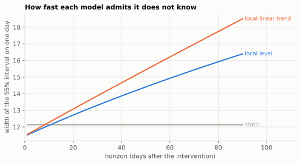

On this panel the static interval misses the truth and the local level's contains it. Which is
right is a matter of coverage, which part 5 measures over 100 panels.

**A second source of uncertainty.** The forecast at the maximum-likelihood estimate ignores that
the parameters are themselves estimates. CausalImpact integrates them out by MCMC; the cheap
frequentist counterpart is to draw them from the asymptotic normal of the MLE and mix the forecast
over those draws. With 365 pre-period days, the cumulative interval barely moves: [207, 926]
becomes [203, 914].

## 4. The protocol on a known truth

The panel: one treated unit and five controls, 365 days before the intervention and 90 after. All
units load on two latent factors (random walks) and a weekly pattern, with their own weights, plus
a small random-walk level of their own and observation noise. The controls are noisy proxies of
what drives the target, not copies. The planted effect is a 10% lift over the post period, 831
cumulative units, and the counterfactual \(y^0\) is kept so every estimator can be graded.

| | relative effect, 95% interval | cumulative effect | tail probability |
|---|---|---|---|
| real intervention (truth 10%, 831) | **+6.6% [+2.3%, +11.3%]** | 569 [207, 926] | 0.000 |
| placebo at day 243, data truncated at the real date | +0.3% [−5.3%, +6.7%] | 38 [−655, 742] | 0.461 |

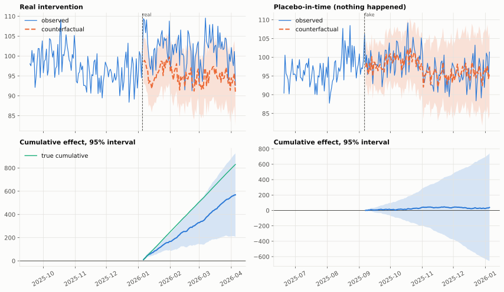

Both criteria are met: the real interval excludes zero and contains the truth, the placebo
interval contains zero. The placebo is computed on data **truncated at the real date**, so that no
treated data enters the analysis.

One panel proves the protocol runs, not that the method is good. Two extensions make the placebo
more informative:

- **The placebo-in-time as a sweep.** One fake date is one draw. Eight fake dates spread over the
  pre period give the distribution of "effects" the design produces when nothing happens: that is
  the yardstick for the real effect. Here, all eight intervals contain zero.
- **The placebo-in-space as a ranking.** Each control is treated in turn as the unit of interest,
  at the real date. The real unit ranks first of six by absolute effect.

 sits outside the cloud. Right: each unit treated as if it were the target; the real unit is the only one whose interval excludes zero.")

## 5. Is the 95% interval a 95% interval?

Two curves grade the method: the share of intervals that exclude zero by true effect (power, and at
zero effect the false-positive rate), and the share that contain the truth (coverage, which must
stay near 95%). I drew them over 100 panels per effect size, for the maximum-likelihood interval,
for the interval mixed over parameter draws, and for the placebo-in-time on the same panels. Since
the effect touches neither the pre period nor the controls, coverage, width and bias are the same
at every effect size; only detection moves.

| estimator | coverage | false positives at 0% | detection at 1% | 2% | 5% | 10% | mean width |
|---|---|---|---|---|---|---|---|
| local level, MLE interval | 0.92 | 0.08 | 0.10 | 0.15 | 0.51 | 0.94 | 874 |
| local level, 40 parameter draws | 0.93 | 0.07 | 0.07 | 0.13 | 0.47 | 0.92 | 912 |
| placebo-in-time on the same panels (243-day pre period, truth 0) | 0.89 | **0.11** | | | | | 1,321 |

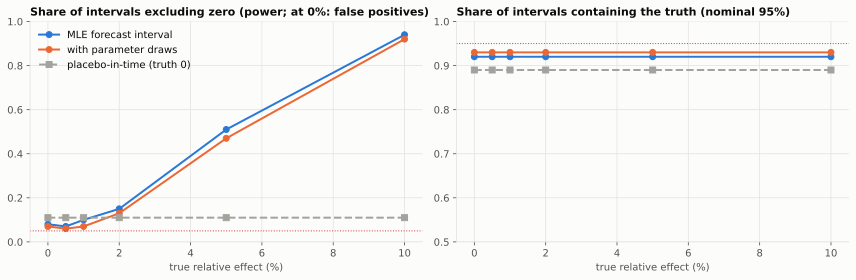

**Detection is modest.** A 1% lift is invisible, 5% is seen one time in two, 10% almost always,
with 90 post days. That is the order of magnitude of Brodersen's simulation.

**The placebo fires more often than 5%.** The placebo windows have a shorter pre period (243 days
instead of 365) and a less well calibrated interval: 11% false positives. One placebo in nine
therefore finds an effect on a perfectly valid design. Reading the **sweep** against its own
clean-panel rate is fairer than one date against a 5% threshold.

**The length of the pre period matters, because a variance needs more points than a mean.**
Coverage over 50 panels per cell, at a 5% effect:

| pre period (days) | 60 | 120 | 240 | 365 | 730 |
|---|---|---|---|---|---|
| local level, MLE | 0.72 | 0.84 | 0.92 | 0.88 | 0.92 |
| local level, parameter draws | 0.88 | 0.90 | 0.92 | 0.92 | 0.92 |
| OLS on the controls | 0.18 | 0.20 | 0.22 | 0.10 | 0.16 |

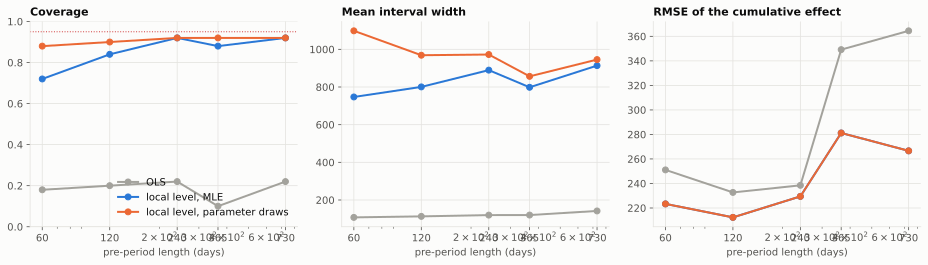

The parameter draws earn their keep on short pre periods, where the estimated level variance can
collapse to zero and hand back an overconfident static model. A prior corrects that too, and that
is one honest reason CausalImpact puts one on the level standard deviation. Part 9 shows the other
side of it.

## 6. Nine estimators on the same panels

Each estimator fits on the pre period and returns the cumulative effect with the interval a
practitioner would compute for it (iid errors for the simple ones). Same 100 panels, effects of 0
and 5%.

| estimator | coverage | false positives at 0% | detection at 5% | width | RMSE |
|---|---|---|---|---|---|
| pre-period mean | 0.10 | 0.90 | 0.88 | 262 | 954 |
| trend only (local trend, no controls) | 0.96 | 0.04 | 0.15 | 2,224 | 559 |
| difference-in-differences (mean of controls) | 0.12 | 0.88 | 0.90 | 148 | 400 |
| OLS on the controls, iid interval | 0.19 | 0.81 | 0.93 | 124 | 274 |
| convex synthetic control, iid interval | 0.17 | 0.83 | 0.91 | 142 | 335 |
| static regression in state-space form | 0.21 | 0.79 | 0.93 | 135 | 274 |
| **local level + regression (MLE)** | **0.94** | **0.06** | 0.57 | 886 | **227** |
| local level + regression, parameter draws | 0.95 | 0.05 | 0.53 | 938 | 227 |
| local trend + regression | 0.92 | 0.08 | 0.44 | 1,065 | 280 |

 or whose false-positive rate is above 10% (right). Only the models with a stochastic level, and the trend alone, pass both.")

- **OLS on the controls and the static state-space regression are the same estimator.** Point
  estimate nearly as accurate as the local level's (RMSE 274 against 227), interval six to seven
  times too narrow: **80% false positives at zero effect**. Four promotions out of five that did
  nothing would be declared effective. That is the measured version of the "overoptimistic
  inferences" Brodersen cites, after Bertrand, Duflo and Mullainathan.
- **The convex synthetic control is nearly unbiased but inherits the same iid interval.** The
  classical method knows this: it reports permutation ranks rather than intervals.
- **Difference-in-differences is worse on both counts**: the mean of the controls is a poor
  synthetic control when loadings differ across units.
- **Trend extrapolation without controls covers**, with an interval two and a half times wider,
  and detects a 5% lift one time in seven.
- **The local level is the only estimator with near-nominal coverage and false positives near
  5%.** The local trend pays for its extra component in width and power.

That table is, of these three weeks, the strongest argument for the placebo: the placebo-in-time
of an OLS design would fire four times out of five too.

## 7. When the design breaks: who catches what

The real deliverable is not the effect but the ability to say why a measurement is invalid. I
planted four violations one at a time, with a 5% lift, 100 panels per scenario:

- **cannibalised control**: the treated effect is subtracted, one for one, from controls c0 and c1
  (a promotion on A that eats the sales of B and C, used as controls);
- **halo on the controls**: the same amount is added to c0 and c1;
- **own trend**: the treated unit drifts by +0.1 per day on its own from day one (about 36% a year
  on a level of 100);
- **relation break**: the treated unit's loadings on the common factors change by +30% at the
  intervention date.

Four checks on each: the placebo-in-time, the placebo-in-space, a Chow test on differences between
the two halves of the pre period, and the bias against the truth, which one never knows in
practice. The "clean" row gives each check's false-alarm rate.

| scenario | coverage | relative bias | placebo-in-time fires | placebo-in-space flags c0 / c1 | flags a clean control | Chow rejects |
|---|---|---|---|---|---|---|
| clean | 0.89 | −0.5% | 0.17 | 0.10 / 0.08 | 0.24 | 0.15 |
| cannibalised control | 0.86 | **+26%** | 0.17 | **0.39 / 0.36** | 0.34 | 0.15 |
| halo on the controls | 0.82 | **−27%** | 0.17 | **0.38 / 0.45** | 0.31 | 0.15 |
| own trend | 0.69 | **+71%** | **0.39** | 0.10 / 0.08 | 0.24 | 0.15 |
| relation break | **0.56** | −11% | 0.17 | 0.10 / 0.08 | 0.24 | 0.15 |

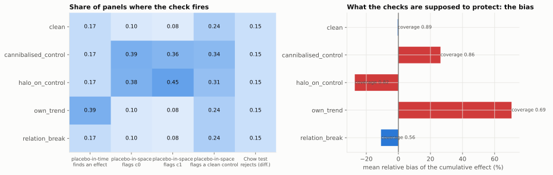

- **Cannibalised control and halo.** The bias is large (+26% and −27%), and yet **the
  placebo-in-time is exactly as often green as on clean panels**: the contamination starts at the
  intervention, nothing is wrong before. The placebo-in-space flags each contaminated control about
  four times more often than a clean one: power, but far from certainty. It also flags clean
  controls more often: a contaminated donor contaminates the placebos that use it.
- **Own trend.** The placebo-in-time fires in 39% of panels, more than twice its clean rate: a
  unit that drifts on its own produces "effects" at any date. The bias is +71%, because the local
  level forecasts flat and the drift continues.
- **Relation break.** Biased, under-covered, and **no check fires above its clean rate**. A
  relationship that stops holding at the intervention date is indistinguishable, in the data, from
  an effect of the intervention: the assumption is untestable by construction. The only defences
  are outside the data: a reason to believe the relationship persists, and the business
  reconciliation of part 10.

### Isolating a contaminated control

When the placebo-in-space flags several controls, one may be the culprit and the others its
victims. The procedure removes the worst one (the smallest tail probability), reruns the check on
the rest, and repeats until nothing is flagged.

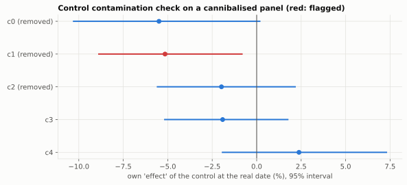

On this panel the isolation removes c1, then c0, then a clean control, c2. With all controls the
effect is estimated 20% too high; with the two kept ones it is covered but very imprecise. Removing
controls trades bias for variance, and with five donors the trade is a poor one. Hence the rule of
part 10: a pool of 10 to 20 donors chosen **before** the campaign among products that cannot
interact with the promoted one. The check is a guard, not a selection procedure.

## 8. A real case: Volkswagen, 18 September 2015

I took the public panel that the CausalImpact port uses as a test fixture: weekly closing prices of
Volkswagen, BMW and Allianz, 325 weeks from January 2011 to March 2017. The intervention is dated:
the US EPA's notice of violation against Volkswagen, on Friday 18 September 2015. Here no truth is
available, and every claim has to be defended by a placebo or a sensitivity analysis.

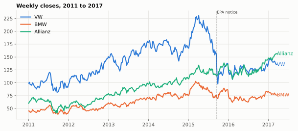

### The first thing to notice

The week of Sunday 20 September 2015 already contains the crash: VW loses 28%. The pre period
therefore ends on 13 September (246 weeks) and the post period starts on 20 September (79 weeks).
But **BMW falls in the same week** (−8%) while Allianz gains 1%: the whole sector was repriced
before recovering in October. If BMW reacted to the same event, it is not an untreated control.

### Is the pre-period relationship stable?

A rolling 52-week regression shows coefficients that wander: three share prices co-move through the
market factor, but the loadings are not a law. A Chow test between the two halves of the pre
period, computed on weekly **differences**, does not reject stability (p = 0.42). Stable enough to
try, not stable enough to skip the placebo.

### The effect, with BMW and Allianz as controls

| | value |
|---|---|
| average effect per week | −33.5 [−65.1, −2.1] |
| cumulative effect over 79 weeks | −2,650 [−5,140, −169] |
| **relative effect** | **−20.9% [−33.9%, −1.7%]** |
| tail probability | 0.018 |
| one-step fit on the pre period | R² 0.99, coverage 0.92, Ljung-Box p = 1.0 |
| coefficients | BMW 0.63, Allianz 0.30 |

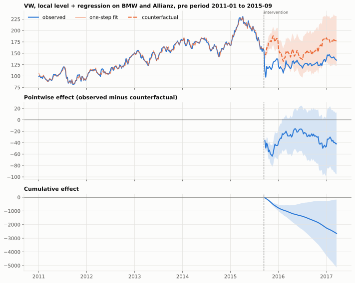

The interval excludes zero, but not by much, and it widens fast: 79 weeks is a long horizon for a
random-walk level. VW traded about a fifth below its counterfactual over the following eighteen
months. The one-step R² of 0.99 says nothing: one-step forecasts of a random walk are always
excellent. More telling: the residual spread after the date is 3.4 times the one before.

### The placebo-in-time, one year earlier

I pretend the intervention happened on 14 September 2014, on data that stops on 13 September 2015.
The estimated effect is indeed indistinguishable from zero: **+5.4% [−8.2%, +23.1%]**. Then the
sweep: twelve fake dates between February 2012 and March 2015, 26-week post windows.

 sits outside the cloud.")

All twelve intervals contain zero, the placebo estimates scatter between −7.6% and +9.0%, and the
real effect sits well outside that cloud. This is the (b) half of the criterion, the one that makes
the (a) half reportable. This placebo validates the pre-intervention model; it says nothing about
BMW, which was hit by nothing in the placebo windows.

### Were the controls themselves treated?

Brodersen's third analysis: each control as if it were the treated unit, with the other control as
its donor, at the real date.

| | own effect over 79 weeks | over the 14 weeks after the notice |
|---|---|---|
| BMW (counterfactual from Allianz) | −11.3% [−27.3%, +13.8%] | −1.5% [−10.5%, +9.6%] |
| Allianz (counterfactual from BMW) | +14.7% [−3.7%, +41.6%] | **+9.4% [+1.0%, +19.3%]** |

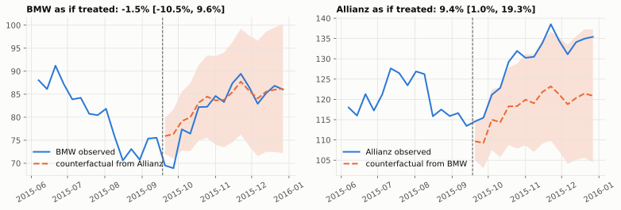

With two controls this check is a mirror: "BMW fell relative to Allianz" and "Allianz rose
relative to BMW" are the same fact. BMW lost 8% then recovered 12% within three weeks, Allianz did
not move: BMW is a doubtful control, at least in the short run. Rather than pick a verdict, I
reported the effect under each control set.

### Sensitivity: how much of the answer is a modelling choice?

| specification | relative effect | 95% interval | excludes zero |
|---|---|---|---|
| BMW + Allianz, local level (reference) | −20.9% | [−33.9, −1.7] | yes |
| Allianz only | −27.2% | [−41.8, −2.8] | yes |
| BMW only | −16.8% | [−31.5, +5.9] | no |
| no control, local linear trend | −22.9% | [−45.0, +27.2] | no |
| BMW + Allianz, static regression | −30.1% | [−31.0, −29.1] | yes |
| BMW + Allianz, local linear trend | −19.7% | [−35.1, +4.4] | no |
| BMW + Allianz, log prices | −4.3% | [−8.4, +0.2] | no |
| BMW + Allianz, pre period from 2013 | −21.5% | [−34.9, −1.2] | yes |
| BMW + Allianz, pre period from 2014 | −21.4% | [−34.6, −1.5] | yes |

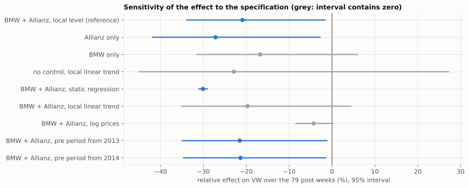

Every specification in prices with a control puts the estimate between about −15% and −30%, and
the sign never flips. What moves is the interval: the static regression is narrow with a confidence
part 6 showed to be unearned, the local linear trend too uncertain at 79 weeks to conclude, BMW
alone not significant. The defensible report is a **range from −17% to −27%**, with the control-set
question flagged.

### Does the model use time order at all?

A cheap check, after TASC: shuffle the pre-period rows and refit. A static regression gives the
same answer; a model with a stochastic level does not, because a shuffled random walk is no longer
one and the level variance collapses.

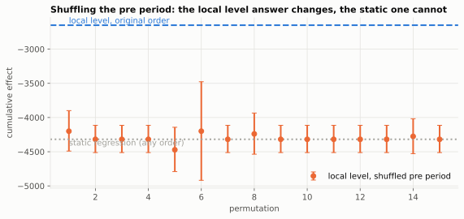

Over 20 permutations, the local level's cumulative effect converges to the static answer and its
narrow interval (width 518 against 4,971 in the original order). The local level's wider interval
is the price of serial dependence; the static regression's narrow interval is what one gets by
pretending the weeks are exchangeable.

## 9. Comparison with Google's CausalImpact

The hand-built model is a frequentist cousin of CausalImpact: same state space, maximum
likelihood instead of priors and MCMC. I ran `tfcausalimpact`, the TensorFlow Probability port, on
the Volkswagen panel and on synthetic panels.

| case | method | cumulative effect, 95% interval | width |
|---|---|---|---|
| VW, BMW + Allianz | hand-built, MLE | −2,650 [−5,140, −169] | 4,971 |
| | tfcausalimpact, default prior on the level sd (0.01) | −3,355 [−4,427, −2,233] | **2,193** |
| | tfcausalimpact, prior at 0.1 | −2,878 [−5,212, −428] | 4,784 |

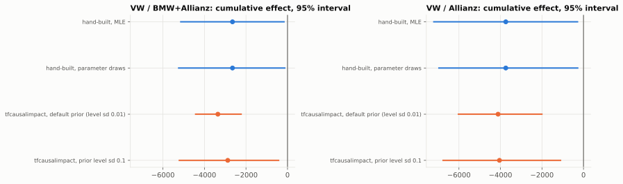

Same data, same state space, point estimates each inside the other's interval, and an interval
half as wide. CausalImpact's default prior on the level standard deviation is 0.01, in units of
the standardised series; maximum likelihood gives 0.085 here, eight times larger. A tight prior
keeps the level nearly deterministic, which forecasts 79 weeks ahead with a nearly constant
variance. Loosening it to 0.1 opens the interval up to the hand-built one. **The narrow interval
was the prior, not the data.** This is not a flaw of either implementation, but the interval width
on a real case is a modelling choice, to be reported as such. On a known truth one can ask who
covers:

| 30 panels, 5% lift | coverage | detection | mean width | RMSE | seconds per fit |
|---|---|---|---|---|---|
| hand-built, MLE | **0.90** | 0.53 | 887 | 219 | 0.1 |
| tfcausalimpact, default prior | 0.77 | 0.80 | 494 | 262 | 15.7 |

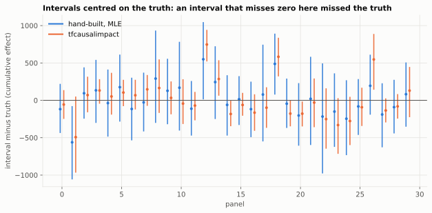

The default prior buys an interval 45% narrower and a higher detection rate at the price of
coverage: 77% against 90%. It is a reasonable default for the daily marketing series the method
was built for, and a poor default for a series with a large own random walk, such as a share
price. A placebo sweep would reveal it: its false-positive rate would sit well above 5%.

Neither "narrow" nor "Bayesian" is a synonym for "calibrated". Coverage on a known truth, or a
placebo sweep on real data, are the only evidence I found, and that brings me back to TASC's
"narrower" intervals. One practical point, finally: 0.1 seconds per fit against 12 to 16, which
matters for sweeps and Monte Carlo studies.

## 10. Measuring promotion incrementality continuously

The plan's third block was an architecture decision, with no code: a promotion engine runs
campaigns on products in stores, and for each campaign one wants the causal effect on sales by
counterfactual, because the business will not accept a holdout for every promotion. Three points
decide whether the number is worth anything.

**Selection and integrity of the controls.** With part of the lift cannibalised from a product
used as a control, the effect is overestimated by a quarter and the placebo-in-time stays green in
83% of cases. Before the campaign, candidate controls therefore come from a **registry of eligible
donors** built from the product graph: same store cluster and seasonality as the target, but a
different category and no substitution edge, whatever the quality of the fit, because the
best-fitting control is often the closest substitute. The pool holds 10 to 20 donors, to afford
losing some. After the campaign, the placebo-in-space with leave-one-out isolation flags the donors
that moved: a negative own effect is a cannibalisation, a positive one a halo, and the effect is
reported on the kept pool.

**Monitoring the causal assumption over time.** The counterfactual is unobservable. Four
substitutes, each tied to a failure mode the panel reproduces:

| Signal | What it guards | Rule |
|---|---|---|
| pre-period fit of the deployed model (one-step R², Ljung-Box, coverage of the one-step interval), per campaign | the model is the right size for the series | one-step coverage outside [0.90, 0.98] or Ljung-Box p < 0.01 blocks the report |
| rolling placebo-in-time on **never-treated** products, same model, same lengths, every week | the calibration of the design where the truth is zero | share of placebo intervals excluding zero over the last 50 runs above 10% (the panel measured 11% on short pre periods) raises an alert; the clean-panel rate is the baseline |
| placebo-in-space on every campaign | interference | any isolation round beyond the first on a target triggers a review |
| stability of the donor-target relationship: Chow on differences, drift of the coefficients between successive campaigns of the same target | the relationship that is extrapolated | p < 0.01 or a sign change of a coefficient blocks the donor |

What this monitoring cannot see, and the dashboard says so: a relationship that breaks at the
campaign date. Only the third point catches it.

**The business guard-rail.** The estimated effect is a forecast residual. It is tied to money
through a quantity observed later: the **realised incremental margin**, reconciled every month
against the sum of estimated counterfactual and incremental margins. The reconciliation gap is a
time series: its level is noisy, its **drift** is the alarm. A gap that grows in one direction for
three months means the counterfactuals are systematically off, and that is what a relation break
that nothing else sees looks like from outside. Two more anchors: an occasional real holdout on a
small share of campaigns, compared with the counterfactual effect; and the sum of effects within a
category, which cannot exceed its observed growth for long. As long as the gap has not been closed
for a product family, the effect that goes into a decision is the lower bound of the interval.

## 11. What I take away

These observations hold for the setups studied here: a semi-synthetic panel with five controls and
90 post days, and a panel of three share prices.

1. **The counterfactual is a forecast, and its uncertainty is the model's belief about what the
   unexplained part does over time.** On these panels only a level that can wander gives a 95%
   interval that covers at 95%.
2. **Static estimators are accurate and overconfident**: 80% false positives at zero effect. That
   is the strongest argument for not skipping the placebo.
3. **The placebo-in-time validates the pre-intervention model, and nothing that starts at the
   intervention date.** It is blind to a contaminated control and to a relation break.
4. **The placebo-in-space is the check for interference**, with modest power and a necessary
   leave-one-out isolation, because a contaminated donor flags its neighbours.
5. **A relationship that breaks at the intervention date is seen by no data-only check.** Control
   selection before, business reconciliation after: that is the only treatment I found.
6. **A placebo that fires does not necessarily invalidate the design.** I now read a sweep against
   its clean rate, not one date against 5%.
7. **On Volkswagen, the effect of the EPA notice is −17% to −27% over 79 weeks, depending on the
   control set**, placebo clean at twelve fake dates, BMW flagged as a doubtful control.
8. **The interval width on a real case is a modelling choice.** CausalImpact's default prior gives
   an interval half as wide, which covers 77% instead of 90%.

**Open questions.** I did not implement TASC, nor measure its coverage. A ramp and a pulse remain
to be studied in place of the step-shaped effect, and the placebo-in-space was measured for a
single contamination size. The monitoring of part 10 is a line of reasoning, not a production
system.


**A question to check your understanding.** *A promotion on product A is measured by
counterfactual with, as controls, three products from the same aisle chosen for the quality of
their pre-period fit. The effect is +12% [+4%, +20%], and the placebo-in-time at three fake dates
is clean. What is that number worth?* The placebo-in-time only tests the pre period, where the
controls were contaminated by nothing (part 7). If the promotion took sales from the same aisle,
the counterfactual is pulled down and the effect overestimated without any placebo-in-time seeing
it. What is needed is the placebo-in-space on each of the three controls, and a reason for having
chosen them other than their fit.


## Reproduce and go further

The code, the five notebooks and the 22 tests are in the
[gwils28/time_series_causal_statistics](https://github.com/gwils28/time_series_causal_statistics)
repository (Python 3.13, versions locked with `uv`). Every table in this article comes out of a
`cts synth`, `cts vw`, `cts study all` or `cts tfci` command, with fixed seeds; the Monte Carlo
studies take about fifteen minutes and the cross-check about ten.

**Sources**

- Brodersen, Gallusser, Koehler, Remy and Scott, [*Inferring causal impact using Bayesian structural time-series models*](https://arxiv.org/abs/1506.00356), The Annals of Applied Statistics, 9(1), 2015, and the [CausalImpact](https://google.github.io/CausalImpact/) implementation.
- Rho, Illick, Narasipura, Abadie, Hsu and Misra, [*Time-Aware Synthetic Control*](https://arxiv.org/abs/2601.03099), arXiv, January 2026.
- Carlson and Shephard, [*When are time series predictions causal? The potential system and dynamic causal effects*](https://arxiv.org/abs/2603.20394), arXiv, March 2026.
- [tfcausalimpact](https://github.com/WillianFuks/tfcausalimpact), Python port of CausalImpact on TensorFlow Probability, and its test fixture for the Volkswagen panel.
