


A forecasting model does not break down: it drifts. It keeps producing plausible numbers while the
world changes, and nobody notices until the ground truth arrives. When that takes two months, what
can we know about the model's health in the meantime, and at what point does that measurement start
to lie?


*Reading time: about 40 minutes, the longest post on the blog. Each section stands on its own; the
boxes and tables are enough for a first pass. The repository and its figures are in French; each
caption explains what the figure shows.*



This post distils **two months of hands-on research** (2 July to 2 September 2026, 670 commits)
into the **observability** of a forecasting model: monitoring its health once in production.
Starting from a one-hour plan (read NannyML and a recent paper, run a model through COVID, sketch an
architecture), the project grew into a full case: ten experiments, a demonstration production setup
and a version 1.0. Everything is reproducible in the
[zonefleet-observability](https://github.com/gwils28/zonefleet-observability) repository, where the
figures come from; its [documentation site](https://gwils28.github.io/zonefleet-observability/) (in
French) details every point.


**In short.** A taxi demand forecaster by zone and by hour, frozen, watched without labels:

1. **Performance estimated without labels (NannyML DLE) tracks the real error when the inputs
   shift** (*covariate shift*, tracking rate 0.85 to 0.99) **and sees nothing when the relationship
   between inputs and demand changes** (*concept drift*, 0.00). This is the central result.
2. **On COVID, the monitor detects the shock in 9 days without a label**, against 62 with labels,
   but underestimates its size by a factor of 2.7.
3. **Alerting on input drift alone is untenable**: 177 days on alert out of 177 after the
   congestion charge, for a model that did not degrade.
4. **The joint condition "cleaned drift AND rising estimated loss"** catches 51 % of harmful drifts
   with a 3-day median delay, **without a single false alarm** across 240 scenarios and three calm
   periods.
5. **Retraining as soon as the alert fires does worse than doing nothing** over the COVID year.
6. **A data bug is invisible to the model monitor**; simple quality checks see it on day one.
7. **The main lever is not in monitoring**: getting labels in two days instead of sixty.


## 1. The problem: a model that ages silently

### A fictional client, real data

The setting is an invented client case: **ZoneFleet**, a mobility operator that forecasts **hourly
ride demand by zone** to position its fleet the day before. Its model is degrading without anyone
noticing, because nobody monitors it. The request is not "a better model" but **full
observability**: knowing when the model is unwell, why, and what to do.

The data is real: yellow and green taxi trips published by New York's Taxi & Limousine Commission
(TLC), over 2019-2021 and 2024-2025. It contains two very different breaks: **COVID** (March 2020),
a global collapse, and the **congestion pricing** of 5 January 2025, a charge for entering southern
Manhattan.

### The three clocks of a forecast

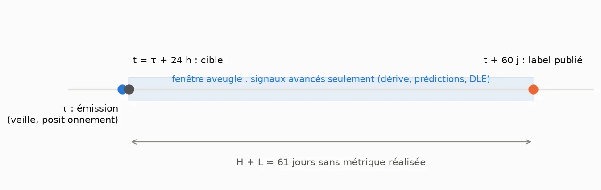

| Clock | Notation | At ZoneFleet | What is known |
|---|---|---|---|
| Issue | \(\tau\) | the day before, when positioning the fleet | the inputs: history, calendar, weather |
| Target | \(t = \tau + H\) | the forecast hour, **H = 24 h** | demand happens, nobody measures it yet |
| Label | \(t + L\) | TLC publication, **L ≈ 60 days** | the ground truth |

The **label** is the real value the model was trying to forecast. Between issue and label lies a
**blind window** of about 61 days with no computable error metric. Everything we know about the model
then comes from what it **sees** (its inputs) and what it **says** (its predictions). Three practical
consequences:

1. **No input looks closer than 24 hours.** A 1-hour "lag" (the demand of a past hour used as an
   input) gives excellent backtests and an unusable model; the code rejects it.
2. **A detection delay is measured on the decision clock**: each alert is dated by the day it could
   have been raised, not the day it concerns.
3. **The reference must be out of sample.** If the comparison period was used for training, the
   model is too good there and the monitor sees a "degradation" from day one. Each experiment
   therefore splits three periods:

| Experiment | Training | Reference | Analysis |
|---|---|---|---|
| E1, COVID | Jan-Aug 2019 | Sep-Dec 2019 | Jan-Jun 2020 |
| E2, congestion | Jan-Aug 2024 | Sep-Dec 2024 | Jan-Jun 2025 |

The protocol asks three questions: can we measure the model's health **during the blind window**?
**Where does that measurement lie?** (hypothesis: it tracks the error when the inputs shift, and
breaks down when the relationship changes); and which **alerting policy** gives the best trade-off
between detections, delay and false alarms?

## 2. What the sources say

**NannyML** is an open-source post-deployment monitoring library. For regression, its flagship
method, **DLE** (*Direct Loss Estimation*), estimates a model's error without ground truth: if the
model errs more in some regions of the inputs, a second model, the *nanny model*, can **learn where
it goes wrong**, then predict its error where labels are missing. The documentation sets four
conditions:

| # | Assumption | If it fails |
|---|---|---|
| 1 | **No concept drift**: stable input-target relationship | the learned error map is no longer right |
| 2 | No shift towards **never-seen** regions | the nanny model extrapolates |
| 3 | Error **uneven** across regions | any estimated variation is noise |
| 4 | Enough observations per period | alerts become random |

The project turns assumption 1 into an **experimental question**.

**DriftGuard** (Alam, Rahman and Sadeqa, [arXiv:2601.08928](https://arxiv.org/abs/2601.08928),
2026) has four drift detectors vote in supply chain forecasting (97.8 % reported recall, 4.2 days of
latency). Hidden assumption: **three detectors out of four work on residuals, so on labels**, which
arrive the same evening for Walmart sales but would be silent for ZoneFleet's whole blind window. I
kept its methodological contribution: **a recall only makes sense together with a delay and a false
alarm rate**. The reading also noted a few numerical inconsistencies in the text and no published
code.

**Sculley et al.** ([NeurIPS 2015](https://proceedings.neurips.cc/paper/2015/hash/86df7dcfd896fcaf2674f757a2463eba-Abstract.html)),
the founding paper of MLOps, read again as an observability checklist:

| Recommendation (2015) | Translation in the project |
|---|---|
| No fixed thresholds in a dynamic system | thresholds derived from the reference, recomputed with each new model |
| *Prediction bias* | prediction drift, realised bias by zone |
| *Action limits* | fleet moves capped by zone and by hour |
| *Up-stream producers* | data contract, quality checks |
| Feedback loops | the model positions the fleet, the fleet makes the rides, the rides become its labels |

## 3. The approach: a frozen protocol and figures that regenerate

Before any code, I fixed the protocol in `SPEC.md` (2 July), with one rule: **it is not changed to
accommodate a result**, like a clinical trial pre-registration. It has not moved since. Five rules
shaped the project more than any technical choice:

1. **Frozen protocol**; every deviation dated and justified in `docs/notes/implementation.md`.
2. **An experiment is declared before it runs**: each extension has an issue with the question, the
   measurement and **"what would be a surprise"**. A signal added afterwards is labelled as such.
3. **No figure typed by hand**: tables and figures generated from `results/`; a register recomputes
   the 33 figures quoted in the prose, and CI fails if a sentence is stale.
4. **Mechanical safeguards**: a hook protects the raw data, CI refuses a red test, a dead link or an
   image without alt text.
5. **Unexpected results are published as they are.**

Rule 2 proved useful: the issue for E4 quater (section 12) anticipated that a seasonal signal would
raise false alarms. It did, and the prior declaration stopped me from tuning the signal until the
problem went away. A method is also judged by what it catches:

| Problem | How it was found | Fix |
|---|---|---|
| Season inputs extrapolated outside training | abnormally high reference error | removed, MAE 29.5 → 22.7 |
| Daily PSI on a 7-day rolling mean | 73 % of days on alert with no shift | artefact documented |
| 100 % recall for an alarm always on | inconsistent delay | detection on the "rising edge" |
| E3 measured as before / after | non-zero effect without drift | comparison with a counterfactual |
| Morning report reading labels "from the future" | rereading an example | label clock |
| 53 images without alt text, failed render hidden in CI | check of the rendered site | CI that really fails |

Checked in a clean container: more than 160 tests pass, and `make release-check` regenerates every
figure and table with no difference at all.

## 4. The data: from 120 files to a zone × hour panel

The sources: 120 monthly TLC Parquet files (3.6 GB, one row per ride, yellow and green taxis,
ride-hailing excluded), the table of 263 zones, Open-Meteo hourly weather at Times Square (the
**observed** weather is used as the forecast, an assumption lifted in E9) and the US calendar.

. In April 2020, volume falls to 3.9 % of February's; no visible drop after the 2025 congestion charge.")

COVID divides rides by twenty-five; the congestion charge leaves no trace at city level. If it moves
demand, it does so between zones and between hours.

### A data contract, the monitor's first sensor

Before the model, it is often the **data** that changes shape. Each file is validated against a
versioned **data contract**: **required** columns (blocking), **known, dated breaks**
(`cbd_congestion_fee` from 2025, accepted only after its date), and **everything else**, logged as an
unknown break. Only the schema is read: 120 files in under a second.

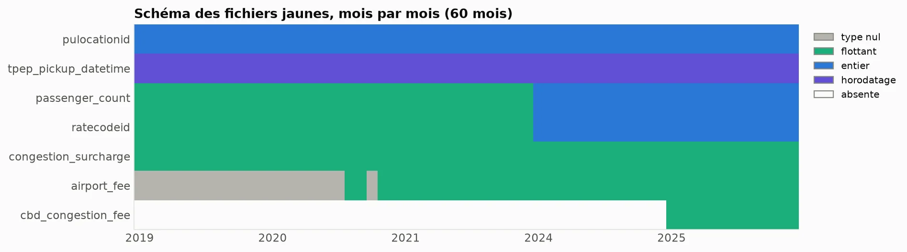

None of these breaks affects this pipeline, but one using the total fare would have seen its
variable change meaning on 5 January 2025, without a single line of code changing.

### The panel

Rides are aggregated with duckdb into a **panel**: pickups per zone and per local hour. **60 frozen
zones** (the busiest in 2019, 93 % of rides: recomputing them would change the monitored object at
the same time as the world), explicit zeros, and repaired daylight-saving hours (2 am missing in
spring, 1 am doubled in autumn). Result: 2.6 million rows, 10 MB, versioned.

; in green, the 28 others.")

Membership of the CBD (*central business district*, the charged zone) is read from the data: the
share of 2025 rides paying the charge is close to 1 for an inner zone.

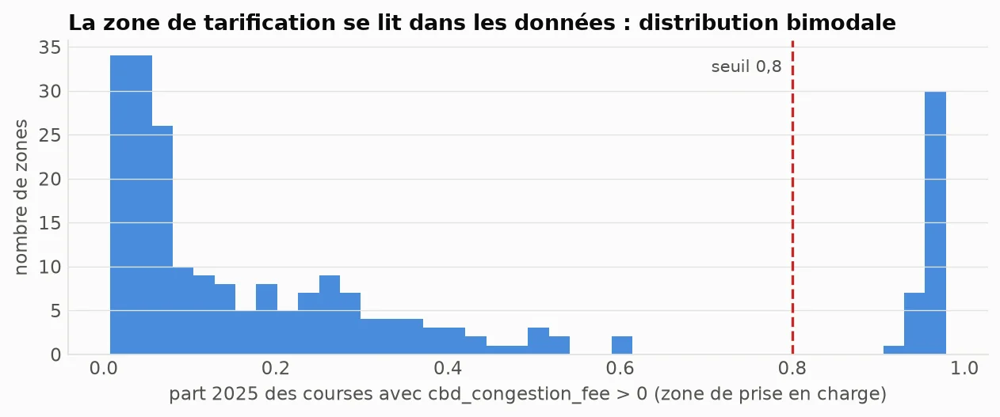

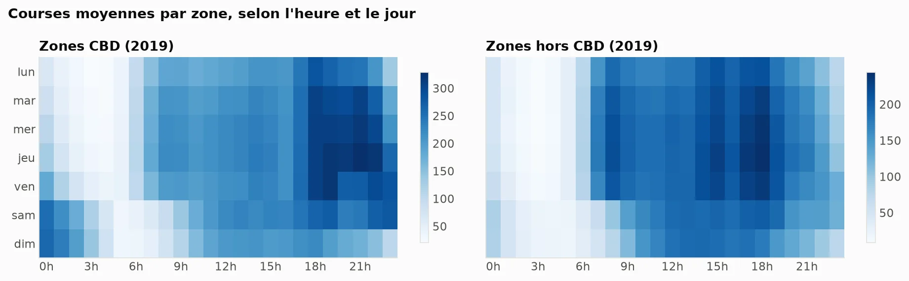

Levels span two orders of magnitude (20 to more than 300 rides an hour), hence a `log1p` target (the
logarithm of 1 + the value) and a **global model** with the zone as a categorical variable: a single
object to monitor.

## 5. The monitored model (E0)

The project is not after the best forecaster but a **realistic** one, to watch it age: a global
LightGBM, the de facto standard for tabular demand forecasting, with lags from 24 to 336 hours, two
rolling means, calendar, weather and zone (15 inputs). Three quantile models give a central forecast
(q50) and a [q10, q90] interval meant to cover 80 % of cases. Once trained, the model is **frozen**:
it becomes the observed object.

The first model included the season (day of year). Trained from January to August, it saw on the
reference values it had **never encountered**:

| Variant (E1 reference) | MAE | 80 % interval coverage |
|---|---|---|
| with season | 29.5 | 58 % |
| **without** (kept) | **22.7** | **72 %** |

A first encounter with the project's subject: an input that encodes absolute time **always drifts**
between training and production, without the world having changed.

| Experiment | Period | Model | MAE | sMAPE (%) | 80 % cov. |
|---|---|---|---|---|---|
| E1 (2019-2020) | reference | LightGBM | 22.7 | 20.5 | 71.5 |
| E1 (2019-2020) | reference | seasonal naive | 31.1 | 26.5 | - |
| E1 (2019-2020) | analysis (COVID) | LightGBM | 14.0 | 61.6 | 56.7 |
| E2 (2024-2025) | reference | LightGBM | 14.9 | 33.5 | 71.8 |
| E2 (2024-2025) | reference | seasonal naive | 19.7 | 40.5 | - |
| E2 (2024-2025) | analysis (congestion) | LightGBM | 14.3 | 30.0 | 75.2 |

LightGBM beats the *seasonal naive* (the demand of the same hour a week earlier) by 24 to 27 %, and
MSTL on eight tested zones. One row should catch the eye: **during COVID, the MAE goes down** while
the relative error (sMAPE) triples. It is a central trap (section 6).

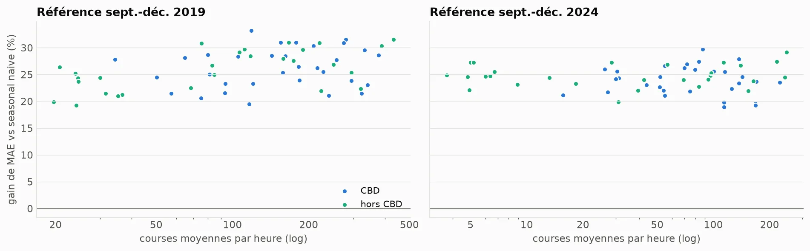

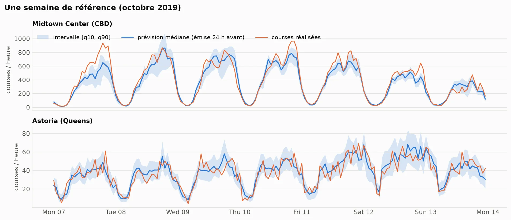

 accounts for more than half.")

The weight of the weekly lag shapes everything that follows: after a shock, the model only catches up
with the new regime a week later, once `lag_168` has seen it. Until then, it is wrong for a reason its
inputs do not show.

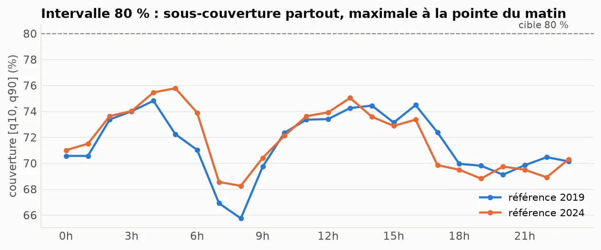

The interval is too narrow (72 % instead of 80 %). The flaw is documented rather than fixed, and
realised coverage becomes a health indicator, compared with **its** reference value.

## 6. The monitoring tools, and their blind spots

### Two ways for the world to change

A model learns a relationship between inputs \(X\) and a target \(y\), whose joint distribution
splits into \(P(X, y) = P(y \mid X)\,P(X)\). Each term can move on its own.

; right, the relationship changes with identical inputs (concept drift).")

| Drift | What changes | Trace in the inputs? | Example |
|---|---|---|---|
| **Covariate shift** | \(P(X)\), relationship stable | **yes** | heatwave, unseen season |
| **Concept drift** | \(P(y \mid X)\) | **no**, if pure | same hour, weather and history, but a charge lowers demand |

Without labels, a covariate shift is detectable and its impact can be estimated; a **pure concept
drift** is invisible until the labels arrive.

**The case of lag models** is the subtlety that taught me the most: the boundary between the two
**moves over time**. On the day of the shock, demand collapses but the lags still describe the world
before: from the model's point of view, it is a pure concept drift. Over the next two weeks, the lags
switch and the inputs leave the known. After that, the problem looks like a covariate shift. In other
words: **for a lag forecaster, every abrupt shock starts as a concept drift**.

### DLE, the estimated error

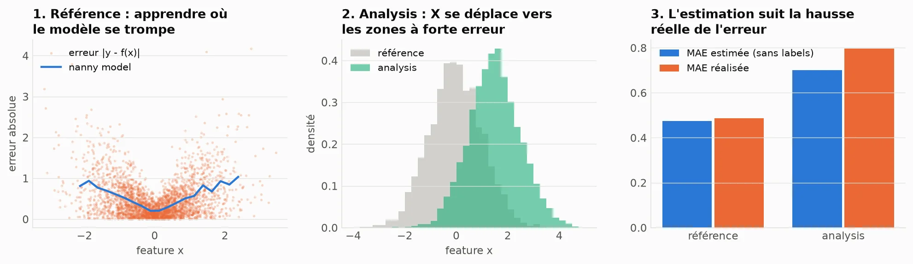

On the reference \(R\), the nanny model \(\hat g\) learns the loss \(\ell\) of each row from its
inputs and the frozen model's prediction \(f\); on a day \(C\) without labels (60 zones × 24 hours =
1,440 rows), the predicted losses are averaged:

$$
\widehat{\mathrm{MAE}}(C) = \frac{1}{|C|} \sum_{i \in C} \hat g\big(x_i, f(x_i)\big)
$$

DLE never re-evaluates the error map; it **reads it at new positions**. It is reliable if the inputs
move within known regions, **biased** (usually downwards) if they leave the reference's support, and
**blind** if the relationship changes with stable inputs. A test checks that DLE never sees the
analysed period's labels; the alert threshold is NannyML's (mean of reference days + 3 standard
deviations).

### Input drift: univariate and multivariate

, area between them (Wasserstein), difference in shares within the reference's deciles (PSI).")

To know whether an input has moved, we compare its distribution on the day with the reference's.
Kolmogorov-Smirnov measures the largest gap between distribution functions, Wasserstein the mass to
move (in the input's unit), and the PSI the change of shares within the reference's deciles:

$$
\mathrm{PSI} = \sum_{b=1}^{B} (c_b - r_b)\,\ln\frac{c_b}{r_b}
$$

Above 0.25, drift is considered strong. With 1,440 rows a day, every test is significant, so the
comparison is with the variability between reference days, not with a p-value.

For changes of **structure**, NannyML reconstructs each row through a PCA fitted on the reference: a
row with an unseen structure reconstructs badly. The converse, which the documentation does not say:
**a shift along a principal component does not change the reconstruction error**.

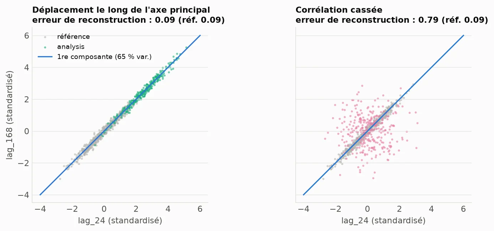

Yet the lags of a demand panel are highly correlated, and a shock moves them together, along the
first component. A test pins this behaviour down, and the drift signal combines **PCA or PSI**. COVID
will show the precaution was not theoretical.

### The absolute MAE paradox

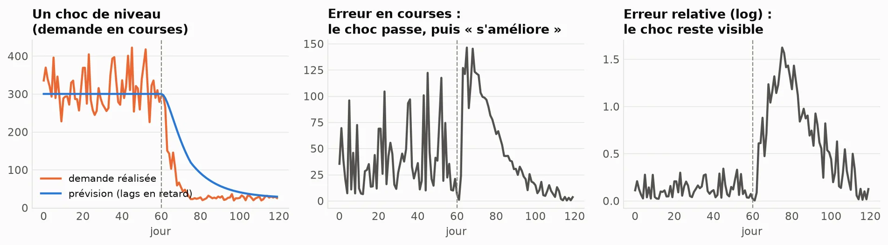

When a zone drops from 300 to 30 rides an hour, a 50 % error weighs only 15 rides instead of 150: the
MAE **goes down** while the model has become useless. The project therefore monitors two scales:
**count** (MAE in rides, the business reading) and **log** (MAE on `log1p`, roughly the relative
error), which is the alerts' **detection scale**.

## 7. E1: the COVID shock, estimated against realised

The model trained in 2019, frozen, goes through the first half of 2020.

 and realised, revealed afterwards (orange). Top, the relative error; bottom, the error in rides. The pink band covers the month after the state of emergency.")

| Scale | Phase | Estimated (DLE) | Realised | Estimated / realised |
|---|---|---|---|---|
| MAE log | before (Jan-12 Mar) | 0.217 | 0.202 | 1.08 |
| MAE log | shock (13 Mar-12 Apr) | 0.401 | 1.096 | **0.37** |
| MAE log | trough (13 Apr-30 Jun) | 0.372 | 0.594 | 0.63 |
| MAE rides | before | 22.8 | 20.6 | 1.11 |
| MAE rides | trough | 6.2 | 3.5 | 1.76 |

**Before the shock**, DLE closely tracks the realised error. **During the shock**, the relative error
is multiplied by five; DLE rises, but stays at **37 % of reality**: the lags still describe the world
before, then collapse to never-seen levels, and DLE extrapolates. **In the trough**, the lags have
caught up and DLE underestimates less. In rides, it is the opposite: the realised MAE **goes down** in
the trough and DLE overestimates it. Only the relative scale says the model has become useless.

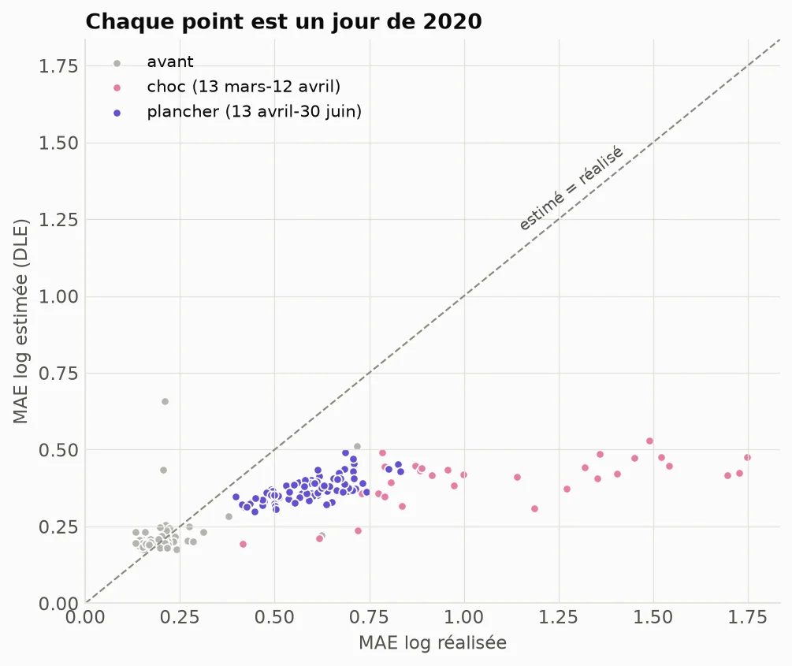

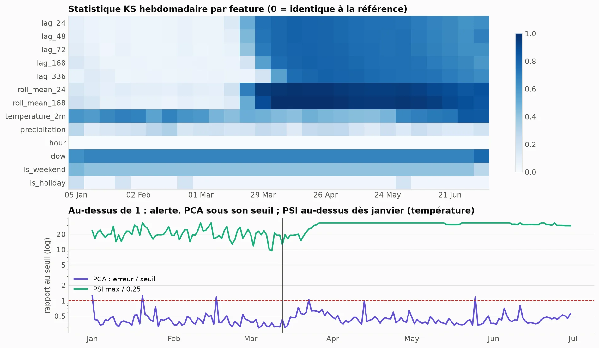

On the drift side: **temperature drifts all the time** (winter against autumn), **PCA does not see
the shock** (2.7 % of days on alert while volume is divided by more than ten), and calendar inputs
tested day by day produce artefacts.

### When each policy would have alerted

The daily signals form four policies, with two-day persistence: **P1** drift alone, **P2** DLE alone,
**P3** drift AND DLE, **P4** labels. After the artefacts of E1 and E2, I declared a **"cleaned
drift"** (P1b: only the 24- and 168-hour lags) and its joint condition P3b.

| Policy | Decision possible on | Delay (days) | Days on alert before the shock |
|---|---|---|---|
| P1 drift alone | 12/03/2020 | -1 | **71** |
| P2 DLE alone | 22/03/2020 | 9 | 0 |
| P3 drift AND DLE | 22/03/2020 | 9 | 0 |
| P4 labels | 14/05/2020 | **62** | 0 |
| P1b cleaned drift | 14/03/2020 | **1** | 0 |
| P3b cleaned drift AND DLE | 22/03/2020 | 9 | 0 |

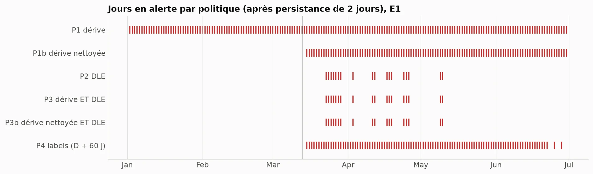

P1 had already been alerting for 71 days: a permanent alarm has no delay, it has 100 % false alarms.
P2 and P3 decide on **22 March**, nine days after the state of emergency, with no false alarm. P4
waits until **14 May**. P1b decides **from 14 March**: removing temperature and the rolling mean turns
a permanent alarm into an early detector. Two months later, the labels give those days an error three
to four times the estimate: **the page would have been right about the fact, wrong about the size.**

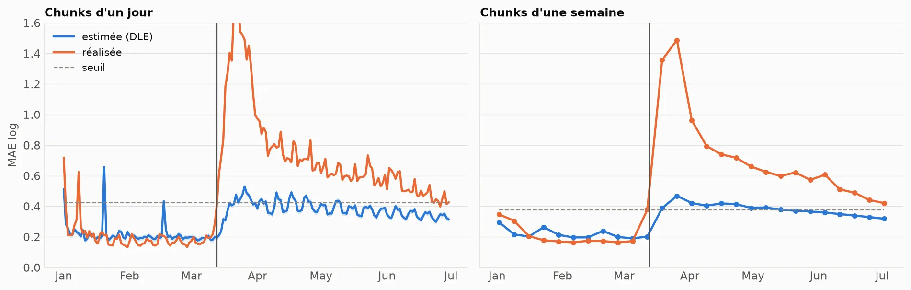

A variant (E1 bis) computes DLE per week: the confidence interval is 2.7 times narrower, and the week
behaves like the day with two days of persistence. I kept persistence, which retains the daily
granularity useful for diagnosis.


**What E1 establishes.** On a real shock, performance estimated without labels detects in 9 days what
labels detect in 62, but during the break its figure is a lower bound.


## 8. E2: the congestion charge, a drift without impact

The brief assumed that the congestion charge had "moved the relationship between inputs and demand".
E2 tests the hypothesis, separating the 32 CBD zones from the 28 others.

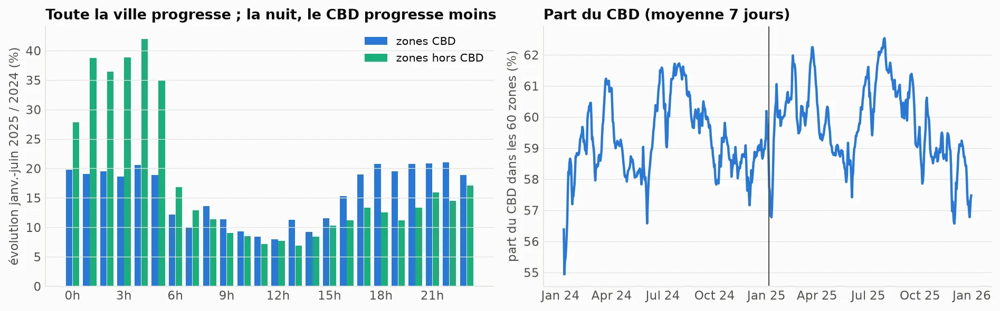

The whole city grows (+7 to +42 % depending on the hour). At night, the CBD grows 16 to 21 points
less than the rest, in the evening 5 to 8 points more: an hourly recomposition, consistent with an
effect of the charge, without it being causally attributable here.

| Group | Period | MAE log |
|---|---|---|
| CBD | reference (Sep-Dec 2024) | 0.253 |
| CBD | after 5 Jan 2025 | **0.229** |
| non-CBD | reference | 0.305 |
| non-CBD | after 5 Jan 2025 | **0.280** |

The model **did not degrade**: its error is even lower than on the reference. A gradual recomposition
is absorbed in one to two weeks by the lags; a $0.75 surcharge is not COVID.

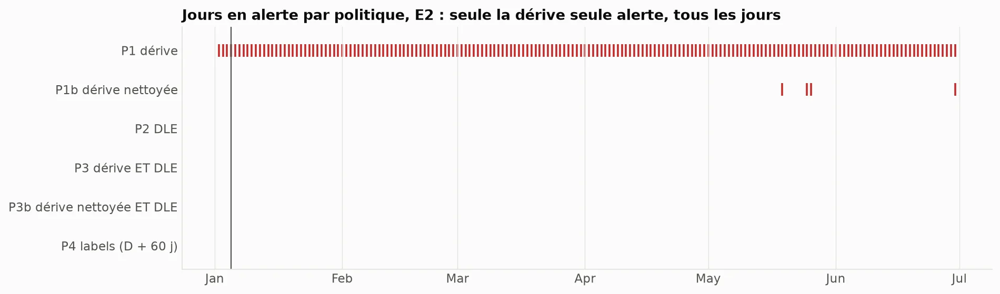

This is the textbook **drift without impact**: drift alone alerts on **177 days out of 177**, an
on-call rota woken every day for six months for a perfectly healthy model. DLE, the joint conditions
and the labels stay silent.

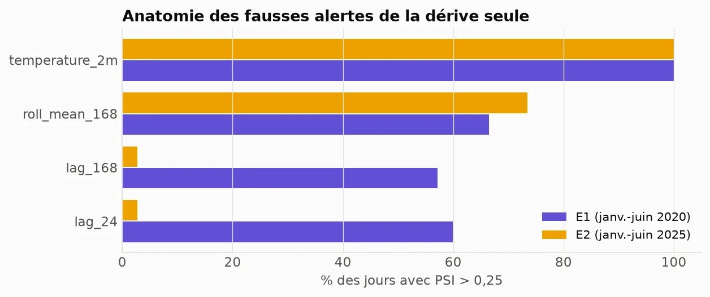

Two sources of noise: **temperature** (real drift, zero impact) and **the 7-day rolling mean**, an
artefact: over a single day it barely varies, its distribution is narrow, and the PSI explodes
without any real shift.

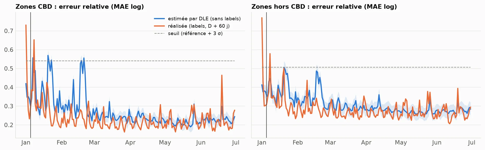

DLE's only spikes fall during two cold snaps, in the coldest 1 % of the reference: outside the known,
the estimate can also be wrong upwards.


**What E2 establishes.** A real break does not necessarily degrade a lag model. Alerting on drift
alone is untenable there; the joint condition cuts the noise to zero without missing anything.


## 9. E3: the boundary where the estimate lies

A real shock mixes everything up. To **name the regime where the estimate breaks down**, E3 builds
pure drifts on the calm 2025 period, injected on 3 March:

| Family | Construction | Guaranteed purity |
|---|---|---|
| **Harmful** covariate shift | resampling **real** rows to over-represent low levels | each row keeps its true (inputs, demand) pair |
| **Benign** covariate shift | same, over-representing high levels | same |
| **Pure** concept drift | demand multiplied, inputs and forecasts **frozen** | inputs intact |
| **Propagated** level shock | demand multiplied, lags recomputed | none: the realistic case |

My first version compared before and after the injection, mixing the injected effect with the
season's natural evolution. Each scenario is therefore compared with **the same scenario without
drift, on the same days**. The **tracking rate** is estimated increase / realised increase: 1 if DLE
tracks, 0 if it is blind.

 against estimated increase (y axis). On the diagonal, DLE is right; on the horizontal axis, it is blind.")

| Scenario | Δ realised (steady) | Δ estimated (steady) | Tracking rate |
|---|---|---|---|
| harmful covariate, κ = 0.5 | 0.051 | 0.047 | 0.93 |
| harmful covariate, κ = 2 | 0.189 | 0.161 | 0.85 |
| benign covariate, κ = 2 | -0.086 | -0.085 | 0.99 |
| pure concept × 0.85 | 0.019 | 0.000 | **0.00** |
| pure concept × 0.5 | 0.381 | 0.000 | **0.00** |
| propagated shock × 0.5 (first 14 days) | 0.145 | 0.046 | 0.32 |

Under **covariate shift**, DLE tracks at 0.82-0.99, including drifts that *improve* the model, which
input drift cannot tell apart from a degradation. Under **pure concept drift**, tracking is **exactly
zero**: a 50 % drop in demand, invisible for the whole blind window. The **propagated shock** is only
partly tracked, while the lags absorb it.

 and realised (orange) error, with the no-drift realised error in grey. Pure concept: the realised error jumps, the estimate sticks to the counterfactual.")

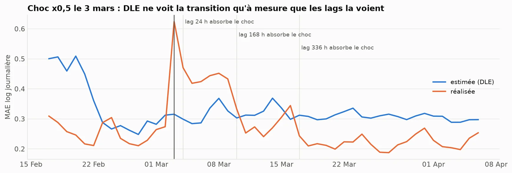

The propagated shock in slow motion shows the COVID mechanism: day 0, demand changes but the inputs
do not (pure concept drift, DLE blind); days 1 to 7, the short lags switch and DLE rises; days 7 to
14, `lag_168` and `lag_336` switch and the model readjusts.

: the families never overlap.")

Replayed with five seeds (E3 bis, criterion declared before running), the conclusion holds: the worst
harmful covariate shift tracks at 0.84, the best concept drift at 0.00. The run also revealed that the
nanny model is **deterministic**: the robustness measured is robustness to the injection.


**What E3 establishes.** The hypothesis is confirmed, more sharply than expected. Another finding:
NannyML's default thresholds alert in **none** of these scenarios, even for +60 % error. Tuning
thresholds is the subject of E4.


## 10. E4: testing the monitor itself

Every day, a monitor answers a binary question: "is the model unwell?". Like any classifier, it has a
**recall** (the share of real degradations caught), a **false alarm rate** and a **delay**. Not
measuring them means plugging into an on-call rota a system nobody knows anything about.

| Element | Choice |
|---|---|
| Scenarios | 240 drawn at random: no drift (42), harmful covariate (50), benign (44), pure concept (49), propagated shock (55) |
| Drawn parameters | intensity, subset of zones or hours, start date |
| Harmful | realised error up **more than 10 %** over 28 days, against the counterfactual |
| Detection | an alert **switching on** (rising edge) within 28 days; an alarm already on detects nothing |
| Thresholds | mean + k standard deviations of the reference days |

The rising-edge rule comes from a mistake: my first version gave 100 % recall to drift alone, which
was permanently on. Another key point: a **row-level scorer** reusing NannyML's models (equality
tested) brought the backtest down from several days to eleven minutes.

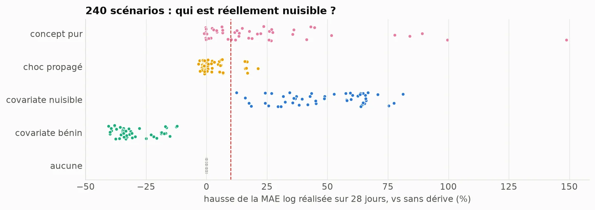

87 scenarios are harmful, **only 6 of them propagated shocks**: on a lag model, a level shock only
hurts for a week or two, a concept drift often and for a long time.

| Signal | Policy | Recall [90 % CI] | Median delay | False alarms / 30 d | Alert on benign drift |
|---|---|---|---|---|---|
| daily | P1 drift alone | 0 % (always on) | - | - | - |
| daily | P1b cleaned drift | 67 % [58; 74] | 0 d | 0.16 | 55 % |
| daily | P2 DLE alone | 56 % [47; 65] | 0 d | 1.19 | 23 % |
| daily | P3b cleaned drift AND DLE | 45 % [36; 54] | 0 d | **0.00** | 13 % |
| daily | P4 labels | 70 % [62; 78] | 61 d | 0.62 | 2 % |
| 7-day smoothed | P2 DLE alone | 56 % [48; 65] | 3 d | 0.85 | 22 % |
| 7-day smoothed | **P3b cleaned drift AND DLE** | **51 %** [42; 59] | 3 d | **0.00** | 14 % |

Cleaned drift detects a lot but alerts on **55 % of benign drifts**. DLE alone raises more than one
false alarm a month. **The cleaned joint condition is the only one with zero false alarms**; smoothed
over 7 days, it catches 51 % of harmful drifts with a 3-day median delay. Labels detect the most, two
months too late. A limitation written on the page: the no-drift days all come from the same period, so
the uncertainty on false alarms is underestimated (hence E4 ter).

 stays at zero false alarms across the whole range; DLE alone (blue) buys its recall with false alarms.")

In the joint condition, cleaned drift is the filter and DLE the judge: even at the lowest threshold,
it reaches 54 % recall with no false alarm.

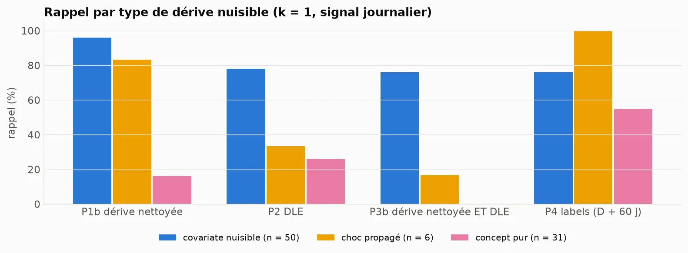

On pure concept drift, the "detections" of cleaned drift and DLE alone are **accidental** (a false
alarm landing in the window); the joint condition is at 0 %, which is the truth. **The recall ceiling
of label-free signals is set by the share of concept drift**: here 31 harmful drifts out of 87, so
about 64 % at best.

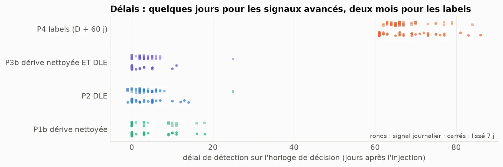

A notebook on the site puts a price on each error: cleaned drift alone wins as long as a false page
costs less than 7.5 % of a missed degradation, the joint condition beyond that.

### Sensitivity and calm periods (E4 bis and ter)

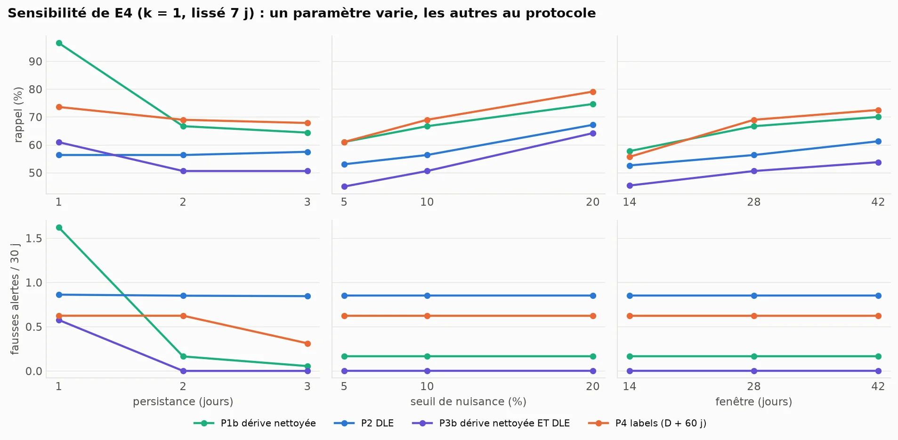

| Persistence | P3b recall | False alarms / 30 d | Median delay |
|---|---|---|---|
| 1 d | 61 % | **0.58** | 2 d |
| 2 d | 51 % | 0.00 | 3 d |
| 3 d | 51 % | 0.00 | 4 d |

**Persistence is the critical parameter**: at one day, the joint condition loses its main property.
The harm threshold and the window shift every recall together without changing the ranking.

E4 ter adds two real calm periods (autumns 2019 and 2024), with no injection:

| Period | Policy | Alerts switched on / 30 d | of which on real degradation | Real degradation covered |
|---|---|---|---|---|
| Sep-Dec 2019 | P2 DLE alone | 0.74 | **100 %** | 41 % |
| Sep-Dec 2024 | P2 DLE alone | 0.49 | **100 %** | 38 % |
| Jan-Jun 2025 | P2 DLE alone | 0.50 | 22 % | 100 % |
| all three | P3b joint condition | **0.00** | - | 0 % |

Zero false pages replicates. But **"calm" does not mean "no degradation"**: the model degrades over
the holidays, and every alert day of DLE alone then lands on a real degradation, which the joint
condition ignores (the lags do not move). Hence an adjustment: the joint condition triggers the
**page**, a persistent alert from DLE alone opens a **ticket**, "probable degradation".

## 11. E5: retrain, but not by reflex

An alert has fired: should we retrain? E5 replays the whole of 2020 day by day, with labels at
**D + 60** (TLC publication) or **D + 1** (an operator that knows its rides the next day).

| Policy | Rule |
|---|---|
| never | the 2019 model stays in service |
| schedule | monthly retraining on the last 8 months of labels |
| reflex | at the first alert (22 March), on 8 months of labels |
| short reflex | same date, on labels after 13 March only |
| guarded | confirmed drift AND 28 days of post-alert labels; challenger promoted if it beats the model in service by 5 % on later labels |

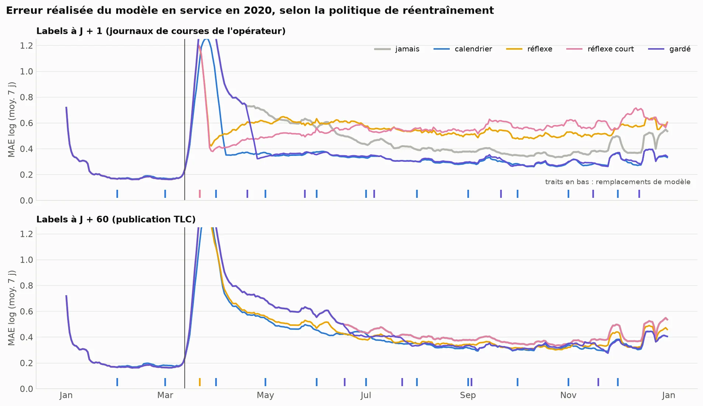

| Labels | Policy | Shock | 2nd half | 13 Mar-31 Dec | Replacements |
|---|---|---|---|---|---|
| D + 1 | never | 1.096 | 0.397 | 0.524 | 0 |
| D + 1 | schedule | 0.755 | 0.301 | **0.363** | 11 |
| D + 1 | reflex | 0.657 | 0.532 | 0.565 | 1 |
| D + 1 | short reflex | **0.600** | 0.577 | 0.565 | 1 |
| D + 1 | guarded | 1.096 | 0.306 | 0.411 | 6 |
| D + 60 | schedule | 0.927 | 0.334 | 0.435 | 11 |
| D + 60 | guarded | 1.096 | 0.345 | 0.489 | 4 |

- **The reflex does worse than doing nothing** (0.565 against 0.524): it mixes eight months of "old
  world" with a few days of lockdown, then gets stuck. At D + 60 it is worse in principle: on 22
  March, the latest published labels date from 22 January.
- **Eight days of labels means learning noise**: the short reflex is the best during the shock, then
  the worst in the second half, frozen on the worst weeks.
- **The guarded policy avoids accidents**: it waits, promotes a challenger on 20 April and reaches the
  best level with replacements that are all validated.
- **The monthly schedule is the best over 2020**, a result I did not expect: it adapts from 1 April
  without waiting for evidence. But it imposes 11 replacements a year whatever happens and has no
  safeguard against corrupted data or data driven by the model itself.

That last point leads back to Sculley's feedback loop: the retraining decision also refuses a label
window **100 % driven by the model** (independently positioned control zones, a log of unserved
demand).

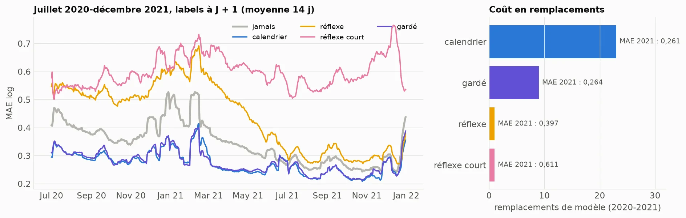

E5 bis extends the simulation over the 2021 recovery: the guarded policy **catches up with the
schedule** (log MAE 0.264 against 0.261) with **9 replacements instead of 23**. The schedule's
advantage came from the 2020 shock.


**What E5 establishes.** No reflex retraining. **The label delay decides everything**: at 60 days, no
policy reacts to the shock; at one day, the good policies converge within weeks. Recommendation: the
guarded policy, with a quarterly background retraining as a safety net.


## 12. The extensions: localise, deseasonalise, check the data

These extensions are outside the protocol, each declared in an issue before running.

### E6: localising the drift by zone

An alert says there is a problem; then we need to know **where**, to reposition the fleet and exclude
zones from a retraining.

 and estimated without labels (right). Different scales, same map.")

| Zone | Realised increase | Estimated increase | Estimated rank (out of 60) |
|---|---|---|---|
| Meatpacking/West Village West | 1.44 | 0.30 | 2 |
| TriBeCa/Civic Center | 1.29 | 0.31 | 1 |
| SoHo | 1.24 | 0.27 | 6 |
| Lower East Side | 1.24 | 0.17 | 40 |
| Midtown Center | 1.23 | 0.29 | 3 |

**Without a single label**, the estimated loss ranks the zones almost like the realised error (rank
correlation 0.74): the size is wrong, the ranking largely right.

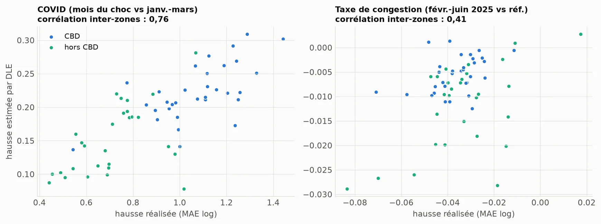

.")

On drifts injected into the CBD only, the estimated loss localises a shock perfectly (AUC 1.00) and a
concept drift not at all (0.50): E3's boundary reappears at zone level. The raw PSI fails (0.46),
swamped by the season. After a page, the first thing to open is therefore the **map of estimated loss
by zone**.

### E7: comparing each day with its own season

The natural idea against seasonal noise: compare each day with the same weeks of the previous year. A
synthetic test written before running had predicted it: the PSI of a single day stays high **even
against the right season**, because a day is much narrower than 28 days. So I added, labelled as such,
a **seasonal z-score** of the daily mean.

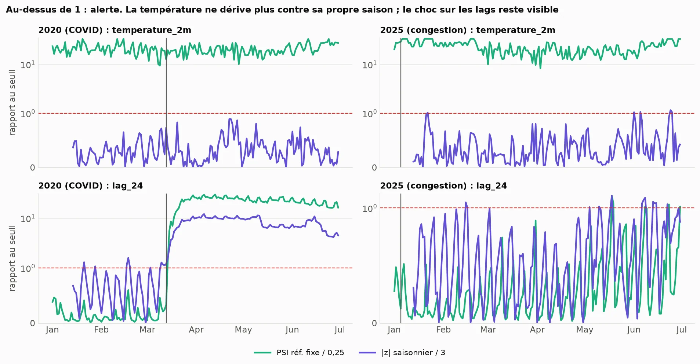

For temperature, the z-score never fires in 2020 and only once in 2025 (a heatwave): the first source
of false alarms disappears. On `lag_24`, it detects COVID on the same day.

**E4 quater** then put it into the joint condition instead of the lag PSI, and the declared surprise
happened: 0.26 false alarms a month instead of 0. Its apparent gain in recall came only from
accidental detections. The previous year's baseline imports everything that changed from one year to
the next, including the growth in demand. The seasonal z-score suits exogenous inputs like
temperature, not the lags of a growing demand.

### E8: when the data is what lies

A data bug produces the symptoms of a drift. Three daily checks, compared with the four previous same
weekdays, known calendar excluded: day's volume, correlation of the hourly profile, number of zones
with no ride. Four bugs are injected from 3 to 9 March 2025.

: duplication at 2.2, truncation at 0.6, profile correlation at 0.72 with the one-hour shift, 3 silent zones.")

| Bug | Checks: 1st signal | P3b days | Estimated loss | Realised loss |
|---|---|---|---|---|
| none | - | 0 | 0.279 | 0.241 |
| truncation | 3 March | 0 | 0.305 | 0.397 |
| duplication | 3 March | 0 | 0.265 | **0.585** |
| 1 h shift | 4 March | 0 | 0.282 | 0.348 |
| silent zone | 3 March | 0 | 0.295 | 0.426 |

The checks see everything within one or two days; the model monitor almost nothing. Yet the realised
error explodes: two months later, the labels would **blame the model** and a retraining would learn
from corrupted data. The quality layer therefore comes **before** the monitor.

### E9, E10, E0 bis: three checks

**E9** replaces the observed weather with the forecast actually issued the day before (1.5 °C error,
rain forecast 41 % of the time): the MAE moves by **0.08 %**. The optimistic assumption biased
nothing.

**E10** evaluates the joint condition by group of zones (CBD, non-CBD): recall rises from 51 % to
**55 %**, still with no false alarm.

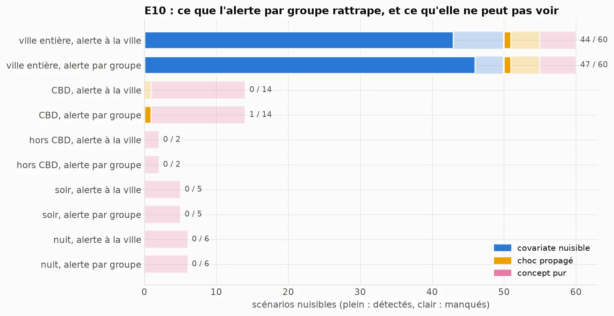

But 26 of the 27 harmful local drifts are concept drifts: a finer granularity does not break through
the blind spot.

**E0 bis** calibrates the intervals with conformal calibration (CQR), whose guarantee assumes that
calibration and use look alike. Calibrated on the autumn, it does not hold over the holidays; the
rolling version recomputes the correction every day on the last 28 days of published labels.

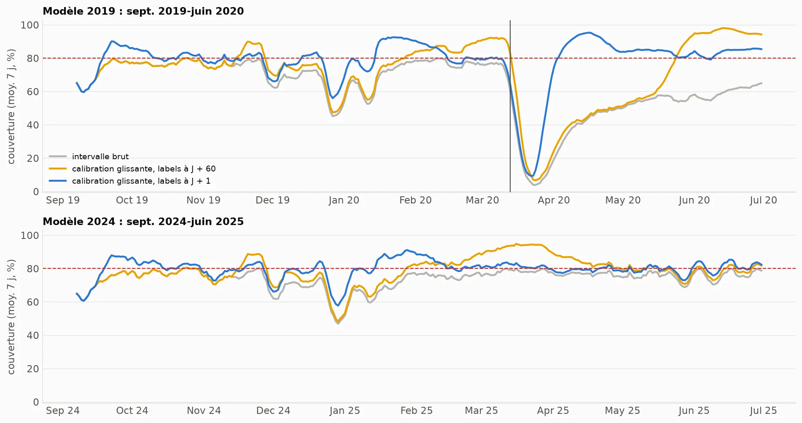

Same message as E5: **the label delay decides the capacity to adapt**, much more than the method.

## 13. From measurement to operations

### The decision in ten lines

1. **Data first**: contract and quality checks; a failure suspends the reading of the model (E8).
2. **The estimated loss decides, drift qualifies**, prediction drift serves as a consistency check.
3. **Page** only on the joint condition persisting two days; drift alone or estimated loss alone
   open a **ticket** (E4).
4. **Thresholds** from the reference, recomputed with each new model, on a 7-day smoothed signal.
5. **Realised performance** audits the monitor and triggers retraining.
6. **Accepted blind spot**: pure concept drift is covered by early labels and external indicators
   (unserved demand).
7. **Guarded retraining**, validated on a later window (E5).
8. **Never reflex retraining**.
9. **Against the feedback loop**: control zones, refusing to learn from a window driven by the model.
10. **The monitor is backtested** before being plugged into an on-call rota.

```text
PAGE    if  (psi_lag24 > 0.25 OR psi_lag168 > 0.25 OR pca_alert)
         AND dle_mae_log_smoothed_7d > reference_threshold(k = 1)
         for 2 consecutive days
TICKET  if  cleaned drift alone for 7 days, or estimated loss alone for 2 days
DATA INCIDENT  if a quality check fails        -> overrides everything else
```

Yet the first lever is not an algorithm. No setting makes concept drift visible (E3, E4, E10), but
ZoneFleet knows its own rides the next day: **plugging realised monitoring into the internal logs
shrinks the blind window from 61 days to 2**, and also makes retraining (E5) and calibration (E0 bis)
responsive.

### A demonstration production setup

The repository contains a complete local chain: **Dagster** orchestrates monitoring as a graph of
*assets* (declared data and dependencies) with four quality checks, in 22 seconds; **MLflow** holds
the registry (`champion` alias, challenger promoted at +5 %); decisions are pure functions tested
without the orchestrator; a `zonefleet` CLI runs the 17 experiments and variants, the alerts and the
morning report.

That **morning report** sums up each day's severity, signals, zones with the highest estimated loss
and recommendation. One rule was added after a mistake: in a historical replay, it hides any realised
loss published after its date. Without it, the report for 23 March 2020 showed a loss only known in
May and recommended retraining.

Rereading this report for the post, I noticed its severity is "**DATA INCIDENT**", not "page": the
day's volume is 7 % of the median of the four previous Mondays, far below the quality threshold, and
the documentation page, written before that layer, still discusses a page. The observation is
instructive: **a real collapse looks exactly like a truncated file**, and the final decision needs a
human who knows a state of emergency has just been declared.


flowchart TD
  P["PAGE received"] --> C1{"data contract<br/>and quality OK?"}
  C1 -- no --> D["DATA incident:<br/>freeze forecasts,<br/>fallback positioning"]
  C1 -- yes --> C2{"estimated loss by zone:<br/>a few zones or the whole city?"}
  C2 -- a few zones --> L["manual repositioning<br/>of the top zones on the map"]
  C2 -- whole city --> G{"known event?<br/>(weather, holiday, strike)"}
  G -- yes --> E["annotate, watch 48 h,<br/>no retraining"]
  G -- no --> R["switch to seasonal naive<br/>on critical zones"]


## 14. What I take away

These findings hold for a lag forecaster, 60 New York taxi zones, two real shocks and drifts built on
a calm period.

1. **Estimating performance without labels works when the inputs shift.** The skill is not using
   DLE, it is knowing **when not to believe it**.
2. **For a lag model, every shock starts as a concept drift.** This idea, absent from my initial
   plan, explains the COVID breakdown, the propagated shock and the recall ceiling.
3. **A drift is not a degradation**: the congestion charge recomposed demand without degrading the
   model.
4. **The monitor is tested like a model**: without a backtest, I would have seen neither the fake
   100 % recall nor the critical role of persistence.
5. **Data first, and labels sooner**: these are the two most powerful levers, and neither is a
   monitoring algorithm.
6. **The frozen protocol changed how I read my own results**: writing "what would be a surprise"
   forced me to publish those that contradicted my intuition, often the most instructive.

What I would do differently: test every signal on a synthetic case before the real data (E7's test
did, E6's did not), write the row-level scorer from the start, and put several calm periods in the
protocol. Still open: concept drift before the labels, a reliable lower bound on the size during a
break, transferring the thresholds to another city, and the real cost of alerts at an operator.


**A question to check your understanding.** *Input drift has been alerting for three weeks, but the
estimated loss stays below its threshold. Is the model fine?* Not necessarily. It may be a drift
without impact (section 8), but if the relationship between inputs and demand has changed, DLE is
blind (section 9) and drift is the only clue before the labels. That is why it opens a ticket, and
why the real answer is to get labels sooner.


## Reproduce and go further

The code, tests and results are in the
[gwils28/zonefleet-observability](https://github.com/gwils28/zonefleet-observability) repository
(Python 3.12, `uv`, Docker image). The aggregated panel is versioned: no raw data is needed.

```bash
git clone https://github.com/gwils28/zonefleet-observability && cd zonefleet-observability
uv sync --all-extras
make check            # lint, type checking, more than 160 tests
make e0 e1 e2 e3      # a few minutes
make e4 e5            # about 20 minutes
make release-check    # every figure and table regenerated, no difference
```

The [project site](https://gwils28.github.io/zonefleet-observability/) (in French) offers three
reading paths (15 minutes, one hour, one day), interactive charts, three notebooks, the runbook and the
logbook; [version 1.0](https://github.com/gwils28/zonefleet-observability/releases/tag/v1.0.0) archives
the results.

**Sources**

- NannyML, [repository](https://github.com/nannyml/nannyml) and documentation on [performance estimation](https://nannyml.readthedocs.io/en/stable/how_it_works/performance_estimation.html) and [multivariate drift](https://nannyml.readthedocs.io/en/stable/how_it_works/multivariate_drift.html).
- Alam, Rahman and Sadeqa, [*DriftGuard: A Hierarchical Framework for Concept Drift Detection and Remediation in Supply Chain Forecasting*](https://arxiv.org/abs/2601.08928), arXiv, January 2026.
- Sculley et al., [*Hidden Technical Debt in Machine Learning Systems*](https://proceedings.neurips.cc/paper/2015/hash/86df7dcfd896fcaf2674f757a2463eba-Abstract.html), NeurIPS 2015.
- NYC Taxi & Limousine Commission, [Trip Record Data](https://www.nyc.gov/site/tlc/about/tlc-trip-record-data.page); Open-Meteo, [historical archive](https://open-meteo.com/en/docs/historical-weather-api) and [Previous Runs API](https://open-meteo.com/en/docs/previous-runs-api).
