


Un modèle de prévision ne tombe pas en panne : il dérive. Il continue de produire des chiffres
plausibles pendant que le monde change, et personne ne s'en aperçoit avant l'arrivée de la vérité
terrain. Quand elle met deux mois à arriver, que peut-on savoir de la santé du modèle entre-temps,
et à quel moment cette mesure se met-elle à mentir ?


*Temps de lecture : environ 40 minutes, l'article le plus long du blog. Chaque section se lit
seule ; les encadrés et les tableaux suffisent pour une première lecture. Le dépôt et ses figures
sont en français.*



Cet article restitue **deux mois de veille active** (du 2 juillet au 2 septembre 2026, 670 commits)
sur l'**observabilité** d'un modèle de prévision : la surveillance de sa santé une fois en
production. Parti d'un plan d'une heure (lire NannyML et un article récent, passer un modèle au
travers du COVID, esquisser une architecture), le projet est devenu un cas complet : dix
expériences, une mise en exploitation de démonstration et une version 1.0. Tout est reproductible
dans le dépôt [zonefleet-observability](https://github.com/gwils28/zonefleet-observability), dont
viennent les figures ; son [site de documentation](https://gwils28.github.io/zonefleet-observability/)
détaille chaque point.


**En bref.** Un forecaster de demande de taxis par zone et par heure, figé, observé sans labels :

1. **La performance estimée sans labels (NannyML DLE) suit l'erreur réelle quand les entrées se
   déplacent** (*covariate shift*, taux de suivi de 0,85 à 0,99) **et ne voit rien quand la
   relation entre entrées et demande change** (*concept drift*, 0,00). C'est le résultat central.
2. **Sur le COVID, le moniteur détecte le choc en 9 jours sans label**, contre 62 avec, mais
   sous-estime l'ampleur d'un facteur 2,7.
3. **Alerter sur la dérive des entrées seule est intenable** : 177 jours d'alerte sur 177 après la
   taxe de congestion, pour un modèle qui ne s'est pas dégradé.
4. **La condition jointe « dérive nettoyée ET hausse de la perte estimée »** détecte 51 % des
   dérives nuisibles en 3 jours médians, **sans aucune fausse alerte** sur 240 scénarios et trois
   périodes calmes.
5. **Réentraîner dès l'alerte fait pire que ne rien faire** sur l'année du COVID.
6. **Un bug de données est invisible pour le moniteur de modèle** ; des contrôles de qualité simples
   le voient le premier jour.
7. **Le levier principal n'est pas dans le monitoring** : obtenir les labels en deux jours au lieu
   de soixante.


## 1. Le problème : un modèle qui vieillit en silence

### Un client fictif, des données réelles

Le cadre est un cas client inventé : **ZoneFleet**, un opérateur de mobilité qui prévoit la
**demande horaire de courses par zone** pour positionner sa flotte la veille. Son modèle se dégrade
sans que personne ne le voie, faute de surveillance. La demande n'est pas « un meilleur modèle »,
mais **une observabilité complète** : savoir quand le modèle va mal, pourquoi, et quoi faire.

Les données sont réelles : les courses de taxis jaunes et verts publiées par la Taxi & Limousine
Commission (TLC) de New York, sur 2019-2021 et 2024-2025. Elles contiennent deux ruptures de nature
très différente : le **COVID** (mars 2020), un effondrement global, et la **tarification de
congestion** du 5 janvier 2025, une taxe sur l'entrée dans le sud de Manhattan.

### Les trois horloges d'une prévision

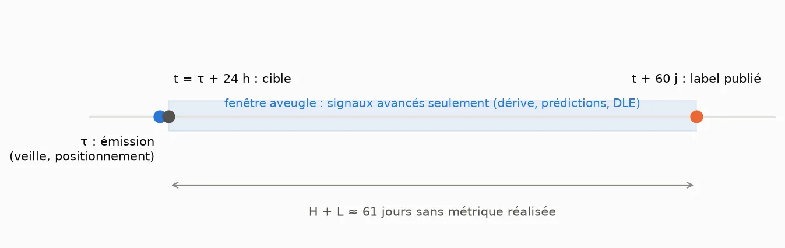

| Horloge | Notation | Chez ZoneFleet | Ce qui est connu |
|---|---|---|---|
| Émission | \(\tau\) | la veille, au positionnement de la flotte | les entrées : historique, calendrier, météo |
| Cible | \(t = \tau + H\) | l'heure prévue, **H = 24 h** | la demande se produit, personne ne la mesure encore |
| Label | \(t + L\) | publication TLC, **L ≈ 60 jours** | la vérité terrain |

Le **label** est la valeur réelle que le modèle cherchait à prévoir. Entre l'émission et le label
s'étend une **fenêtre aveugle** d'environ 61 jours sans aucune métrique d'erreur calculable. Tout ce
qu'on sait du modèle vient alors de ce qu'il **voit** (ses entrées) et de ce qu'il **dit** (ses
prédictions). Trois conséquences pratiques :

1. **Aucune entrée ne regarde à moins de 24 heures.** Un « lag » (la demande d'une heure passée,
   utilisée comme entrée) de 1 heure donne d'excellents backtests et un modèle inutilisable ; le
   code le refuse.
2. **Un délai de détection se mesure sur l'horloge de décision** : chaque alerte est datée du jour
   où elle aurait pu être levée, pas du jour qu'elle concerne.
3. **La référence doit être hors échantillon.** Si la période de comparaison a servi à
   l'entraînement, le modèle y est trop bon et le moniteur voit une « dégradation » dès le premier
   jour. Chaque expérience découpe donc trois périodes :

| Expérience | Entraînement | Référence | Analyse |
|---|---|---|---|
| E1, COVID | janv.-août 2019 | sept.-déc. 2019 | janv.-juin 2020 |
| E2, congestion | janv.-août 2024 | sept.-déc. 2024 | janv.-juin 2025 |

Le protocole pose trois questions : peut-on mesurer la santé du modèle **pendant la fenêtre
aveugle** ? **Où cette mesure ment-elle ?** (hypothèse : elle suit l'erreur quand les entrées se
déplacent, elle décroche quand la relation change) ; et quelle **politique d'alerte** offre le
meilleur compromis entre détections, délai et fausses alertes ?

## 2. Ce que disent les sources

**NannyML** est une bibliothèque open source de surveillance post-déploiement. Pour une régression,
sa méthode phare, **DLE** (*Direct Loss Estimation*), estime l'erreur d'un modèle sans vérité
terrain : si le modèle se trompe plus dans certaines régions des entrées, un second modèle, le
*nanny model*, peut **apprendre où il se trompe**, puis prédire son erreur là où les labels
manquent. La documentation pose quatre conditions de validité :

| # | Hypothèse | Si elle tombe |
|---|---|---|
| 1 | **Pas de concept drift** : relation entre entrées et cible stable | la carte des erreurs apprise n'est plus la bonne |
| 2 | Pas de déplacement vers des régions **jamais vues** | le nanny model extrapole |
| 3 | Erreur **hétérogène** selon les régions | toute variation estimée est du bruit |
| 4 | Assez d'observations par période | les alertes deviennent aléatoires |

Le projet transforme l'hypothèse 1 en **question expérimentale**.

**DriftGuard** (Alam, Rahman et Sadeqa, [arXiv:2601.08928](https://arxiv.org/abs/2601.08928), 2026)
fait voter quatre détecteurs de dérive en prévision de supply chain (97,8 % de rappel annoncé, 4,2
jours de latence). Hypothèse cachée : **trois détecteurs sur quatre travaillent sur les résidus,
donc sur des labels**, qui arrivent le soir même sur les ventes Walmart, mais qui seraient muets
pendant toute la fenêtre aveugle de ZoneFleet. J'en ai repris l'apport méthodologique : **un rappel
n'a de sens qu'avec un délai et un taux de fausses alertes**. La lecture a aussi relevé quelques
incohérences chiffrées dans le texte et l'absence de code publié.

**Sculley et al.** ([NeurIPS 2015](https://proceedings.neurips.cc/paper/2015/hash/86df7dcfd896fcaf2674f757a2463eba-Abstract.html)),
le papier fondateur du MLOps, relu comme une grille d'observabilité :

| Recommandation (2015) | Traduction dans le projet |
|---|---|
| Pas de seuils fixes dans un système dynamique | seuils dérivés de la référence, recalculés à chaque nouveau modèle |
| *Prediction bias* | dérive des prédictions, biais réalisé par zone |
| *Action limits* | déplacement de flotte borné par zone et par heure |
| *Up-stream producers* | contrat de données, contrôles de qualité |
| Boucles de rétroaction | le modèle positionne la flotte, la flotte fait les courses, les courses deviennent ses labels |

## 3. La démarche : un protocole figé et des chiffres qui se régénèrent

Avant tout code, j'ai fixé le protocole dans `SPEC.md` (2 juillet), avec une règle : **on ne le
modifie pas pour accommoder un résultat**, comme un pré-enregistrement d'étude clinique. Il n'a pas
bougé depuis. Cinq règles ont structuré le projet plus que n'importe quel choix technique :

1. **Protocole figé** ; chaque écart daté et justifié dans `docs/notes/implementation.md`.
2. **Une expérience se déclare avant de s'exécuter** : chaque extension a une issue avec la
   question, la mesure et **« ce qui serait une surprise »**. Un signal ajouté après coup est
   étiqueté comme tel.
3. **Aucun chiffre tapé à la main** : tables et figures générées depuis `results/` ; un registre
   recalcule les 33 chiffres cités dans la prose, et la CI échoue si une phrase est périmée.
4. **Des garde-fous mécaniques** : un hook protège les données brutes, la CI refuse un test rouge,
   un lien mort ou une image sans texte alternatif.
5. **Les résultats imprévus sont publiés tels quels.**

La règle 2 a servi : l'issue de E4 quater (section 12) envisageait qu'un signal saisonnier fasse des
fausses alertes. C'est arrivé, et la déclaration préalable m'a empêché de régler le signal jusqu'à
ce que le problème disparaisse. Une méthode se juge aussi à ce qu'elle rattrape :

| Problème | Comment il a été trouvé | Correction |
|---|---|---|
| Entrées de saison extrapolées hors de l'entraînement | erreur de référence anormalement haute | retrait, MAE 29,5 → 22,7 |
| PSI journalier sur une moyenne glissante de 7 jours | 73 % de jours en alerte sans déplacement | artefact documenté |
| Rappel de 100 % pour une alarme toujours allumée | délai incohérent | détection par « front montant » |
| E3 mesurée en avant / après | effet non nul sans dérive | comparaison à un contrefactuel |
| Rapport du matin lisant des labels « du futur » | relecture d'un exemple | horloge des labels |
| 53 images sans texte alternatif, rendu en échec masqué en CI | contrôle du site rendu | CI qui échoue vraiment |

Vérifié dans un conteneur vierge : plus de 160 tests passent, et `make release-check` régénère
toutes les figures et tables sans aucune différence.

## 4. Les données : de 120 fichiers à un panel zone × heure

Les sources : 120 fichiers Parquet mensuels de la TLC (3,6 Go, une ligne par course, taxis jaunes
et verts, VTC exclus), la table des 263 zones, la météo horaire Open-Meteo à Times Square (la météo
**réalisée** sert de prévision, hypothèse levée en E9) et le calendrier US.

. En avril 2020, le volume tombe à 3,9 % de celui de février ; aucune chute visible après la taxe de congestion de 2025.")

Le COVID divise les courses par vingt-cinq ; la taxe de congestion ne laisse aucune trace à
l'échelle de la ville. Si elle déplace la demande, c'est entre zones et entre heures.

### Un contrat de données, premier capteur du monitoring

Avant le modèle, ce sont souvent les **données** qui changent de forme. Chaque fichier est validé
contre un **contrat de données** versionné : colonnes **requises** (bloquantes), **ruptures connues
et datées** (`cbd_congestion_fee` à partir de 2025, acceptée seulement après sa date), et **tout le
reste**, journalisé comme rupture inconnue. Seul le schéma est lu : 120 fichiers en moins d'une
seconde.

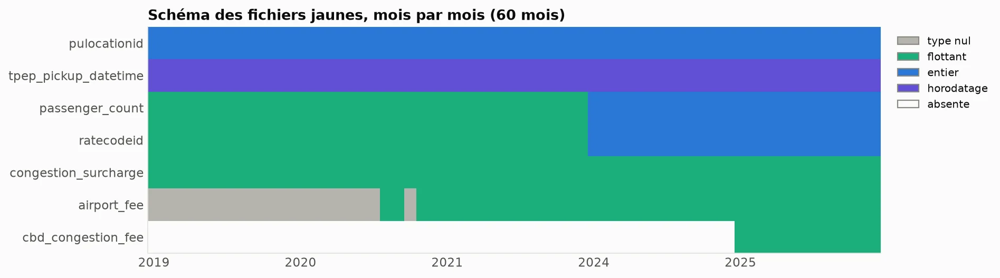

Aucune de ces ruptures ne casse ce pipeline, mais un pipeline utilisant le montant total des
courses aurait vu sa variable changer de sens le 5 janvier 2025, sans une ligne de code modifiée.

### Le panel

Les courses sont agrégées avec duckdb en un **panel** : prises en charge par zone et par heure
locale. **60 zones figées** (les plus actives en 2019, 93 % des courses : les recalculer changerait
l'objet surveillé en même temps que le monde), zéros explicites, et réparation des heures du
changement d'heure (2 h absente au printemps, 1 h doublée à l'automne). Résultat : 2,6 millions de
lignes, 10 Mo, versionnées.

 ; en vert, les 28 autres.")

L'appartenance au CBD (*central business district*, la zone taxée) se lit dans les données : la
part des courses 2025 qui paient la taxe vaut près de 1 pour une zone intérieure.

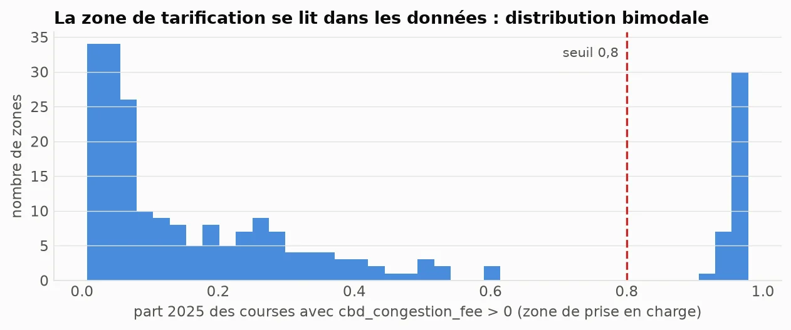

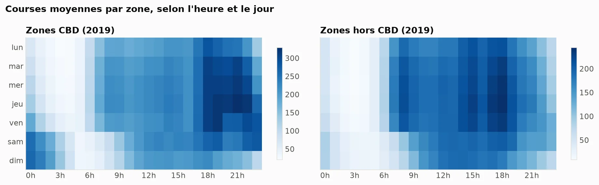

Les niveaux couvrent deux ordres de grandeur (20 à plus de 300 courses par heure), d'où une cible
en `log1p` (logarithme de 1 + la valeur) et un **modèle global** avec la zone en variable
catégorielle : un seul objet à surveiller.

## 5. Le modèle surveillé (E0)

Le projet ne cherche pas le meilleur forecaster mais un forecaster **réaliste**, pour l'observer
vieillir : un LightGBM global, standard de fait de la prévision de demande tabulaire, avec des lags
de 24 à 336 heures, deux moyennes glissantes, le calendrier, la météo et la zone (15 entrées).
Trois modèles quantiles donnent une prévision centrale (q50) et un intervalle [q10, q90] censé
couvrir 80 % des cas. Une fois entraîné, le modèle est **figé** : il devient l'objet observé.

Le premier modèle incluait la saison (jour de l'année). Entraîné de janvier à août, il voyait sur la
référence des valeurs **jamais rencontrées** :

| Variante (référence E1) | MAE | Couverture de l'intervalle 80 % |
|---|---|---|
| avec la saison | 29,5 | 58 % |
| **sans** (retenue) | **22,7** | **72 %** |

Première rencontre avec le sujet du projet : une entrée qui encode le temps absolu **dérive
toujours** entre entraînement et production, sans que le monde ait changé.

| Expérience | Période | Modèle | MAE | sMAPE (%) | Couv. 80 % |
|---|---|---|---|---|---|
| E1 (2019-2020) | référence | LightGBM | 22,7 | 20,5 | 71,5 |
| E1 (2019-2020) | référence | seasonal naive | 31,1 | 26,5 | - |
| E1 (2019-2020) | analyse (COVID) | LightGBM | 14,0 | 61,6 | 56,7 |
| E2 (2024-2025) | référence | LightGBM | 14,9 | 33,5 | 71,8 |
| E2 (2024-2025) | référence | seasonal naive | 19,7 | 40,5 | - |
| E2 (2024-2025) | analyse (congestion) | LightGBM | 14,3 | 30,0 | 75,2 |

LightGBM bat le *seasonal naive* (la demande de la même heure une semaine plus tôt) de 24 à 27 %,
et MSTL sur huit zones testées. Une ligne doit arrêter l'œil : **pendant le COVID, la MAE baisse**
alors que l'erreur relative (sMAPE) triple. C'est un piège central (section 6).

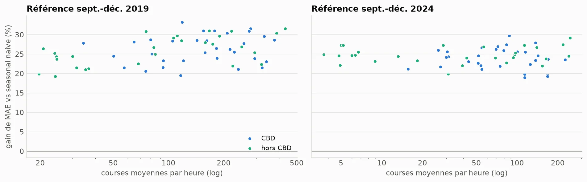

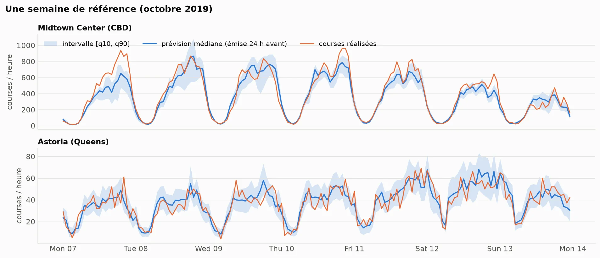

 pèse plus de la moitié.")

Le poids du lag hebdomadaire conditionne tout ce qui suit : après un choc, le modèle ne rattrape le
nouveau régime qu'une semaine plus tard, quand `lag_168` l'a vu. Pendant ce temps, il se trompe pour
une raison que ses entrées ne montrent pas.

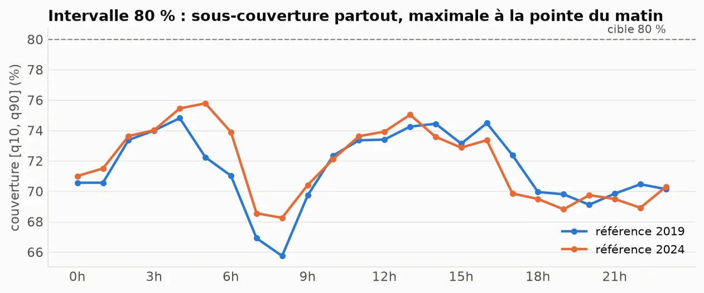

L'intervalle est trop étroit (72 % au lieu de 80 %). Le défaut est documenté plutôt que corrigé, et
la couverture réalisée devient un indicateur de santé, comparé à **sa** valeur de référence.

## 6. Les outils du monitoring, et leurs angles morts

### Deux façons pour le monde de changer

Un modèle apprend une relation entre des entrées \(X\) et une cible \(y\), dont la loi jointe se
décompose en \(P(X, y) = P(y \mid X)\,P(X)\). Chaque terme peut bouger séparément.

 ; à droite, la relation change à entrées identiques (concept drift).")

| Dérive | Ce qui change | Trace dans les entrées ? | Exemple |
|---|---|---|---|
| **Covariate shift** | \(P(X)\), relation stable | **oui** | vague de chaleur, saison jamais vue |
| **Concept drift** | \(P(y \mid X)\) | **non**, s'il est pur | mêmes heure, météo et historique, mais une taxe fait baisser la demande |

Sans labels, un covariate shift est détectable et son impact estimable ; un **concept drift pur**
est invisible jusqu'à l'arrivée des labels.

**Le cas des modèles à lags** est la subtilité qui m'a le plus appris : la frontière entre les deux
**se déplace avec le temps**. Le jour du choc, la demande s'effondre mais les lags décrivent encore
le monde d'avant : du point de vue du modèle, c'est un concept drift pur. Dans les deux semaines
suivantes, les lags basculent et les entrées sortent du connu. Ensuite, le problème ressemble à un
covariate shift. Autrement dit : **pour un forecaster à lags, tout choc brutal commence comme un
concept drift**.

### DLE, l'erreur estimée

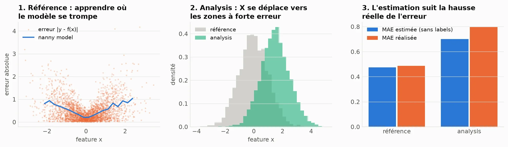

Sur la référence \(R\), le nanny model \(\hat g\) apprend la perte \(\ell\) de chaque ligne à partir
de ses entrées et de la prédiction du modèle figé \(f\) ; sur une journée \(C\) sans labels (60
zones × 24 heures = 1 440 lignes), on fait la moyenne des pertes prédites :

$$
\widehat{\mathrm{MAE}}(C) = \frac{1}{|C|} \sum_{i \in C} \hat g\big(x_i, f(x_i)\big)
$$

DLE ne réévalue jamais la carte des erreurs, il la **lit à de nouvelles positions**. Elle est fiable
si les entrées se déplacent dans des régions connues, **biaisée** (en général vers le bas) si elles
sortent du support de la référence, **aveugle** si la relation change à entrées stables. Un test
vérifie que DLE ne voit jamais les labels de la période analysée ; le seuil d'alerte est celui de
NannyML (moyenne des jours de référence + 3 écarts-types).

### La dérive des entrées : univariée et multivariée

, aire entre elles (Wasserstein), écart de répartition dans les déciles de la référence (PSI).")

Pour savoir si une entrée a bougé, on compare sa distribution du jour à celle de la référence.
Kolmogorov-Smirnov mesure le plus grand écart entre fonctions de répartition, Wasserstein la masse
à déplacer (dans l'unité de l'entrée), et le PSI le changement de répartition dans les déciles de
la référence :

$$
\mathrm{PSI} = \sum_{b=1}^{B} (c_b - r_b)\,\ln\frac{c_b}{r_b}
$$

Au-delà de 0,25, la dérive est jugée forte. Avec 1 440 lignes par jour, tout test est
significatif : on compare donc à la variabilité entre jours de référence, pas à une p-valeur.

Pour les changements de **structure**, NannyML reconstruit chaque ligne par une PCA ajustée sur la
référence : une ligne de structure inédite se reconstruit mal. L'inverse, que la documentation ne
dit pas : **un déplacement le long d'une composante principale ne change pas l'erreur de
reconstruction**.

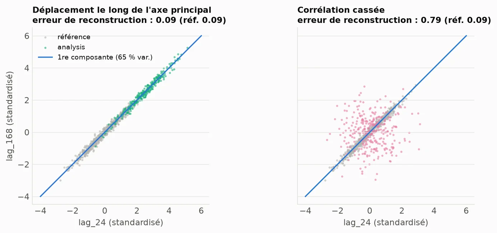

Or les lags d'un panel de demande sont très corrélés, et un choc les déplace ensemble, le long de
la première composante. Un test fige ce comportement, et le signal de dérive combine **PCA ou
PSI**. Le COVID montrera que la précaution n'était pas théorique.

### Le paradoxe de la MAE absolue

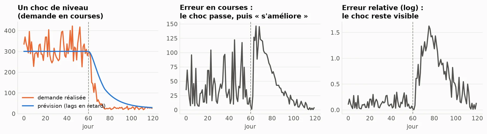

Quand une zone passe de 300 à 30 courses par heure, une erreur de 50 % ne pèse plus que 15 courses
au lieu de 150 : la MAE **baisse** alors que le modèle est devenu inutile. Le projet surveille donc
deux échelles : **count** (MAE en courses, lecture métier) et **log** (MAE sur `log1p`, environ
l'erreur relative), qui est l'**échelle de détection** des alertes.

## 7. E1 : le choc du COVID, estimé contre réalisé

Le modèle entraîné en 2019, figé, traverse le premier semestre 2020.

 et réalisée, révélée a posteriori (orange). En haut l'erreur relative, en bas l'erreur en courses. La bande rose couvre le mois qui suit l'état d'urgence.")

| Échelle | Phase | Estimée (DLE) | Réalisée | Estimée / réalisée |
|---|---|---|---|---|
| MAE log | avant (janv.-12 mars) | 0,217 | 0,202 | 1,08 |
| MAE log | choc (13 mars-12 avril) | 0,401 | 1,096 | **0,37** |
| MAE log | plancher (13 avril-30 juin) | 0,372 | 0,594 | 0,63 |
| MAE courses | avant | 22,8 | 20,6 | 1,11 |
| MAE courses | plancher | 6,2 | 3,5 | 1,76 |

**Avant le choc**, DLE suit l'erreur réalisée de près. **Pendant le choc**, l'erreur relative est
multipliée par cinq ; DLE monte, mais reste à **37 % de la réalité** : les lags décrivent encore le
monde d'avant, puis s'effondrent vers des niveaux jamais vus, et DLE extrapole. **Au plancher**, les
lags ont rattrapé le nouveau niveau et DLE sous-estime moins. En courses, c'est l'inverse : la MAE
réalisée **baisse** au plancher et DLE la surestime. Seule l'échelle relative dit que le modèle est
devenu inutile.

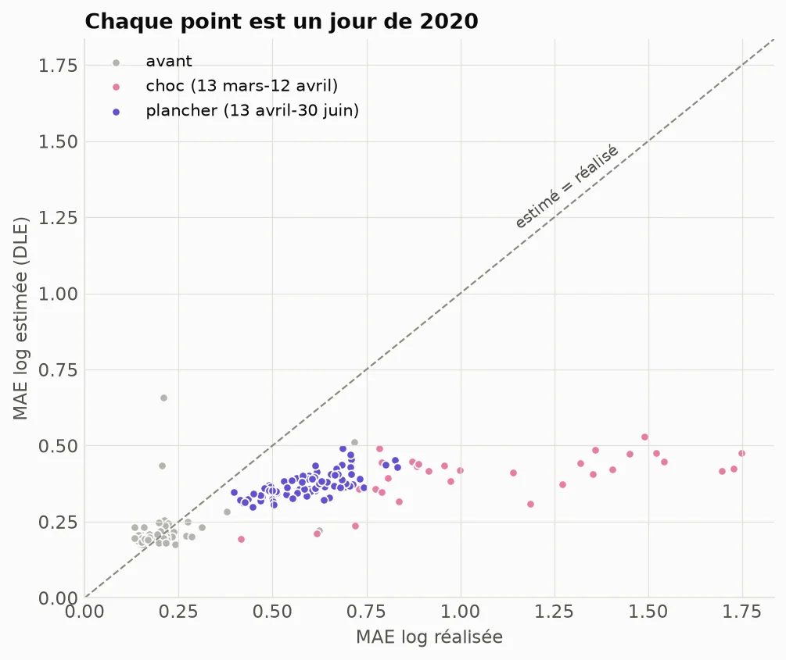

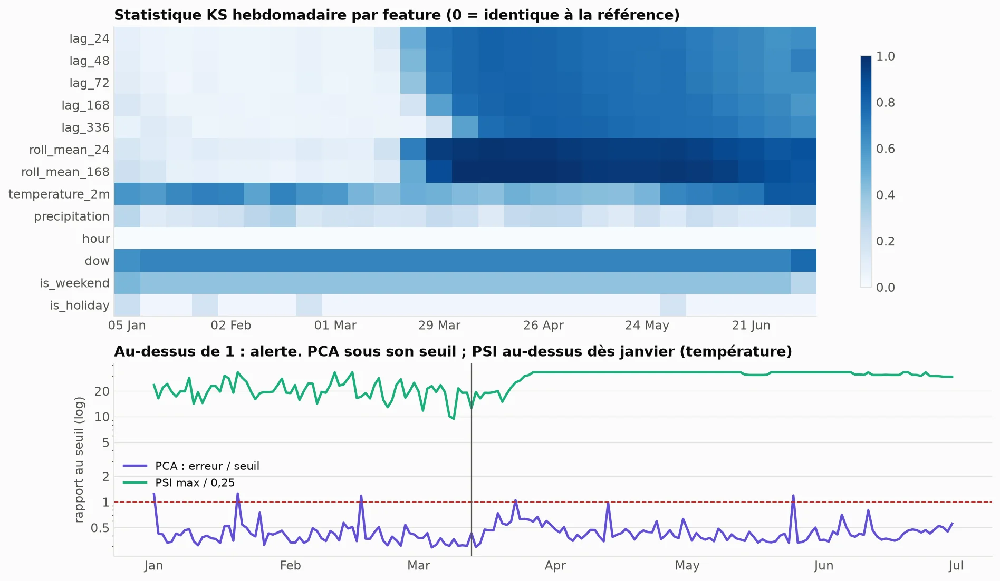

Côté dérive : **la température dérive en permanence** (hiver contre automne), **la PCA ne voit pas
le choc** (2,7 % de jours en alerte alors que le volume est divisé par plus de dix), et les entrées
calendaires testées jour par jour produisent des artefacts.

### Quand chaque politique aurait alerté

Les signaux journaliers forment quatre politiques, avec une persistance de deux jours : **P1** dérive
seule, **P2** DLE seul, **P3** dérive ET DLE, **P4** labels. Après les artefacts de E1 et E2, j'ai
déclaré une **« dérive nettoyée »** (P1b : seulement les lags de 24 et 168 heures) et sa condition
jointe P3b.

| Politique | Décision possible le | Délai (jours) | Jours en alerte avant le choc |
|---|---|---|---|
| P1 dérive seule | 12/03/2020 | -1 | **71** |
| P2 DLE seul | 22/03/2020 | 9 | 0 |
| P3 dérive ET DLE | 22/03/2020 | 9 | 0 |
| P4 labels | 14/05/2020 | **62** | 0 |
| P1b dérive nettoyée | 14/03/2020 | **1** | 0 |
| P3b dérive nettoyée ET DLE | 22/03/2020 | 9 | 0 |

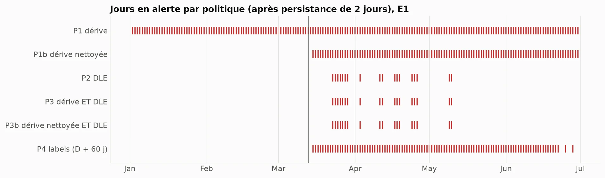

P1 alertait déjà depuis 71 jours : une alarme permanente n'a pas de délai, elle a 100 % de fausses
alertes. P2 et P3 décident le **22 mars**, neuf jours après l'état d'urgence, sans fausse alerte. P4
attend le **14 mai**. P1b décide **dès le 14 mars** : retirer la température et la moyenne glissante
transforme une alarme permanente en détecteur précoce. Deux mois plus tard, les labels donnent pour
ces journées une erreur trois à quatre fois supérieure à l'estimation : **la page aurait été juste
sur le fait, fausse sur l'ampleur.**

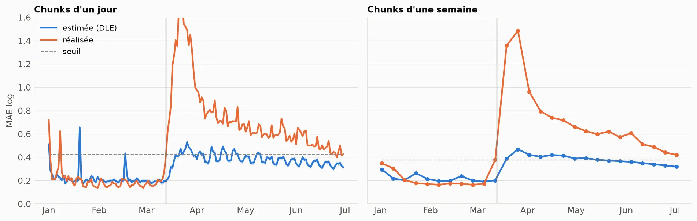

Une variante (E1 bis) calcule DLE par semaine : l'intervalle de confiance est 2,7 fois plus étroit,
et la semaine se comporte comme le jour avec deux jours de persistance. J'ai gardé la persistance,
qui conserve la granularité journalière utile au diagnostic.


**Ce que E1 établit.** Sur un choc réel, la performance estimée sans labels détecte en 9 jours ce
que les labels détectent en 62, mais pendant la rupture son chiffre est un minorant.


## 8. E2 : la taxe de congestion, une dérive sans impact

Le cahier des charges supposait que la taxe de congestion avait « déplacé la relation entre entrées
et demande ». E2 teste l'hypothèse en séparant les 32 zones CBD des 28 autres.

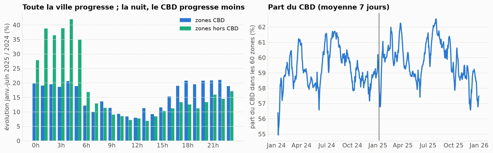

Toute la ville progresse (+7 à +42 % selon l'heure). La nuit, le CBD progresse de 16 à 21 points de
moins que le reste, le soir de 5 à 8 points de plus : une recomposition horaire, compatible avec un
effet de la taxe, sans qu'on puisse l'attribuer causalement ici.

| Groupe | Période | MAE log |
|---|---|---|
| CBD | référence (sept.-déc. 2024) | 0,253 |
| CBD | après le 5 janv. 2025 | **0,229** |
| hors CBD | référence | 0,305 |
| hors CBD | après le 5 janv. 2025 | **0,280** |

Le modèle **ne s'est pas dégradé** : son erreur est même plus faible qu'en référence. Une
recomposition progressive est absorbée en une à deux semaines par les lags ; une surtaxe de 0,75 $
n'est pas un COVID.

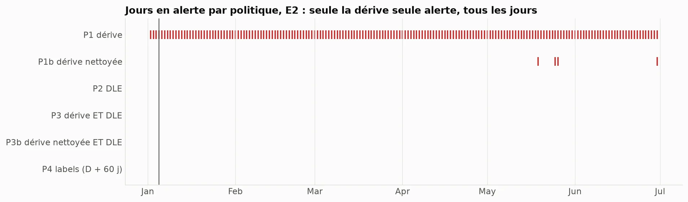

C'est le cas d'école de la **dérive sans impact** : la dérive seule alerte **177 jours sur 177**,
une astreinte réveillée tous les jours pendant six mois pour un modèle en parfaite santé. DLE, les
conditions jointes et les labels restent muets.

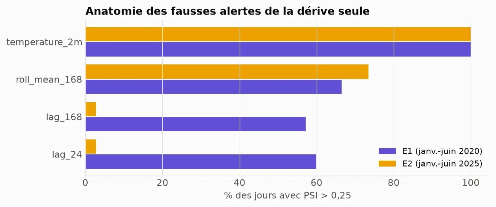

Deux sources de bruit : **la température** (dérive vraie, impact nul) et **la moyenne glissante sur 7
jours**, un artefact : sur une seule journée, elle varie à peine, sa distribution est resserrée et le
PSI explose sans déplacement réel.

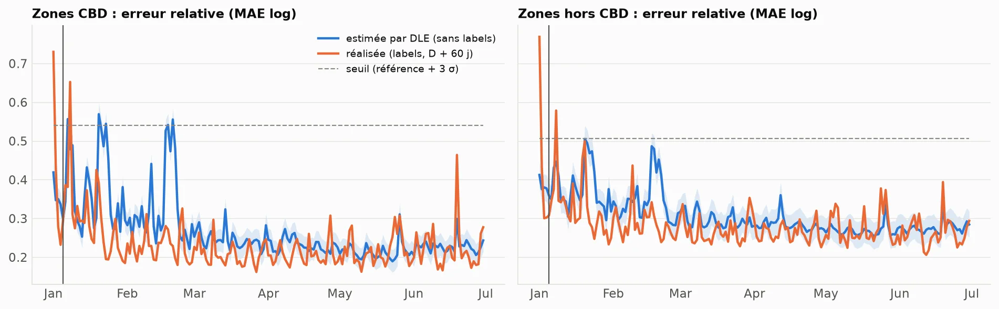

Les seuls pics de DLE tombent pendant deux vagues de froid, dans le 1 % le plus froid de la
référence : hors du connu, l'estimation peut aussi se tromper vers le haut.


**Ce que E2 établit.** Une rupture réelle ne dégrade pas forcément un modèle à lags. Alerter sur la
dérive seule y est intenable ; la condition jointe réduit le bruit à zéro sans rien rater.


## 9. E3 : la frontière où l'estimation ment

Un choc réel mélange tout. Pour **nommer le régime où l'estimation décroche**, E3 construit des
dérives pures sur la période calme de 2025, injectées le 3 mars :

| Famille | Construction | Pureté garantie |
|---|---|---|
| Covariate shift **nuisible** | rééchantillonnage de lignes **réelles** en sur-représentant les faibles niveaux | chaque ligne garde son vrai couple (entrées, demande) |
| Covariate shift **bénin** | idem, en sur-représentant les niveaux élevés | idem |
| Concept drift **pur** | demande multipliée, entrées et prévisions **gelées** | entrées intactes |
| Choc de niveau **propagé** | demande multipliée, lags recalculés | aucune : le cas réaliste |

Ma première version comparait avant et après l'injection, et mélangeait l'effet injecté avec
l'évolution naturelle de la saison. Chaque scénario est donc comparé au **même scénario sans dérive,
sur les mêmes jours**. Le **taux de suivi** vaut hausse estimée / hausse réalisée : 1 si DLE suit, 0
s'il est aveugle.

 contre hausse estimée (ordonnée). Sur la diagonale, DLE dit vrai ; sur l'axe horizontal, il est aveugle.")

| Scénario | Δ réalisé (établi) | Δ estimé (établi) | Taux de suivi |
|---|---|---|---|
| covariate nuisible, κ = 0,5 | 0,051 | 0,047 | 0,93 |
| covariate nuisible, κ = 2 | 0,189 | 0,161 | 0,85 |
| covariate bénin, κ = 2 | -0,086 | -0,085 | 0,99 |
| concept pur × 0,85 | 0,019 | 0,000 | **0,00** |
| concept pur × 0,5 | 0,381 | 0,000 | **0,00** |
| choc propagé × 0,5 (14 premiers jours) | 0,145 | 0,046 | 0,32 |

Sous **covariate shift**, DLE suit à 0,82-0,99, y compris les dérives qui *améliorent* le modèle,
que la dérive des entrées ne distingue pas d'une dégradation. Sous **concept drift pur**, le suivi
est **exactement nul** : une chute de 50 % de la demande, invisible pendant toute la fenêtre
aveugle. Le **choc propagé** n'est suivi qu'en partie, le temps que les lags l'absorbent.

 et réalisée (orange), avec en gris la réalisée sans dérive. Concept pur : la réalisée saute, l'estimée colle au contrefactuel.")

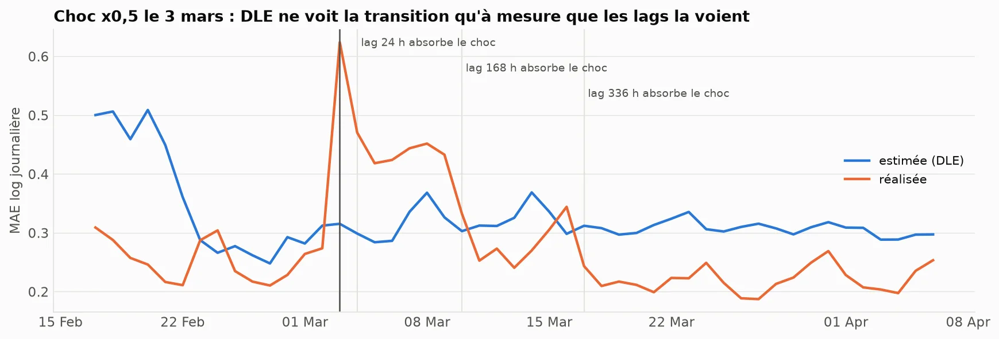

Le choc propagé au ralenti montre la mécanique du COVID : jour 0, la demande change mais pas les
entrées (concept drift pur, DLE aveugle) ; jours 1 à 7, les lags courts basculent et DLE monte ;
jours 7 à 14, `lag_168` et `lag_336` basculent et le modèle se recale.

 : les familles ne se chevauchent jamais.")

Rejouée avec cinq graines (E3 bis, critère déclaré avant exécution), la conclusion tient : le pire
covariate shift nuisible suit à 0,84, le meilleur concept drift à 0,00. L'exécution a aussi révélé
que le nanny model est **déterministe** : la robustesse mesurée est celle à l'injection.


**Ce que E3 établit.** L'hypothèse est confirmée, avec une netteté inattendue. Autre constat : les
seuils par défaut de NannyML n'alertent dans **aucun** de ces scénarios, même pour +60 % d'erreur.
Régler les seuils est l'objet de E4.


## 10. E4 : tester le moniteur lui-même

Un moniteur répond chaque jour à une question binaire : « le modèle va-t-il mal ? ». Comme tout
classifieur, il a un **rappel** (part des vraies dégradations détectées), un **taux de fausses
alertes** et un **délai**. Ne pas les mesurer, c'est brancher sur une astreinte un système dont on
ignore tout.

| Élément | Choix |
|---|---|
| Scénarios | 240 tirés au hasard : aucune dérive (42), covariate nuisible (50), bénin (44), concept pur (49), choc propagé (55) |
| Paramètres tirés | intensité, sous-ensemble de zones ou d'heures, date de début |
| Nuisible | erreur réalisée en hausse de **plus de 10 %** sur 28 jours, contre le contrefactuel |
| Détection | un **allumage** d'alerte (front montant) dans les 28 jours ; une alarme déjà allumée ne détecte rien |
| Seuils | moyenne + k écarts-types des jours de référence |

La règle du front montant vient d'une erreur : ma première version donnait 100 % de rappel à la
dérive seule, allumée en permanence. Autre point clé, un **scoreur par ligne** qui réutilise les
modèles de NannyML (égalité testée) a fait passer le backtest de plusieurs jours à onze minutes.

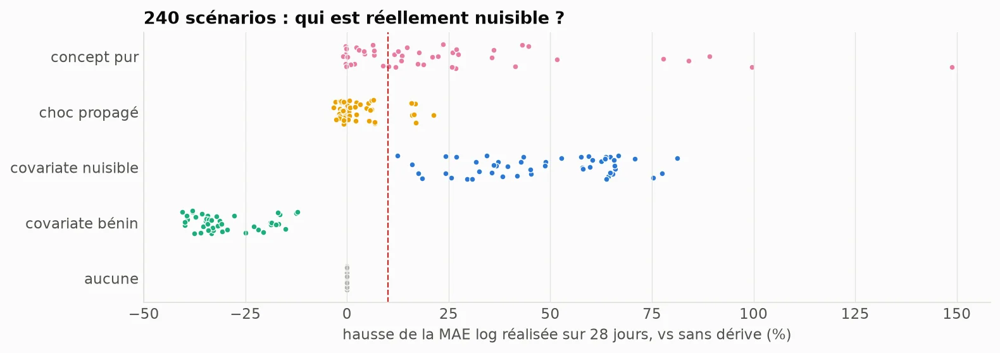

87 scénarios sont nuisibles, dont **6 chocs propagés seulement** : sur un modèle à lags, un choc de
niveau ne nuit qu'une semaine ou deux, un concept drift souvent et longtemps.

| Signal | Politique | Rappel [IC 90 %] | Délai médian | Fausses alertes / 30 j | Alerte sur dérive bénigne |
|---|---|---|---|---|---|
| journalier | P1 dérive seule | 0 % (toujours allumée) | - | - | - |
| journalier | P1b dérive nettoyée | 67 % [58 ; 74] | 0 j | 0,16 | 55 % |
| journalier | P2 DLE seul | 56 % [47 ; 65] | 0 j | 1,19 | 23 % |
| journalier | P3b dérive nettoyée ET DLE | 45 % [36 ; 54] | 0 j | **0,00** | 13 % |
| journalier | P4 labels | 70 % [62 ; 78] | 61 j | 0,62 | 2 % |
| lissé 7 j | P2 DLE seul | 56 % [48 ; 65] | 3 j | 0,85 | 22 % |
| lissé 7 j | **P3b dérive nettoyée ET DLE** | **51 %** [42 ; 59] | 3 j | **0,00** | 14 % |

La dérive nettoyée détecte beaucoup mais alerte sur **55 % des dérives bénignes**. DLE seul fait plus
d'une fausse alerte par mois. **La condition jointe nettoyée est la seule à zéro fausse alerte** ;
lissée sur 7 jours, elle détecte 51 % des nuisibles en 3 jours médians. Les labels détectent le plus,
deux mois trop tard. Limite écrite dans la page : les jours sans dérive viennent tous de la même
période, l'incertitude sur les fausses alertes est sous-estimée (d'où E4 ter).

 reste à zéro fausse alerte sur toute la plage ; DLE seul (bleu) achète son rappel par des fausses alertes.")

Pour la condition jointe, la dérive nettoyée sert de filtre et DLE de juge : même au seuil le plus
bas, elle atteint 54 % de rappel sans fausse alerte.

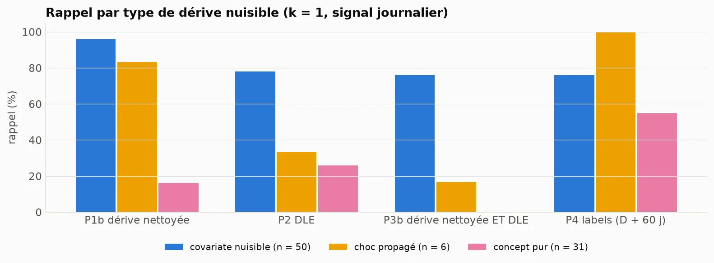

Sur le concept drift pur, les « détections » de la dérive nettoyée et de DLE seul sont **fortuites**
(une fausse alerte tombée dans la fenêtre) ; la condition jointe est à 0 %, ce qui est la vérité.
**Le plafond de rappel des signaux sans labels est fixé par la part de concept drift** : ici 31
nuisibles sur 87, soit environ 64 % au mieux.

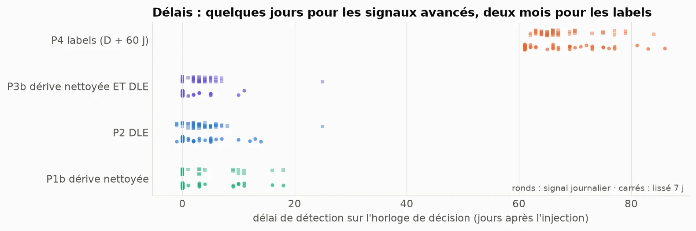

Un notebook du site donne un prix à chaque erreur : la dérive nettoyée seule gagne tant qu'une
fausse page coûte moins de 7,5 % d'une dégradation manquée, la condition jointe au-delà.

### Sensibilité et périodes calmes (E4 bis et ter)

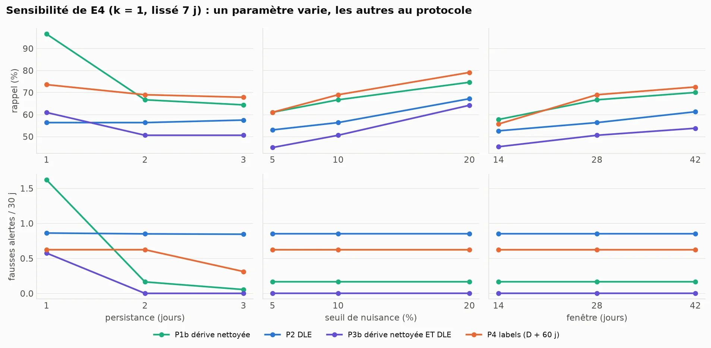

| Persistance | Rappel P3b | Fausses alertes / 30 j | Délai médian |
|---|---|---|---|
| 1 j | 61 % | **0,58** | 2 j |
| 2 j | 51 % | 0,00 | 3 j |
| 3 j | 51 % | 0,00 | 4 j |

**La persistance est le paramètre critique** : à un jour, la condition jointe perd sa propriété
principale. Le seuil de nuisance et la fenêtre déplacent tous les rappels ensemble sans changer le
classement.

E4 ter ajoute deux périodes calmes réelles (automnes 2019 et 2024), sans injection :

| Période | Politique | Allumages / 30 j | dont sur dégradation réelle | Dégradation réelle couverte |
|---|---|---|---|---|
| sept.-déc. 2019 | P2 DLE seul | 0,74 | **100 %** | 41 % |
| sept.-déc. 2024 | P2 DLE seul | 0,49 | **100 %** | 38 % |
| janv.-juin 2025 | P2 DLE seul | 0,50 | 22 % | 100 % |
| les trois | P3b condition jointe | **0,00** | - | 0 % |

Le zéro fausse page se réplique. Mais **« calme » ne veut pas dire « sans dégradation »** : le modèle
se dégrade pendant les fêtes, et chaque jour d'alerte de DLE seul tombe alors sur une vraie
dégradation, que la condition jointe ignore (les lags ne bougent pas). D'où un ajustement : la
condition jointe déclenche la **page**, DLE seul persistant ouvre un **ticket** « dégradation
probable ».

## 11. E5 : réentraîner, mais pas par réflexe

Une alerte a sonné : faut-il réentraîner ? E5 rejoue toute l'année 2020 jour par jour, avec des
labels à **J + 60** (publication TLC) ou **J + 1** (un opérateur qui connaît ses courses le
lendemain).

| Politique | Règle |
|---|---|
| jamais | le modèle de 2019 reste en service |
| calendrier | réentraînement mensuel sur les 8 derniers mois de labels |
| réflexe | dès la première alerte (22 mars), sur 8 mois de labels |
| réflexe court | même date, sur les seuls labels postérieurs au 13 mars |
| gardé | dérive confirmée ET 28 jours de labels post-alerte ; challenger promu s'il bat le modèle en place de 5 % sur des labels postérieurs |

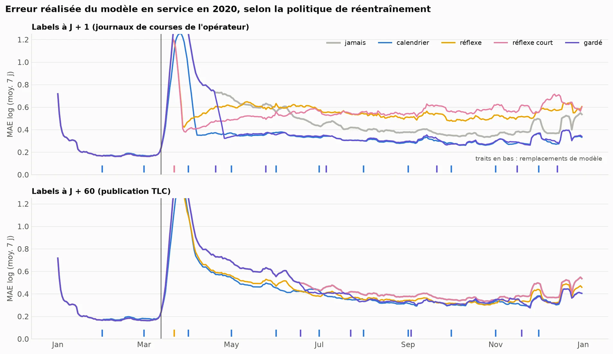

| Labels | Politique | Choc | 2nd semestre | 13 mars-31 déc. | Remplacements |
|---|---|---|---|---|---|
| J + 1 | jamais | 1,096 | 0,397 | 0,524 | 0 |
| J + 1 | calendrier | 0,755 | 0,301 | **0,363** | 11 |
| J + 1 | réflexe | 0,657 | 0,532 | 0,565 | 1 |
| J + 1 | réflexe court | **0,600** | 0,577 | 0,565 | 1 |
| J + 1 | gardé | 1,096 | 0,306 | 0,411 | 6 |
| J + 60 | calendrier | 0,927 | 0,334 | 0,435 | 11 |
| J + 60 | gardé | 1,096 | 0,345 | 0,489 | 4 |

- **Le réflexe fait pire que ne rien faire** (0,565 contre 0,524) : il mélange huit mois de « vieux
  monde » et quelques jours de confinement, puis reste coincé. À J + 60, c'est pire dans le
  principe : le 22 mars, les derniers labels publiés datent du 22 janvier.
- **Huit jours de labels, c'est apprendre le bruit** : le réflexe court est le meilleur pendant le
  choc, puis le pire au second semestre, figé sur les pires semaines.
- **La politique gardée évite les accidents** : elle attend, promeut un challenger le 20 avril et
  rejoint le meilleur niveau avec des remplacements tous validés.
- **Le calendrier mensuel est le meilleur sur 2020**, résultat que je n'attendais pas : il s'adapte
  dès le 1er avril sans attendre de preuve. Mais il impose 11 remplacements par an quoi qu'il arrive
  et n'a aucun garde-fou contre des données corrompues ou pilotées par le modèle lui-même.

Ce dernier point renvoie à la boucle de rétroaction de Sculley : la décision de réentraînement
refuse aussi une fenêtre de labels **pilotée à 100 % par le modèle** (zones témoins positionnées
indépendamment, journal de la demande non servie).

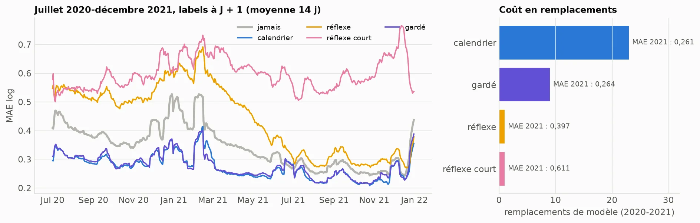

E5 bis prolonge la simulation sur la reprise de 2021 : la politique gardée **rejoint le calendrier**
(MAE log 0,264 contre 0,261) avec **9 remplacements au lieu de 23**. L'avantage du calendrier tenait
au choc de 2020.


**Ce que E5 établit.** Pas de réentraînement réflexe. **Le délai des labels décide de tout** : à 60
jours, aucune politique ne réagit au choc ; à un jour, les bonnes politiques convergent en quelques
semaines. Recommandation : politique gardée, avec un réentraînement de fond trimestriel comme filet.


## 12. Les extensions : localiser, désaisonnaliser, vérifier les données

Ces extensions sont hors protocole, chacune déclarée dans une issue avant exécution.

### E6 : localiser la dérive par zone

Une alerte dit qu'il y a un problème ; il faut ensuite savoir **où**, pour repositionner la flotte
et exclure des zones d'un réentraînement.

 et estimée sans labels (à droite). Échelles différentes, même carte.")

| Zone | Hausse réalisée | Hausse estimée | Rang estimé (sur 60) |
|---|---|---|---|
| Meatpacking/West Village West | 1,44 | 0,30 | 2 |
| TriBeCa/Civic Center | 1,29 | 0,31 | 1 |
| SoHo | 1,24 | 0,27 | 6 |
| Lower East Side | 1,24 | 0,17 | 40 |
| Midtown Center | 1,23 | 0,29 | 3 |

**Sans un seul label**, la perte estimée classe les zones presque comme l'erreur réalisée
(corrélation de rang 0,74) : l'ampleur est fausse, le classement largement juste.

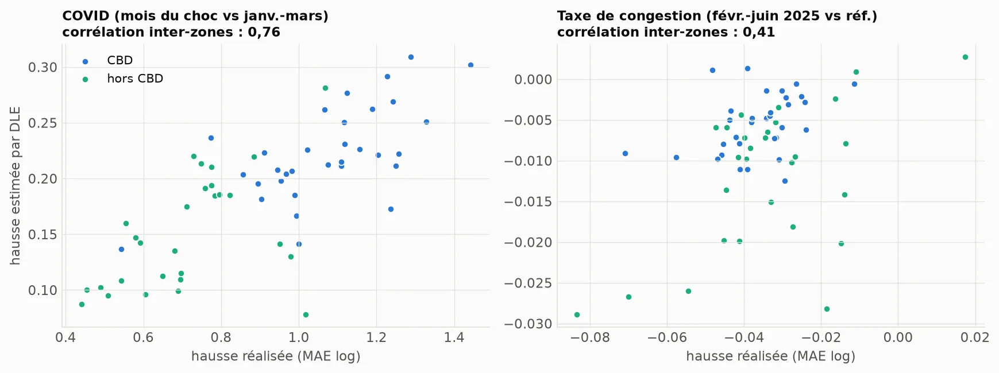

.")

Sur des dérives injectées dans le seul CBD, la perte estimée localise parfaitement un choc (AUC
1,00) et pas du tout un concept drift (0,50) : la frontière de E3 se retrouve à la maille de la zone.
Le PSI brut échoue (0,46), noyé dans la saison. Après une page, la première chose à ouvrir est donc
la **carte de perte estimée par zone**.

### E7 : comparer chaque jour à sa propre saison

L'idée naturelle contre le bruit saisonnier : comparer chaque jour aux mêmes semaines de l'année
précédente. Un test synthétique écrit avant l'exécution l'avait prévu : le PSI d'une seule journée
reste élevé **même contre la bonne saison**, car une journée est bien plus resserrée que 28 jours.
J'ai donc ajouté, étiqueté comme tel, un **z-score saisonnier** de la moyenne journalière.

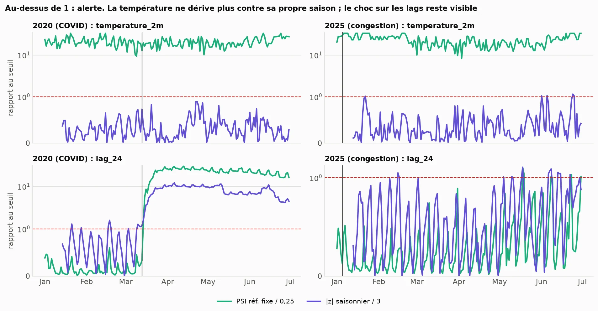

Pour la température, le z-score ne déclenche jamais en 2020 et une seule fois en 2025 (une vague de
chaleur) : la première source de fausses alertes disparaît. Sur `lag_24`, il détecte le COVID le jour
même.

**E4 quater** l'a ensuite mis dans la condition jointe à la place du PSI des lags, et la surprise
déclarée s'est produite : 0,26 fausse alerte par mois au lieu de 0. Son gain apparent de rappel
venait uniquement de détections fortuites. La base de l'année précédente importe tout ce qui a
changé d'une année sur l'autre, dont la croissance de la demande. Le z-score saisonnier convient aux
entrées exogènes comme la température, pas aux lags d'une demande en croissance.

### E8 : quand ce sont les données qui mentent

Un bug de données produit les symptômes d'une dérive. Trois contrôles journaliers, comparés aux
quatre mêmes jours de semaine précédents et calendrier connu exclu : volume du jour, corrélation du
profil horaire, nombre de zones sans course. Quatre bugs sont injectés du 3 au 9 mars 2025.

 : duplication à 2,2, troncature à 0,6, corrélation du profil à 0,72 avec le décalage d'une heure, 3 zones muettes.")

| Bug | Contrôles : 1er signal | Jours P3b | Perte estimée | Perte réalisée |
|---|---|---|---|---|
| aucun | - | 0 | 0,279 | 0,241 |
| troncature | 3 mars | 0 | 0,305 | 0,397 |
| duplication | 3 mars | 0 | 0,265 | **0,585** |
| décalage 1 h | 4 mars | 0 | 0,282 | 0,348 |
| zone muette | 3 mars | 0 | 0,295 | 0,426 |

Les contrôles voient tout en un ou deux jours ; le moniteur de modèle presque rien. Pourtant l'erreur
réalisée explose : dans deux mois, les labels **accuseraient le modèle** et un réentraînement
apprendrait sur des données corrompues. La couche qualité passe donc **avant** le moniteur.

### E9, E10, E0 bis : trois vérifications

**E9** remplace la météo réalisée par la prévision réellement émise la veille (1,5 °C d'erreur, pluie
prévue 41 % du temps) : la MAE bouge de **0,08 %**. L'hypothèse optimiste ne biaisait rien.

**E10** évalue la condition jointe par groupe de zones (CBD, hors CBD) : le rappel passe de 51 % à
**55 %**, toujours sans fausse alerte.

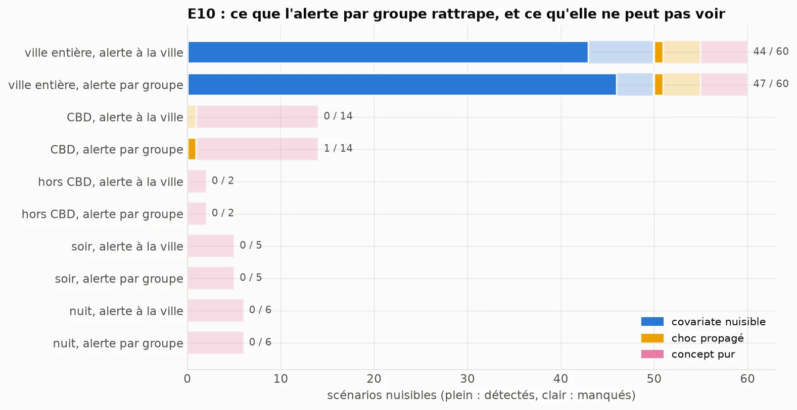

Mais 26 des 27 dérives locales nuisibles sont des concept drifts : affiner la maille ne perce pas
l'angle mort.

**E0 bis** calibre les intervalles par calibration conforme (CQR), dont la garantie suppose que
calibration et usage se ressemblent. Calibrée sur la rentrée, elle ne tient pas pendant les fêtes ;
la version glissante recalcule la correction chaque jour sur les 28 derniers jours de labels publiés.

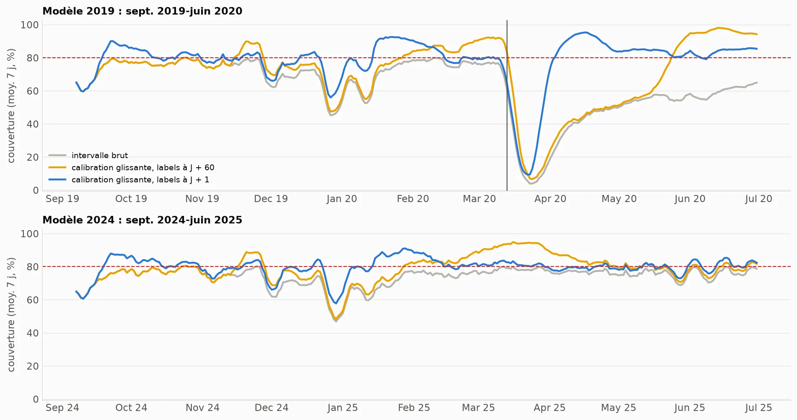

Même message que E5 : **le délai des labels décide de la capacité d'adaptation**, bien plus que la
méthode.

## 13. De la mesure à l'exploitation

### La décision en dix lignes

1. **D'abord les données** : contrat et contrôles de qualité ; un échec suspend la lecture du
   modèle (E8).
2. **La perte estimée décide, la dérive qualifie**, la dérive des prédictions sert de contrôle de
   cohérence.
3. **Page** seulement sur la condition jointe persistante deux jours ; dérive seule ou perte estimée
   seule ouvrent un **ticket** (E4).
4. **Seuils** issus de la référence, recalculés à chaque nouveau modèle, sur un signal lissé 7 jours.
5. **La performance réalisée** audite le moniteur et déclenche le réentraînement.
6. **Angle mort assumé** : le concept drift pur se couvre par des labels précoces et des indicateurs
   externes (demande non servie).
7. **Réentraînement gardé**, validé sur une fenêtre postérieure (E5).
8. **Jamais de réentraînement réflexe**.
9. **Contre la boucle de rétroaction** : zones témoins, refus d'apprendre sur une fenêtre pilotée
   par le modèle.
10. **Le moniteur se backteste** avant d'être branché sur une astreinte.

```text
PAGE    si  (psi_lag24 > 0,25 OU psi_lag168 > 0,25 OU pca_alert)
         ET dle_mae_log_lisse_7j > seuil_reference(k = 1)
         pendant 2 jours consécutifs
TICKET  si  dérive nettoyée seule 7 jours, ou perte estimée seule 2 jours
INCIDENT DONNÉES  si un contrôle de qualité échoue   -> prime sur tout le reste
```

Le premier levier n'est pourtant pas un algorithme. Aucun réglage ne rend le concept drift visible
(E3, E4, E10), mais ZoneFleet connaît ses propres courses le lendemain : **brancher le monitoring
réalisé sur les journaux internes fait passer la fenêtre aveugle de 61 jours à 2**, et rend aussi le
réentraînement (E5) et la calibration (E0 bis) réactifs.

### Une mise en production de démonstration

Le dépôt contient une chaîne locale complète : **Dagster** orchestre le monitoring comme un graphe
d'*assets* (données et dépendances déclarées) avec quatre contrôles qualité, en 22 secondes ;
**MLflow** tient le registre (alias `champion`, challenger promu à +5 %) ; les décisions sont des
fonctions pures testées sans orchestrateur ; une CLI `zonefleet` lance les 17 expériences et
variantes, les alertes et le rapport du matin.

Ce **rapport du matin** résume chaque jour sévérité, signaux, zones en tête de perte estimée et
recommandation. Une règle y a été ajoutée après une erreur : dans un rejeu historique, il masque
toute perte réalisée publiée après sa date. Sans elle, le rapport du 23 mars 2020 affichait une
perte connue seulement en mai et recommandait de réentraîner.

En relisant ce rapport pour l'article, j'ai remarqué que sa sévérité est « **INCIDENT DONNÉES** »,
pas « page » : le volume du jour vaut 7 % de la médiane des quatre lundis précédents, bien sous le
seuil qualité, et la page de documentation, écrite avant cette couche, commente encore une page. Le
constat est instructif : **un effondrement réel ressemble exactement à un fichier tronqué**, et la
décision finale demande un humain qui sait qu'un état d'urgence vient d'être déclaré.


flowchart TD
  P["PAGE reçue"] --> C1{"contrat et qualité<br/>des données OK ?"}
  C1 -- non --> D["Incident DONNÉES :<br/>geler les prévisions,<br/>positionnement de repli"]
  C1 -- oui --> C2{"perte estimée par zone :<br/>quelques zones ou toute la ville ?"}
  C2 -- quelques zones --> L["repositionnement manuel<br/>des zones en tête de carte"]
  C2 -- toute la ville --> G{"événement connu ?<br/>(météo, férié, grève)"}
  G -- oui --> E["annoter, surveiller 48 h,<br/>pas de réentraînement"]
  G -- non --> R["bascule seasonal naive<br/>sur les zones critiques"]


## 14. Ce que j'en retiens

Ces constats valent pour un forecaster à lags, 60 zones de taxis new-yorkais, deux chocs réels et
des dérives construites sur une période calme.

1. **Estimer la performance sans labels fonctionne quand les entrées se déplacent.** La compétence
   n'est pas d'utiliser DLE, c'est de savoir **quand ne pas le croire**.
2. **Pour un modèle à lags, tout choc commence comme un concept drift.** Cette idée, absente de mon
   plan de départ, explique le décrochage du COVID, le choc propagé et le plafond de rappel.
3. **Une dérive n'est pas une dégradation** : la taxe de congestion a recomposé la demande sans
   dégrader le modèle.
4. **Le moniteur se teste comme un modèle** : sans backtest, je n'aurais vu ni le faux rappel de
   100 % ni le rôle critique de la persistance.
5. **Les données d'abord, et des labels plus tôt** : ce sont les deux leviers les plus puissants,
   et aucun n'est un algorithme de monitoring.
6. **Le protocole figé a changé ma lecture de mes propres résultats** : écrire « ce qui serait une
   surprise » m'a obligé à publier ceux qui contredisaient mon intuition, souvent les plus
   instructifs.

Ce que je referais autrement : tester chaque signal sur un cas synthétique avant les données
réelles (le test de E7 l'a fait, pas celui de E6), écrire le scoreur par ligne dès le départ, et
inscrire plusieurs périodes calmes dans le protocole. Restent ouverts : le concept drift avant les
labels, un minorant fiable de l'ampleur pendant une rupture, le transfert des seuils à une autre
ville, et le coût réel des alertes chez un opérateur.


**Une question pour vérifier sa compréhension.** *La dérive des entrées alerte depuis trois
semaines, mais la perte estimée reste sous son seuil. Le modèle va-t-il bien ?* Pas forcément. Ce
peut être une dérive sans impact (section 8), mais si la relation entre entrées et demande a changé,
DLE est aveugle (section 9) et la dérive est le seul indice avant les labels. C'est pourquoi elle
ouvre un ticket, et pourquoi la vraie réponse est d'obtenir des labels plus tôt.


## Reproduire et aller plus loin

Le code, les tests et les résultats sont dans le dépôt
[gwils28/zonefleet-observability](https://github.com/gwils28/zonefleet-observability) (Python 3.12,
`uv`, image Docker). Le panel agrégé est versionné : aucune donnée brute n'est nécessaire.

```bash
git clone https://github.com/gwils28/zonefleet-observability && cd zonefleet-observability
uv sync --all-extras
make check            # lint, typage, plus de 160 tests
make e0 e1 e2 e3      # quelques minutes
make e4 e5            # environ 20 minutes
make release-check    # toutes les figures et tables régénérées, sans différence
```

Le [site du projet](https://gwils28.github.io/zonefleet-observability/) propose trois parcours de
lecture (15 minutes, une heure, une journée), des graphiques interactifs, trois notebooks, le
runbook et le journal de bord ; la
[version 1.0](https://github.com/gwils28/zonefleet-observability/releases/tag/v1.0.0) archive les
résultats.

**Sources**

- NannyML, [dépôt](https://github.com/nannyml/nannyml) et documentation sur l'[estimation de performance](https://nannyml.readthedocs.io/en/stable/how_it_works/performance_estimation.html) et la [dérive multivariée](https://nannyml.readthedocs.io/en/stable/how_it_works/multivariate_drift.html).
- Alam, Rahman et Sadeqa, [*DriftGuard: A Hierarchical Framework for Concept Drift Detection and Remediation in Supply Chain Forecasting*](https://arxiv.org/abs/2601.08928), arXiv, janvier 2026.
- Sculley et al., [*Hidden Technical Debt in Machine Learning Systems*](https://proceedings.neurips.cc/paper/2015/hash/86df7dcfd896fcaf2674f757a2463eba-Abstract.html), NeurIPS 2015.
- NYC Taxi & Limousine Commission, [Trip Record Data](https://www.nyc.gov/site/tlc/about/tlc-trip-record-data.page) ; Open-Meteo, [archive historique](https://open-meteo.com/en/docs/historical-weather-api) et [Previous Runs API](https://open-meteo.com/en/docs/previous-runs-api).
