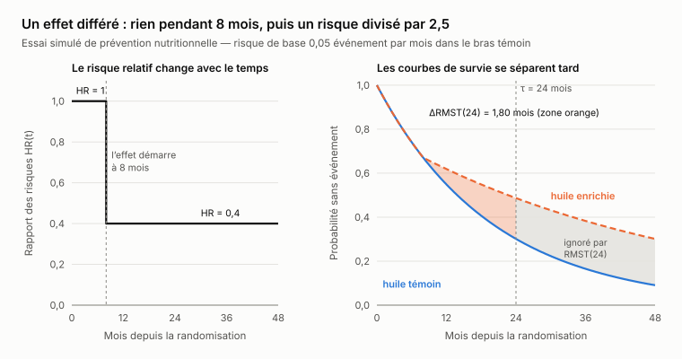
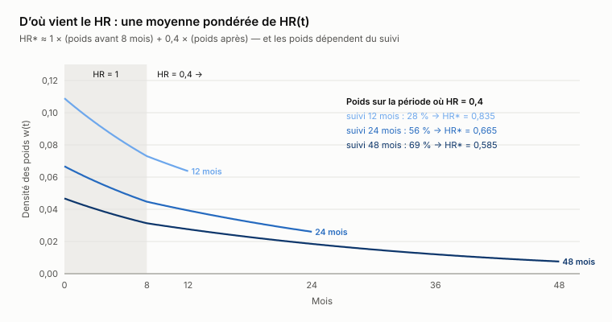
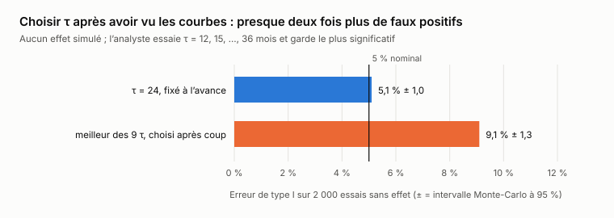




**Brouillon en cours de rédaction.** Le projet n'est pas terminé : l'étude de simulation
(notebook 03) et l'analyse de la censure informative (notebook 04) restent à faire. Les
sections marquées « à venir » seront écrites quand leurs résultats existeront. Rien ici n'est
définitif, en particulier les conclusions.



Un même traitement, une même population, et pourtant quatre hazard ratios : 0,83, 0,67, 0,58,
0,55. Seule la durée du suivi a changé. Quand l'effet d'un traitement tarde, le chiffre phare
des essais cliniques cesse de décrire le traitement. Il décrit aussi le calendrier de l'essai.


*Temps de lecture : à préciser quand l'article sera complet. Les formules sont toujours suivies
de leur intuition : on peut les survoler sans perdre le fil.*



Cet article restitue ma **veille active de la semaine 41** (octobre 2026). Je ne me suis pas
contenté de lire : j'ai écrit un petit paquet Python testé, `rmstpy`, vérifié contre R au
quinzième chiffre près, simulé un essai de prévention nutritionnelle et figé un protocole de
simulation avant d'en voir le moindre résultat. Tout est reproductible dans le dépôt
[RMST_VS_Cox](https://github.com/gwils28/RMST_VS_Cox). **Toutes les données sont simulées ;
aucune donnée de patient.**


**En bref (provisoire).**

1. **Le HR de Cox n'est pas un estimand** sous un effet différé : il converge vers une moyenne
   pondérée du rapport des risques au cours du temps, et les poids dépendent du suivi.
2. **La RMST en est un** : un temps moyen sans événement sur un horizon \(\tau\) fixé à
   l'avance, exprimé en mois gagnés.
3. **Son prix, c'est \(\tau\)** : choisi après avoir vu les courbes, il fait presque doubler
   le taux de faux positifs (9,1 % au lieu de 5 %).
4. *Est-elle plus puissante que le log-rank ? Réponse dans l'étude de simulation, à venir.*


## 1. Le cas d'étude : un effet qui tarde

Imaginons un essai de prévention de long terme. Des adultes à risque cardiovasculaire modéré
reçoivent soit une huile enrichie (en oméga-3 ou en stérols végétaux), soit une huile témoin.
Le critère de jugement est le délai avant un premier événement cardiovasculaire majeur.

Un régime alimentaire n'agit pas du jour au lendemain. Il est plausible que l'effet soit
**différé** : rien pendant les premiers mois, puis une baisse durable du risque. Le scénario
simulé est volontairement simple :

- dans le bras témoin, le risque instantané est constant, \(h_0(t) = \lambda = 0{,}05\)
  événement par mois (survie médiane d'environ 14 mois) ;
- dans le bras traité, il est identique pendant 8 mois, puis multiplié par 0,4.

$$
h_1(t) = \begin{cases} \lambda & t < 8 \text{ mois} \\ 0{,}4\,\lambda & t \ge 8 \text{ mois} \end{cases}
\qquad\Longrightarrow\qquad \mathrm{HR}(t) = \frac{h_1(t)}{h_0(t)} \in \{1;\ 0{,}4\}.
$$

Il n'existe donc **pas de « vrai HR » unique** : le rapport des risques est une fonction du
temps. Toute la suite découle de cette remarque.



Les deux courbes de survie sont confondues pendant 8 mois, puis s'écartent, et l'écart ne cesse
de grandir : le bénéfice s'accumule. Un résumé qui ignore *quand* la différence apparaît
dépendra forcément de *combien de temps* on regarde.

## 2. Le hazard ratio de Cox n'est pas un estimand

### Un traitement, quatre hazard ratios

Première expérience : 20 000 patients par bras, assez pour que le bruit d'échantillonnage soit
négligeable. On les suit 12, 24, 48 ou 120 mois, sans aucune perte de vue, et on ajuste un
modèle de Cox à chaque fois.

| Suivi | Événements | HR de Cox | IC à 95 % | Limite théorique |
|---:|---:|---:|:---:|---:|
| 12 mois | 16 565 | 0,834 | [0,809 ; 0,860] | 0,835 |
| 24 mois | 24 232 | 0,666 | [0,649 ; 0,683] | 0,665 |
| 48 mois | 32 103 | 0,584 | [0,571 ; 0,597] | 0,585 |
| 120 mois | 38 554 | 0,554 | [0,543 ; 0,566] | 0,558 |

Les quatre intervalles de confiance **ne se chevauchent pas**. Ce ne sont pas quatre estimations
bruitées d'une même quantité : ce sont **quatre quantités différentes**. La dernière colonne ne
vient pas d'une simulation. C'est la valeur vers laquelle l'estimateur de Cox converge quand
l'effectif tend vers l'infini, obtenue en résolvant l'*équation de score limite* (Struthers et
Kalbfleisch, 1986). Simulation et théorie concordent.

, chute vite, puis approche 0,4 sans jamais l'atteindre.")

Un essai arrêté à 24 mois « trouve » un HR d'environ 0,67. Le même essai prolongé dix ans
trouve 0,56. **Le traitement n'a pas changé ; le suivi, si.**

### Pourquoi : une moyenne pondérée, et des poids qui bougent

L'équation de score limite se réécrit sous une forme parlante. En notant \(G(t)\) la probabilité
d'être encore observé (non censuré) à l'instant \(t\) et \(p_j(t) = S_j(t)\,G(t)\) la probabilité
d'être encore à risque dans le bras \(j\) :

$$
\mathrm{HR}^* = \int_0^\infty w(t)\,\mathrm{HR}(t)\,dt,
\qquad
w(t) \propto \frac{p_0(t)\,p_1(t)}{p_0(t) + p_1(t)\,\mathrm{HR}^*}\,h_0(t).
$$

*En clair* : le HR de Cox est une moyenne de \(\mathrm{HR}(t)\), pondérée grosso modo par « là où
surviennent les événements, parmi les patients encore à risque dans les deux bras ». Et ces poids
**dépendent de \(G\)**, c'est-à-dire du plan de suivi.



Comme \(\mathrm{HR}(t)\) ne prend que deux valeurs, on peut refaire chaque ligne du tableau de
tête :

| Suivi | Poids avant 8 mois | Poids après 8 mois | \(1 \times \text{avant} + 0{,}4 \times \text{après}\) |
|---:|---:|---:|---:|
| 12 mois | 0,725 | 0,275 | 0,835 |
| 24 mois | 0,442 | 0,558 | 0,665 |
| 48 mois | 0,309 | 0,691 | 0,585 |
| 120 mois | 0,262 | 0,738 | 0,557 |

### Ce qui déplace les poids dans un vrai essai

Tout ce qui change *qui est encore à risque, et quand* : la durée du recrutement (entrées
échelonnées), les perdus de vue, le taux d'événements lui-même. Sous le schéma de censure du
protocole (fin de suivi uniforme entre 18 et 48 mois), la limite vaut **0,625**. Ajouter 15 %
d'abandons à 24 mois la déplace à **0,640**.

| Plan de suivi | Effet différé (HR 1 → 0,4) | Risques proportionnels (HR 0,65) |
|---|---:|---:|
| Suivi administratif de 24 mois | 0,665 | 0,65 |
| Fin de suivi uniforme entre 18 et 48 mois (protocole) | 0,625 | 0,65 |
| Idem + 15 % d'abandons à 24 mois | 0,640 | 0,65 |
| Suivi administratif de 48 mois | 0,585 | 0,65 |

La colonne de droite est la clé : **sous risques proportionnels, rien de tout cela ne compte**.
Les poids bougent toujours, mais ils moyennent une constante. C'est seulement quand
\(\mathrm{HR}(t)\) varie que le plan de suivi s'invite dans le résultat.

### Le mot qui fâche : estimand

L'addendum ICH E9(R1) demande de définir, avant l'essai, l'**estimand** : la quantité de
population que l'on cherche à connaître, indépendamment de la manière dont on l'estime. Sous un
effet différé, « le HR de l'essai » n'en est pas un : il dépend de la durée pendant laquelle on a
*choisi* (ou *pu*) observer les patients. Deux essais identiques en tout point sauf le calendrier
rapporteraient deux HR différents, tous deux « corrects ».

Ce n'est pas un défaut du modèle de Cox : c'est le prix de son hypothèse de proportionnalité.
Quand elle tient, le HR est un excellent résumé. Quand elle ne tient pas, il reste une moyenne,
mais une moyenne dont on ne maîtrise pas les poids.

### Un second piège, indépendant : les temps ex aequo

En pratique, les dates d'événements sont souvent arrondies au mois ou au trimestre de la visite.
Les ex aequo se multiplient, et la vraisemblance partielle de Cox doit être approchée. Les
logiciels ne font pas le même choix par défaut : **statsmodels utilise Breslow, R `coxph` et
lifelines utilisent Efron**. Deux programmeurs, deux outils, deux réponses.

Pour le mesurer : un vrai log-HR de 0,5, 400 patients, 300 répétitions, et une grille de temps de
plus en plus grossière (le pas est exprimé en multiples de la survie moyenne du bras témoin).

| Pas d'arrondi | Breslow | Efron |
|---:|---:|---:|
| 0 (temps exacts) | 0,494 | 0,494 |
| 0,05 | 0,478 | 0,494 |
| 0,10 | 0,463 | 0,493 |
| 0,25 | 0,418 | 0,490 |
| 0,50 | 0,351 | 0,476 |
| 1,00 | 0,241 | 0,427 |

Avec des temps exacts, les deux méthodes coïncident. Dès que les ex aequo s'accumulent, Breslow
tire l'effet vers zéro ; Efron résiste beaucoup mieux. Règle pratique : **toujours passer
`ties=` explicitement** et l'écrire dans le plan d'analyse statistique. Dans `rmstpy`, la
fonction `cox_fit` n'a volontairement pas de valeur par défaut pour cet argument.

## 3. La RMST : une aire, une durée, une variance

### Définition

La *restricted mean survival time* (RMST, temps moyen de survie restreint) jusqu'à un horizon
\(\tau\) est l'espérance du temps sans événement, plafonné à \(\tau\) :

$$
\mathrm{RMST}(\tau) = \mathbb{E}\big[\min(T, \tau)\big] = \int_0^\tau S(t)\,dt.
$$

*En clair* : c'est l'**aire sous la courbe de survie** entre 0 et \(\tau\). L'égalité vient d'une
identité classique : pour une variable positive, \(\mathbb{E}[X] = \int_0^\infty P(X > t)\,dt\).

La lecture est immédiate : « sur les 24 premiers mois, un patient du bras témoin vit en moyenne
\(\mathrm{RMST}_0(24)\) mois sans événement ». La différence entre bras,
\(\Delta\mathrm{RMST}(\tau)\), est l'**aire entre les deux courbes**, en **mois gagnés**. C'est
une unité qu'un clinicien, un patient ou un payeur comprend sans cours sur les risques
instantanés.

Dans notre scénario, \(\mathrm{RMST}_0(24) = 13{,}98\) mois et
\(\Delta\mathrm{RMST}(24) = 1{,}80\) mois : la zone orange de la première figure. Tout ce qui se
passe après \(\tau\) est invisible pour \(\mathrm{RMST}(24)\), par construction. C'est sa force (une
quantité bien définie, qui ne dépend ni de la censure ni du suivi au-delà de \(\tau\)) et son prix
(le bénéfice tardif n'est pas compté).

### ΔRMST dépend de τ, et c'est normal

 vaut 0,15 mois ; ΔRMST(48) vaut 6,86 mois, davantage que sous risques proportionnels.")

Sous effet différé, \(\Delta\mathrm{RMST}(12) \approx 0{,}15\) mois, presque rien, alors que
\(\Delta\mathrm{RMST}(48) \approx 6{,}9\) mois, plus que sous risques proportionnels. **\(\tau\) est
un choix scientifique** (quel horizon compte cliniquement ?) **et un choix de conception**
(combien de temps peut-on suivre les patients ?). Il doit être justifié et fixé à l'avance. Le
protocole retient \(\tau = 24\) mois.

### L'estimation : une somme de rectangles

L'estimateur est l'aire sous la courbe de Kaplan-Meier, qui est une fonction en escalier : une
simple somme de rectangles. Sur un jeu minuscule, vérifiable à la main (et qui sert de test
unitaire à `rmstpy`) : temps 1, 2, 2, 3+, 4, 5+ (le « + » signale une censure), \(\tau = 4{,}5\).

| Intervalle | Niveau de \(\hat S\) | Largeur | Aire |
|---|---:|---:|---:|
| [0 ; 1[ | 1 | 1 | 1 |
| [1 ; 2[ | 5/6 | 1 | 0,833 |
| [2 ; 4[ | 1/2 | 2 | 1 |
| [4 ; 4,5] | 1/4 | 0,5 | 0,125 |
| **Total** | | | **71/24 ≈ 2,958** |

Dans le code, c'est trois lignes : les nœuds (0, les temps d'événement, \(\tau\)), les niveaux de
Kaplan-Meier, et `sum(levels * widths)`.

### La variance : Greenwood propagé à l'aire

Chaque événement au temps \(t_i\) fait descendre la courbe *pour tous les temps suivants*. Une
erreur sur cette marche modifie donc toute l'aire **à droite de \(t_i\)**,
\(A_i = \int_{t_i}^{\tau} \hat S(u)\,du\). La formule de Greenwood donne la variance de chaque
marche ; propagée à l'aire :

$$
\widehat{\mathrm{Var}}\big(\widehat{\mathrm{RMST}}(\tau)\big) = \sum_{t_i \le \tau} A_i^2\,\frac{d_i}{n_i\,(n_i - d_i)},
$$

avec \(n_i\) patients à risque et \(d_i\) événements en \(t_i\). *En clair* : les événements
précoces pèsent lourd (grande aire à leur droite), et ceux qui surviennent quand il reste peu de
patients à risque aussi (petit \(n_i\)). Sur le petit exemple, la variance vaut exactement
263/864.

Deux contrôles indépendants sur un essai simulé réaliste (150 patients par bras, effet différé) :

- **bootstrap** de cet essai, 2 000 rééchantillonnages : écart-type 1,036, contre une erreur
  standard de Greenwood de 1,037 ;
- **répétition de l'essai** 2 000 fois : écart-type des estimations 1,034, contre une erreur
  standard moyenne du modèle de 1,033 ; estimation moyenne 1,773 pour une vérité de 1,796.

La formule tient. Au passage, cet essai unique illustre ce qui attend la section suivante :
\(\Delta\mathrm{RMST}(24) = 1{,}85\) mois, IC à 95 % [−0,19 ; 3,88], \(p = 0{,}075\). Un vrai
bénéfice, bien estimé, et **non significatif** avec 150 patients par bras.

### Où la RMST casse

**τ au-delà du suivi.** Après le dernier temps observé, la courbe de Kaplan-Meier est inconnue.
`rmstpy` refuse plutôt que d'extrapoler : `tau=60 exceeds the largest observed time in arm 0
(47.65): RMST is not identifiable beyond follow-up`.

**τ choisi après coup.** C'est le principal moyen d'abuser de la RMST. Simulons 2 000 essais
**sans aucun effet**, et laissons un analyste essayer \(\tau\) = 12, 15, …, 36 mois puis garder le
plus significatif.



Neuf candidats fortement corrélés suffisent à presque doubler le taux de faux positifs. Des
méthodes à \(\tau\) adaptatif existent (Sun, Schaubel et Tchetgen Tchetgen, arXiv:2501.15284),
précisément pour choisir \(\tau\) à partir des données *avec* une correction ; sans elles, on fixe
\(\tau\) dans le plan d'analyse.

**τ trop précoce.** Avec un effet différé, une analyse à 12 mois rapporterait, à juste titre,
« presque aucun gain sur la première année ». Vrai, et aveugle au bénéfice qui suit. La RMST
répond à la question posée ; encore faut-il poser la bonne.

## 4. Un protocole figé avant les résultats

Comparer deux méthodes par simulation, c'est facile à truquer sans le vouloir : on ajuste un
scénario, on change \(\tau\), on relance, et la conclusion finit par ressembler à ce qu'on
attendait. J'ai donc écrit le protocole **avant** toute exécution, dans un fichier versionné
(`config/protocol.yaml`), en suivant le cadre ADEMP de Morris, White et Crowther (2019).

| | Choix du protocole |
|---|---|
| **Estimand** | \(\Delta\mathrm{RMST}(24)\) en mois sans événement, stratégie « politique de traitement » |
| **Mécanisme de génération** | 150 patients par bras ; risque de base 0,05/mois ; fin de suivi uniforme entre 18 et 48 mois |
| **Scénarios** | H0 (aucun effet) ; risques proportionnels, HR 0,65 ; effet différé, HR 1 → 0,4 à 8 mois |
| **Méthodes** | ΔRMST(24) (analyse principale) ; log-rank sur tout le suivi ; log-rank censuré à τ ; Cox (Efron) |
| **Mesures de performance** | erreur de type I, puissance directionnelle, biais, couverture, erreur relative des erreurs standard ± erreur Monte-Carlo |
| **Répétitions** | 5 000 par scénario, graine fixée, sorties sauvegardées répétition par répétition |

Trois choix méritent une explication.

- **Le log-rank censuré à τ.** Comparer la RMST à 24 mois avec un log-rank qui voit 48 mois de
  données, c'est comparer deux tests qui ne regardent pas la même fenêtre. Le log-rank censuré à
  \(\tau\) est le comparateur à armes égales.
- **La puissance directionnelle.** Un test bilatéral qui rejette dans le mauvais sens n'est pas
  une bonne nouvelle. La mesure principale est donc « rejeter *et* conclure au bénéfice du bras
  traité ».
- **Le HR de Cox comparé à sa limite.** Sous effet différé, il n'y a pas de « vrai HR » ; le biais
  du Cox se mesure par rapport à \(\mathrm{HR}^* = 0{,}625\), la limite calculée en section 2.

Le protocole a été amendé deux fois, toujours avant le lancement officiel, et chaque amendement
est daté et justifié dans le fichier. La version 1.1 a suivi la relecture méthodologique : 5 000
répétitions au lieu de 1 000 (erreur Monte-Carlo d'environ 0,3 point sur la couverture), ajout du
log-rank censuré, refonte complète de l'analyse de censure informative. La version 1.2 ne touche
qu'au *rapport* des résultats (erreurs standard du Cox, erreur Monte-Carlo appariée pour les
différences de puissance) ; \(\tau\), scénarios et analyse principale n'ont pas bougé.

Une transparence s'impose : avant la version 1.2, l'agent relecteur a lancé un pilote de 2 000
répétitions avec une autre graine et m'en a rapporté les résultats. L'amendement qui a suivi ne
concerne que le rapport, mais il a été adopté *après* ce coup d'œil, et je préfère le dire.

## 5. L'étude de simulation


**À venir.** Notebook 03 : erreur de type I, puissance, biais et couverture des quatre méthodes
sous les trois scénarios, 5 000 répétitions chacun, avec erreurs Monte-Carlo. Question centrale :
la RMST est-elle *plus puissante* que le log-rank sous effet différé, ou seulement *plus
interprétable* ? L'essai unique de la section 3 laisse deviner que la réponse n'est pas
celle qu'on lit souvent.


<!--
À rédiger quand results/simulation.csv existera :
- tableau type I (H0) pour les 4 méthodes ± ES Monte-Carlo
- puissance directionnelle (PH, différé), différences appariées
- biais et couverture de ΔRMST(24) ; erreur relative de l'ES
- HR de Cox moyen vs HR* = 0,625 ; couverture de log HR* (naïf vs robuste)
- lecture critique : pourquoi la RMST perd (ou gagne) en puissance ici, en chiffres
-->

## 6. Censure informative : jusqu'où la conclusion tient-elle ?


**À venir.** Notebook 04. Toute l'analyse repose sur une censure *non informative* : un patient
qui quitte l'étude aurait eu le même risque que ceux qui restent. Le protocole prévoit d'ajouter
environ 15 % d'abandons à 24 mois, puis une **imputation multiple ajustée par delta** : après
l'abandon, le risque du bras traité est multiplié par \(\delta\) = 1 ; 1,5 ; 2 ; 3 ; 5, jusqu'au
pire cas (événement à la date d'abandon). Le **point de bascule** est le plus petit \(\delta\) pour
lequel l'intervalle de confiance de \(\Delta\mathrm{RMST}\) contient zéro. Répété sur 200 jeux de
données plutôt qu'un seul tirage.


<!--
Note pour la rédaction : le plan initial appliquait l'analyse de sensibilité à une censure
administrative (non informative par construction), imputée avec le vrai risque, sur un seul jeu.
Expliquer pourquoi cela ne testait rien, et ce que change la refonte.
-->

## 7. Porter survRM2 en Python sans copier de code GPL

R dispose de `survRM2` pour comparer deux bras par la RMST. Python a `lifelines`, qui calcule une
RMST pour un échantillon, mais ni test à deux échantillons ni intervalle de confiance. `rmstpy`
comble ce manque, et la manière de le faire compte autant que le code.

### Hygiène de licence

`survRM2` est sous **GPL-2** : une œuvre dérivée de son code doit l'être aussi. `rmstpy` est sous
MIT, ce qui n'est possible que s'il n'en dérive pas. La discipline suivie est celle de la
« salle blanche » :

- **ce qui est entré** : les formules publiées (Royston et Parmar 2013 ; Tian, Zhao et Wei 2014 ;
  Uno et al. 2014) et la *documentation* de `survRM2` (noms des champs renvoyés) ;
- **ce qui n'est pas entré** : le code source R, ni lu ni traduit ;
- **le rôle de R** : uniquement une **référence numérique**. Un script R produit des valeurs
  attendues ; les tests Python s'y comparent.

Les tests dépendent des *sorties* de R ; l'implémentation dépend des *articles*.

### Une pyramide de preuves

Le cœur du calcul tient en une trentaine de lignes. Ce qui le rend crédible, ce sont les
90 tests, organisés du moins cher au plus fort :

| Niveau | Exemple | Ce que cela attrape |
|---|---|---|
| Cas calculés à la main | 1, 2, 2, 3+, 4, 5+ → 71/24 et 263/864 | décalages dans les ensembles à risque, ex aequo, forme de la variance |
| Identité | sans censure, la variance vaut exactement var(min(T, τ))/n | la forme de la variance, sans aucun logiciel |
| Propriétés | RMST ≤ τ, croissante en τ, pente ≤ 1, changement d'unité, ordre des lignes | les bugs de structure |
| Bibliothèque indépendante | valeur de la RMST de lifelines, à 10⁻¹⁰ près | les bugs de Kaplan-Meier ou d'intégration |
| Comportement statistique | erreur standard ≈ écart-type sur 2 000 essais ; couverture à 95 % | la variance en pratique |
| Logiciel de référence | `survRM2` 1.0.4 : RMST, erreur standard, Δ, IC, p, rapport | tout, conventions comprises |

### Un piège trouvé en route

`lifelines.utils.restricted_mean_survival_time(..., return_variance=True)` renvoie une
« variance ». Sur le petit exemple : 1,811, contre 0,304 pour `rmstpy`. Un facteur 6. Ce n'est
pas un bug de l'un ou de l'autre : lifelines renvoie la variance de la *variable aléatoire*
\(\min(T, \tau)\) sous la loi de Kaplan-Meier, **pas la variance de l'estimateur**. Comparer les
deux aurait été un test dénué de sens. Seule la valeur de la RMST est comparée.

### Lire l'écart, pas seulement la coche verte

Sur quatre jeux de données simulés (dont un avec 280 temps ex aequo), tous les écarts entre
`rmstpy` et `survRM2` sont de l'ordre de 10⁻¹⁵ à 10⁻¹⁶ : l'arrondi des flottants. Deux remarques :

- **pas exactement zéro**, et c'est rassurant : un zéro parfait partout suggérerait que le code a
  été copié opération par opération, ou que la « référence » a été calculée par le code testé ;
- **pas 10⁻⁶ non plus** : un petit écart systématique signalerait une convention différente à
  expliquer (forme de variance, règle des ex aequo, intégration).

Restait à vérifier que le test de parité *sait* échouer. J'ai écrit, dans le notebook seulement,
une variante plausible mais fausse : la variance de type Aalen, \(d_i/n_i^2\) au lieu de
\(d_i/(n_i(n_i - d_i))\). Les deux formes sont correctes asymptotiquement. La variante manque R de
10⁻³ à 10⁻², très au-dessus de la tolérance de 10⁻⁸ : le test aurait échoué bruyamment. Et il
nous apprend au passage une chose qu'aucun article ne disait sans ouvrir le code GPL :
**`survRM2` utilise la forme de Greenwood**.

## 8. La méthode : un relecteur qui ne code pas

Ce projet a été mené avec Claude Code, et avec une règle : celui qui écrit le code n'est pas
celui qui valide les méthodes. Un agent relecteur en lecture seule, « Le Statisticien », est
consulté avant et après chaque étape. Il n'écrit rien dans le dépôt ; il rend un verdict
(*validé*, *validé avec réserves*, *rejeté*) et des remarques classées par gravité, chacune avec
sa source ou un calcul numérique qu'il a lui-même lancé.

C'est lui qui a fait renforcer le protocole (section 4), et refondre l'analyse de censure
informative. Le plan de départ, lui, n'a pas été pris pour argent comptant. Ce que j'ai corrigé :

- **Les ex aequo du Cox sont explicites partout** (`ties="efron"`) ; le plan s'appuyait sur le
  défaut de statsmodels, Breslow.
- **La parité avec R a été réellement exécutée** ; le plan l'avait sautée.
- **lifelines s'installe sans problème** en Python 3.13 ; l'échec de compilation du plan venait
  de l'environnement (Python 3.14).
- **La « variance de la RMST » de lifelines** n'est pas celle de l'estimateur (section 7).
- **Les chiffres du HR diffèrent légèrement** du plan (0,834 / 0,666 / 0,584 / 0,554 contre
  0,827 / 0,665 / 0,587 / 0,559), parce que les tirages aléatoires sont faits dans un autre ordre.
  Les deux séries concordent avec les limites théoriques, aux fluctuations d'échantillonnage près.

<!-- À compléter : ce que l'agent relecteur a rejeté ou nuancé dans les notebooks 03 et 04. -->

## 9. Ce que j'en retiens (provisoire)

- **Sous un effet différé, il n'y a pas un HR** : l'estimation de Cox converge vers une moyenne
  pondérée de \(\mathrm{HR}(t)\) dont les poids sont fixés par le suivi et la censure. Ce n'est
  pas une propriété du traitement.
- **La RMST à τ fixé est un estimand** au sens d'ICH E9(R1), exprimé dans une unité que tout le
  monde comprend : des mois sans événement.
- **Son prix est τ** : il doit être clinique, atteignable, et fixé avant de voir les données.
- *Plus puissante, ou seulement plus interprétable ? À trancher par l'étude de simulation.*
- *Robuste à une censure informative ? À trancher par l'analyse de point de bascule.*

## Reproduire

Le dépôt [RMST_VS_Cox](https://github.com/gwils28/RMST_VS_Cox) contient le paquet `rmstpy`, ses
90 tests, les notebooks exécutés et le protocole versionné.

```bash
uv sync                  # Python 3.13
uv run pytest -q         # 90 tests
make r-ref               # facultatif : régénère les valeurs de référence R (R + survRM2)
make results             # étude de simulation -> results/ (environ 10 min)
make notebooks           # ré-exécute tous les notebooks
```

## Références

- Royston P, Parmar MKB. Restricted mean survival time: an alternative to the hazard ratio for
  the design and analysis of randomized trials with a time-to-event outcome. *BMC Medical
  Research Methodology*, 2013;13:152.
- Tian L, Zhao L, Wei LJ. Predicting the restricted mean event time with the subject's baseline
  covariates in survival analysis. *Biostatistics*, 2014;15(2):222–233.
- Uno H et al. Moving beyond the hazard ratio in quantifying the between-group difference in
  survival analysis. *Journal of Clinical Oncology*, 2014;32(22):2380–2385.
- Struthers CA, Kalbfleisch JD. Misspecified proportional hazard models. *Biometrika*,
  1986;73(2):363–369.
- Morris TP, White IR, Crowther MJ. Using simulation studies to evaluate statistical methods.
  *Statistics in Medicine*, 2019;38:2074–2102.
- ICH E9(R1), addendum sur les estimands et l'analyse de sensibilité dans les essais cliniques
  (EMA, version finale).

<!-- Pages et titres à revérifier avant publication (le README du dépôt le signale aussi). -->
