


A time series foundation model forecasts a series it has never seen, without any training. A
classical statistical model is refitted on each series, at every forecast. Which one wins, at which
horizon, on which days, and with intervals that can be trusted? I asked the question on a year of
French electricity consumption, hour by hour.


*Reading time: about 30 minutes. Every formula is followed by its intuition, so you can skim the
maths without losing the thread.*



This article distils **two weeks of hands-on research** (2 to 15 August 2026) into time series
foundation models, *TSFMs* for short. The plan had four blocks: three recent resources to read at
the source, a backtest harness pitting a TSFM used as-is against strong statistical models, an
architecture decision for the "complexity router" of a May 2026 paper, and the founding paper of
the MASE to reread. Its success criterion: say in one sentence **at which horizon and in which
regime** the TSFM wins or loses, based on interval coverage and not only on the mean error.
Everything is reproducible in the
[W25_tsfm_viability](https://github.com/gwils28/W25_tsfm_viability) repository.


**In short.** The main results, with their scope:

1. **On French load in 2019, Chronos-Bolt base beats the reference model at every horizon step and
   on every ordinary day type**, without ever having seen the series. Against the strongest
   specialist (MSTL) the gap is smaller: 15% less error for Bolt base, 24% for Chronos-2.
2. **Chronos-Bolt's "90%" interval is its 80% interval**, by construction. A conformal repair,
   built from its own past errors, brings it to 0.902.
3. **Public holidays are where zero-shot loses**: its 90% interval covers 37% of the hours there.
   Given the calendar as a covariate (exploratory), Chronos-2 halves its error on those days.
4. **A well-calibrated interval is not necessarily a useful one**: the reference, which forecasts a
   flat line, covers 0.899 of the hours with an interval 45% of the load wide.
5. **On 50 European series, Chronos-2 wins on all 200 units (series × history length)**, most of
   all in cold start. A router can then only trade accuracy for cost, and the measured cost does
   not justify the trade.
6. **The routing decision drifts**: 40 of 50 series change branch during the year.


## 1. The problem: one model per series, or one model for all

Time series forecasting classically relies on **one model per series**: pick a family (exponential
smoothing, ARIMA, seasonal decomposition), fit it on the history, refit it as data arrives. I call
this model the **specialist**: it only knows its own series, but it knows it well.

A foundation model is pretrained once, on a large corpus of heterogeneous series (energy, traffic,
sales, weather, synthetic data), to learn what they have in common: seasonalities, trends, moving
levels. In use, it is given the recent past of a new series (its **context**) and forecasts what
comes next **without any fitting**: this is **zero-shot**. The same model serves the whole
portfolio.

The two models studied come from Amazon's Chronos family:

- **Chronos-Bolt** (*small* and *base* sizes) splits the context into patches of a few steps and
  directly forecasts the next 24 hours as **nine quantiles**, from 0.1 to 0.9. It sees nothing but
  the series.
- **Chronos-2**, more recent, forecasts 21 quantiles from 0.01 to 0.99 and accepts
  **covariates**: series known in the past, or known in advance, such as a calendar.

A 0.9 quantile is the value below which the model expects reality to fall 90% of the time. Between
the 0.05 and 0.95 quantiles lies a **90% prediction interval**: if well calibrated, it contains
reality 9 hours out of 10. That promise, as much as the mean error, is what the plan asked to check.

## 2. What the sources say

I reread the plan's three resources at the source (papers, model cards, published code, GIFT-Eval
leaderboard results recomputed), last checked on 30 October 2026.

| Claim in the plan | What the source says | Verdict |
|---|---|---|
| IBM's three forecasting models (March 2026) emit quantiles natively | True for FlowState r1.1 (9 quantiles), TTM-r3 (new multi-quantile head) and PatchTST-FM r1 (99 quantiles). Only TTM is new on this point | holds |
| The GIFT-Eval point-forecast leader has only 18.5M parameters | On 12 April 2026, FlowState r1.1 was first by MASE **only under the "zero-shot" and "replication code" filters**; unfiltered, 13th. On 30 October 2026 it is 13th even filtered | partly, and outdated |
| The complexity router (arXiv:2605.24381) gives better accuracy at much lower cost than a universal TSFM | The headline figure ranks series by their **realised test MASE**: an oracle. The deployed rule, in the authors' repository, scores 0.981 against 0.989 for the TSFM alone, with 33% fewer calls. The cost ratio (1,000 to 1) is assumed | partly |
| Specialists win on physically constrained systems | The paper's "energy" regime is ETTh1: the oil temperature of 7 transformers. No load series | does not transfer |
| The blog post classifies TSFM limits as fixable, unfixable and open | Published 24 April 2026. Two groups only: true challenges (loss, context, high-frequency bias, scaling laws, covariates) and non-problems (interpretability, data leakage) | partly |

The third point shaped the rest. The paper's **complexity router** computes four indicators on
each series' history (spectral entropy, coefficient of variation, seasonal autocorrelation, trend
share); the series goes to the TSFM when at least two of the four thresholds are crossed, otherwise
to a specialist.

 does about as well as the TSFM alone (0.989); the 0.964 is only reached by ranking series by their test error. Right, the share of TSFM calls avoided: 70% for the oracle, 33% for the deployed rule.")

An **oracle** uses information that is not available at decision time, here the error each model
will make on the test period. It bounds what a perfect router would gain, not what a real one
gains. Hence a rule for block 3: evaluate the router **out of sample from the start**.

Two more checks. **Contamination**: Chronos-2's training list contains neither ENTSO-E nor OPSD,
the sources of my series; Chronos-Bolt's is not itemised, and might contain Spanish load for
2015-2018 (same provider, another country). Nothing says Bolt's score is optimistic, nothing rules
it out. **Licences**: the Chronos models are Apache-2.0; IBM's TTM-r3, under CC-BY-NC-SA-4.0,
cannot go into a commercial deliverable.

## 3. The series and its traps

The series is **French national electricity consumption, hour by hour**, published by ENTSO-E and
packaged by Open Power System Data (version of 6 October 2020, checksum verified).

; in red, the first lockdown window, treated separately.")

On top of the yearly cycle driven by heating, load superimposes two cycles: 24 hours (night,
morning ramp, plateau, evening peak) and 168 hours (five working days, a lower weekend). A model
that has only one of the two is systematically wrong.

: working days look alike, Saturday and Sunday are clearly lower. Right, two weeks of January 2018: the 24-hour cycle and the weekend dip.")

### Defects found before modelling

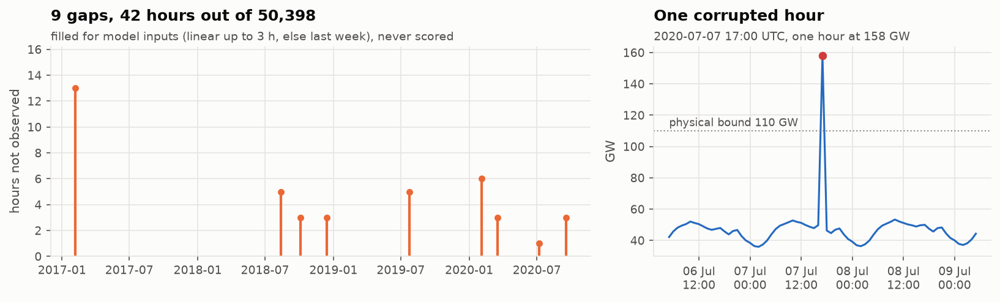

One hour at 158 GW, for a national record of about 102 GW, and nine gaps. Values outside
[20, 110] GW are set to missing. Gaps are filled **for model inputs only** (linearly up to 3 hours,
otherwise with the previous week), and **an imputed hour is never scored**: a model should not be
rewarded for recovering a value I made up.

### Two naives rather than one

The plan asked for a season-24 *SeasonalNaive* as the baseline: tomorrow is a copy of today. It
therefore forecasts Monday with Sunday, and I expected a strawman. I added the weekly naive (a copy
of last week). The measurement proved me wrong.

 misses the level of a working day, the copy of the previous Monday (orange) is too high. Right, mean absolute error by weekday over 2017-2018: neither naive dominates.")

The daily naive clearly loses on Monday and Saturday, the days that follow a change of regime; on
the other five days, yesterday looks more like today than last week does. Both stay in the bench.

## 4. The protocol: a rolling-origin backtest

A **rolling-origin backtest** replays history: stand at a past date (the **origin**), give the
models only the earlier data, forecast the next 24 hours, compare with reality, then move forward
one day. The plan asked for at least 6 origins; I took **one per day over 2019, i.e. 365**, plus a
separate stress window during the first lockdown (55 origins).

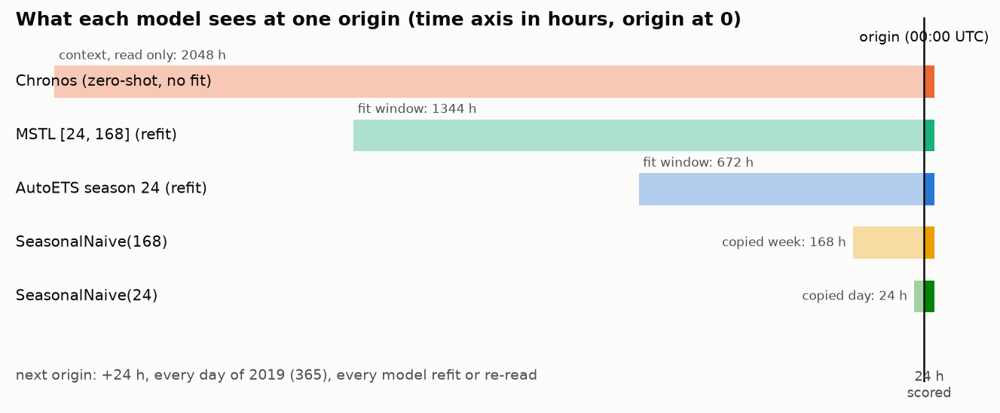

| Model | Fit | Window | Intervals |
|---|---|---|---|
| SeasonalNaive(24), SeasonalNaive(168) | none | last day, last week | from residuals |
| AutoETS, season 24 | refitted at every origin, AICc selection | 672 h (4 weeks) | model-based |
| ETS(Z,Z,A), seasonality forced (**declared deviation**) | refitted | 672 h | model-based |
| MSTL [24, 168] + AutoETS trend | refitted at every origin | 1,344 h (8 weeks) | model-based |
| Chronos-Bolt small, base | zero-shot | 2,048 h context | quantiles 0.1 to 0.9 |
| Chronos-2 | zero-shot, one series at a time | 2,048 h context | quantiles 0.01 to 0.99 |

**ETS** is the exponential smoothing family: a level, optionally a trend and a seasonality,
updated with more weight on recent data; **AutoETS** picks the combination with an information
criterion. **MSTL** decomposes the series into several seasonalities (24 and 168 hours) and a trend,
forecasts each piece and recombines them: it is the only statistical model in the bench that knows
both cycles.

The protocol, the verdict thresholds and the uncertainty rule were committed **before the first
forecast**. Any value changed afterwards is a **deviation**, declared wherever it appears (there
was one). Tests corrupt future values and check that the forecasts do not move: no **leakage** from
the future.

### Measuring the uncertainty of a gap

"Chronos makes 15% less error than MSTL": on another year it might be 5% or 25%. The **bootstrap**
gives a confidence interval: draw origins at random, with replacement, among the 365, recompute the
ratio, 2,000 times, and keep the central 95%. Whole **origins** are drawn, because the 24 hours of
one forecast are not independent, in **blocks of 7 consecutive days** (*moving block bootstrap*),
because neighbouring days look alike.

The pre-registered verdict rule: the challenger **wins** if the interval of the MASE ratio
(challenger / reference) lies entirely below 1 **and** the coverage of its 90% interval is in the
[0.85, 0.95] band; it **wins on points only** if coverage falls outside the band; it **loses** if
the ratio's interval lies above 1; otherwise, no conclusion.

## 5. Measuring a forecast: the MASE and its alternatives

The fourth block of the plan was a reading, Hyndman and Koehler (2006), *Another look at measures
of forecast accuracy*, which introduced the MASE. I put it here because everything that follows
depends on it.

The mean absolute error (MAE) is in megawatts: it cannot be averaged between Germany and Latvia.
The **MASE** divides the error by that of a naive method on the same series' history:

$$
\text{MASE} = \frac{\dfrac{1}{H}\sum_{h=1}^{H} \lvert y_{T+h} - \hat y_{T+h} \rvert}
{\dfrac{1}{T-m}\sum_{t=m+1}^{T} \lvert y_t - y_{t-m} \rvert}
$$

The numerator is the error over the \(H = 24\) forecast hours; the denominator, the mean error the
copy of the value \(m\) hours earlier would have made over the history. With \(m = 24\), a MASE of
0.4 means "40% of the error of copying yesterday". Rereading the paper, I noticed it defines the
MASE with the one-step naive (\(m = 1\)); the seasonal version comes from the FPP3 textbook
(section 5.8), which is the one to cite for \(m = 24\).

### Why not the MAPE, nor the sMAPE

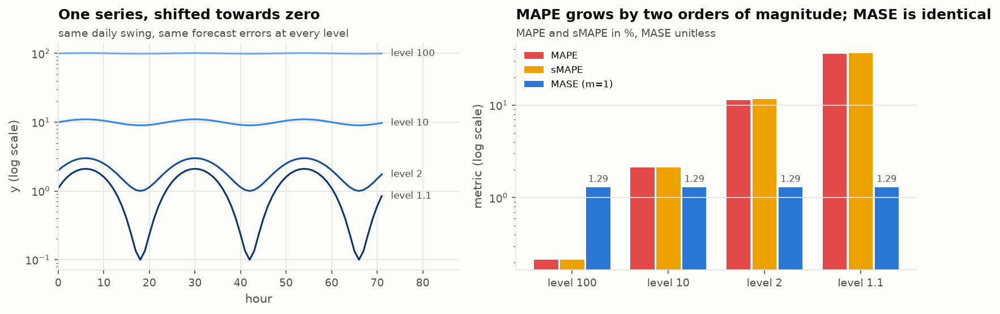

The MAPE divides each error by the observed value: the same errors give a MAPE a hundred times
larger near zero, and it is undefined at zero. It also assumes a meaningful zero, which degrees
Celsius do not have. The so-called "symmetric" sMAPE divides by the mean of actual and forecast,
and is not symmetric either.

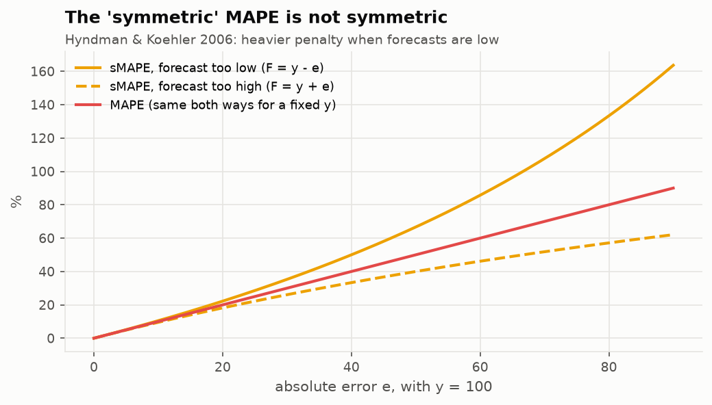

French load never drops below 29 GW, so the MAPE would remain usable there. The argument for the
MASE here is **comparability across series**. (The `utilsforecast` library computes an sMAPE equal
to half the textbook one; it drives no decision.)

 on the 50 series of block 3. Left, the MAE spans a factor of 70, from 18 MW (Latvia) to 1,245 MW (Great Britain), and ranks countries by size. Right, the MASE runs from 0.25 to 0.87 and ranks series by how hard they are to forecast.")

The MAE ranks countries by size; the MASE ranks them by **difficulty** (Sardinia is the hardest, a
German zone the easiest). That is what makes the block 3 router possible.

### The choice of scale changes the meaning of "1"

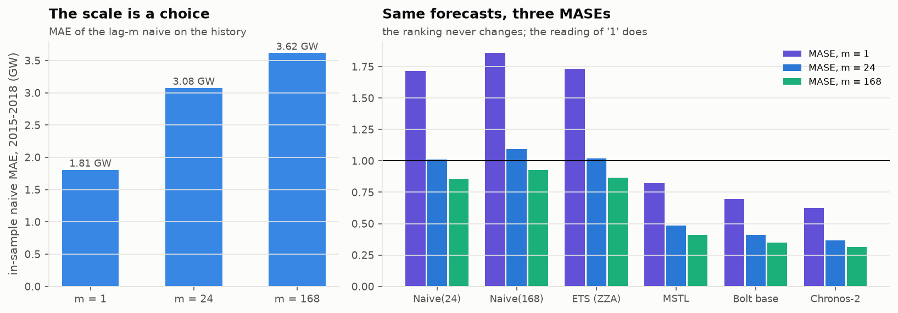

With \(m = 24\), the daily naive scores 1.01: out of sample, it repeats what defines the scale.
With \(m = 1\), the same forecasts score 1.72, because a 24-hour forecast is compared with the
error of a one-hour forecast. A MASE only means something with its \(m\).

## 6. Measuring an interval: coverage, width and score

The plan insisted: "if the TSFM wins on MASE but its actual 90% coverage is 70%, you must be able
to say so". Four measures serve for intervals:

- **coverage**, the share of hours where reality falls inside the interval (0.90 targeted at 90%);
- the mean **width**, as a share of the load;
- the **Winkler score**, which combines both for an interval \([l, u]\) at \(1-\alpha = 90\%\):

$$
W = (u - l) + \frac{2}{\alpha}\,(l - y)\,\mathbb{1}_{y < l} + \frac{2}{\alpha}\,(y - u)\,\mathbb{1}_{y > u}
$$

You pay the width, plus twenty times the miss (\(2/\alpha = 20\)) when reality falls outside: a
narrow interval that misses pays the penalties, a huge one pays its width;

- the **quantile loss** (*pinball loss*), \(\rho_\tau(y, q_\tau) = (\tau - \mathbb{1}_{y <
  q_\tau})(y - q_\tau)\), which scores each quantile: for \(\tau = 0.9\), being below reality costs
  0.9 per unit of gap, being above costs 0.1, and the value that minimises this loss is exactly the
  0.9 quantile. Averaged over 0.1 to 0.9, it scores the whole distribution.

## 7. Results on the year 2019

The table printed by `w25 backtest`, identical from one run to the next (bit for bit on the same
GPU, within 0.016 MW between CPU and GPU):

| Model | MASE | WAPE | cov80 | cov90 | width 90 | Winkler 90 | quantile loss |
|:--|--:|--:|--:|--:|--:|--:|--:|
| SeasonalNaive(24) | 1.001 | 0.059 | 0.824 | 0.879 | 0.293 | 7.08 | 0.429 |
| SeasonalNaive(168) | 1.084 | 0.061 | 0.854 | 0.915 | 0.330 | 6.92 | 0.448 |
| AutoETS | 1.715 | 0.102 | 0.772 | 0.899 | 0.450 | 8.74 | 0.669 |
| AutoETS + conformal | 1.715 | 0.102 | 0.806 | 0.908 | 0.337 | 6.34 | 0.609 |
| ETS(Z,Z,A), deviation | 1.010 | 0.061 | 0.652 | 0.736 | 0.176 | 6.96 | 0.410 |
| MSTL | 0.479 | 0.028 | 0.689 | 0.779 | 0.090 | 3.49 | 0.195 |
| Chronos-Bolt small | 0.435 | 0.026 | 0.859 | 0.859 | 0.088 | 2.79 | 0.173 |
| Chronos-Bolt base | 0.406 | 0.024 | 0.858 | 0.858 | 0.082 | 2.65 | 0.162 |
| Bolt base + conformal | 0.406 | 0.024 | 0.795 | **0.902** | 0.108 | 2.72 | 0.163 |
| Chronos-2 | **0.365** | 0.021 | 0.761 | 0.862 | 0.076 | **2.37** | **0.146** |

*cov80 and cov90: coverage of the nominal 80% and 90% intervals. Width as a share of the load. The
"conformal" rows are described in section 8.*

, coverage of the 90% interval on the y axis. The grey band is the pre-registered [0.85, 0.95] band. Bars are 95% confidence intervals; diamonds, the conformal repair of the same model.")

The figure reads by corners: MSTL bottom left, accurate but under-covering; AutoETS top right, well
covered but very inaccurate; the Chronos models top left, the only ones both accurate and close to
the band.

### The reference model forecasts a flat line

AutoETS's MASE of 1.715, worse than the naive, made me look at what it was choosing: at 572 of the
608 origins, ETS(A,N,N), a level alone that forecasts the last value 24 times. Its selection
criterion, the AICc, rests on the likelihood of **one-step-ahead forecasts**; on a smooth hourly
series, the best forecast of the next hour is roughly the current hour, and the level-only model
wins that contest. At 24 steps it knows nothing of the daily cycle.

The pre-registered verdict is still reported ("Bolt base makes four times less error"), but it says
little. As a **declared deviation**, I added an ETS with forced seasonality, ETS(Z,Z,A), on par with
the daily naive (1.010). Even against it, Bolt base makes 2.5 times less error. The real contender
remains MSTL.

### A flat line can be "perfectly calibrated"

AutoETS covers 0.899 of the hours, almost exactly the nominal level, with an interval 45% of the
load wide: from 30 to 60 GW on a summer day. Its Winkler score, 8.74, is the worst in the table.
Coverage alone rewards a useless interval.

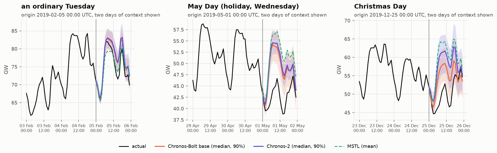

On a Tuesday in February, both TSFMs get the shape of the day right and their intervals enclose
reality. The other two panels come back in section 9.

## 8. Chronos-Bolt's 90% interval

In the table, Chronos-Bolt has the same coverage at 80% and at 90%: 0.858.

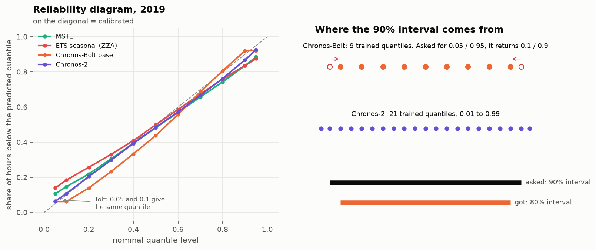

Trained on the quantiles 0.1 to 0.9, Chronos-Bolt returns 0.1 and 0.9 when asked for 0.05 and 0.95
(a test in the repository checks it on the real weights). Its "90% interval" is its 80% interval. I
had spotted this by reading the code before running anything.

Yet it lands in the [0.85, 0.95] band **because its 80% interval over-covers**, and the confidence
interval of that coverage (0.833 to 0.884) spills below the band. The rule says "wins"; I would not
sign off a 90% interval on that basis. Chronos-2, trained from 0.01 to 0.99, has a real 90% interval
(0.862), but under-covers at 80% (0.761).

### The conformal repair

Instead of trusting a model's quantiles, **conformal prediction** rebuilds them from its past
errors. The version used here:

1. keep the model's median as the point forecast;
2. for each horizon step \(h\), collect the model's absolute errors \(\lvert y - \text{median}
   \rvert\) at the same step over the previous 56 origins, all observed at forecast time;
3. for a 90% interval, add and subtract the 90% quantile of those errors to the median (with the
   method's finite-sample correction).

If future errors resemble past errors, reality falls inside the interval 90% of the time, whatever
the model. For Bolt base, coverage goes from 0.858 to **0.902**, with a slightly wider interval
(0.108 instead of 0.082). I applied it to AutoETS too, so that the repair does not favour one side.
Its limit: it calibrates **on average** over the previous 56 days, not on a rare regime.

## 9. By horizon and by regime

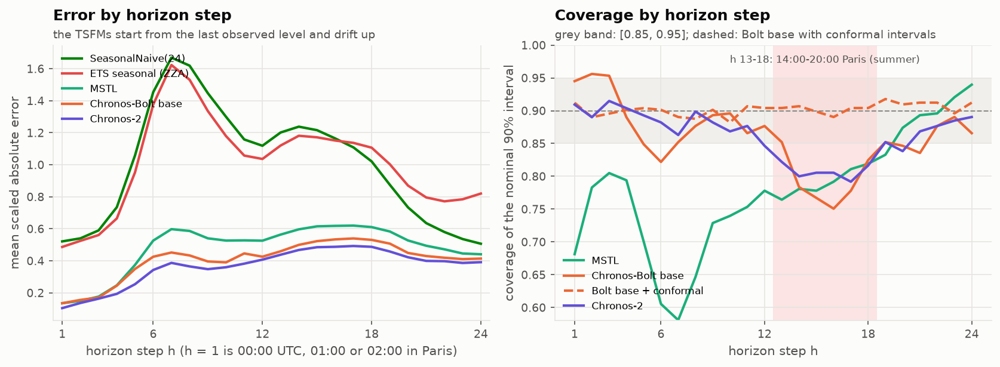

At the first step, every model that reads the last hour does well: Bolt base equals MSTL,
Chronos-2 makes 77% of its error. The gap opens from step 7, the morning ramp, where the naives and
the seasonal ETS are most wrong. The TSFMs' coverage drops to 0.79-0.81 on steps 13 to 18, the
afternoon and the evening ramp; MSTL's collapses on the morning ramp (0.58 at step 7). The conformal
repair, computed step by step, flattens the profile around 0.90.

, with the 95% confidence interval. The third gives the 90% coverage, with the pre-registered band in grey.")

This *forest plot* sums up the bench. Against the seasonal ETS, both TSFMs are left of 1 in every
regime except holidays and bridge days. Against MSTL they are closer to 1, and a few intervals touch
it (Sunday, spring and autumn for Bolt base). Coverage stays within the band or at its edge, except
for one row: public holidays.

The May Day and Christmas panels above show why. A holiday looks like a Sunday, but nothing in the
preceding hours tells a univariate TSFM. Both fell on a Wednesday: it forecasts an ordinary
Wednesday, several gigawatts too high, and reality passes below its interval. Over the 11 holidays
of 2019, Bolt base has a MASE of 1.49, four times its ordinary level and worse than the daily naive
(1.42). Against the seasonal ETS the ratio is 1.12 [0.85, 1.55]: no better. Its 90% interval covers
37% of the hours (Chronos-2: 35%, MSTL: 26%).

No model in the bench receives a holiday flag. The difference is that **a specialist can be given
one, whereas a univariate zero-shot TSFM cannot be told**; Chronos-2, however, can (section 11).
The two bridge days of 2019 are not enough: below 10 origins, no verdict.

## 10. Three robustness checks

### Six origins decide nothing when the gap is small

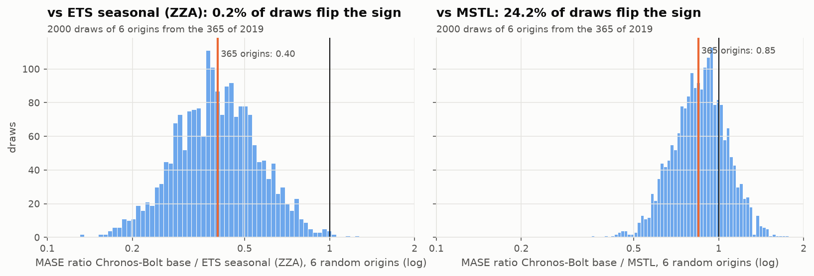

Against the seasonal ETS (a factor of 2.5), almost every draw of 6 origins gives the right ranking.
Against MSTL (a 15% gap), **one in four reverses it**. Six origins detect a large gap, not a close
one. Here, 608 origins of eight models take about six minutes.

### The lockdown

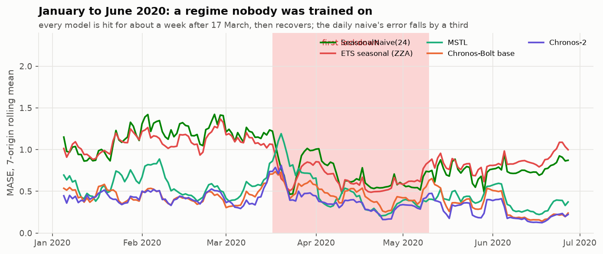

Every model is hit for about a week after 17 March, then recovers. The ranking holds: Chronos-2
0.392, Bolt base 0.477, MSTL 0.506, seasonal ETS 0.631, daily naive 0.672. The daily naive's error
even falls by a third: with no difference between working days and weekends, copying yesterday
becomes a good strategy.

### Context length (exploratory)

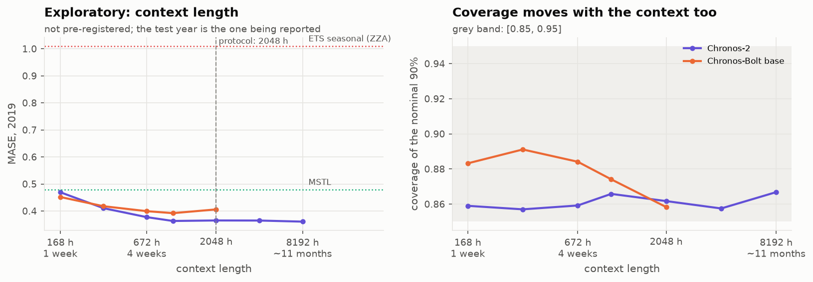

Explored after the results, so outside the protocol. With a single week of context, Bolt base
(0.452) already beats MSTL fitted on 8 weeks (0.479). Its best context is 1,024 hours (0.392), not
the protocol's 2,048 (0.406); I did not change the protocol, since that choice would be made on the
test year. The result foreshadows block 3: a TSFM needs much less history than a specialist.

## 11. Telling the TSFM the calendar

Chronos-2 accepts **known future covariates**, holidays and bridge days among them. For each hour,
two 0/1 flags (holiday, bridge day) are passed to the model over the context and the horizon. Same
model, same context, no retraining. This part is **exploratory**: decided after the results, on the
test year.

| Chronos-2, 2019 | MASE | cov80 | cov90 | quantile loss | holidays: MASE | holidays: cov90 |
|---|--:|--:|--:|--:|--:|--:|
| zero-shot, univariate | 0.365 | 0.761 | 0.862 | 0.146 | 1.446 | 0.352 |
| + holiday and bridge flags | **0.331** | 0.808 | **0.899** | **0.130** | **0.745** | 0.769 |

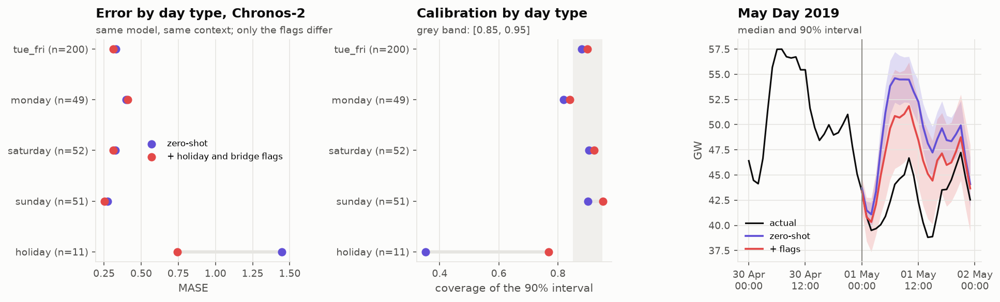

On holidays the error is **halved** (ratio 0.52 [0.39, 0.67]) and coverage goes from 0.35 to 0.77.
On other days it drops slightly (ratio 0.96): my hypothesis, untested, is that past holidays in the
context stop looking like anomalies once flagged. Over the year, the 90% coverage reaches 0.899.
"Zero-shot" therefore does not have to mean "univariate". Found on 11 days of the test year, this
result motivates a pre-registered test on another year; it does not replace it.

## 12. The complexity router, rebuilt on 50 series

The third block asked for architecture reasoning, without code, to put the paper's router into
production. So that every figure would be measured, I first rebuilt the router.

**The panel.** 50 European countries and bidding zones from the OPSD package, with less than 0.5%
missing hours over 2015-2019; 73 origins in 2019 (one every 5 days, to cover every weekday), a
24-hour horizon. **Cold start**, a new series with little history, is simulated by letting the
models read only the last 1, 2, 4 or 12 weeks: **200 units** (series × history length). The TSFM is
Chronos-2 zero-shot; the specialist, MSTL [24, 168] refitted at every origin (a seasonal ETS below
two weeks of history: a weekly cycle cannot be estimated on one week).

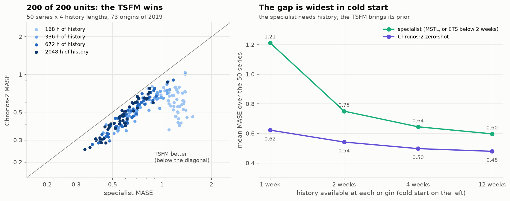

**The TSFM wins on all 200 units**, with gains from 5% to 70%, largest in cold start: with one week,
the specialist has a single weekly cycle to fit, while the TSFM brings what it learned elsewhere. On
this point the paper is confirmed.

### Which features predict the gain

A router decides on features **computed before the forecast** (*ex ante*), never on the future
error.

 against six features, with Spearman's rank correlation. Colour shows the history length, from lightest (1 week) to darkest (12 weeks).")

History length is the most related to the gain (rank correlation −0.62), followed by the 168-hour
and 24-hour autocorrelations; the paper's coefficient of variation and spectral entropy say little
here. Several indicators also move with the history length itself. **Intermittency** and
**physical constraints**, two features in the plan, cannot be tested: national load has neither.

### The pre-registered policies

| Policy | mean MASE | 90% coverage | sent to the TSFM | gap to "always TSFM" [95% CI] |
|---|--:|--:|--:|---|
| always the specialist | 0.801 | 0.745 | 0% | +0.266 [0.243, 0.296] |
| always the TSFM | **0.535** | 0.846 | 100% | 0 |
| paper's rule, published thresholds | 0.566 | 0.833 | 92% | +0.030 [0.014, 0.056] |
| learned stump, leave one country out | 0.535 | 0.846 | 100% | 0 |
| oracle (winner of each unit) | 0.535 | 0.846 | 100% | 0 |

A **decision stump** is the simplest tree: one feature, one threshold. Its thresholds are learned
on the other countries and applied to the one left out, so that no country scores a rule it helped
build. Across the 28 folds it finds no threshold that improves on "always the TSFM", and the oracle
coincides with it. The paper's rule, with thresholds tuned on Traffic and M4 Daily, sends 8% of the
series to the specialist and **loses 0.030 MASE** out of sample.

### What the router can still buy: cost

If the TSFM wins everywhere, a router can only **save TSFM calls**, at the expense of accuracy. I
added, outside the protocol, a stump that pays a penalty per series sent to the TSFM, with a
varying penalty.

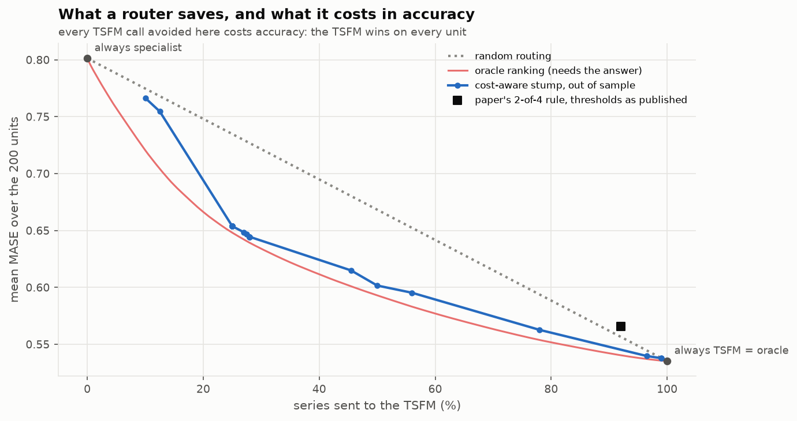

The stump stays within 0.015 MASE of the oracle between 25% and 100% of TSFM calls. Saving 22% of
calls costs 5% of MASE, 44% costs 11%. The paper's rule sits **above the random-routing line**: on
this panel it routes worse than chance.

Is the saving worth anything? The paper assumes a TSFM call costs a thousand specialist calls.
Measured: Chronos-2 takes about **95 ms per series on 4 CPU threads** (about 5 ms in a GPU batch),
an MSTL refit **183 ms on one core**. The assumption holds for a specialist that only predicts, not
for one refitted at every forecast. The milliseconds come from a single machine; the ratio is what
transfers.

## 13. The routing decision drifts

The plan named a "senior trap": a router's decision can drift like a model's. To measure it, I took
a cost-aware stump tuned to send about two thirds of the series to the TSFM (the operating point of
the paper's deployed router), with a rule on the 24-hour autocorrelation, re-evaluated at every
origin on the trailing four weeks.

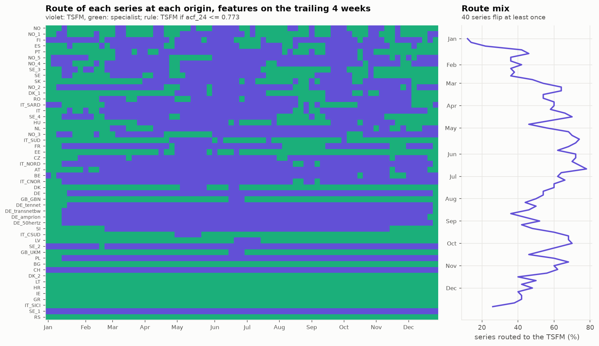

**40 of 50 series change branch at least once**, for 323 flips, and the share sent to the TSFM
swings between 12% and 78%. The flips follow holidays and seasons: the German zones switch together
at the turn of the year, the British and Danish series in June. Each flip changes overnight the
model that produces a series' forecast. A **hysteresis** band (switch branch only when the indicator
crosses the threshold by a given margin) cuts these back-and-forths:

| Band on the 24-hour autocorrelation | flips in 2019 | series that flip | max for one series |
|---|--:|--:|--:|
| none | 323 | 40 | 22 |
| ± 0.01 | 218 | 38 | 16 |
| ± 0.02 | 168 | 38 | 16 |
| ± 0.05 | 78 | 35 | 6 |

Another lesson came from a mistake: my first version fitted the stump on indicators computed over
2,048 hours and applied it to indicators computed over 672 hours. Spectral entropy depends on the
window, and the stump sent 4 to 20% of the series to the TSFM instead of about 56%. It is
train/serve skew, router edition.

### The architecture reasoning

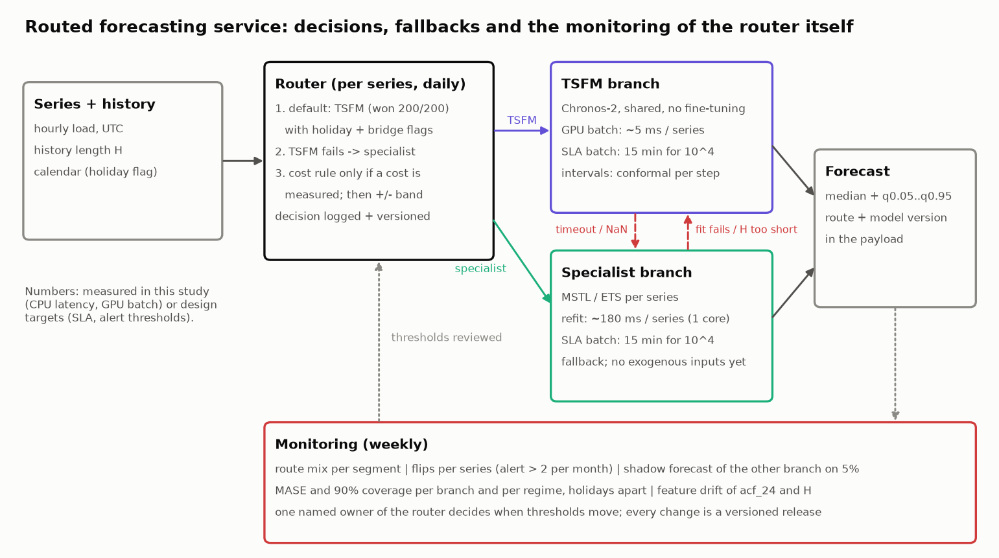

The requested deliverable fitted in 8 to 12 lines. With the measurements above:

1. **History length predicts the size of the TSFM's gain, not the winner.** No threshold can be
   justified on accuracy; the plan said that signals a poorly chosen routing feature, or here the
   absence of a route to choose.
2. **By default, the TSFM for every series, with the calendar as a covariate**, rather than a branch
   switch on holidays.
3. **The specialist as the fallback**: timeout or missing value on the TSFM side; the reverse if the
   fit fails or the history is under two days; the daily naive, flagged, if both fail.
4. **Both branches in daily batch**; real time only for intraday re-forecasts, on the TSFM, which
   has nothing to refit.
5. **Every forecast carries its route and its model version.**
6. **The router is monitored like a model**: route mix, flips per series (alert above two a month),
   hysteresis, shadow forecast of the other branch on 5% of the series.
7. **One named owner** decides the thresholds; every change is a release evaluated out of sample.
8. **No complexity router whose only gain would be a cost the measurement does not show.**

## 14. What I take away

These observations hold for hourly load series, without temperature, against univariate
statistical specialists.

1. **A zero-shot TSFM can beat a refitted specialist on a series it has never seen**, and the gap
   depends mostly on the specialist: a factor of 4 against a flat line, 15% against MSTL.
2. **The reference deserves a look before being beaten**: AutoETS's one-step criterion does not
   match a 24-hour horizon.
3. **Coverage only reads alongside width**: the flat line is the best-calibrated and least useful
   model in the table.
4. **An interval is checked at the source**: Bolt's 90% interval is its 80% one, and the conformal
   repair fixes it on average, not on rare regimes.
5. **The calendar is the weakness of univariate zero-shot**, and a covariate fixes it without
   retraining.
6. **Cold start is where the gap is largest**: half the error with one week of history.
7. **A router is only worth the gap it exploits**, and here none favours the specialist.
8. **The routing decision drifts** and needs the same monitoring as a model.

**Limits and open questions.** A single series for block 2 and no temperature, a first-order driver
of national load. The specialists are univariate: a specialist with a holiday flag is the next test,
the one most likely to reverse some units. Origins are at midnight UTC, whereas a day-ahead market
forecast is issued around noon the day before. The calendar effect on Chronos-2 remains to be
confirmed on another year, with the protocol declared beforehand.


**A question to check your understanding.** *A vendor presents a TSFM whose 90% interval covers 91%
of the hours on a six-month backtest. Is that enough to put it into production?* At least three
pieces of information are missing. The width or the Winkler score: a flat line covers 90% too
(section 7). Coverage by regime and by horizon: a fine average can hide 37% on holidays or 79% in
the afternoon (section 9). And the quantiles the model was trained on (section 8).


## Reproduce and go further

The code, tests and results are in the
[gwils28/W25_tsfm_viability](https://github.com/gwils28/W25_tsfm_viability) repository (Python
3.11, versions pinned with `uv`); `make all` rebuilds everything, from the data to the report, GPU
optional. The decisions taken before writing code are in `SPEC.md`, the deviations and corrections
in `IMPLEMENTATION_NOTES.md`, including an independent review that fixed the bootstrap on rare
regimes. The [online report](https://gwils28.github.io/W25_tsfm_viability/) presents the figures in
their original order.

**Sources**

- Soni, Das and Guduguntla, [*Assessing the operational viability of foundation models for time series forecasting*](https://arxiv.org/abs/2605.24381), arXiv, May 2026, and the [authors' code](https://github.com/kavin-soni/TimeSeries-ZeroShot-Eval).
- Ansari et al., [*Chronos: Learning the language of time series*](https://arxiv.org/abs/2403.07815), 2024; the [Chronos-2](https://arxiv.org/abs/2510.15821) technical report, 2025; the [Chronos-Bolt base](https://huggingface.co/amazon/chronos-bolt-base) model card.
- TSFM.ai, [*IBM's March 2026 time-series refresh*](https://tsfm.ai/blog/ibm-march-2026-time-series-refresh), April 2026.
- Kafritsas, [*Time series foundation models: a deep dive into strengths and limitations*](https://aihorizonforecast.substack.com/p/time-series-foundation-models-a-deep), AI Horizon Forecast, April 2026.
- Hyndman and Koehler, [*Another look at measures of forecast accuracy*](https://robjhyndman.com/papers/mase.pdf), International Journal of Forecasting, 22(4), 2006; Hyndman and Athanasopoulos, [*Forecasting: Principles and Practice*](https://otexts.com/fpp3/accuracy.html), 3rd edition, section 5.8.
- [Open Power System Data](https://data.open-power-system-data.org/time_series/2020-10-06/), time series package, version of 6 October 2020.
