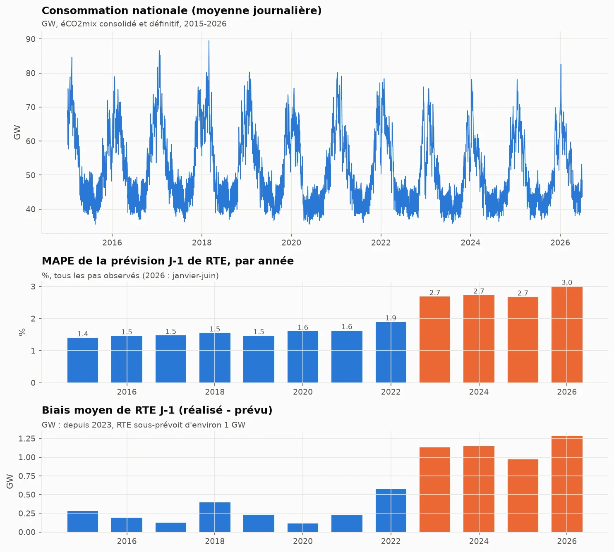
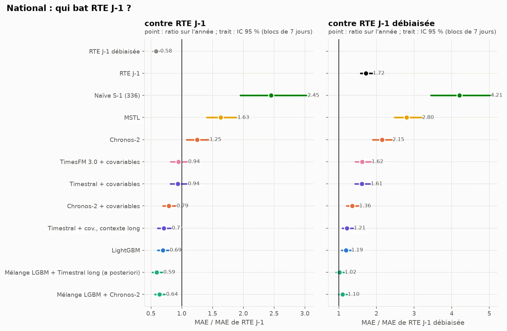
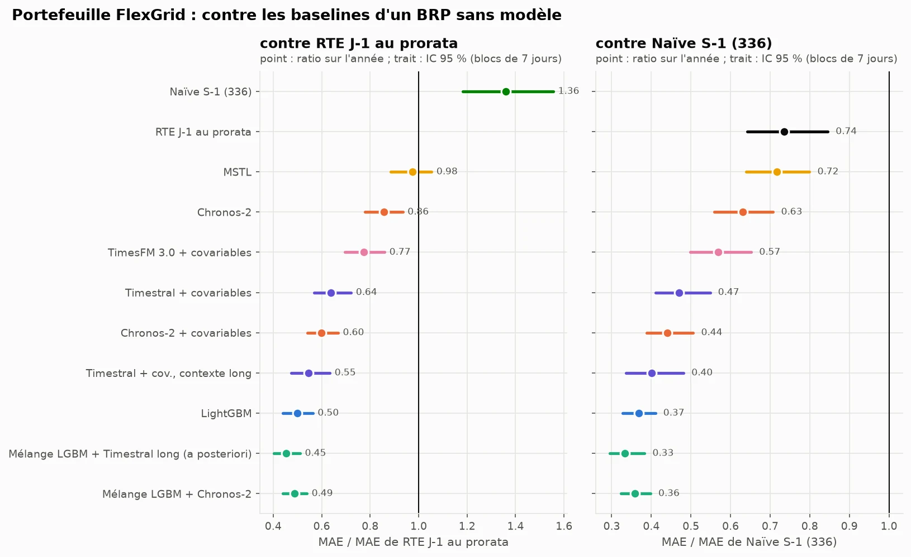
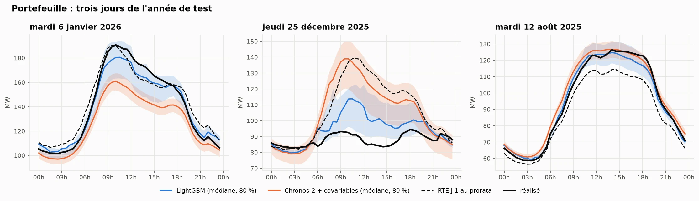
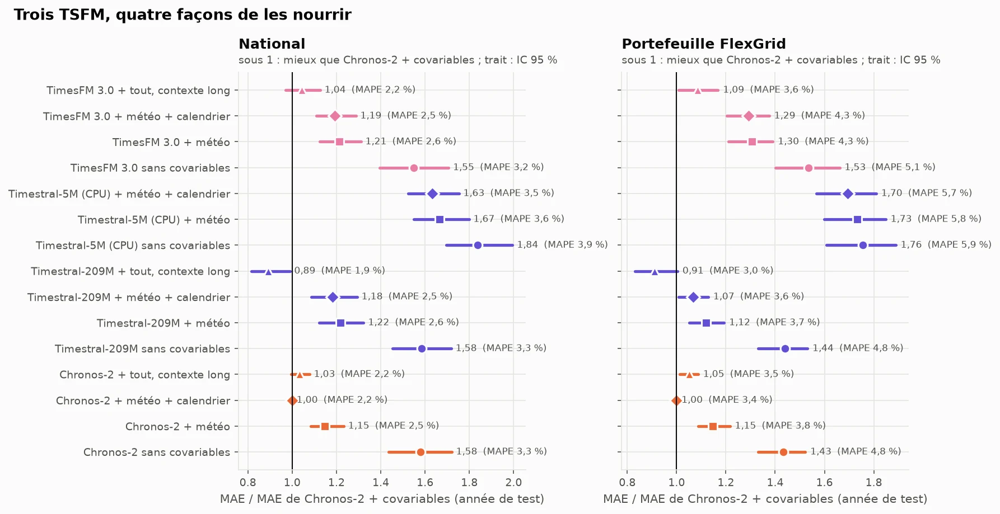
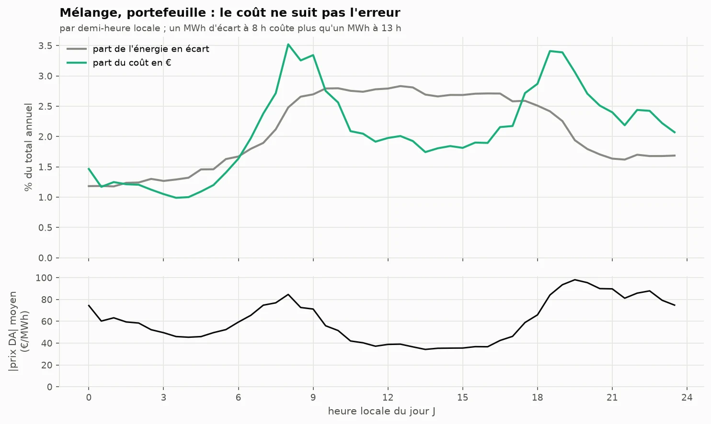
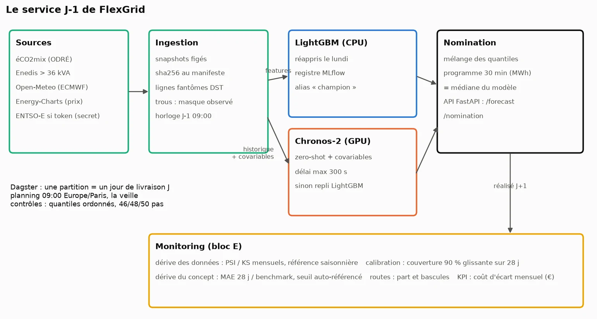


Moving from the tech-watch question, "when does a foundation model beat a specialist?", to a
client's: what to nominate every day at 9 am for a portfolio of 3,517 commercial sites, with
which intervals, and how much it is worth compared with what they already do.





LightGBM + Chronos-2 blend, against 5.6% for RTE's forecast scaled down to the portfolio
national MAE ratio, 95% CI [0.99, 1.22]: a one-line correction ties with every model
against −1.8% for the best possible router, known after the fact




This repository applies the article
[Time series foundation models: zero-shot against the specialist]()
to a client brief. The article asked the question on a single series and rebuilt a router; this
project asks it again with a real benchmark to beat, covariates, a metric in euros and a service
to run. The repository, its [online report](https://gwils28.github.io/flexgrid_dayahead/) and
its figures are in French.

## The goal

FlexGrid Énergie is a fictional balance responsible party (BRP). Every day, it must nominate
its portfolio's consumption for the next day in 30-minute steps, before the day-ahead market
closes at noon. Any gap between nomination and actual consumption is settled at the balancing
price. The brief put the current forecast at about 6% MAPE and set a blunt criterion: beat
RTE's day-ahead forecast published in éCO2mix, or the project has no demonstrable value.

The data is public and real: national consumption from éCO2mix with RTE's day-ahead forecast,
Enedis aggregated load curves (sites above 36 kVA, by region, power band and sector), archived
weather forecasts from Open-Meteo, and day-ahead prices from Energy-Charts. The test year runs
from 1 July 2025 to 30 June 2026: 365 delivery days, a forecast issued every day at 9 am with
only what is known at that time.

What I wanted to learn came down to three questions:

- what happens to the tech watch's conclusion (a zero-shot TSFM beat univariate specialists)
  when the specialist is given weather and calendar;
- how to judge a model against a public benchmark when that benchmark has flaws of its own;
- what a backtest needs before it becomes a service that can be monitored.

## The approach

The work follows the brief's five blocks, each with its own folder and results README. The
decisions made before writing code are in `SPEC.md`, with fourteen blind spots found in the
data; the evaluation protocol was frozen in `configs/protocol.yaml` before the first
computation, and every deviation is dated in `IMPLEMENTATION_NOTES.md`. The working method is
the one in
[Claude Code for data science: what changes in my working method]().



Sources frozen by sha256, clock changes repaired by an explicit rule, the nomination clock
rebuilt: national load known up to 8 am, site load curves up to the end of D-2, weather for day
D forecast 48 hours ahead. The portfolio is the sum of two real Enedis segments: 3,517 sites,
815 GWh a year.


Naive forecasts, MSTL and ETS; quantile LightGBM on lags, calendar and weather, refitted
weekly; Chronos-2 with and without covariates; the blend of both models' quantiles. Rolling
origin over the test year, after six months of validation. Pre-registered verdicts against
published RTE and debiased RTE, under two readings of the quarter-hour.


A per-segment router on a panel of 81 commercial segments, learned on validation and compared
with the oracle and the blend. New portfolios simulated on three held-out regions, with 7 to 56
days of history.


Nomination error valued at the day-ahead price, with several penalty levels, and avoided cost
with a confidence interval from seven-day blocks.


Dagster (one partition per delivery day, scheduled at 9 am the day before), MLflow registry,
FastAPI for quantiles and nominations, a Docker image, then monitoring replayed over the test
year: data drift, concept drift, calibration, monthly cost.



An addendum, written on 16 October before any forecast from these models, added Timestral
(Mistral AI) and TimesFM 3.0 (Google Research), both released after the project ended.

## What the data corrected in the brief

| The brief says | What the data says |
|---|---|
| "5,000 commercial sites and EV chargers" | No public 30-minute data for chargers. The portfolio becomes two real Enedis segments (3,517 sites, 815 GWh/year), close to the requested order of magnitude. |
| "Beat RTE's day-ahead forecast" | RTE only forecasts the national load, and its forecast has under-predicted actual consumption by about 1.1 GW since 2023. The criterion becomes: beat published RTE **and** debiased RTE. |
| "Temperatures by département" | Observed temperature is a leak: at 9 am the day before, only a forecast exists. Verdicts use the weather forecast issued 48 hours ahead. |
| "Cost = volume × imbalance price" | The imbalance settlement price cannot be downloaded without an account. Cost is valued at the day-ahead price, with a penalty factor from 1 (the brief's definition) down to 0.1. |
| "Current forecast at 6% MAPE" | Almost exactly the MAPE of RTE's forecast scaled to the portfolio half-hour by half-hour (5.6%): that of a method with no model. |

## The results

Every figure comes from the versioned tables in `results/`, produced by the `flexgrid` CLI.
Confidence intervals are bootstraps over seven-day blocks.

### The benchmark had a bias



Before any model, the data block showed two things about the reference. Its bias is stable,
positive in every month of the test year: a BRP can correct it in one line, by subtracting the
mean error of the last 28 known days for each half-hour. And the way a quarter-hourly forecast
is read on a 30-minute grid moves its MAE by 6.5% (1,400 or 1,310 MW), with nothing in the
documentation to settle it. A model only "beats RTE" here if it beats both readings.

The sources had their own traps too: éCO2mix publishes hours that do not exist when clocks go
forward (48 duplicated UTC timestamps over 2015-2026) and drops the repeated October hour every
year.

### National: published RTE beaten, debiased RTE not



The LightGBM + Chronos-2 blend has an MAE of 897 MW against 1,401 MW for published RTE (ratio
0.64, 95% CI [0.56, 0.73]). The brief's criterion is met literally. But debiased RTE scores
816 MW: against it, the blend shows no difference (1.10 [0.99, 1.22]) and loses under the other
quarter-hour reading (1.14 [1.02, 1.26]).

| National, test year | MAE (MW) | MAPE | 90% coverage |
|---|---|---|---|
| Debiased RTE day-ahead | 816 | 1.61% | (point forecast) |
| LightGBM + Chronos-2 blend | 897 | 1.73% | 0.86 |
| LightGBM | 972 | 1.87% | 0.76 |
| Chronos-2 + covariates | 1,109 | 2.15% | 0.83 |
| Published RTE day-ahead | 1,401 | 2.79% | (point forecast) |
| Chronos-2 without covariates | 1,752 | 3.33% | 0.81 |
| MSTL | 2,284 | 4.47% | 0.79 |

Three readings:

- **Covariates matter more than the model.** Chronos-2 drops from 1,752 to 1,109 MW once it is
  given weather and calendar. Zero-shot without covariates, a TSFM does not know it will be cold
  tomorrow.
- **Perfect weather would have changed almost nothing.** Fed with observed instead of forecast
  weather, LightGBM gains only 4% in MAE. What separates the models from RTE is information on
  consumption itself: RTE revises its forecast later, with its own telemetry.
- **The blend wins in summer and loses in winter.** It beats debiased RTE from July to October
  (592 against 706 MW) and on one day in two over the year, but its bad days are winter days,
  where errors are counted in GW.

### On the portfolio: a model halves the brief's 6%



RTE does not forecast the portfolio, so there is no debiased RTE to fall back on. The best
method without a model is RTE's forecast multiplied by the portfolio's recent share, half-hour
by half-hour. This benchmark was added after the protocol, and declared as such: without it,
the portfolio's only reference was a naive forecast.

| Portfolio, test year | MAE (MW) | MAPE | 90% coverage |
|---|---|---|---|
| LightGBM + Chronos-2 blend | 2.57 | 2.72% | 0.85 |
| LightGBM | 2.64 | 2.78% | 0.75 |
| Chronos-2 + covariates | 3.16 | 3.36% | 0.84 |
| RTE day-ahead, pro rata | 5.28 | 5.59% | (point forecast) |
| Weekly naive | 7.17 | 7.55% | 0.87 |

The gap is much wider than at national level because the portfolio does not look like France:
an office peak around 10 am, a flat Sunday, and summer air conditioning that the national load
barely has. A national forecast, even rescaled half-hour by half-hour, carries the national
shape. The blend beats pro-rata RTE every month and on 86% of days.

### Public holidays, the TSFMs' weak spot



This was already the weak spot of zero-shot in the tech watch, and it remains so with a
calendar covariate. On the year's eleven public holidays, LightGBM has 0.42 times the MAE of
pro-rata RTE, Chronos-2 1.25. The blend therefore inherits Chronos-2's errors on those days. A
rule like "LightGBM alone on holidays" would be an easy gain, but it was not pre-registered, so
it is not applied. On the four bridge days, every model loses: a bridge day in commercial
buildings means half the offices closed, which no calendar variable measures.

### The intervals

Raw, they do not keep their promise. LightGBM's 90% interval covers 75% of steps on the
portfolio and 76% at national level. The SPEC attributed this under-coverage to the gap between
observed weather in training and forecast weather in service; measurement refuted it (77% with
observed weather as input). The main cause is quantile regression itself, which fits its
training data too closely.

The tech watch's conformal repair (median kept, quantiles rebuilt from the errors of the last
56 days) brings every model back to 0.90-0.91 over the year. It follows the seasons with a lag:
the blend's repaired coverage drops to 0.78 in November, when the error rises with heating.

### Blending rather than routing


On the 81 segments of the panel, a *stump* (one variable, one threshold) learned on validation
sends only one segment to Chronos-2. Even the oracle router, which knows the right answer, only
gains 1.8%: LightGBM has the lowest MASE on 66 segments out of 81, and where Chronos-2 wins
(electrically heated segments, the largest sites), it wins by little. The blend gains 6.8% and
beats the oracle on 70 segments. Two models that err at different times correct each other over
time; a router only chooses once per segment.

The decision also drifts, as in the tech watch: reapplied every week, the stump sends between 0
and 50 segments to Chronos-2 depending on the season, and 4.3 segments switch branch each week
on average. The service therefore nominates the blend, which has no decision to monitor.

### A new portfolio is first nominated with the naive forecast

 beats almost everything; only Timestral with sibling segments in context goes below it. From 14 days on, the models converge below the naive forecast.")

| WAPE | 7 days | 14 days | 28 days | 56 days |
|---|---|---|---|---|
| Weekly naive | 6.6% | 6.6% | 6.6% | 6.6% |
| LightGBM trained on other regions | 12.6% | **3.9%** | **3.9%** | 3.9% |
| Chronos-2 + covariates | 19.2% | 4.4% | 3.9% | **3.6%** |
| Chronos-2 few-shot in-context | 19.7% | 4.4% | 4.0% | 3.8% |
| Timestral few-shot (addendum) | **5.7%** | 4.2% | 4.0% | 3.8% |

With one week of history, Chronos-2 sees a single weekly cycle, does not recognise it as a
season, and forecasts a Tuesday halfway between a working day and a Sunday. LightGBM receives a
missing 14-day lag it never saw in training. The naive forecast simply copies the right day.
From 14 days on, LightGBM trained on other regions takes the lead, within 0.5 points of what it
does with full history. Chronos-2's few-shot in-context mode, which the brief proposed for the
cold start, does not help. Timestral's is the first model below the naive forecast at 7 days,
without it being possible to conclude that it beats it (ratio 0.87 [0.73, 1.04]).

The resulting rule: the naive forecast for two weeks, then the global model. One limit: a
segment aggregates hundreds of sites. What is simulated is a new portfolio arriving, not an
isolated site, which would be far noisier.

### Timestral and TimesFM 3.0: context matters more than the model



The addendum asked three questions, with the same origins, the same inputs and the published
default settings:

1. **Does a new TSFM beat Chronos-2?** With equal context (2,048 steps), no: Timestral has 1.18
   times its national MAE, TimesFM 3.0 1.19. Without covariates, all three are level: the gap
   comes from how each reads covariates. With its full context (32,768 steps, almost two years),
   Timestral moves ahead: 990 MW, 0.89 times Chronos-2. More context helps neither Chronos-2 nor
   TimesFM 3.0.
2. **Does a calendar covariate help on holidays?** Yes, it removes about a quarter of Chronos-2's
   and Timestral's error on those days, almost nothing from TimesFM 3.0's. The TSFMs remain far
   behind LightGBM: a binary "holiday" covariate does not replace ten years of holidays seen in
   training.
3. **Do the new TSFMs improve the blend?** No. Two blends pass the pre-registered switch rule on
   validation; neither is confirmed on the test year. The service keeps LightGBM + Chronos-2.

An exploratory result, declared as such: the LightGBM + long-context Timestral blend, built
after seeing the results, is the best model in the repository. At national level it scores
832 MW and ties with debiased RTE (1.02 [0.92, 1.13]). Chosen by looking at the test year, this
figure is optimistic; it counts in no verdict and will be a candidate for a future protocol, on
a window it has not seen.

### From MW to euros: cost does not follow error



Under the brief's definition (gap × day-ahead price), the blend avoids **€1.24M a year**
compared with pro-rata RTE (95% CI [0.93, 1.56] €M), or **€0.12M to €0.62M** with a more
realistic penalty. The ranking of models does not depend on the penalty, only the amounts do.
The interval is wide because a year holds only one winter: from November to January, three
months account for 47% of the annual cost.

Cost is not a disguised MAE. Pro-rata RTE errs mostly at midday, when prices are low. The blend
avoids 51% of the energy in imbalance but only 47% of the cost. A model aiming at cost rather
than MAE would weight its errors by the expected price: that is not done here, and it is the
natural next step.

### The service and its monitoring



Three partitions were materialised end to end, including both clock-change days (46 and 50
steps). **Production reproduces the backtest**: identical quantiles for Chronos-2, and for
LightGBM on the day the service and the backtest refit on the same date. This is the check that
ties the verdicts to the code being served.

Monitoring was replayed over the test year, and says so: there was no real deployment. Two
findings came out of it. The naive alert threshold, "the model does worse than debiased RTE",
fires on 208 days out of 365 at national level: it describes a state known since the backtest
and detects nothing. The threshold kept is self-referenced (1.15 times the model's ratio on
validation). And LightGBM's raw coverage drops to 0.52 on the portfolio in January: the brief's
"90% that drifts to 70%" did happen, and the conformal repair catches up with a lag.

## What got in the way

- **The benchmark was the first question.** "Beat RTE" looked settled. The +1.1 GW bias and the
  quarter-hour ambiguity turned it into two benchmarks and two readings, and the conclusion
  flipped between published and debiased RTE.
- **Leaks come from the clock.** A two-day lag counted in UTC steps read, on the day clocks go
  back, a value later than the segments' cutoff; a test found it before any computation. Later, a
  *backfill* of 26 October 2025 reused a registry model trained for 30 June 2026, eight months
  in the future. A tested rule now prevents it.
- **A sanity check removed real values.** The pre-registered range filter dropped 7,399 real
  steps from an electrically heated segment whose winter is six times its summer. It was
  replaced before any forecast, and the deviation is dated.
- **Compute.** The full backtest takes several hours on an RTX 5070 and 32 cores, including
  4.5 hours for LightGBM on the panel, and the addendum adds about 9 GPU hours. Two LightGBM jobs
  launched together took five times longer: heavy jobs run one after the other.
- **The Docker image weighs 6.9 GB compressed**, almost all of it torch and CUDA, while the API
  alone needs neither. A separate image for the API is the next step.

## What I take away

- The tech watch's conclusion does not carry over as is. Against univariate specialists,
  Chronos-2 won everywhere; against a LightGBM fed with weather and calendar, it loses on 66
  segments out of 81. What makes the difference is what each model receives as input.
- "Beating the benchmark" is checked against the corrected benchmark. A one-line bias
  correction tied with all my models at national level. On the portfolio, where no such
  correction exists, the gap is real: 2.7% against 5.6%.
- Between the specialist and the TSFM, the best answer was "both". The blend beats the best
  possible router, and removes a decision to monitor.
- Holidays remain the TSFMs' weak spot, even with a calendar covariate. A model that has seen
  ten years of them does better.
- An honest replay states what it does not show: the alert thresholds were set after seeing the
  naive threshold saturate, and real monitoring would set them on validation and keep them for a
  year.

## Reproduce

```bash
git clone https://github.com/gwils28/flexgrid_dayahead
cd flexgrid_dayahead
uv sync --extra prod           # Python 3.12; Chronos-2 runs on GPU (a CPU works, much more slowly)
make data                      # downloads and freezes the sources (sha256 in data/MANIFEST.json)
uv run flexgrid build          # intermediate tables
uv run flexgrid forecast national snaive_day snaive_week mstl ets_seasonal lgbm chronos2 chronos2_cov
uv run flexgrid forecast segments snaive_day snaive_week mstl ets_seasonal lgbm chronos2 chronos2_cov
uv run flexgrid score national segments && uv run flexgrid tables
uv run flexgrid router && uv run flexgrid coldstart
make figures report            # figures for every block, then the Quarto report in docs/
uv run pytest
```

The addendum's models run the same way (list in `configs/protocol.yaml`). Raw forecasts are not
versioned; the per-origin tables are, and every figure and verdict starts from them. Licences:
Chronos-2 Apache-2.0; Timestral, code Apache-2.0 and weights under a modified MIT licence;
TimesFM 3.0, non-commercial weights, which a real BRP could not serve without another licence.
