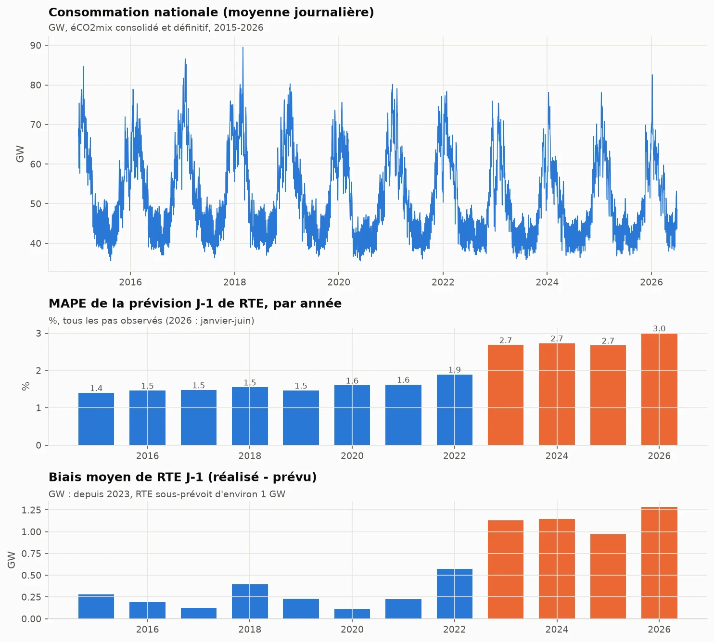
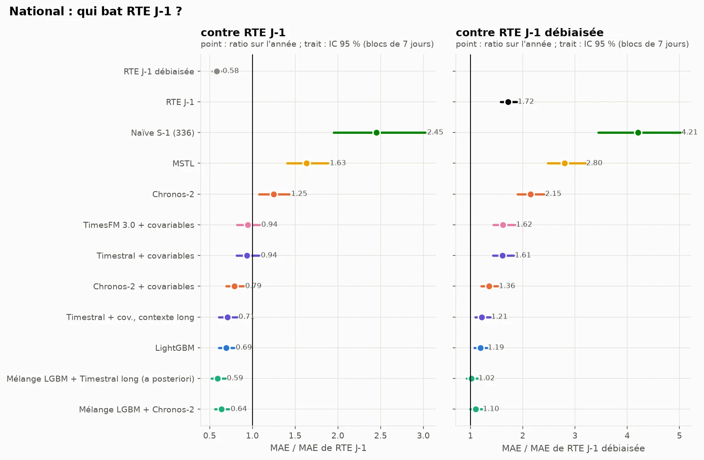
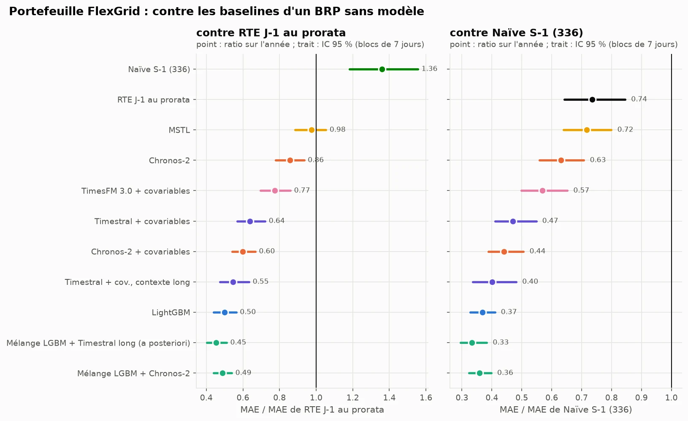
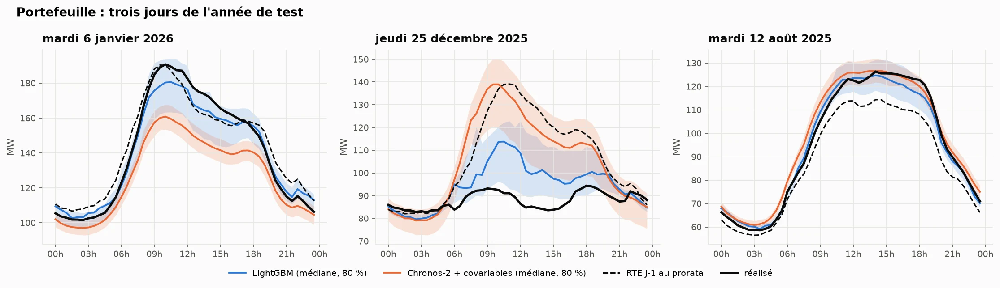
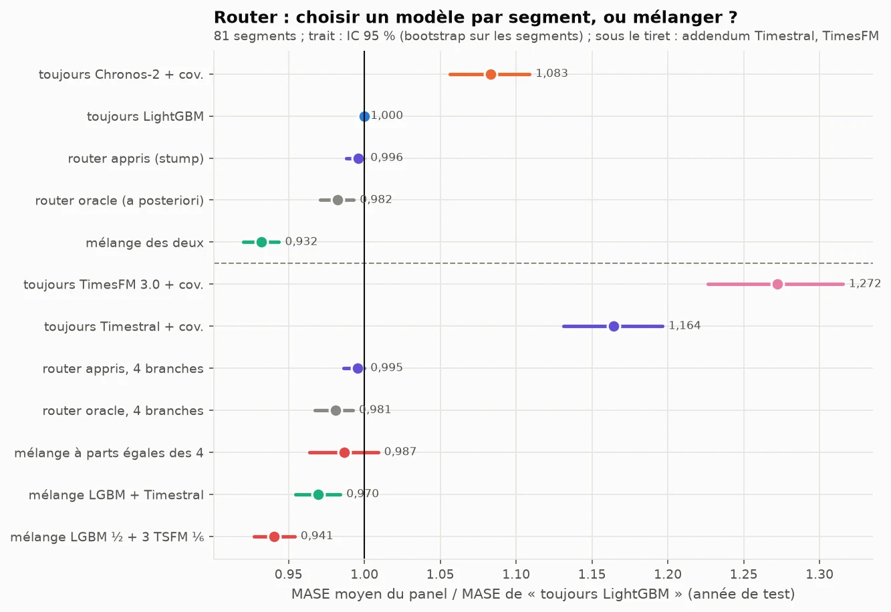
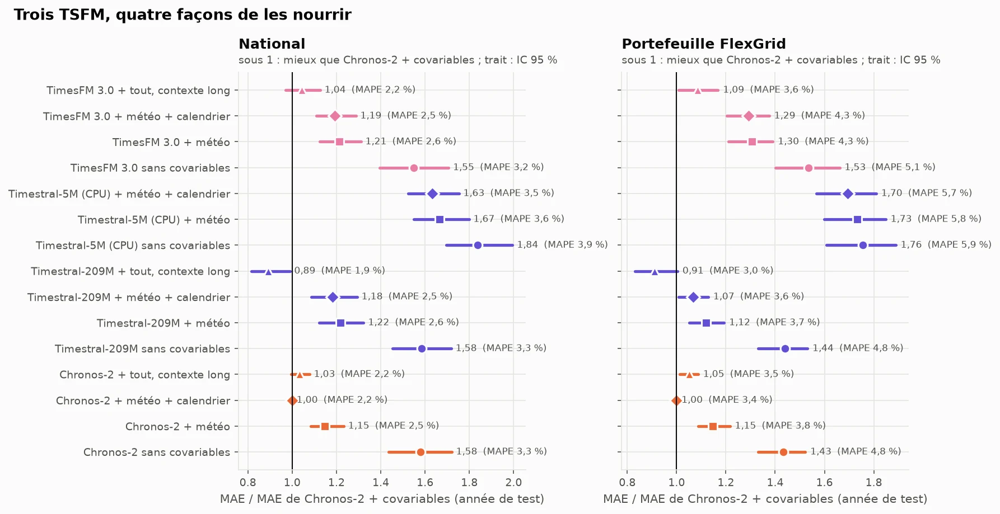
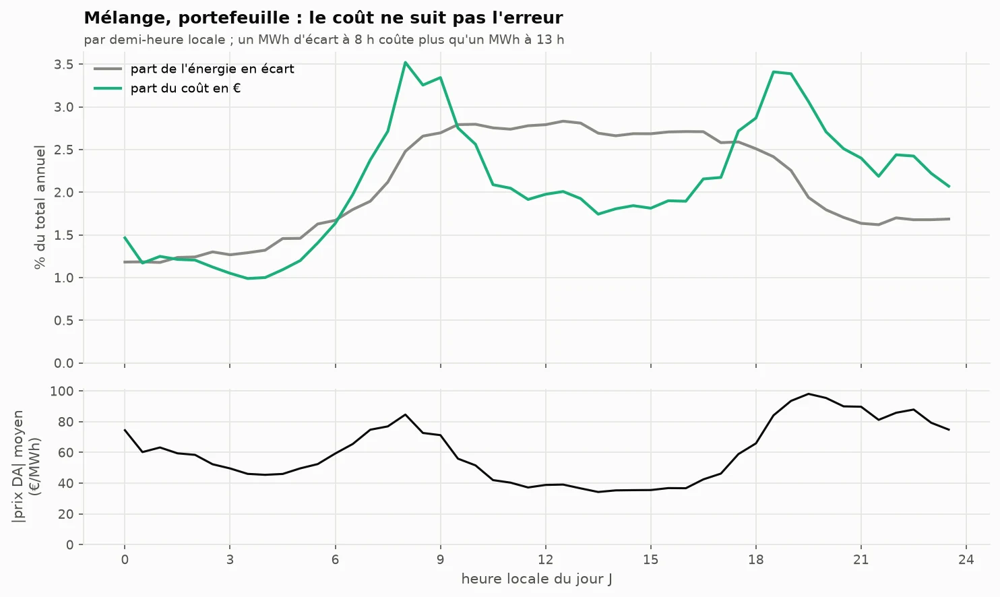
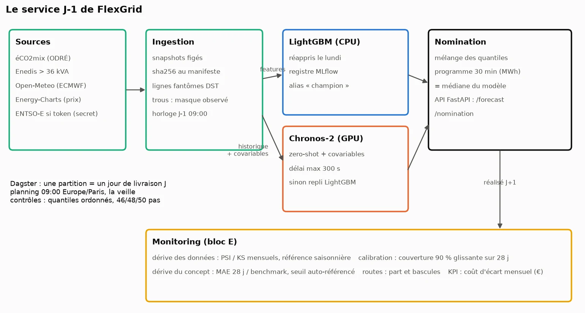


Passer de la question de veille, « quand un modèle de fondation bat-il un spécialiste ? », à
celle d'un client : que nommer chaque veille à 9 h pour un portefeuille de 3 517 sites
tertiaires, avec quels intervalles, et combien cela rapporte face à ce qu'il fait déjà.





mélange LightGBM + Chronos-2, contre 5,6 % pour la prévision RTE ramenée au portefeuille
ratio de MAE au national, IC 95 % [0,99 ; 1,22] : une correction d'une ligne fait jeu égal avec tous les modèles
contre −1,8 % pour le meilleur router possible, connu a posteriori




Ce dépôt applique l'article
[Les modèles de fondation pour séries temporelles : zero-shot contre spécialiste]()
à un cahier des charges client. L'article posait la question sur une seule série et
reconstruisait un routeur ; ce projet la repose avec un vrai benchmark à battre, des
covariables, une métrique en euros et un service à faire tourner. Le dépôt, son
[rapport en ligne](https://gwils28.github.io/flexgrid_dayahead/) et ses figures sont en
français.

## L'objectif

FlexGrid Énergie est un responsable d'équilibre (BRP) fictif. Chaque veille, il doit nommer au
pas de 30 minutes la consommation de son portefeuille pour le lendemain, avant la clôture du
marché day-ahead à midi. Tout écart entre la nomination et le réalisé se règle au prix de
l'équilibrage. Le brief annonçait une prévision actuelle à environ 6 % de MAPE et fixait un
critère sans appel : battre la prévision J-1 de RTE publiée dans éCO2mix, sinon le projet n'a
pas de valeur démontrable.

Les données sont publiques et réelles : la consommation nationale éCO2mix et la prévision J-1
de RTE, les courbes de charge agrégées d'Enedis (sites de plus de 36 kVA, par région, tranche et
secteur), les prévisions météo archivées d'Open-Meteo et les prix day-ahead d'Energy-Charts.
L'année de test va du 1er juillet 2025 au 30 juin 2026 : 365 jours de livraison, une prévision
émise chaque veille à 9 h avec uniquement ce qui est connu à cette heure-là.

Ce que je voulais apprendre tenait en trois questions :

- ce que devient la conclusion de la veille (un TSFM zero-shot battait des spécialistes
  univariés) quand le spécialiste reçoit la météo et le calendrier ;
- comment juger un modèle contre un benchmark public quand ce benchmark a ses propres défauts ;
- ce qu'il faut ajouter à un backtest pour qu'il devienne un service qu'on peut surveiller.

## La démarche

Le travail suit les cinq blocs du brief, un dossier et un README de résultats chacun. Les
décisions prises avant d'écrire du code sont dans `SPEC.md`, avec quatorze angles morts repérés
dans les données ; le protocole d'évaluation est figé dans `configs/protocol.yaml` avant le
premier calcul, et chaque écart est daté dans `IMPLEMENTATION_NOTES.md`. La méthode de travail
est celle de
[Claude Code en data science : ce qui change dans ma méthode]().



Sources figées par sha256, transitions d'heure réparées par une règle explicite, horloge de
nomination reconstituée : conso nationale connue jusqu'à 8 h, courbes des sites jusqu'à la fin
de J-2, météo de J prévue 48 h avant. Le portefeuille est la somme de deux segments Enedis
réels : 3 517 sites, 815 GWh par an.


Naïves, MSTL et ETS ; LightGBM quantile sur retards, calendrier et météo, réappris chaque
semaine ; Chronos-2 avec et sans covariables ; le mélange des quantiles des deux. Origine
glissante sur l'année de test, après six mois de validation. Verdicts pré-enregistrés contre
RTE publiée et RTE débiaisée, sous deux lectures du quart d'heure.


Un router par segment sur un panel de 81 segments tertiaires, appris sur la validation et
comparé à l'oracle et au mélange. Des nouveaux portefeuilles simulés sur trois régions tenues à
l'écart, avec 7 à 56 jours d'historique.


Écart de nomination valorisé au prix day-ahead, avec plusieurs niveaux de pénalité, et coût
évité avec un intervalle de confiance par blocs de sept jours.


Dagster (une partition par jour de livraison, planning à 9 h la veille), registre MLflow,
API FastAPI des quantiles et des nominations, image Docker, puis la surveillance rejouée sur
l'année de test : dérive des données, dérive du concept, calibration, coût mensuel.



Un addendum, écrit le 16 octobre avant toute prévision de ces modèles, a ajouté Timestral
(Mistral AI) et TimesFM 3.0 (Google Research), sortis après la fin du projet.

## Ce que les données ont corrigé au brief

| Le brief dit | Ce que les données disent |
|---|---|
| « 5 000 sites tertiaires et des bornes de recharge » | Aucune donnée publique de bornes au pas de 30 minutes. Le portefeuille devient deux segments Enedis réels (3 517 sites, 815 GWh/an), proches de l'ordre de grandeur demandé. |
| « Battre la prévision J-1 de RTE » | RTE ne prévoit que le national, et sa prévision sous-estime le réalisé d'environ 1,1 GW depuis 2023. Le critère devient : battre RTE publiée **et** RTE débiaisée. |
| « Températures départementales » | La température observée est une fuite : à 9 h la veille, on n'a qu'une prévision. Les verdicts utilisent la météo prévue 48 h avant. |
| « Coût = volume × prix d'écart » | Le prix de règlement des écarts n'est pas téléchargeable sans compte. Le coût est valorisé au prix day-ahead, avec un coefficient de pénalité de 1 (définition du brief) à 0,1. |
| « Prévision actuelle à 6 % de MAPE » | C'est presque exactement le MAPE de la prévision RTE ramenée au portefeuille par demi-heure (5,6 %) : celui d'une méthode sans modèle. |

## Les résultats

Tous les chiffres viennent des tableaux versionnés dans `results/`, produits par le CLI
`flexgrid`. Les intervalles de confiance sont des bootstraps par blocs de sept jours.

### Le benchmark avait un biais



Avant tout modèle, le bloc données a montré deux choses sur la référence. Son biais est stable,
positif chaque mois de l'année de test : un BRP peut le corriger en une ligne, en retranchant
l'erreur moyenne des 28 derniers jours connus pour chaque demi-heure. Et la façon de lire une
prévision au quart d'heure sur un pas de 30 minutes déplace son MAE de 6,5 % (1 400 ou
1 310 MW) sans que la documentation tranche. Un modèle ne « bat RTE » ici que s'il bat les deux
lectures.

Les sources avaient aussi leurs pièges : éCO2mix publie des heures qui n'existent pas au
passage à l'heure d'été (48 horodatages UTC en double sur 2015-2026) et omet l'heure
dupliquée d'octobre chaque année.

### Au national : RTE publiée battue, RTE débiaisée non



Le mélange LightGBM + Chronos-2 a un MAE de 897 MW contre 1 401 MW pour RTE publiée (ratio
0,64, IC 95 % [0,56 ; 0,73]). Le critère du brief est rempli au sens littéral. Mais RTE
débiaisée fait 816 MW : contre elle, le mélange ne montre pas de différence (1,10 [0,99 ; 1,22])
et perd sous l'autre lecture du quart d'heure (1,14 [1,02 ; 1,26]).

| National, année de test | MAE (MW) | MAPE | couverture 90 % |
|---|---|---|---|
| RTE J-1 débiaisée | 816 | 1,61 % | (ponctuelle) |
| Mélange LightGBM + Chronos-2 | 897 | 1,73 % | 0,86 |
| LightGBM | 972 | 1,87 % | 0,76 |
| Chronos-2 + covariables | 1 109 | 2,15 % | 0,83 |
| RTE J-1 publiée | 1 401 | 2,79 % | (ponctuelle) |
| Chronos-2 sans covariables | 1 752 | 3,33 % | 0,81 |
| MSTL | 2 284 | 4,47 % | 0,79 |

Trois lectures :

- **Les covariables comptent plus que le modèle.** Chronos-2 passe de 1 752 à 1 109 MW quand il
  reçoit la météo et le calendrier. En zero-shot sans covariables, un TSFM ne sait pas qu'il va
  faire froid demain.
- **La météo parfaite n'aurait presque rien changé.** Nourri avec la météo observée au lieu de
  la météo prévue, LightGBM ne gagne que 4 % de MAE. Ce qui sépare les modèles de RTE, c'est
  l'information sur la consommation elle-même : RTE révise sa prévision plus tard, avec sa propre
  télémesure.
- **Le mélange gagne l'été, perd l'hiver.** Il bat RTE débiaisée de juillet à octobre (592 contre
  706 MW) et un jour sur deux sur l'année, mais ses mauvais jours sont des jours d'hiver, où les
  erreurs se comptent en GW.

### Sur le portefeuille : le modèle divise par deux les 6 % du brief



RTE ne prévoit pas le portefeuille, donc pas de RTE débiaisée qui tienne. La meilleure méthode
sans modèle est la prévision RTE multipliée par la part récente du portefeuille, par
demi-heure. Ce benchmark a été ajouté après le protocole, et déclaré comme tel : sans lui, la
seule référence du portefeuille était une naïve.

| Portefeuille, année de test | MAE (MW) | MAPE | couverture 90 % |
|---|---|---|---|
| Mélange LightGBM + Chronos-2 | 2,57 | 2,72 % | 0,85 |
| LightGBM | 2,64 | 2,78 % | 0,75 |
| Chronos-2 + covariables | 3,16 | 3,36 % | 0,84 |
| RTE J-1 au prorata | 5,28 | 5,59 % | (ponctuelle) |
| Naïve hebdomadaire | 7,17 | 7,55 % | 0,87 |

L'écart est bien plus grand qu'au national parce que le portefeuille ne ressemble pas à la
France : un pic de bureau vers 10 h, un dimanche plat, et une climatisation l'été que le
national n'a presque pas. Une prévision nationale, même mise à l'échelle demi-heure par
demi-heure, porte la forme du national. Le mélange bat RTE au prorata tous les mois et 86 % des
jours.

### Les jours fériés, point faible des TSFM



C'était déjà le point faible du zero-shot dans la veille, et il le reste avec un calendrier en
covariable. Sur les onze jours fériés de l'année, LightGBM fait 0,42 fois le MAE de RTE au
prorata, Chronos-2 1,25. Le mélange hérite donc des erreurs de Chronos-2 ces jours-là. Une règle
« LightGBM seul les jours fériés » serait un gain facile, mais elle n'était pas pré-enregistrée :
elle n'est pas appliquée. Sur les quatre ponts, tous les modèles perdent : un pont dans le
tertiaire, c'est la moitié des bureaux fermés, ce qu'aucune variable du calendrier ne mesure.

### Les intervalles

Bruts, ils ne tiennent pas leur promesse. L'intervalle à 90 % de LightGBM couvre 75 % des pas
sur le portefeuille, 76 % au national. Le SPEC attribuait cette sous-couverture au décalage
entre la météo observée à l'apprentissage et la météo prévue en service ; la mesure l'a
démentie (77 % avec la météo observée en entrée). La cause principale est la régression
quantile, qui s'ajuste trop bien à ses données d'apprentissage.

La réparation conforme de la veille (médiane conservée, quantiles reconstruits sur les erreurs
des 56 derniers jours) ramène tous les modèles à 0,90-0,91 sur l'année. Elle suit les saisons
avec retard : la couverture réparée du mélange tombe à 0,78 en novembre, quand l'erreur monte
avec le chauffage.

### Mélanger plutôt que router



Sur les 81 segments du panel, un *stump* (une variable, un seuil) appris sur la validation
n'envoie qu'un seul segment vers Chronos-2. Même le router oracle, qui connaît la bonne réponse,
ne gagne que 1,8 % : LightGBM a le MASE le plus bas sur 66 segments sur 81, et là où Chronos-2
gagne (les segments chauffés à l'électricité, les plus gros sites), il gagne peu. Le mélange
gagne 6,8 % et bat l'oracle sur 70 segments. Deux modèles qui se trompent à des moments
différents se corrigent dans le temps ; un router ne choisit qu'une fois par segment.

La décision dérive aussi, comme dans la veille : réappliqué chaque semaine, le stump envoie de 0
à 50 segments vers Chronos-2 selon la saison, et 4,3 segments changent de branche par semaine en
moyenne. Le service nomme donc le mélange, qui n'a pas de décision à surveiller.

### Un nouveau portefeuille se nomme d'abord à la naïve

 bat presque tout ; seul Timestral avec les segments frères en contexte passe dessous. Dès 14 jours, les modèles convergent sous la naïve.")

| WAPE | 7 jours | 14 jours | 28 jours | 56 jours |
|---|---|---|---|---|
| Naïve hebdomadaire | 6,6 % | 6,6 % | 6,6 % | 6,6 % |
| LightGBM appris sur les autres régions | 12,6 % | **3,9 %** | **3,9 %** | 3,9 % |
| Chronos-2 + covariables | 19,2 % | 4,4 % | 3,9 % | **3,6 %** |
| Chronos-2 few-shot in-context | 19,7 % | 4,4 % | 4,0 % | 3,8 % |
| Timestral few-shot (addendum) | **5,7 %** | 4,2 % | 4,0 % | 3,8 % |

Avec une semaine d'historique, Chronos-2 ne voit qu'un cycle hebdomadaire, ne le reconnaît pas
comme une saison et prévoit un mardi à mi-chemin entre un jour ouvré et un dimanche. LightGBM
reçoit un retard de 14 jours manquant, qu'il n'a jamais vu à l'apprentissage. La naïve, elle,
recopie le bon jour. Dès 14 jours, LightGBM appris sur les autres régions passe devant, à
0,5 point de ce qu'il fait avec tout l'historique. Le few-shot in-context de Chronos-2, que le
brief proposait pour le cold-start, n'aide pas. Celui de Timestral est le premier modèle sous la
naïve à 7 jours, sans qu'on puisse conclure qu'il la bat (ratio 0,87 [0,73 ; 1,04]).

La règle qui en sort : la naïve pendant deux semaines, puis le modèle global. Une limite : un
segment agrège des centaines de sites. Ce qui est simulé, c'est l'arrivée d'un nouveau
portefeuille, pas d'un site isolé, bien plus bruité.

### Timestral et TimesFM 3.0 : le contexte compte plus que le modèle



L'addendum posait trois questions, avec les mêmes origines, les mêmes entrées et les réglages
publiés par défaut :

1. **Un nouveau TSFM bat-il Chronos-2 ?** À contexte égal (2 048 pas), non : Timestral fait 1,18
   fois son MAE au national, TimesFM 3.0 1,19. Sans covariables, les trois se valent : l'écart
   vient de la façon dont chacun lit les covariables. Avec tout son contexte (32 768 pas, presque
   deux ans), Timestral passe devant : 990 MW, 0,89 fois Chronos-2. Plus de contexte n'aide ni
   Chronos-2 ni TimesFM 3.0.
2. **Le calendrier en covariable aide-t-il les fériés ?** Oui, il retire environ un quart de
   l'erreur de Chronos-2 et de Timestral ces jours-là, presque rien à TimesFM 3.0. Les TSFM
   restent loin de LightGBM : une covariable binaire « férié » ne remplace pas dix ans de fériés
   vus à l'apprentissage.
3. **Les nouveaux TSFM améliorent-ils le mélange ?** Non. Deux mélanges passent la règle de
   bascule pré-enregistrée sur la validation, aucun n'est confirmé sur l'année de test. Le
   service garde LightGBM + Chronos-2.

Un résultat exploratoire, déclaré comme tel : le mélange LightGBM + Timestral à contexte long,
construit après avoir vu les résultats, est le meilleur modèle du dépôt. Au national, il fait
832 MW et jeu égal avec RTE débiaisée (1,02 [0,92 ; 1,13]). Choisi en regardant l'année de
test, ce chiffre est optimiste ; il ne compte dans aucun verdict et sera candidat d'un prochain
protocole, sur une fenêtre qu'il n'a pas vue.

### Du MW à l'euro : le coût ne suit pas l'erreur



Sous la définition du brief (écart × prix day-ahead), le mélange évite **1,24 M€ par an** face à
RTE au prorata (IC 95 % [0,93 ; 1,56] M€), soit **0,12 à 0,62 M€** avec une pénalité plus
réaliste. Le classement des modèles ne dépend pas de la pénalité, seuls les montants en
dépendent. L'intervalle est large parce qu'une année ne contient qu'un hiver : de novembre à
janvier, trois mois font 47 % du coût annuel.

Le coût n'est pas un MAE déguisé. RTE au prorata se trompe surtout en milieu de journée, aux
heures où le prix est bas. Le mélange évite 51 % de l'énergie en écart mais seulement 47 % du
coût. Un modèle qui viserait le coût plutôt que le MAE pondérerait ses erreurs par le prix
attendu : ce n'est pas fait ici, c'est la suite naturelle.

### Le service et sa surveillance



Trois partitions ont été matérialisées de bout en bout, dont les deux jours de changement
d'heure (46 et 50 pas). **La production reproduit le backtest** : mêmes quantiles pour
Chronos-2, et pour LightGBM le jour où le service et le backtest réapprennent à la même date.
C'est le contrôle qui relie les verdicts au code servi.

La surveillance a été rejouée sur l'année de test, et elle le dit : il n'y a pas eu de vraie
mise en service. Deux constats en sortent. Le seuil d'alerte naïf, « le modèle fait moins bien
que RTE débiaisée », sonne 208 jours sur 365 au national : il décrit un état connu depuis le
backtest et ne détecte rien. Le seuil retenu est auto-référencé (1,15 fois le ratio du modèle
sur la validation). Et la couverture brute de LightGBM descend à 0,52 sur le portefeuille en
janvier : le « 90 % qui dérive à 70 % » du brief s'est produit, ce que la réparation conforme
rattrape avec retard.

## Ce qui a coincé

- **Le benchmark était la première question.** Le critère « battre RTE » paraissait fixé. Le
  biais de +1,1 GW et l'ambiguïté du quart d'heure l'ont transformé en deux benchmarks et deux
  lectures, et la conclusion a changé de signe entre RTE publiée et RTE débiaisée.
- **Les fuites viennent de l'horloge.** Un retard de deux jours compté en pas UTC lisait, le jour
  du passage à l'heure d'hiver, une valeur postérieure au cutoff des segments ; un test l'a
  trouvé avant tout calcul. Plus tard, un *backfill* du 26 octobre 2025 a réutilisé un modèle du
  registre appris pour le 30 juin 2026, huit mois dans le futur. Une règle testée l'empêche
  désormais.
- **Une règle de contrôle retirait de vraies valeurs.** Le filtre de plage pré-enregistré
  supprimait 7 399 pas réels d'un segment chauffé à l'électricité, dont l'hiver vaut six fois
  l'été. Il a été remplacé avant toute prévision, et l'écart est daté.
- **Le calcul.** Le backtest complet prend plusieurs heures sur une RTX 5070 et 32 cœurs, dont
  4 h 30 pour LightGBM sur le panel, et l'addendum ajoute environ 9 h de GPU. Deux calculs
  LightGBM lancés en même temps multipliaient la durée par cinq : les calculs lourds passent l'un
  après l'autre.
- **L'image Docker pèse 6,9 Go compressés**, presque tout pour torch et CUDA, alors que l'API
  seule n'en a pas besoin. Une image séparée pour l'API est la prochaine étape.

## Ce que j'en retiens

- La conclusion de la veille ne se transpose pas telle quelle. Contre des spécialistes
  univariés, Chronos-2 gagnait partout ; contre un LightGBM nourri de météo et de calendrier, il
  perd sur 66 segments sur 81. Ce qui fait la différence, c'est ce que chaque modèle reçoit en
  entrée.
- « Battre le benchmark » se vérifie contre la version corrigée du benchmark. Une correction de
  biais d'une ligne a fait jeu égal avec tous mes modèles au national. Sur le portefeuille, où
  elle n'existe pas, l'écart est réel : 2,7 % contre 5,6 %.
- Entre le spécialiste et le TSFM, la meilleure réponse a été « les deux ». Le mélange bat le
  meilleur router possible, et il retire une décision à surveiller.
- Les fériés restent le point faible des TSFM, même avec le calendrier en covariable. Un modèle
  qui en a vu dix ans fait mieux.
- Un rejeu honnête dit ce qu'il ne montre pas : les seuils d'alerte ont été fixés après avoir vu
  la saturation du seuil naïf, et un vrai monitoring les fixerait sur la validation pour un an.

## Reproduire

```bash
git clone https://github.com/gwils28/flexgrid_dayahead
cd flexgrid_dayahead
uv sync --extra prod           # Python 3.12 ; Chronos-2 tourne sur GPU (un CPU suffit, en beaucoup plus lent)
make data                      # télécharge et fige les sources (sha256 dans data/MANIFEST.json)
uv run flexgrid build          # tables intermédiaires
uv run flexgrid forecast national snaive_day snaive_week mstl ets_seasonal lgbm chronos2 chronos2_cov
uv run flexgrid forecast segments snaive_day snaive_week mstl ets_seasonal lgbm chronos2 chronos2_cov
uv run flexgrid score national segments && uv run flexgrid tables
uv run flexgrid router && uv run flexgrid coldstart
make figures report            # figures de tous les blocs, puis le rapport Quarto dans docs/
uv run pytest
```

Les modèles de l'addendum se lancent de la même façon (liste dans `configs/protocol.yaml`). Les
prévisions brutes ne sont pas versionnées ; les tableaux par origine le sont, et toutes les
figures et tous les verdicts en partent. Licences : Chronos-2 Apache-2.0 ; Timestral, code
Apache-2.0 et poids sous licence MIT modifiée ; TimesFM 3.0, poids non commerciaux, qu'un vrai
BRP ne pourrait pas servir sans autre licence.
