
Know where the household's money goes, month after month, and what its assets are worth, without
handing bank statements to an online service. Everything runs on a machine at home.





each one blocked until CI is green
including 48 property tests on financial invariants
written down, with the rejected alternatives





**Work in progress.** This page describes the repository as of 15 October 2026. The figures above
are counted in the code, and will be updated with each phase shipped.



**Every screenshot shows fictional data.** They come from a demo instance, filled with an
invented household (Camille and Sam, four accounts, two years of generated transactions, about
ten holdings). No amount, label or balance comes from real accounts. The interface is shown in
French.


## The problem

Consumer budgeting apps almost all ask for the same thing: access to your bank accounts, and
hosting your financial history on their servers. Spreadsheets ask for nothing, but get abandoned
after three months: re-typing, copying and categorising by hand costs too much.

I wanted a tool in between:

- **private by design**: the data stays on a household machine, with no telemetry and no
  third-party service;
- **fed effortlessly**: you import the bank's CSV export, and expenses sort themselves into their
  categories;
- **exact to the cent**: every total must be recomputable from the transactions;
- **ready for data science**: cash-flow forecasting, net-worth simulation and a natural-language
  assistant must be addable without rebuilding the foundations.

It is also my first product: a project meant to last, not a throwaway experiment. So it is where
I apply [my way of working with Claude Code]().

## Where the project stands




Specifications, architecture and decisions written before the first line of code. Repository,
tooling, continuous integration, Docker Compose stack, Claude Code configuration and a visual
identity borrowed from this blog.



Two-factor authentication, household and invitations, accounts, bank import, manual entry,
rule-based categorisation, internal transfers, budget matrix, spending indicators and automatic
backups. Interface in French and English.



Budget plans by period with their review (projection, drift, money flows, comparison), joint
account and per-scope views, budget month, savings categories, recurring items and projected
balance, reconciling manual entries with the statement, split transactions and notes, reports by
period, activity log. Splitting shared expenses was dropped along the way.



A monthly net-worth matrix: categories and lines entered by hand, debts, net worth, and four
charts (history, allocation as a sunburst and a mosaic, what moved net worth). Reshaped along the
way, see below.



Cash-flow forecasting, evaluated by rolling-origin backtesting against a naive model, and
Monte Carlo net-worth simulation (allocation scenarios, retirement projection).



An assistant that answers natural-language questions about your own data, using a local language
model (Ollama), restricted to a read-only analytics view.




## What works today

### One household, several accounts, three points of view

The owner creates the household and invites the other members with a single-use link; there is
no public sign-up. Login with a password (argon2id) and a mandatory TOTP code.

Each account has a visibility:

- **private**: only its holder sees it;
- **shared**: the whole household sees it, but it is still its holder's;
- **joint**: the common account that pays rent and groceries, nobody's own.

Every aggregated view then reads at the level of the **household**, the **joint accounts** or
**my accounts**. In a narrower scope, each member's share paid into the joint account shows up as
money "paid in from other accounts"; at household level, those transfers cancel out.

### The overview

The home page sums up the month and the whole app: the household's net worth, spending, income,
net cash flow and savings rate, compared with the previous month and the 12-month average.


Below, **the month's targets**: one bar per budgeted category, ranked by share used. The vertical
marker shows the share of the month elapsed, so spending ahead of the calendar shows before it
overruns.

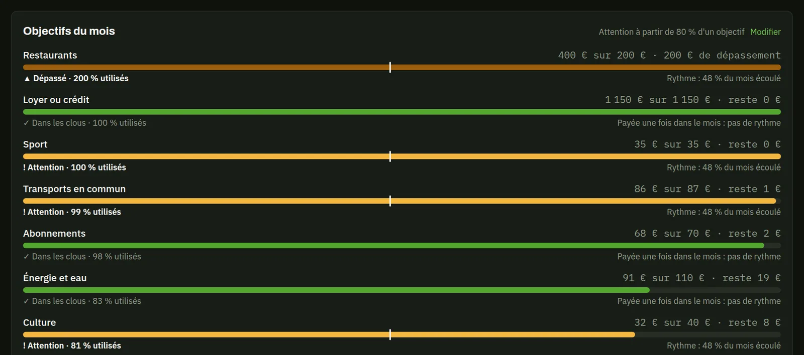

- "Watch" from an adjustable threshold (80% by default);
- **one-off** categories (rent, subscriptions), paid early in the month, are exempt from the
  pace: they are never flagged for having been paid.

Finally, what is **still expected by the end of the month**, with the projected balance. Nothing
is entered on its own: "Enter it" opens a pre-filled entry.

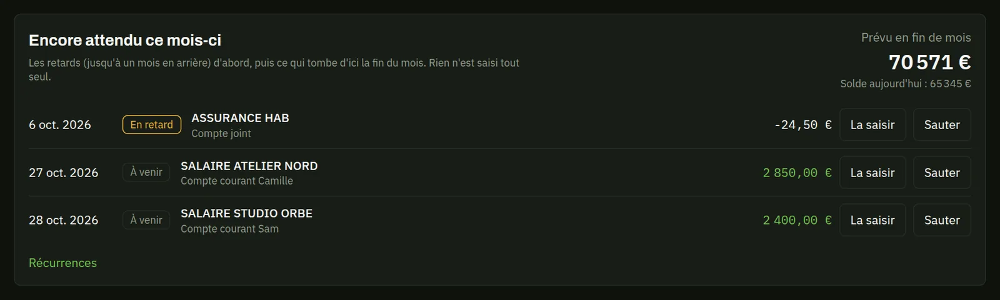

### Import and reconcile

Banks only export a statement once a month: most transactions are therefore entered by hand
during the month, and the statement comes later. The import shows a **preview** before writing
anything, and recognises what was already entered.

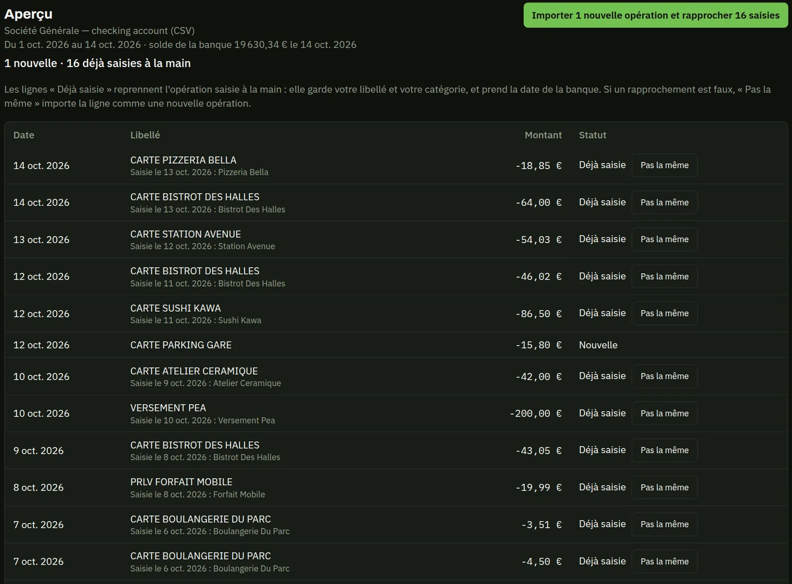

- a statement row **matches** an entry on the same account, with exactly the same amount, within
  five days; "Not the same" undoes a wrong match;
- the entry keeps its category and takes the bank's date;
- every transaction has a fingerprint: **re-importing the same file changes nothing**;
- the computed balance is checked against the bank's, and any import can be rolled back.

Two banks are supported, with three layouts.

### Categorise once, never again

A two-level category tree, and ordered **rules** ("label contains…", amount, account) applied on
every import and every manual entry. Whatever they did not recognise stays flagged "to
categorise".


Transfers between your own accounts are detected then linked, or entered directly as a transfer:
they leave spending and income.


A transaction can also be **split** over several categories (the last part takes the rest, so
the sum is always exact) and carry a **note**, which search finds.

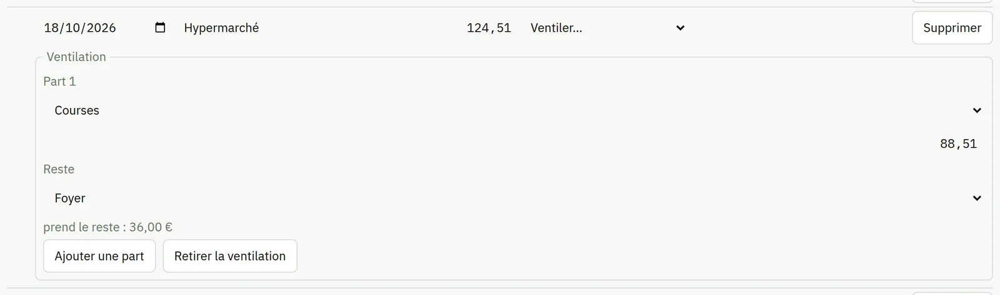

### The budget month

A salary paid on the 28th pays for the next month's spending. Each transaction keeps its real
date, but also counts in a **budget month**: shifted to the next month by its category from a
given day, or set by hand.

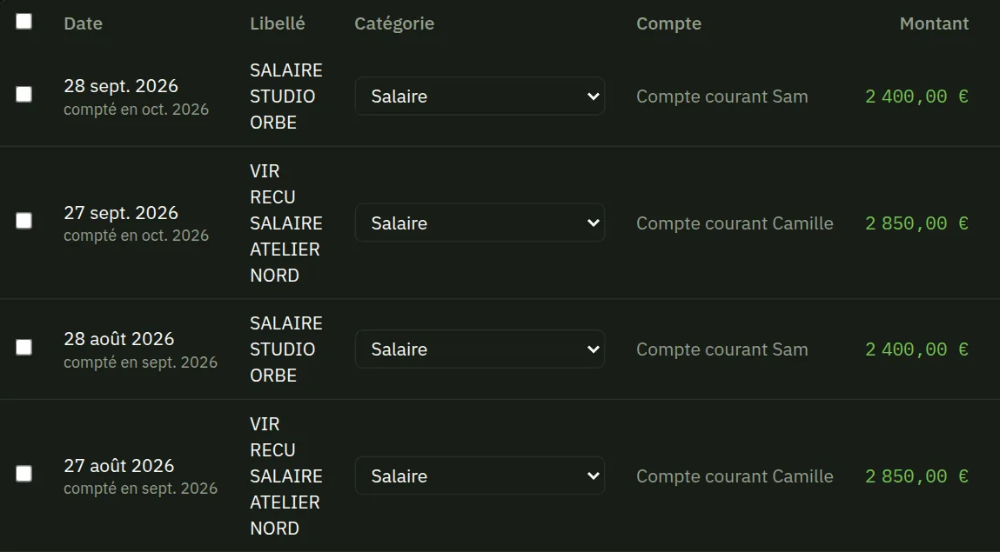

Every figure by month follows the budget month; balances keep the real date. A third kind of
category, **savings** (a PEA, a life insurance policy the app does not track), is never
spending, and can get a minimum objective.

### Recurring items

Salary, rent, subscriptions, electricity: a **recurring item** describes an expected
transaction, with a fixed amount or one estimated from its last three occurrences ("≈"). The app
suggests some from the history, to follow or dismiss.

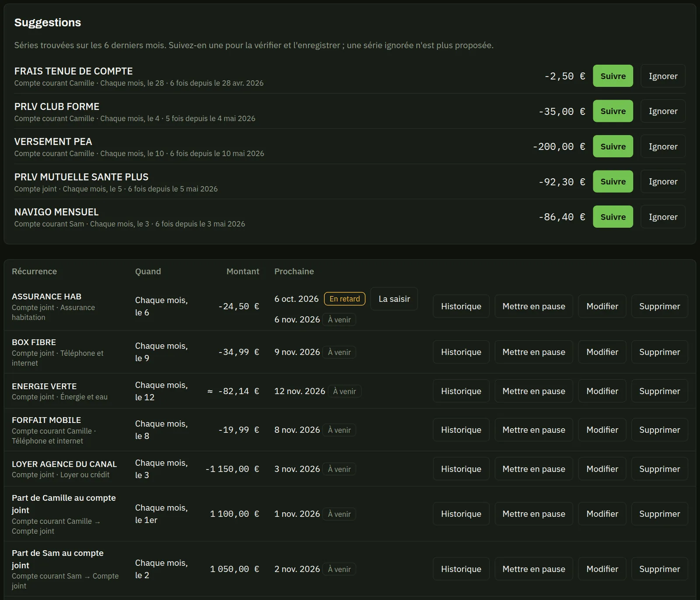

Each incoming transaction fulfils at most one occurrence; an unfulfilled one turns "late". A
monthly transfer into the joint account is a recurring item like any other.

### Budget plans by period

A monthly target per category does not survive real life. So targets live in **plans** covering
a quarter, a semester or a year:

- a cheaper month offsets a dearer one within the plan's envelope;
- a new plan starts from the previous one's targets;
- it can be edited during its first month; after that, you **close it early**, with a reason,
  and a replacement plan covers the rest of the period;
- each target says who pays: the joint account or personal ones.

The budget matrix remains the central view: one row per category, one column per month, each
cell coloured by its gap to the target of the plan covering that month.

, then the matrix. Green: under target; grey: within ±5%; burnt orange: above. Fictional data.")

### The plan review

This is the part closest to my day job. During a plan, the review says where things stand and,
above all, where they will end up: a **projection** at the end of the plan, and the list of
**drifting** categories.


The projection is not a rule of three:

- completed months count as spent;
- the current month and the following ones count for at least their target, or for the
  completed months' average if it is higher;
- so rent paid on the 1st is not a drift, while spending above the target shows at once.

Once the plan is over, the same screen gives the final result, the actual savings and the
planned savings.

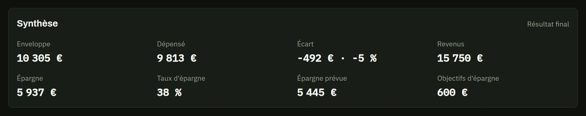

Two charts follow: the gap by category, in the matrix's colours, and cumulative spending day by
day against the envelope line.


The flow diagram shows where the plan's money comes from and where it goes. Both sides always
add up to the same total.


Finally, two plans side by side, as monthly averages so that plans of different lengths stay
comparable.


### Reports over any period

A month, a quarter, a year or any period up to ten years, compared with the **previous one of the
same length**. A running period stops at the current month: "this year" is compared with the same
months last year, not a whole year.

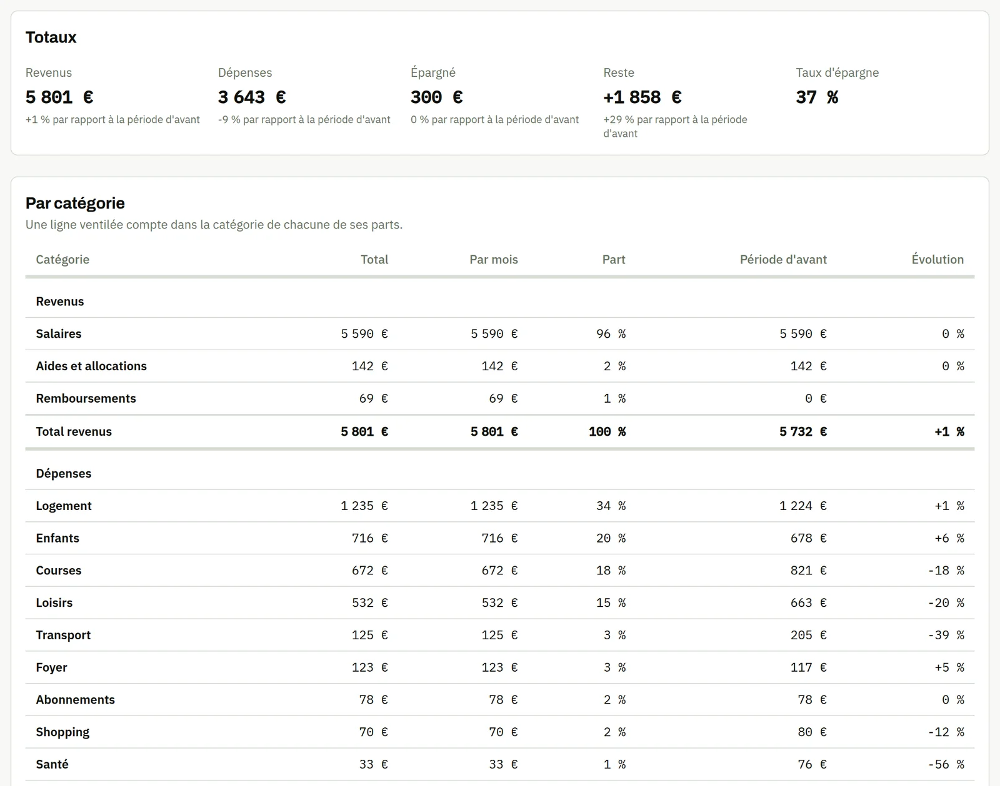

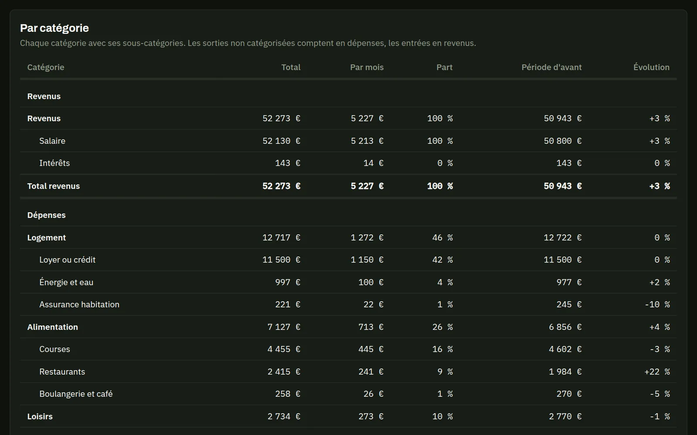

A report also gives a monthly chart and the period's money flows. The owner can set an
**analyses start**: older history, often incomplete, no longer skews the averages.

### Net worth, month by month

Net worth is tracked as in a spreadsheet: one line per holding, filed under a category, one
column per month, and a value entered by hand once a month.

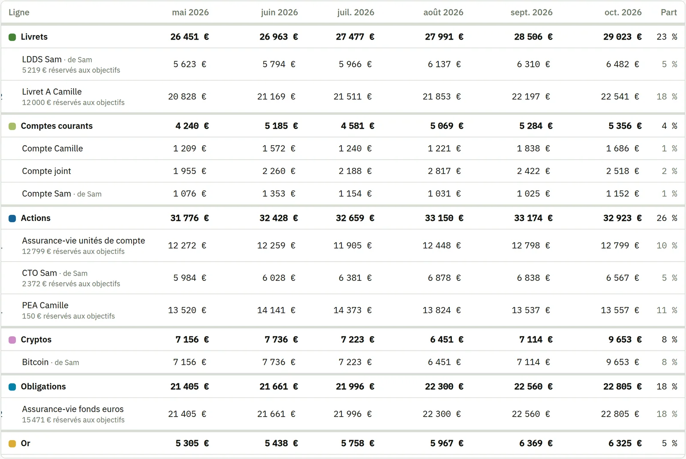

- a month without a value carries the previous one forward, shown as carried;
- "Update this month" lists every line with its last value, to enter them all at once;
- each line has an owner and a visibility, like an account.

An *Analysis* page gives four charts, each category in its colour. Since ten hues cannot all stay
apart for every colour-vision deficiency, every chart also keeps its labels and its data table.

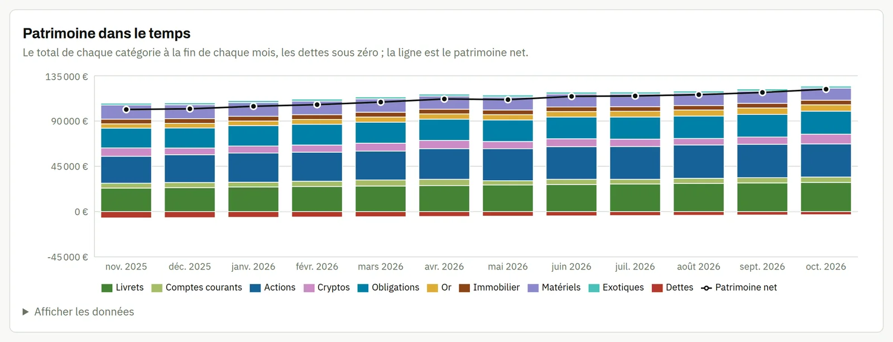

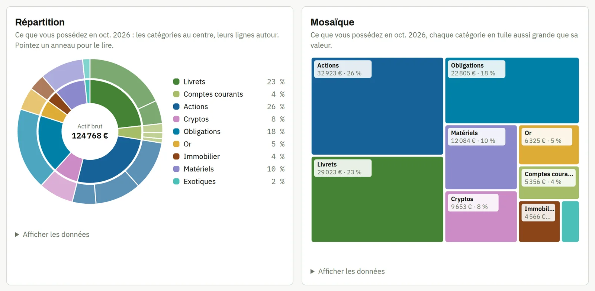

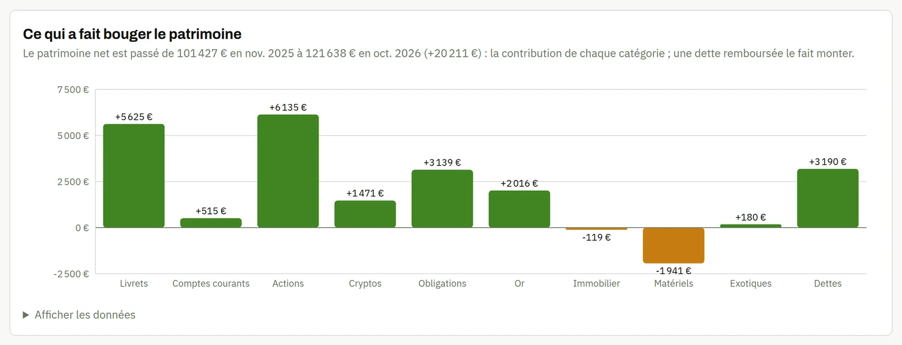

The app is arranged in two spaces, **Spending** and **Wealth**, each with its tabs; the overview,
at the top, sums up both.

### Verified backups, logged actions

A full backup every night, checked before it is kept, with rotation (7 days, 4 weeks, 12 months)
and a written restore procedure.

An **activity log** keeps sensitive actions, written in the same transaction as the action
itself. The owner sees the whole household, a member their own entries.

, an invitation sent then cancelled, a deletion, imports. Fictional data.")

## How it is built

### A simple architecture, designed for what comes next

Everything starts from a single `docker compose up`: a Caddy proxy with TLS on the local network,
a FastAPI API, a PostgreSQL database and a backup service. The React interface is served from the
same origin as the API, which allows cookie sessions with no CORS configuration.

On the Python side, the code is split into packages with a strict rule: `kwak_core` holds **all
the business rules** (amounts, balances, deduplication fingerprints, categorisation rules, plans,
projection, flows, indicators, recurring items, net worth) and depends on nothing. It is tested without a database. The API
and the future analytics layer depend on it, never the other way round: a given figure has only
one definition.

The contract between the API and the interface is the OpenAPI schema: the TypeScript client is
**generated** from it, never written by hand. CI fails if someone forgets to regenerate it.

### Money does not tolerate "roughly"

Amounts are exact decimals (`Decimal` in Python, `NUMERIC` in the database), never floats. And the
rules that must always hold are written in the specifications, then checked by **property tests**
(Hypothesis): instead of a few hand-picked examples, the test generates hundreds of cases and
looks for the one that breaks the rule.

| Invariant | What the test checks |
|---|---|
| Balance | An account's balance equals its opening balance plus its transactions, in any order |
| Idempotent import | Importing the same file twice changes nothing |
| Transfers | A linked transfer nets to zero across the two accounts and is never reused |
| Matrix | The total row equals the sum of the categories plus "to categorise" |
| Plans | Two plans never overlap, and an envelope equals the monthly target times the number of months |
| Flows | Both sides of the flow diagram add up to the same total |
| Splits | The parts of a split transaction add up exactly to its amount, each of its sign |
| Budget month | Summed over all months, income, spending and savings are the same by budget month as by real date |
| Reconciliation | A statement already entered by hand only adds the rows without an entry, and the balance is the statement's alone |
| Consistency | A report, the matrix, a plan review and the month so far always give the same figures |
| Net worth | A month's net worth equals its assets minus its debts, and the household is exactly the sum of its scopes |
| Bank format | Everything the bank writes is read back exactly |
| Visibility | Another member only sees shared and joint accounts |

API tests run against a **real PostgreSQL** started in a container, never against a mocked
database.

### Decisions written down

Every structural choice gets a decision record (ADR), dated, with its rejected alternatives. A
decision that changes gets a new record; the old one is never rewritten.

| Decision | Rather than |
|---|---|
| Self-hosting with Docker Compose | Cloud hosting: needless cost and exposed financial data |
| FastAPI, SQLAlchemy 2, Alembic | Django: heavier, and the admin interface is of no use |
| PostgreSQL, then DuckDB for analytics | SQLite alone: concurrent writes, no vector extension |
| Euro only | Full multi-currency accounting, too costly for a single real need |
| Server sessions and mandatory TOTP | JWT tokens, hard to revoke |
| Local language model (Ollama) | A cloud API: the data must never leave the machine |

Deviations from the original plan are logged in the `README` too, to the day.

### Built with an agent, under control

The project applies the method described in
[my article on Claude Code](), with one starting
rule: **what must always be true becomes a hook**, not an instruction.

- **I am the only commit author.** The agent prepares the change and proposes the message; a Git
  hook and CI reject any message that is not in Conventional Commits format or that adds a
  co-author.
- **Real data is out of reach.** A hook blocks any write into `data/` and any read of secrets; the
  test files are synthetic, and only reproduce the bank's layout.
- **"Done" means "verified".** When the agent has changed code, a hook re-runs lint, types and
  tests, and keeps it from wrapping up while they fail.
- **A cold review.** A read-only subagent reviews each diff before the pull request: correctness,
  invariants, tests, one topic per change. A second one reviews it for security: other members'
  private accounts, owner-only actions, sessions.
- **Merged migrations are frozen.** A hook refuses any edit to a database migration already on
  `main`: a new one must be added.
- **The guide follows the interface.** A branch that changes a page without touching the in-app
  guide is stopped once, with a reminder.
- **Check in the browser, without touching real data.** A skill starts a throwaway instance
  (database in a container, synthetic data), and a subagent walks through it with the Chrome
  extension: both languages, light and dark themes, phone width, console errors. Screenshots stay
  out of the main context.
- **One PR per topic.** Every change goes through a short branch and a pull request, merged only
  once every check is green (lint, strict typing, tests, Docker image builds).
- **Specification first.** Every feature starts with a documentation-only PR that sets the rules
  before any code: the specification is at its 23rd version. A skill describes a feature's full
  path, from the business rule tested first to the bilingual guide.

## What got stuck

- **The real bank format.** The specifications planned user-configurable import profiles. Banks
  actually export quite different layouts, sometimes two for the same bank depending on the
  account type. I chose to code one format per layout, each tested on a synthetic file copying its
  exact structure. A generic profile will come for other banks.
- **A projection that was too naive.** The first plan projection was linear: spent divided by the
  share of time elapsed. On the 3rd of the month, rent already paid showed up as a huge drift. It
  now starts from each remaining month's expected spending.
- **The joint account.** As long as everything was "private" or "shared", a transfer into the
  joint account made no sense in a personal view. It took a third visibility, then judging each
  scope on its own transfers and its own targets.
- **Moving tooling.** The TypeScript client generator needs the JavaScript compiler API, which
  TypeScript 7 no longer exposes: it runs separately, with TypeScript 6.
- **Imagined net worth against real net worth.** Phase 3 planned securities positions valued from
  daily market prices, amortisation schedules and depreciated assets. When specifying it in
  detail, it became clear that I value each holding once a month, by hand, in a spreadsheet, and
  that this is the tracking I want back. The phase became a monthly matrix, and market prices were
  dropped: less ambitious, but shipped in a day, and used.
- **A feature no longer needed.** Splitting shared expenses ("who owes what to whom") was planned
  from the start. The joint account and each member's recurring transfers into it already cover
  that need: the feature was removed from the specification before being coded, as was the CSV
  export, which the backups make useless.
- **The salary of the 28th.** Counting transactions by real date put every salary in the wrong
  month, and made every other month look like a deficit. Hence the budget month, and an invariant
  guaranteeing it only moves money from one month to another.
- **What does not survive the disk.** A backup on the same disk does not protect against a disk
  failure. Off-machine copies remain manual, and that is an open question.

## What's next

Budget and net worth are in place: what is left is the phase I care about most. Phase 4 will
treat cash-flow forecasting as a real time-series problem, with a protocol written in advance, a
backtest with no leakage from the future, and a naive model to beat before anything else. It
already has two customers: the plan review's projection and the projected month-end balance, both
computed by simple rules today. The net-worth matrix, for its part, will be the starting point of
the Monte Carlo simulation. This page will be updated with each phase shipped.

## Try it

```bash
git clone https://github.com/gwils28/kwak-finance
cd kwak-finance
make setup        # dependencies and Git hooks
make check        # everything CI runs
make up           # the full stack on https://localhost:8443
```

The steps to create the owner account and the encryption key are in the `README`, and the app
itself offers, at the bottom of every page, a guide to start, stop and update it.
