
Know where the household's money goes, month after month, what its assets are worth and when its
plans will be funded, without handing its accounts to an online service. Everything runs on a
machine at home.





each one blocked until CI is green
including 49 property tests on financial invariants
written down, with the rejected alternatives





**Work in progress.** This page describes the repository as of 24 October 2026. The figures above
are counted in the code, and will be updated with each phase shipped. There are fewer tests than
on 15 October: the spending redesign removed bank import and everything that depended on it,
tests included.



**Every screenshot shows fictional data.** They come from a demo instance, filled with an
invented household (Camille and Sam, ten months of spending, two years of net worth, nine goals).
No amount, label or balance comes from real accounts.


## The problem

Consumer budgeting apps almost all ask for the same thing: access to your bank accounts, and
hosting your financial history on their servers. Spreadsheets ask for nothing, but get abandoned
after three months: entry is slow, and the totals break at the first copy and paste.

I wanted a tool in between:

- **private by design**: the data stays on a household machine, with no telemetry and no
  third-party service;
- **quick to keep up**: one entry session a week, at the keyboard, with nothing to sort afterwards;
- **exact to the cent**: every total must be recomputable from the lines entered;
- **looking ahead**: tell whether the household's plans will be funded on time, and where its net
  worth could go;
- **ready for data science**: simulation, forecasting and a natural-language assistant must be
  addable without rebuilding the foundations.

It is also my first product: a project meant to last, not a throwaway experiment. So it is where
I apply [my way of working with Claude Code]().

## Where the project stands




Specifications, architecture and decisions written before the first line of code. Repository,
tooling, continuous integration, Docker Compose stack, Claude Code configuration and a visual
identity borrowed from this blog.



Two-factor authentication, household and invitations, accounts, bank import and reconciliation,
categorisation rules, transfers, budget plans by period with their review, recurring items,
reports and an activity log. The whole accounts-and-import side was later replaced by the v1.0
redesign.



A monthly net-worth matrix: categories and lines entered by hand, debts, net worth, and four
charts (history, allocation as a sunburst and a mosaic, contributions to the change).



Goals arranged in a pyramid (the emergency fund as its foundation, then long, medium and short
term, under a golden capstone for treats), funded by envelopes taken from the net-worth lines,
with monthly tracking and an effort plan for the month.



No more accounts, import or transfers: every expense is a line entered by hand, in a grid built
for the keyboard. One level of categories, fixed expenses to confirm, monthly targets with their
matrix and a year view. The spending data starts afresh.



Shipped: the goals analysis (six views and points to look at, computed by rules) and the Monte
Carlo engine of the net-worth projection. Next: the projection page, the chance of reaching each
goal, retirement, then cash-flow forecasting once the spending has enough history.



An assistant that answers natural-language questions about your own data, using a local language
model (Ollama), restricted to a read-only analytics view.




### Why bank import went away

Import was where the project started: drop in the bank's CSV export and let the rules sort the
expenses. In practice, I already entered my expenses by hand every week, and the statement then
arrived as a chore: rows to sort again, duplicates of what was already entered, a reconciliation
to check. So v1.0 removed accounts, import, transfers, rules, recurring items, the budget month
and the plans, with their data, to keep what is useful: quick entry and a readable budget. The
deviation is logged in the repository's `README`, like every deviation from the original plan.

## What works today

### One household, three points of view

The owner creates the household and invites the other members with a single-use link; there is no
public sign-up. Login with a password (argon2id) and a mandatory TOTP code.

Spending belongs to the household: every member sees and edits every line. Net worth and goals,
on the other hand, have a visibility, line by line:

- **private**: only its owner sees it;
- **shared**: the whole household sees it, but it still belongs to its owner;
- **joint**: the household's common holding, which belongs to nobody.

Net worth and goals can then be read at the level of the **household**, the **joint** holdings or
**my lines**. The app is arranged in three spaces, **Spending**, **Wealth** and **Goals**; the
overview, at the top, sums up all three.

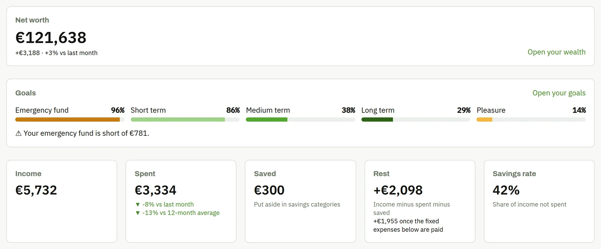

### Quick entry, at the keyboard

The spending space's main page is a **grid**: one month, its lines, every cell editable in place.
An empty row always waits at the bottom; Tab moves to the next cell, Enter saves and opens a new
row with the same date. Everything works without the mouse.

Above it, a **quick line** takes an expense typed in any order: `bakery 12.50 yesterday`,
`45 train 13/10` or `groceries 87.40 #home`.

- the date is recognised ("yesterday", a weekday, `dd/mm`);
- the amount is the last number, the others stay in the label;
- `#word` forces the category that starts with that word;
- the rest is the label, and its category comes from the **label memory**: picking a label
  already used brings back the category of its latest line.

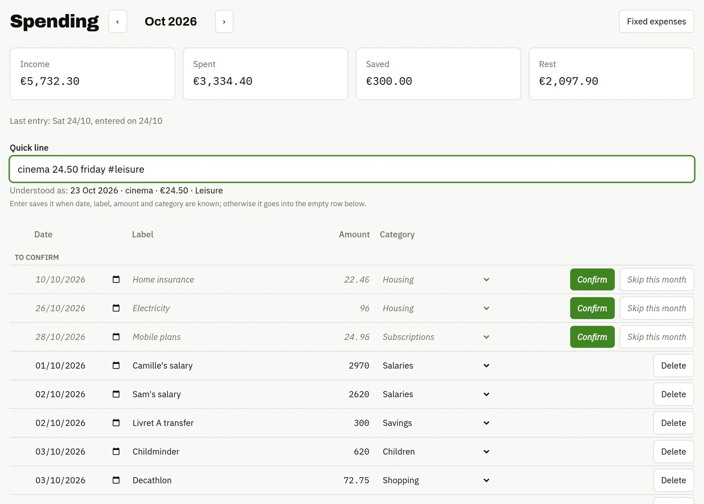

A header recalls the last line entered and when, and a dot marks it in the grid, to pick up where
you stopped.

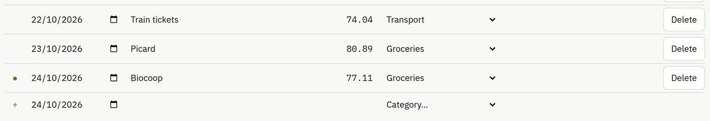

A line can also be **split** across several categories: the last part takes the rest, so the sum
always comes out exact.

 for the home. Fictional data.")

### Categories of three kinds

One level of categories, each of a kind:

- **expense**: rent, groceries, leisure;
- **savings**: money put aside, never spending, but it reduces the month's rest;
- **income**: salaries, benefits, refunds.

A month's income is the sum of its income lines, and the rest is income minus spending minus
savings. **One-off** categories (rent, subscriptions), paid in one go, are never judged against
the pace of the month.

### Fixed expenses

Rent, the childminder, subscriptions, insurance: a **fixed expense** describes a line that comes
back every month, quarter or year. Each occurrence due shows greyed at the top of the month's
grid. Enter confirms it and creates the line, editable first; it can also be skipped for the
month. Nothing is ever created by itself.

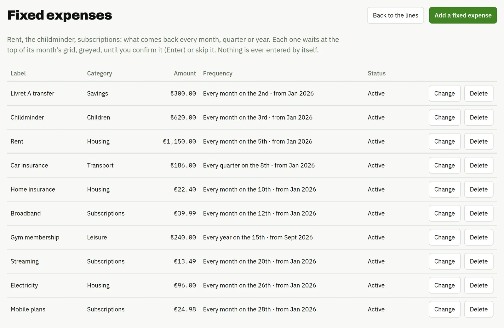

The overview lists what is still to confirm and the **projected rest** at the end of the month.

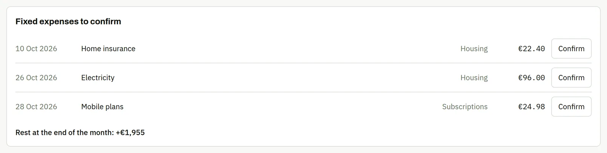

### Monthly targets

Each expense category can get a **monthly target**, set from a month on and kept until changed;
past months keep theirs. A savings category gets a minimum to reach.

- **the month so far**, on the overview: one bar per category, ranked by share used, with a mark
  for the share of the month elapsed, so spending ahead of the calendar shows before it overruns;
- **the matrix**: one row per category, one column per month, each cell coloured by its gap to
  the target (green below, grey within ±5 %, burnt orange above);
- **the year**: the targets to date and for the whole year, the gap, and how many months were
  over, on or under target.

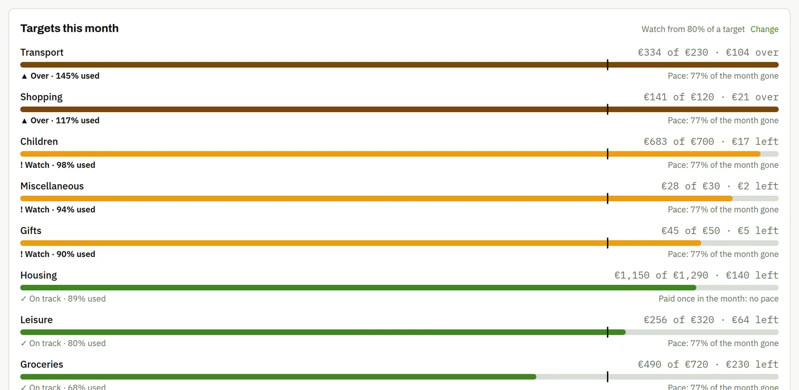

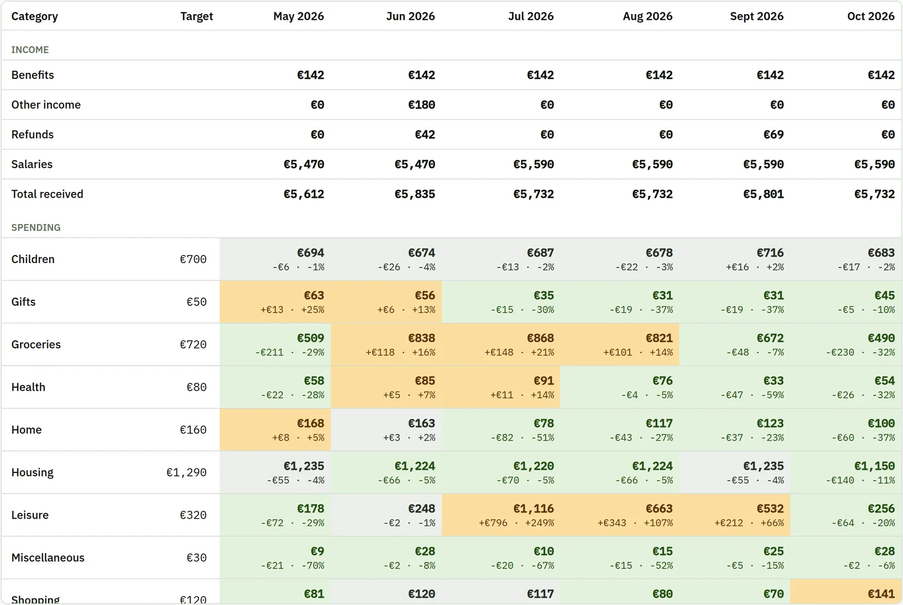

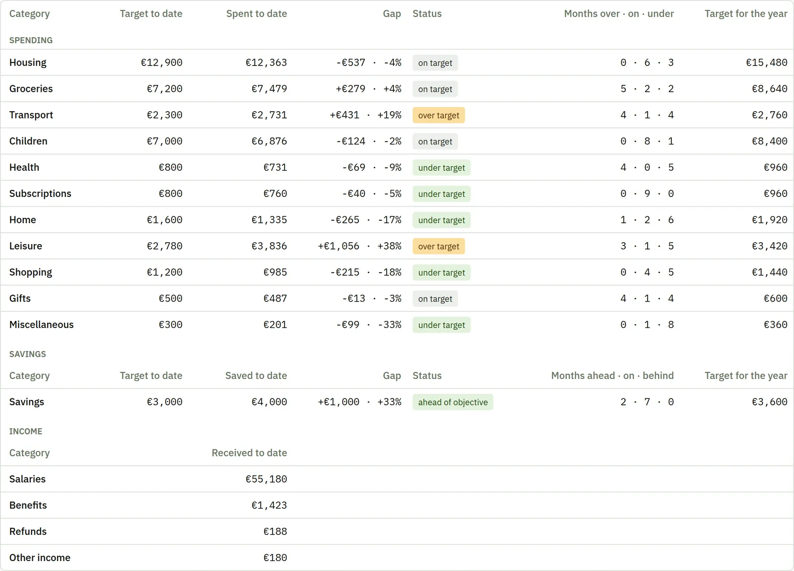

### Reports over any period

A month, a quarter, a year or any period up to ten years, compared with the **previous period of
the same length**. A running period stops at the current month: "this year" is compared with the
same months last year, not with a whole year.

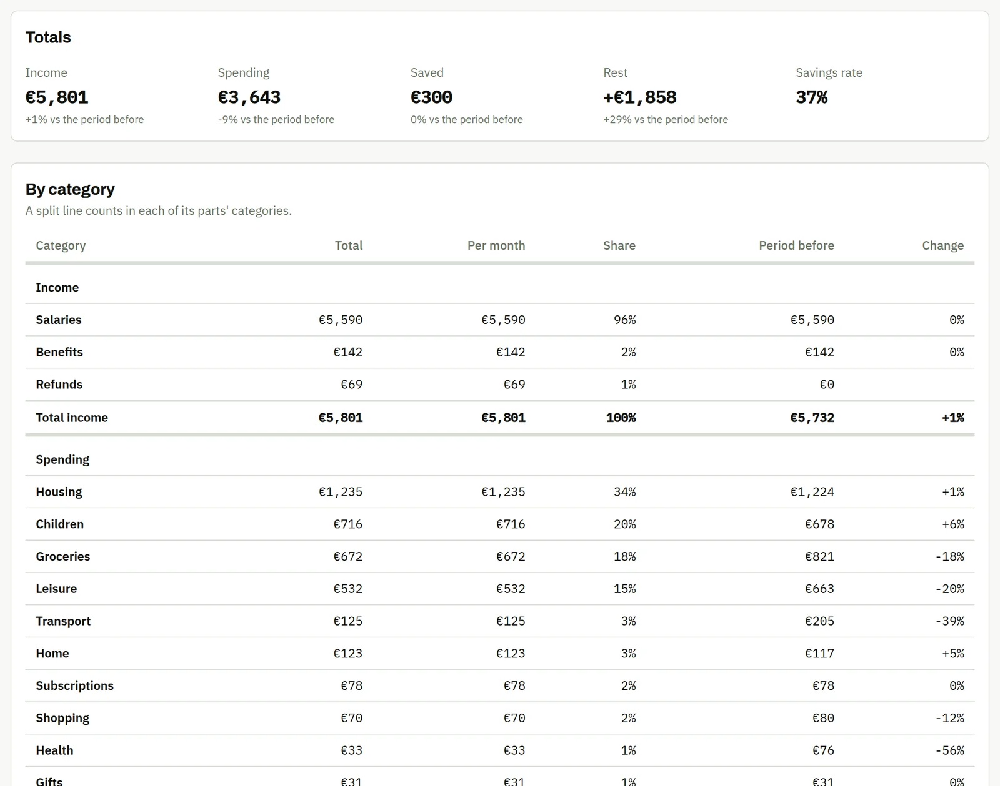

A report also gives a monthly chart stacked by category, spending accumulated day by day, and the
period's **money flows**: income on the left; spending, savings and the unallocated rest on the
right, both sides always adding up to the same total.

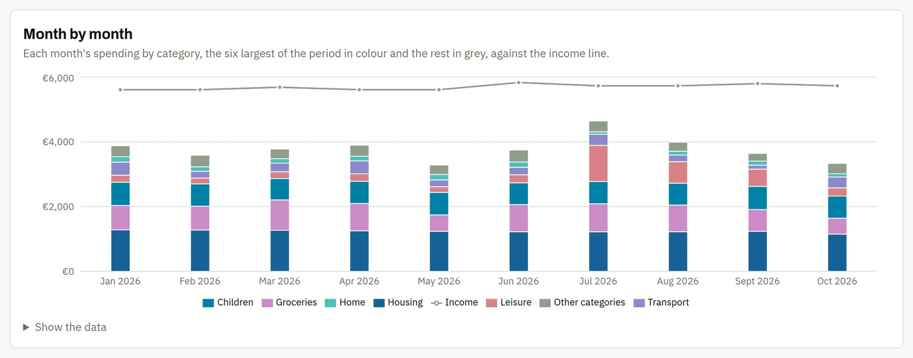

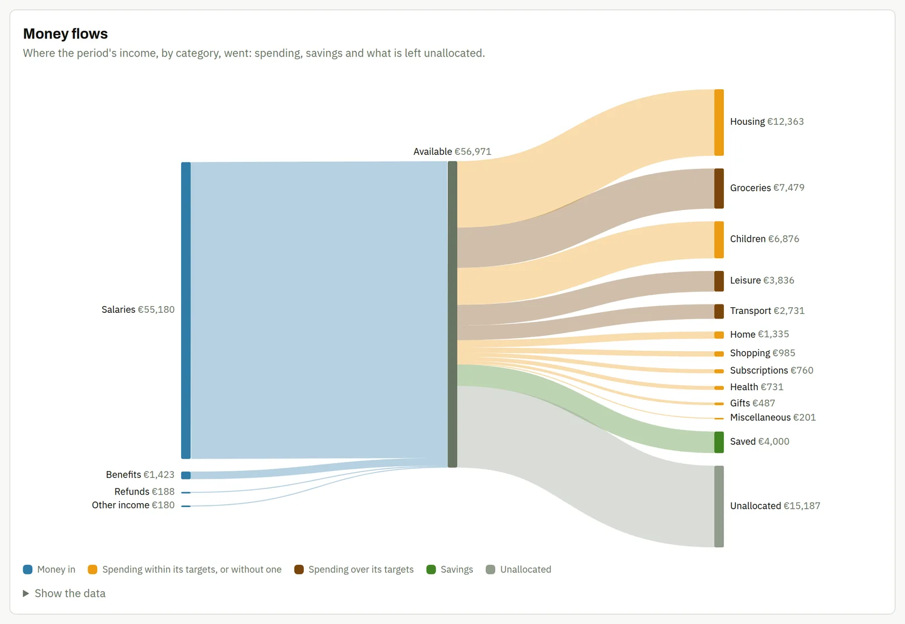

### Net worth, month by month

Net worth is tracked as in a spreadsheet: one line per holding, filed in a category, one column per
month, and a value entered by hand once a month.

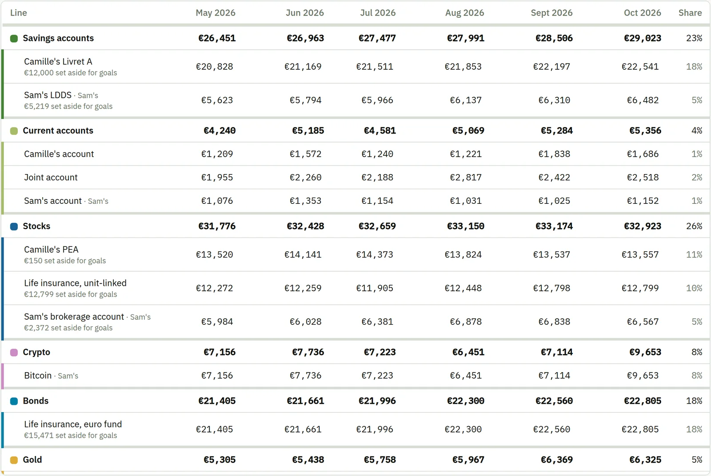

- a month without a value carries the previous one forward, shown as carried;
- "Update this month" lists every line with its last value, to enter them all at once;
- each line has an owner and a visibility;
- a regulated savings account (Livret A, LDDS, LEP, PEL, Livret jeune) knows its ceiling.

An *Analysis* page gives four charts, each category in its colour. Since ten hues cannot all stay
apart for every colour-vision deficiency, every chart also keeps its labels and its data table.


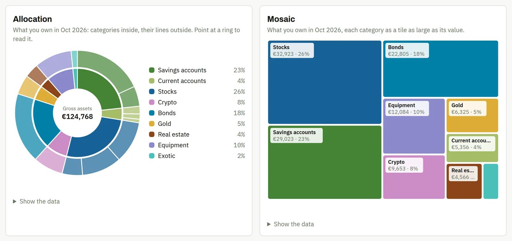

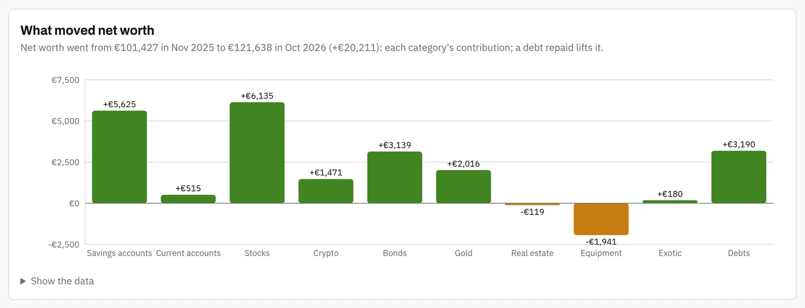

### Goals, in a pyramid

A **goal** is an amount to gather by a date: an emergency fund, a trip, a home deposit. Goals are
arranged in a pyramid, drawn in stone:

- the **foundation** is a Roman column: the emergency fund, filled first. The app proposes its
  amount, six months of fixed expenses by default;
- three **tiers**, set by the deadline and never chosen: the long term (beyond five years) at the
  base, the medium term in the middle, the short term (twelve months at most) at the top. A goal
  climbs a tier by itself as its deadline nears;
- a **golden capstone** for treats (boxing gloves, a record player, a fine bottle of rum), with no
  deadline, **locked** until the essentials are in order: the emergency fund full and at least
  three quarters of the goals ahead.

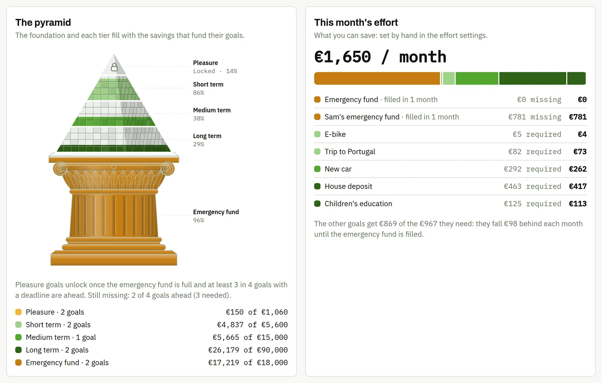

A goal needs nothing more to enter: it is funded by **envelopes**, the part of a net-worth line
set aside for it. When the line rises, each goal receives its share of the rise; when it falls,
the fall comes out of the free part first, and goals only lose once the line drops below what
they hold, treats first and the emergency fund last.


flowchart LR
    L["Net-worth line<br/>Euro-fund life insurance"] -->|50 % of rises| A["Envelope<br/>Trip to Portugal"]
    L -->|30 % of rises| B["Envelope<br/>New car"]
    L -->|20 % of rises| C["Envelope<br/>Home deposit"]
    L -.->|falls first| F["Free part"]


Each goal has its status (reached, ahead, on track, behind), against a straight path from start to
target, and its estimates: the monthly effort required, the actual effort over the last six
months, the estimated date at that pace. The month's **effort plan** shares out the household's
savings capacity: the emergency fund first, up to an adjustable share, then the other goals by
their required effort, then the unlocked treats. It is a recommendation: nothing is moved.

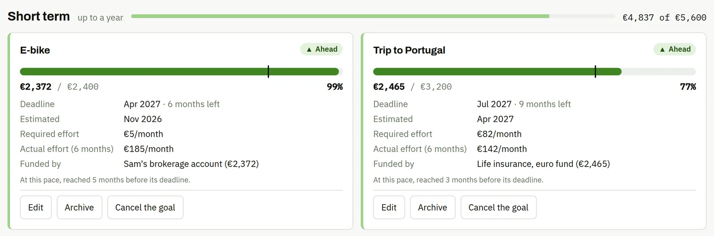

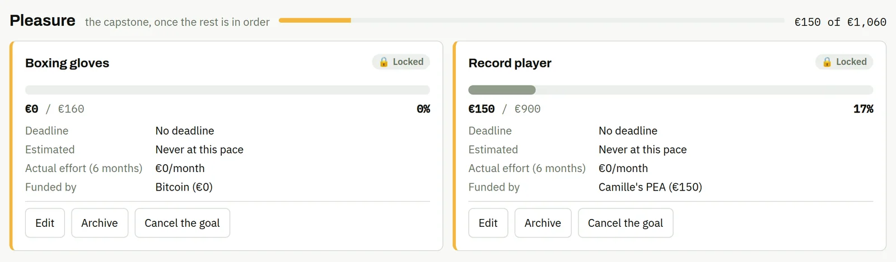

Each goal also has its page: its estimates, its trajectory, its envelopes line by line and its
month-by-month tracking.

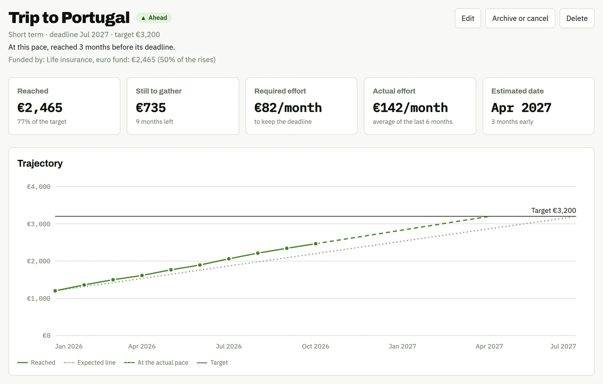

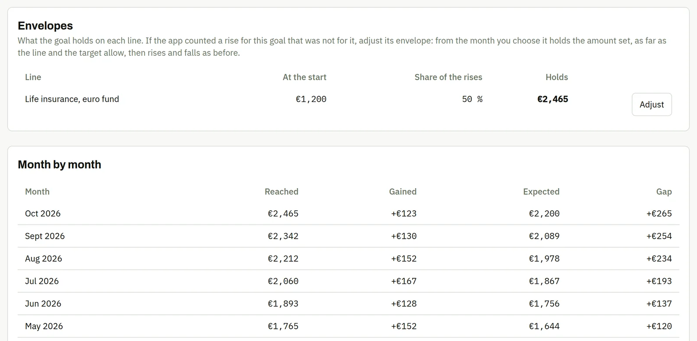

### The goals analysis

An *Analysis* tab looks at the goals **together**, at a reference month: the last month in which
every line funding them has a value entered, so that a month not yet entered never passes for a
month without gain.

- **required effort against capacity** over the next two years, over-committed months shaded;
- **a timeline**: each goal from its start to its deadline, with its estimated date at the actual
  pace and at the plan's pace;
- **horizon and risk**: each goal placed by the months left and the volatility of its envelopes,
  with zones to watch (short and volatile, long and eroded by inflation) and the loss in one
  outcome in ten;
- **where the money sits**: a flow diagram from categories to lines, then to the envelopes and the
  free part;
- **status month by month** for each goal.

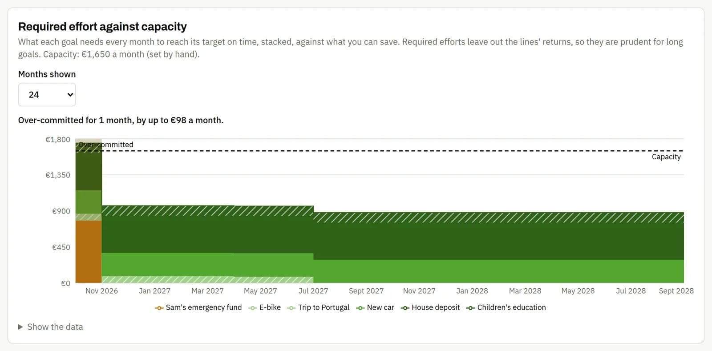

 and at the plan's pace (◇). Fictional data.")

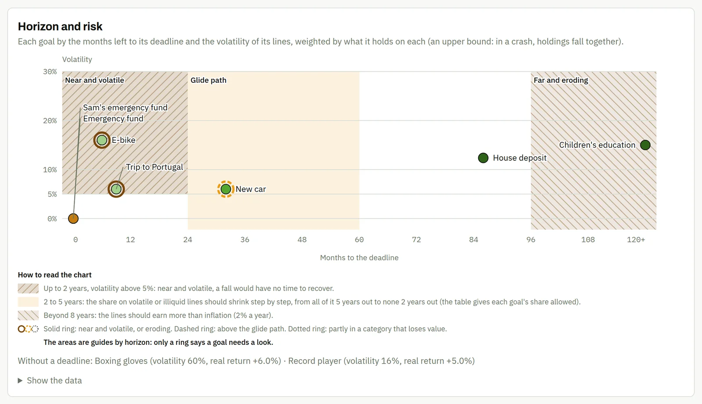

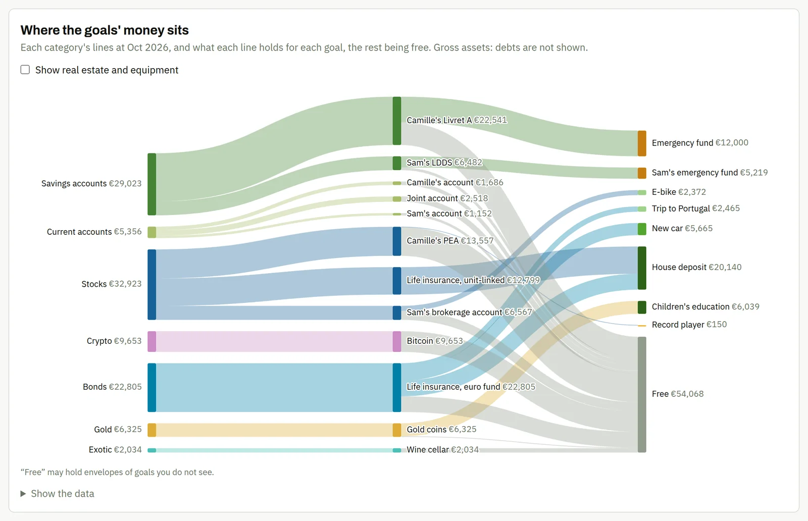

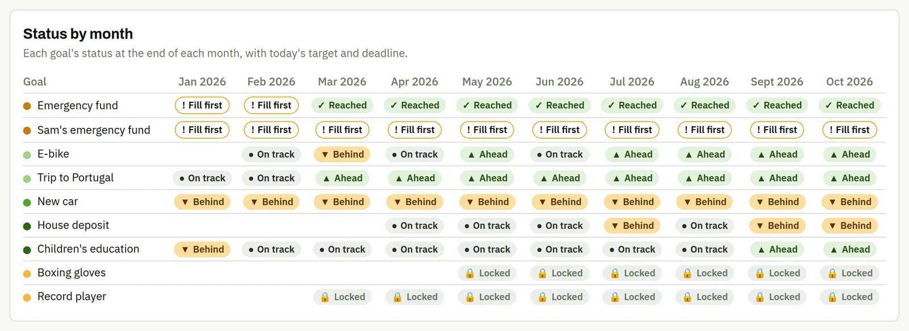

Above them, **points to look at**, computed by some fifteen fixed rules: a goal behind for three
months, an emergency fund too thin or held on volatile lines, a savings account close to its
ceiling, money idle on a current account, goals that ask for more than the capacity (with the
postponement that would be enough). Each point gives the facts, the figures, why it matters and
options; never an instruction to buy or sell, nor a named product. Three at most are shown, and
each member can snooze or dismiss one.

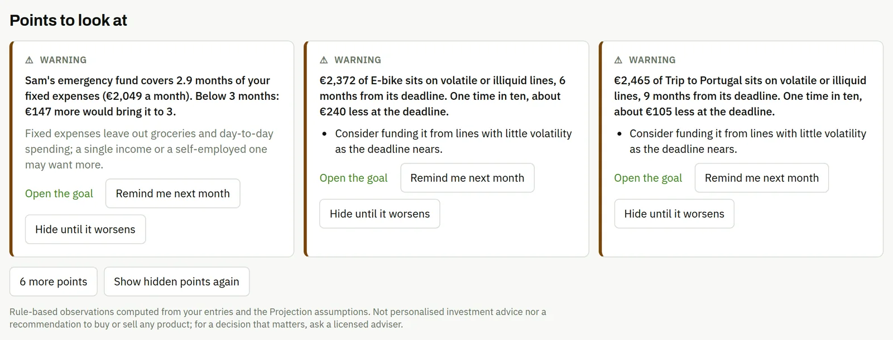

### Verified backups, logged actions

A full backup every night, checked before it is kept, with rotation (7 days, 4 weeks, 12 months)
and a written restore procedure.

An **activity log** keeps sensitive actions, written in the same transaction as the action itself:
sign-ins, invitations, deletions. The owner sees the whole household, a member their own entries.

, an invitation sent then cancelled, settings, a line deleted. Fictional data.")

## How it is built

### A simple architecture, designed for what comes next

Everything starts from a single `docker compose up`: a Caddy proxy with TLS on the local network,
a FastAPI API, a PostgreSQL database and a backup service. The React interface is served from the
same origin as the API, which allows cookie sessions with no CORS configuration.


flowchart LR
    N["Browser<br/>local network"] -->|HTTPS| C["Caddy<br/>TLS + React interface"]
    C -->|/api| A["FastAPI API<br/>kwak_api"]
    A --> K["kwak_core<br/>all the business rules"]
    A -.->|page to come| M["kwak_analytics<br/>Monte Carlo, NumPy"]
    M --> K
    A --> P[("PostgreSQL")]
    S["Nightly backup<br/>checked pg_dump"] --> P


On the Python side, the code is split into packages with a strict rule: `kwak_core` holds **all
the business rules** (amounts, the quick line, splits, monthly targets, fixed expenses, reports,
net worth, envelopes and the effort plan, the analysis rules) and depends on nothing. It is tested
without a database. The API and the `kwak_analytics` layer depend on it, never the other way
round: a given figure has only one definition.

The contract between the API and the interface is the OpenAPI schema: the TypeScript client is
**generated** from it, never written by hand. CI fails if someone forgets to regenerate it.

### Money does not tolerate "roughly"

Amounts are exact decimals (`Decimal` in Python, `NUMERIC` in the database), never floats. And the
rules that must always hold are written in the specifications, then checked by **property tests**
(Hypothesis): instead of a few hand-picked examples, the test generates hundreds of cases and
looks for the one that breaks the rule.

| Invariant | What the test checks |
|---|---|
| Quick line | Every word typed ends up in exactly one field: date, amount, category or label |
| Splits | The parts of a split line add up exactly to its amount, each positive |
| Savings | Savings are never spending, and the month's rest is the sum of its lines |
| Monthly targets | One target in force per category and month, and the yearly target is the sum of the months |
| Fixed expenses | A line fulfils at most one occurrence, and the projected rest deducts exactly those left |
| Consistency | A report, the matrix, the year and the month so far always give the same figures |
| Flows | Both sides of the flow diagram add up to the same total |
| Net worth | A month's net worth equals its assets minus its debts, and the household is exactly the sum of its scopes |
| Envelopes | A line's envelopes are never negative and never exceed its value, nor a goal its target |
| Effort plan | The plan never hands out more than the capacity, and the emergency fund is served first |
| Capstone | A locked treat receives nothing, neither from rises nor from the plan |
| Analysis | A goal's weights on its lines sum to 1, and the postponement proposed is enough, one month less is not |
| Projection | With no volatility, every path matches the exact calculation; money is conserved every month |

API tests run against a **real PostgreSQL** started in a container, never against a mocked
database.

### A Monte Carlo projection

The first piece of phase 5 is the engine that will tell where net worth could be in 1 to 40 years.
The starting point is the current month of the matrix; each category has an expected return and a
volatility, both adjustable, and the household's monthly savings are added every month, shared
across the categories.

- **5,000 paths**, month by month: each category grows by a lognormal return drawn from its own
  random stream, calibrated so that twelve months compound to exactly the chosen annual mean and
  volatility;
- **a fixed seed**: the same assumptions always give the same result, and two scenarios share the
  same draws, so their difference comes from the assumptions only;
- **debts** are repaid by their monthly payment and rate, and what they free joins the savings;
- **negative savings** draw on current accounts then savings accounts, never on the home or
  locked-in holdings; what is missing becomes a debt borrowed at 8 %.

It is the one place where money goes through floating point, for speed: the inputs are `Decimal`,
and the results come back to it, to the cent. The projection's invariants (money conserved,
ordered percentiles, identical paths with no volatility, simulated mean equal to the chosen
return) are tested like the rest, and an engine version is pinned by a golden test.

### Decisions written down

Every structural choice gets a decision record (ADR), dated, with its rejected alternatives. A
decision that changes gets a new record; the old one is never rewritten.

| Decision | Rather than |
|---|---|
| Self-hosting with Docker Compose | Cloud hosting: needless cost and exposed financial data |
| FastAPI, SQLAlchemy 2, Alembic | Django: heavier, and the admin interface is of no use |
| PostgreSQL, then DuckDB for analytics | SQLite alone: concurrent writes, no vector extension |
| Euro only | Full multi-currency accounting, too costly for a single real need |
| Server sessions and mandatory TOTP | JWT tokens, hard to revoke |
| Local language model (Ollama) | A cloud API: the data must never leave the machine |

Deviations from the original plan are logged in the `README` too, to the day.

## What's next

The projection engine is ready: what is left is its page, a fan of possible outcomes (median,
25–75 % and 10–90 % bands), the chance of reaching an amount by a date, the median by category
and two scenarios to compare, with its limits spelled out. The same engine will then give each
goal its **chance of being reached** on time, then a retirement projection.

Cash-flow forecasting, for its part, waits for the spending to build up enough history again since
v1.0. It will be treated as a real time-series problem: a protocol written in advance, a backtest
with no leakage from the future, and a naive model to beat before anything else. This page will be
updated with each step shipped.

## Try it

```bash
git clone https://github.com/gwils28/kwak-finance
cd kwak-finance
make setup        # dependencies and Git hooks
make check        # everything CI runs
make up           # the full stack on https://localhost:8443
```

The steps to create the owner account and the encryption key are in the `README`, and the app
itself offers, at the bottom of every page, a guide to start, stop and update it.
