
Know where the household's money goes, month after month, what its assets are worth, when its
plans will be funded and what it will live on once retired, without handing its accounts to an
online service. Everything runs on a machine at home.





each one blocked until CI is green
including 70 property tests on financial invariants
written down, with the rejected alternatives





**Work in progress.** This page describes the repository as of 17 November 2026. The figures above
are counted in the code, and will be updated with each phase shipped. Since the previous version
of this page (24 October), 58 pull requests have completed phase 5: the projection page,
retirement, the cash-flow forecast, a demo household, then professional goals.



**Every screenshot shows fictional data.** They come from the demo household built into the app,
"the Martins": Camille, Alex and their daughter Léa, three years of invented history. I added two
professional goals, which the demo does not include. Only the activity log screenshot comes from
another demo instance. No amount, label or balance comes from real accounts.


## The problem

Consumer budgeting apps almost all ask for the same thing: access to your bank accounts, and
hosting your financial history on their servers. Spreadsheets ask for nothing, but get abandoned
after three months: entry is slow, and the totals break at the first copy and paste.

I wanted a tool in between:

- **private by design**: the data stays on a household machine, with no telemetry and no
  third-party service;
- **quick to keep up**: one entry session a week, at the keyboard, with nothing to sort afterwards;
- **exact to the cent**: every total must be recomputable from the lines entered;
- **looking ahead**: tell whether the household's plans will be funded on time, where its net
  worth could go, and what the coming year looks like;
- **honest about uncertainty**: every estimate gives its range and its limits, never a lone figure
  presented as a certainty.

It is also my first product: a project meant to last, not a throwaway experiment. So it is where
I apply [my way of working with Claude Code]().

## Where the project stands




Specifications, architecture and decisions written before the first line of code. Repository,
tooling, continuous integration, Docker Compose stack, Claude Code configuration and a design
system taken from this blog.



Two-factor authentication, household and invitations, accounts, bank import and reconciliation,
categorisation rules, transfers, budget plans by period with their review, recurring items,
reports and activity log. The whole accounts and import side was later replaced by the v1.0
redesign.



A monthly net-worth matrix: categories and lines entered by hand, debts, net worth, and four charts
(history, allocation as a sunburst and a mosaic, contributions to the change).



Goals arranged in a pyramid (the emergency fund as the foundation, then long, medium and short
term, under a golden capstone for treats), funded by envelopes taken from net-worth lines, with
their monthly tracking and an effort plan for the month. Since then: several emergency funds per
household, and professional goals.



No more accounts, import or transfers: each expense is a line entered by hand, in a grid designed
for the keyboard. One level of categories, fixed expenses to confirm, monthly targets with their
matrix and a year view. Spending data starts again from zero.



The goals analysis (six views, the chance of reaching each goal, and points to look at computed by
rules), the Monte Carlo net-worth projection, retirement on the same engine, and the cash-flow
forecast for the next twelve months, chosen by back-testing among statistical models, LightGBM
and, optionally, two foundation models. A demo household lets you try it all before having any
history.



A document built on demand for a banker, a wealth advisor, an accountant or notary, or an AI chat.
The rules and the API have shipped, the page is next. It replaces the natural-language assistant
planned at first.




### Why bank import went away

Import was where the project started: drop the bank's CSV export, let the rules file the
expenses. In practice, I was already entering my expenses by hand every week, and the statement
then arrived as a chore: lines to sort again, duplicates of what was already entered, a
reconciliation to check. v1.0 therefore removed accounts, import, transfers, rules, recurring
items, the budget month and plans, with their data, to keep what is useful: quick entry and a
readable budget. The deviation is logged in the repository's `README`, like every deviation from
the original plan.

### Why the AI assistant changed shape

Phase 6 was to be an assistant answering questions in natural language about the household's
data, from a local language model (Ollama). It became an **audit document**: a summary of the
household's finances, written for one specific reader, printed to PDF or copied as Markdown. For an
AI chat, the document opens with an audit prompt and hides the names of members and lines by
default. No model runs in the app, and nothing leaves it unless the household copies or prints the
document itself.

## What works today

### One household, three points of view

The owner creates the household and invites the other members with a single-use link; there is no
public sign-up. Sign-in with a password (argon2id) and a mandatory TOTP code.

Spending belongs to the household: every member sees and edits every line. Net worth and goals,
on the other hand, have a visibility, line by line:

- **private**: only its owner sees it;
- **shared**: the whole household sees it, but it stays its owner's;
- **joint**: the household's property, which belongs to no one.

Net worth and goals are then read at the scale of the **household**, the **joint** part or **my
lines**. The app is organised in three spaces, **Spending**, **Net worth** and **Goals**; the
overview, on top, sums up all three.

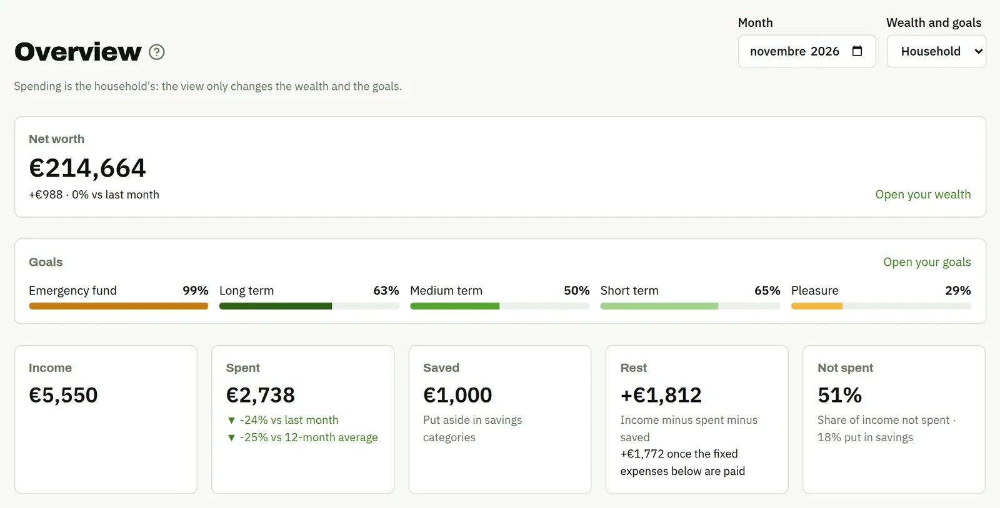

### A demo household

A forecasting tool shows nothing until it has a history. The account menu therefore opens a **demo
household**: a couple and their child, three years of invented spending, net worth, goals and
retirement, plausible for a French household, generated deterministically (the same seed and day
give the same demo). It is shared by the household's members and resets in one click. A tested
invariant guarantees that the demo and the real household never meet: no answer given in the demo
reads or writes a row of the real household.


### Quick entry, at the keyboard

The main spending page is a **grid**: one month, its lines, every cell editable in place. An empty
line always waits at the bottom; Tab moves to the next cell, Enter saves and opens a new line on
the same date. Everything works without the mouse.

Above it, a **quick line** accepts an expense typed in any order: `bakery 12.50 yesterday`,
`45 train 13/10` or `groceries 87.40 #home`.

- the date is recognised ("yesterday", a weekday, `dd/mm`);
- the amount is the last number, the others stay in the label;
- `#word` forces the category starting with that word;
- the rest is the label, and its category comes from **label memory**: picking a label already
  used takes the category of its last line.


A header recalls the last line entered and when, and a dot marks it in the grid, to pick up where
you left off.

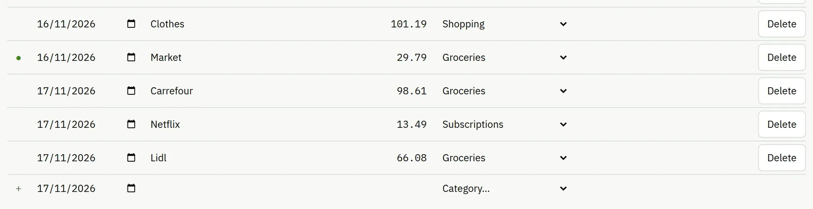

A line can also be **split** across several categories: the last part takes the remainder, so the
sum always comes out right.

 for the home. Fictional data.")

### Categories of three kinds

One level of categories, each of one kind:

- **expense**: housing, groceries, leisure;
- **savings**: money set aside, never an expense but reducing the month's rest;
- **income**: salaries, benefits, refunds.

A month's income is the sum of its income lines, and the rest is income minus spending minus
savings. **One-off** categories (housing, subscriptions), paid in one go, are never judged on the
month's pace.

### Fixed expenses

Mortgage, childminder, subscriptions, insurance: a **fixed expense** describes a line that comes
back every month, quarter or year. Each occurrence due appears greyed out at the top of the
month's grid. Enter confirms it and creates the line, editable first; it can also be skipped for
the month. Nothing is ever created on its own.

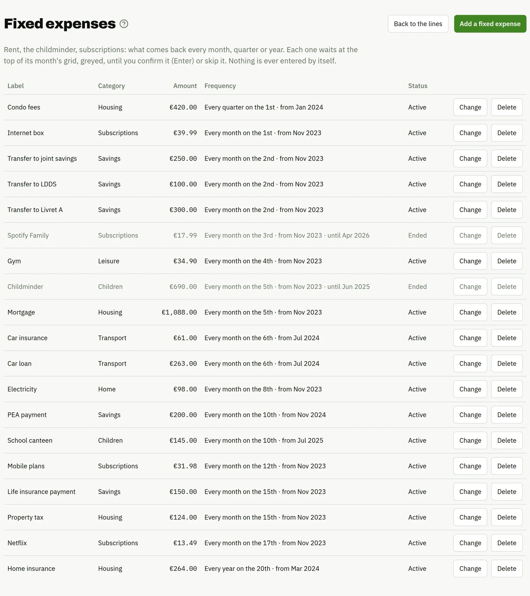

The overview lists what is still to confirm and the **projected rest** at the end of the month.

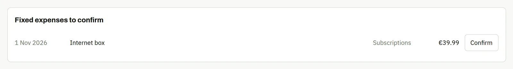

### Monthly targets

Each expense category can get a **monthly target**, set from a month on and kept until it is
changed; past months keep theirs. A savings category gets a minimum to reach.

- **the month so far**, on the overview: one bar per category, sorted by share used, with a mark
  for the share of the month gone, so an expense ahead of the calendar shows before it overruns;
- **the matrix**: one row per category, one column per month, each cell coloured by its gap to
  the target (green below, grey within ±5 %, burnt orange above);
- **the year**: targets cumulated to date and over the whole year, the gap, and how many months
  were above, within or below target.

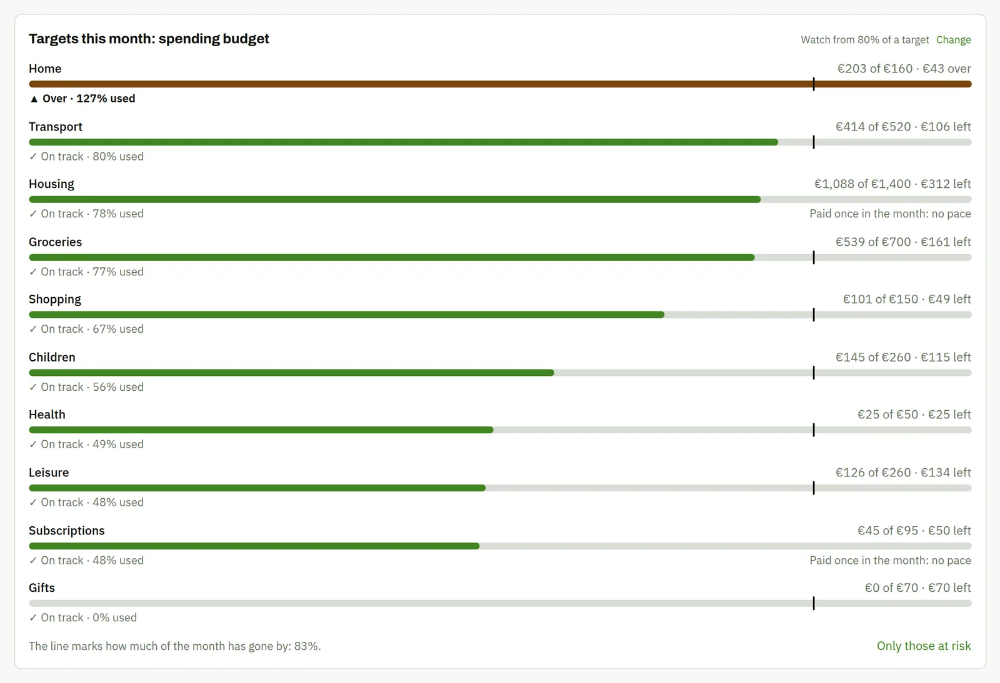

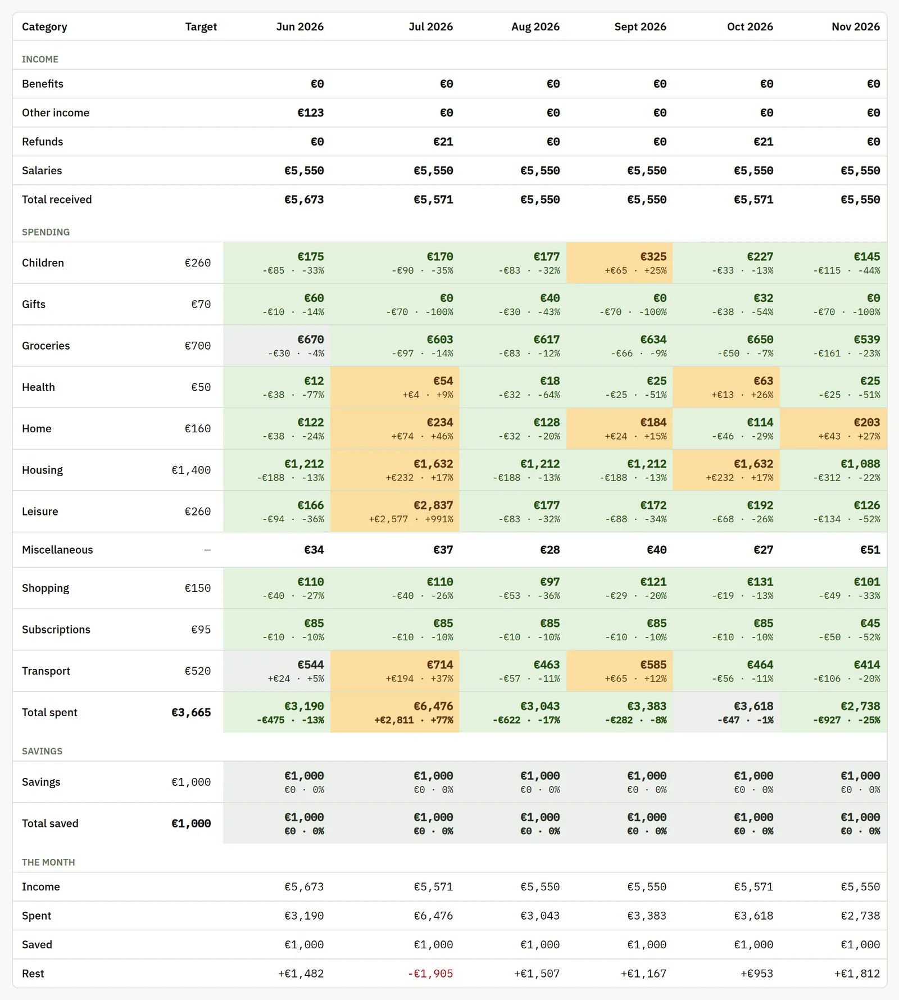

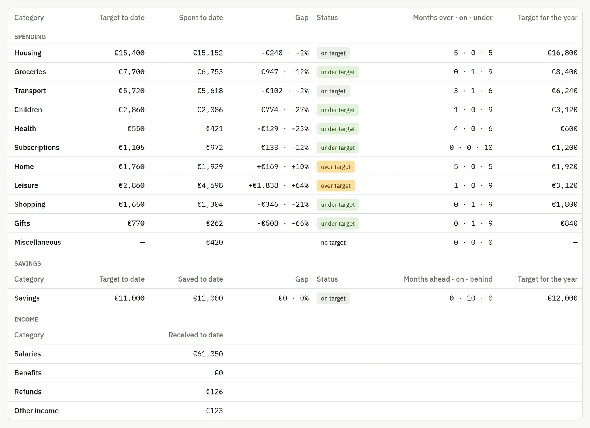

### Reports over any period

A month, a quarter, a year or any period up to ten years, compared with the **previous one of the
same length**. A period in progress stops at the current month: "this year" is compared with the
same months last year, not with a whole year.

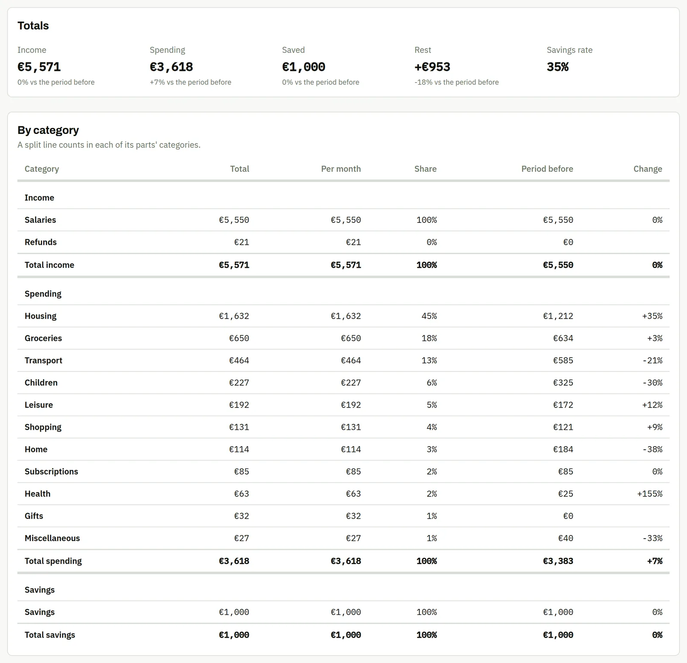

The report also gives a monthly chart stacked by category, spending accumulated day by day, and the
period's **money flows**: income on the left; spending, savings and unallocated rest on the right,
both sides always adding up to the same total.

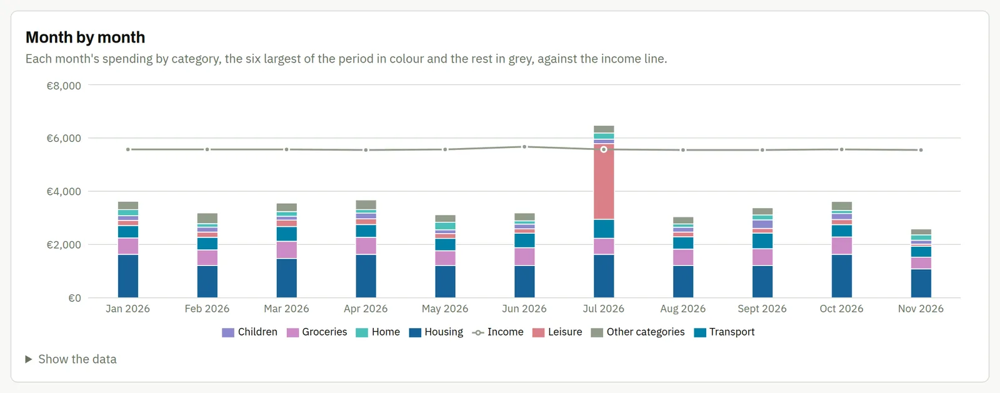

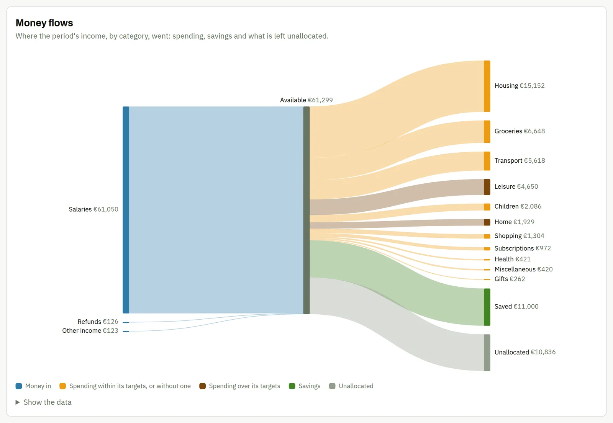

### Net worth, month by month

Net worth is tracked as in a spreadsheet: one line per holding, filed in a category, one column per
month, and a value entered by hand once a month.

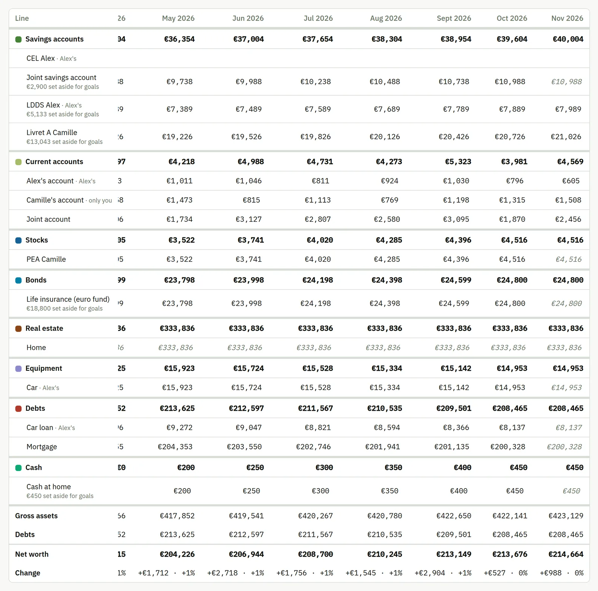

- a month with no entry takes the previous value, shown as carried forward;
- "Update this month" lists every line with its last value, marks those already updated, and saves
  only the ones you touch;
- each line has an owner and a visibility;
- a regulated savings account (livret A, LDDS, LEP, PEL, livret jeune) knows its ceiling, and an
  asset line can carry its tax wrapper (PEA, life insurance…).

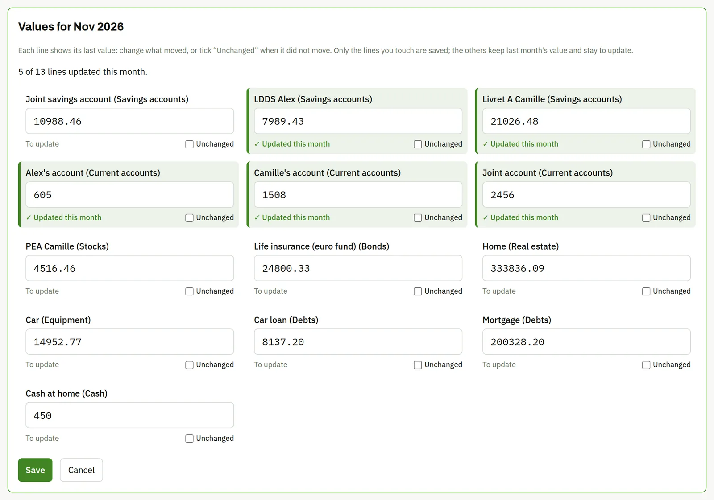

An *Analysis* page gives four charts, each category in its colour. Since ten hues cannot all stay
distinct for every kind of colour blindness, each chart also keeps its labels and its data table.
Checkboxes leave a category out of the analysis: without the home and the car, you finally see how
the savings are spread.

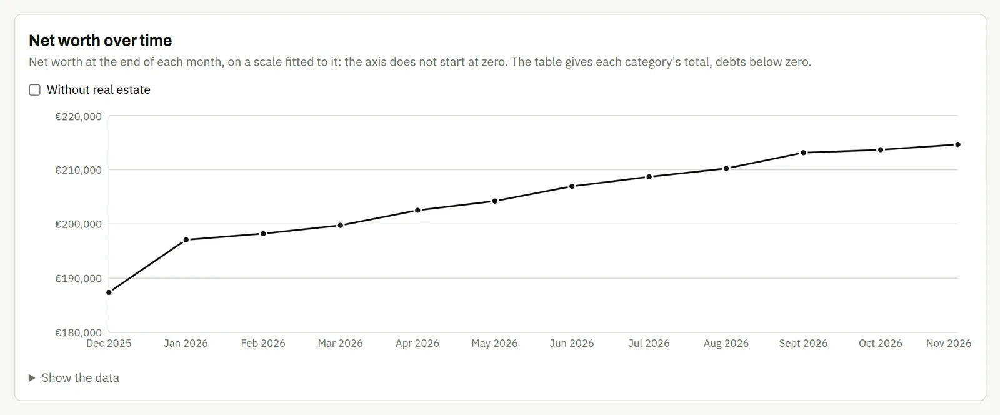

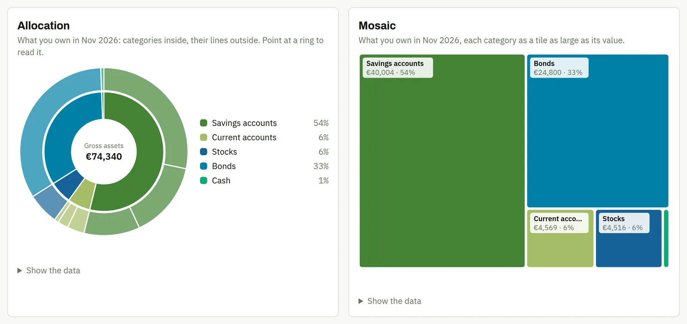

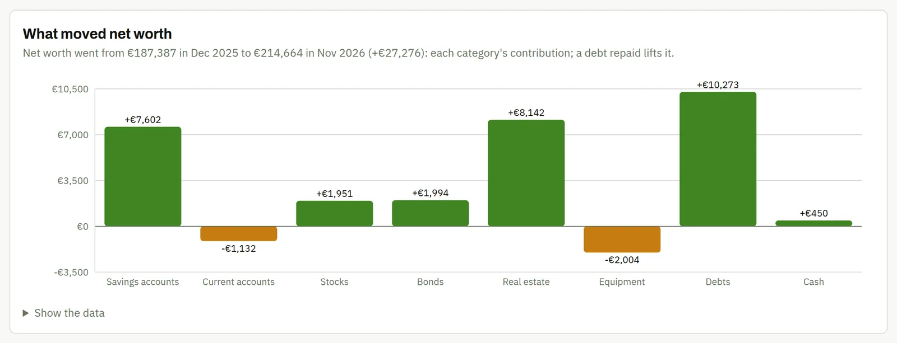

### Goals, in a pyramid

A **goal** is an amount to gather by a date: an emergency fund, a trip, a home deposit. They are
arranged in a pyramid, drawn in stone:

- as the **foundation**, a Roman column: the emergency fund. A household can have several (one
  per member, a joint one, a cash kitty), each to fill first or not. The app suggests its amount,
  six months of fixed expenses by default;
- three **tiers**, given by the deadline and never chosen: long term (beyond five years) at the
  base, medium term in the middle, short term (twelve months at most) at the top. A goal climbs a
  tier on its own as its deadline approaches;
- a golden **capstone** for treats (boxing gloves, a turntable, a fine bottle of rum), with no
  deadline, **locked** until the essentials are in order: the emergency fund full and at least
  three quarters of the goals ahead.

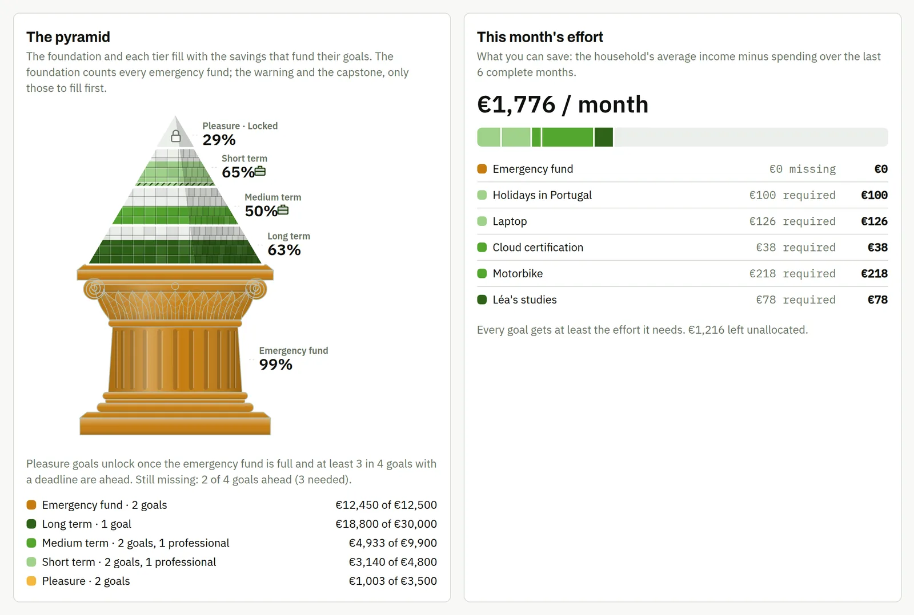

A goal needs no extra entry: it is funded by **envelopes**, the part of a net-worth line set aside
for it. When the line rises, each goal gets its share of the rise; when it falls, the fall comes
first out of the free part, and goals only lose once the line drops below what they hold, treats
first and the emergency fund last.


flowchart LR
    L["Net-worth line<br/>Livret A"] -->|60 % of rises| A["Envelope<br/>Emergency fund"]
    L -->|20 % of rises| B["Envelope<br/>Laptop"]
    L -->|20 % of rises| C["Envelope<br/>Spa weekend"]
    L -.->|falls first| F["Free part"]


Each goal has its status (reached, ahead, on track, behind), compared with a straight path from
the start to the target, and its estimates: the monthly effort required, the actual effort over
the last six months, the estimated date at that pace. The month's **effort plan** shares out the
household's saving capacity: the emergency fund first, within an adjustable share, then the other
goals according to their required effort, then unlocked treats. It is a recommendation: nothing is
moved.

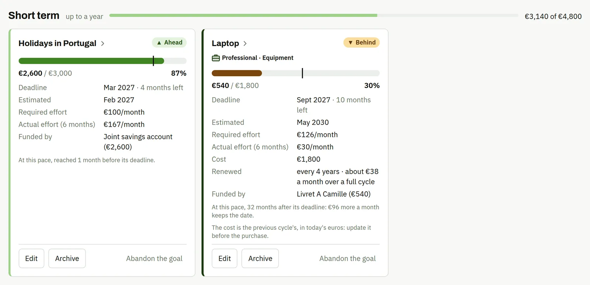

A **professional goal** serves one's work: equipment, training, setting up a business, a career
change, a move. It stays in its tier, hatched, with its type. The form asks for its cost and what
others pay (the personal training account CPF, the employer, France Travail, an honour loan), and
the target is what the household still has to gather. Equipment can be renewed every N years: once
the purchase is made, the next cycle starts on its own.

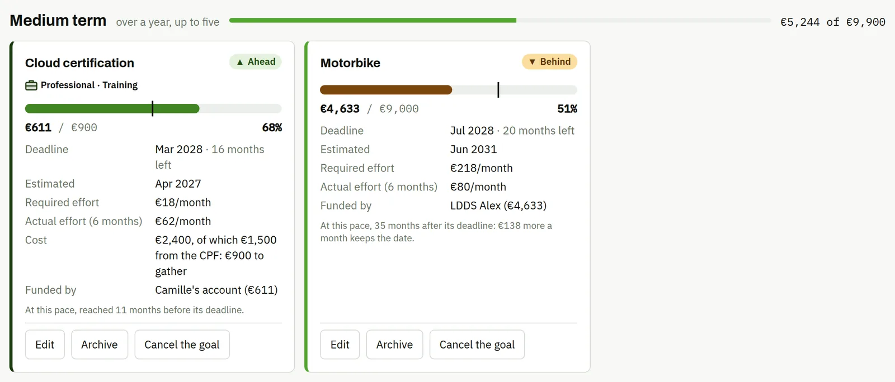

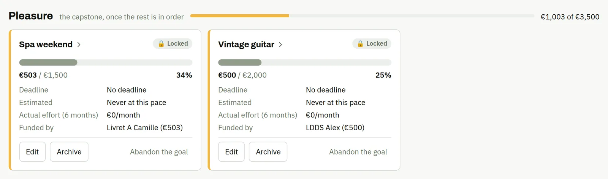

Each goal also has its own page: its estimates, its trajectory, its envelopes line by line and its
monthly tracking.

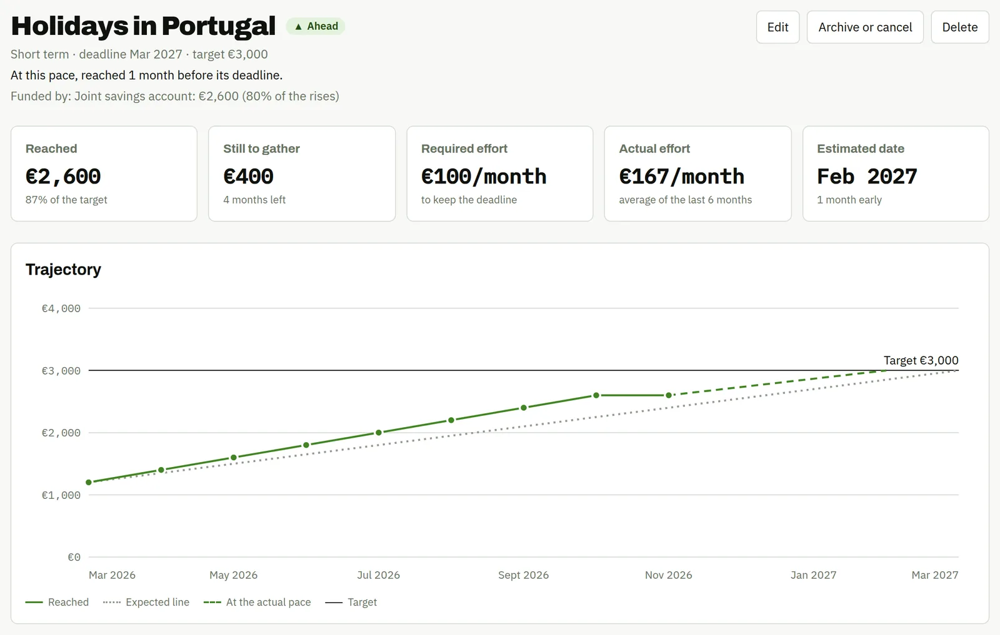

, then each month: reached, gained, expected and gap. Fictional data.")

### The goals analysis

An *Analysis* tab looks at the goals **together**, at a reference month: the last month in which
every line funding them has a value entered, so that a month not yet entered never passes for a
month without gain.

- **required effort against capacity** over the next two years, over-committed months greyed out;
- **a timeline**: each goal from its start to its deadline, with its estimated date at the actual
  pace and at the plan's pace;
- **horizon and risk**: each goal placed by the months left and the volatility of its envelopes,
  with zones to watch (short and volatile, long and eaten by inflation);
- **the chance of reaching each goal** on time, simulated by the projection engine on its own
  lines, at the plan's effort and at the required effort;
- **where the money sits**: a flow diagram from categories to lines, then to envelopes and the
  free part;
- **status month by month** for each goal.

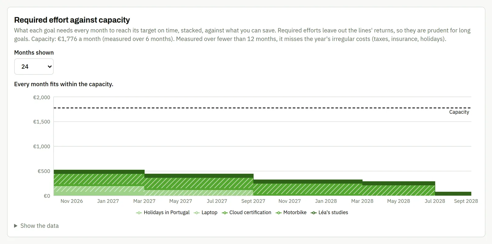

 and at the plan's pace (◇). At its current pace, the motorbike arrives only after its deadline. Fictional data.")

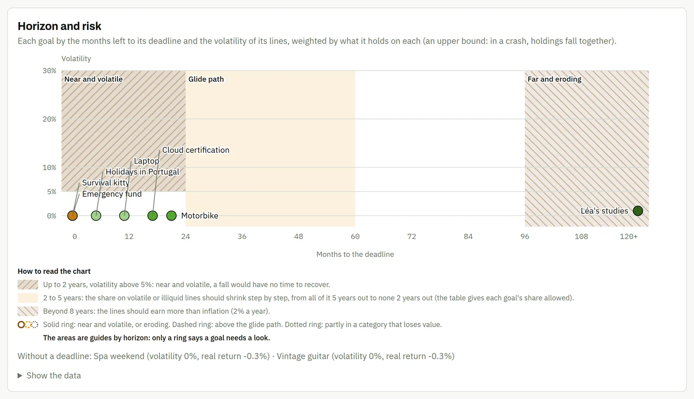

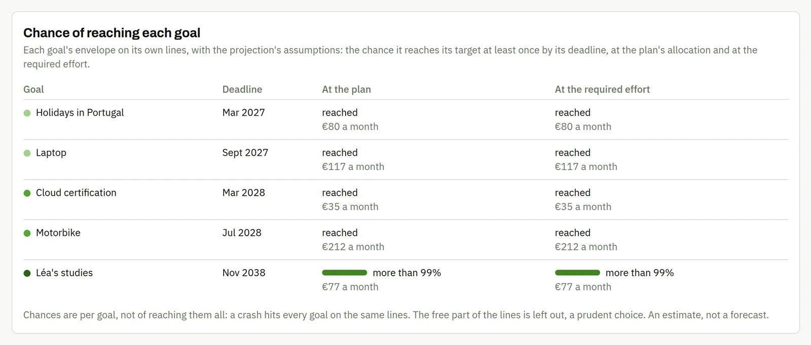

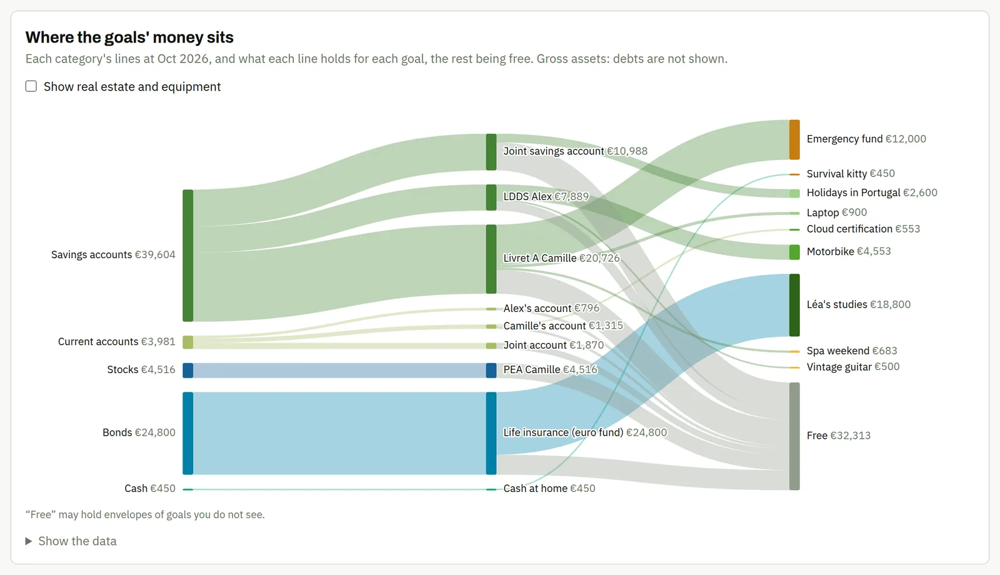

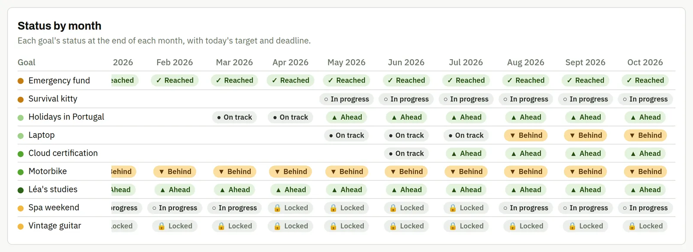

On top, **points to look at**, computed by some fifteen fixed rules: a goal behind for three
months, an emergency fund too thin or held on volatile lines, a savings account near its ceiling,
money sleeping in a current account, goals asking for more than the capacity (with the deadline
postponement that would be enough), a debt costing more than the investments earn, loan payments
above 35 % of income. Each point gives the facts, the figures, why it matters and options; never a
buy or sell instruction, nor a named product. Three at most are shown, and each member can snooze
or dismiss one.

, a distant target to raise with inflation. Fictional data.")

### The net-worth projection

The *Projection* tab answers one question: where could net worth be in 1 to 40 years? It is a
**simulator**: you adjust on the left, the answer is recomputed on the right as you type.

- **monthly savings**, the household's choice: *declared* (contributions by category, which can
  follow inflation) or *measured* (the actual saving capacity of recent months); the history is
  used only if chosen, so that one exceptional month does not skew everything;
- **the answer**: the median net worth at the horizon, the range where eight outcomes in ten fall,
  and the monthly income the liquid holdings could pay at a given withdrawal rate;
- **where the money comes from**: today's net worth, contributions, loan capital repaid and gains,
  which add up exactly to the median;
- **reaching an amount**: the chance of having at least so much by a given date, and when half
  then nine tenths of the outcomes get there;
- **what if…**: two variants (savings, return, volatility, inflation), for the length of the visit.

, a median net worth of €929,900 in 20 years, in today's euros, broken down into what it is today, contributions, repaid loans and gains. Fictional data.")

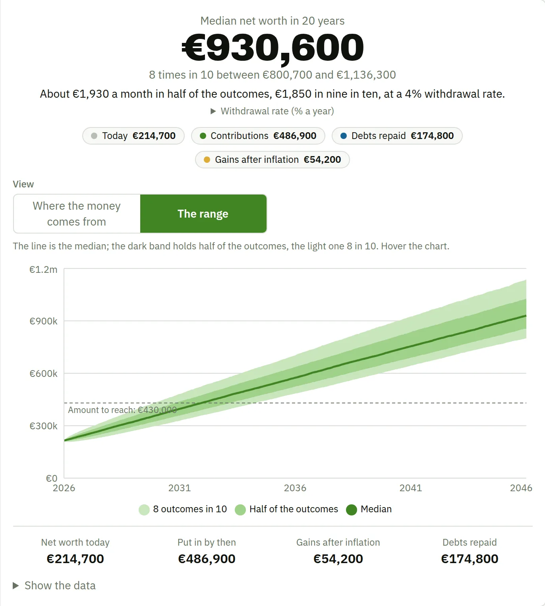

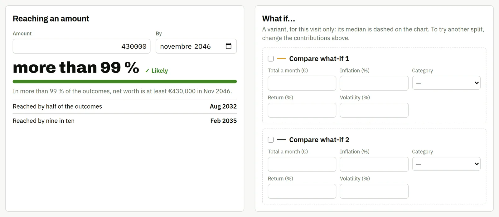

Each page states its limits plainly: an estimate from assumptions, neither a forecast nor advice; a
10–90 % band leaves one outcome in five outside, and the real spread is wider than the model's.

### Retirement

The *Retirement* tab runs on the same engine: what standard of living could the household keep
once retired? Each member enters their birth month, when they stop working, the earnings that stop
then, and the pension estimated on info-retraite.fr; the app computes no pension rights. The
household sets its retirement spending (80 % of today's spending excluding loans, by default),
pension indexation and the horizon.

The page gives the answer first: pensions plus the **sustainable withdrawal**, the largest monthly
amount the liquid wealth can pay up to the horizon without running out in nine outcomes in ten,
against spending; then the chance that the wealth lasts, and the age at which it would otherwise
run out.

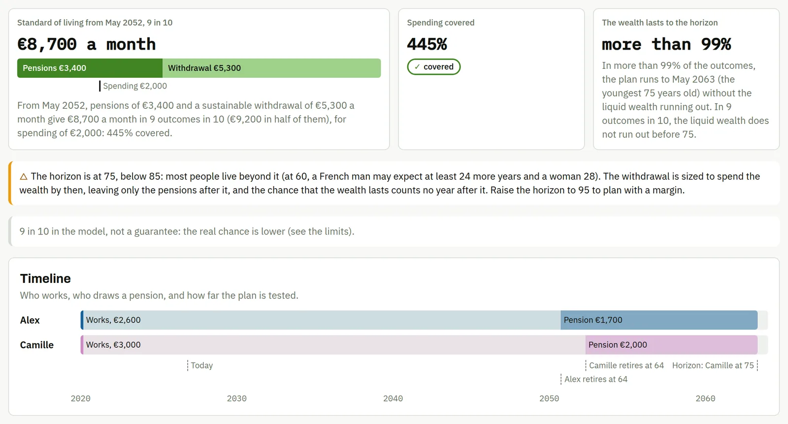

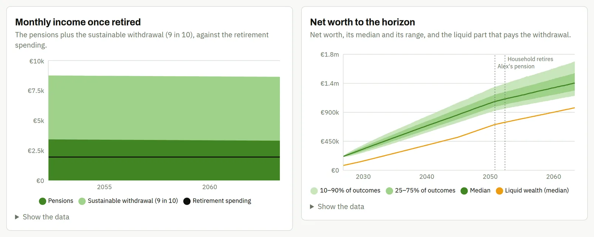

### The cash-flow forecast

The *Forecast* tab shows the next twelve months: income, spending, savings and rest, by category,
with a range, against the budget targets. Upcoming fixed expenses are known; the rest is forecast
from the household's history, by the method that erred least on the months already entered (see
[below](#a-forecast-chosen-by-back-testing)).

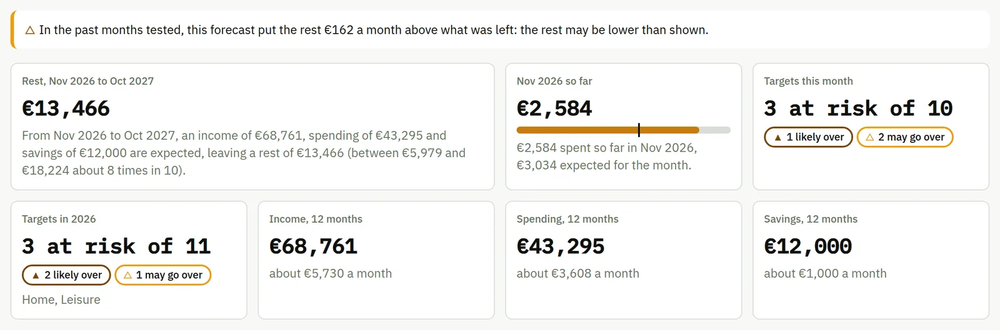

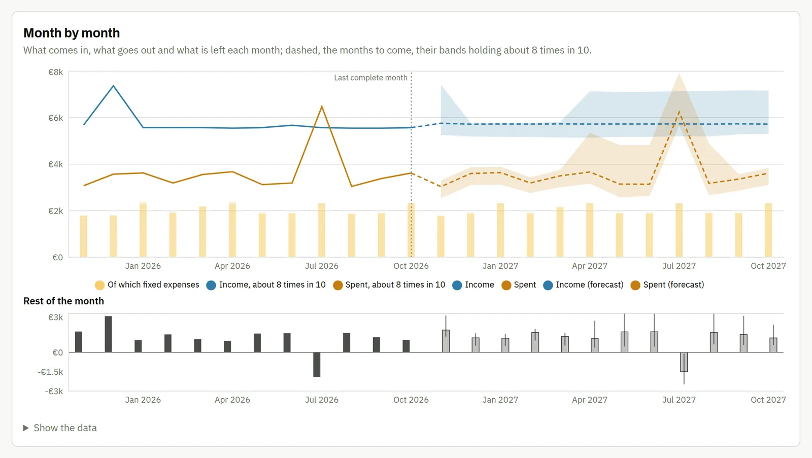

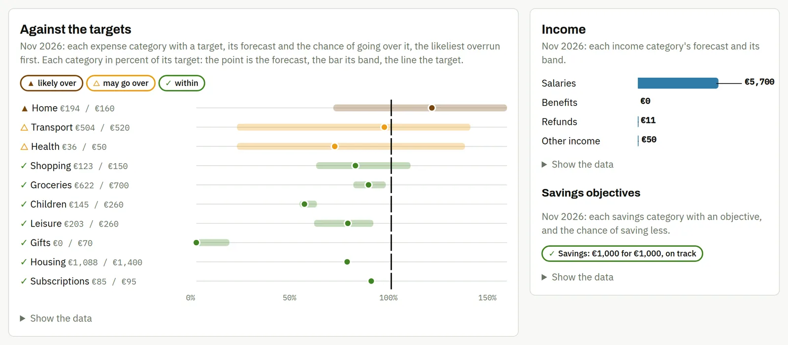

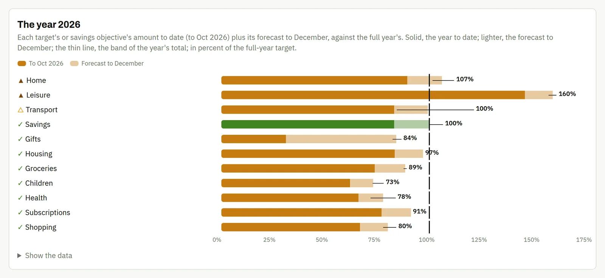

Folded at the bottom, **how reliable it is**: for each category, the method kept and what it gains
over the six-month average, its bias, then the back-test of the totals.

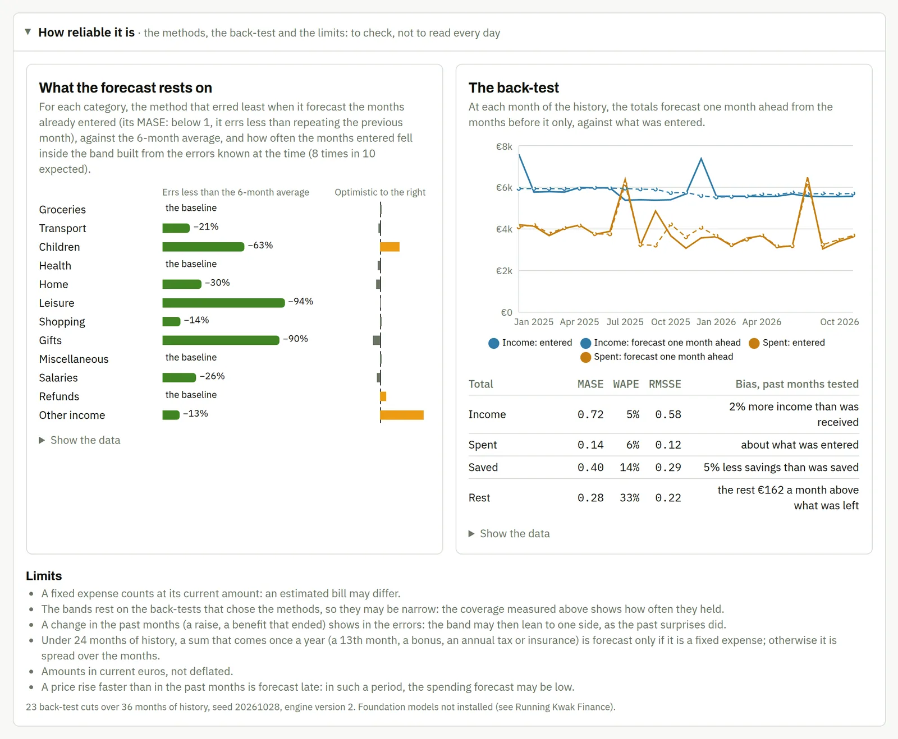

### Verified backups, logged actions

A full backup every night, checked before it is kept, with a rotation (7 days, 4 weeks, 12
months) and a written restore procedure.

An **activity log** keeps sensitive actions, written in the same transaction as the action itself:
sign-ins, invitations, deletions. The owner sees the whole household, a member their own entries.

, an invitation sent then revoked, settings, a line deleted. Fictional data.")

## How it is built

### A simple architecture, designed for what comes next

Everything starts from a single `docker compose up`: a Caddy proxy with TLS on the local network,
a FastAPI API, a PostgreSQL database and a backup service. The React interface is served from the
same origin as the API, which allows cookie sessions with no CORS configuration.


flowchart LR
    N["Browser<br/>local network"] -->|HTTPS| C["Caddy<br/>TLS + React interface"]
    C -->|/api| A["FastAPI API<br/>kwak_api"]
    A --> K["kwak_core<br/>all business rules"]
    A --> M["kwak_analytics<br/>Monte Carlo, forecast"]
    M --> K
    A --> P[("PostgreSQL")]
    S["Nightly backup<br/>checked pg_dump"] --> P


On the Python side, the code is split into packages with a strict rule: `kwak_core` holds **all the
business rules** (amounts, quick line, splits, monthly targets, fixed expenses, reports, net
worth, envelopes and effort plan, the analysis rules, the forecast's series and model choice) and
depends on nothing. It is tested without a database. The API and the analytics layer
`kwak_analytics` (the simulations and the model fitting) depend on it, never the other way round:
a given figure has only one definition.

The contract between the API and the interface is the OpenAPI schema: the TypeScript client is
**generated** from it, never written by hand. CI fails if someone forgets to regenerate it.

The analysis pages were first written in Dash, served in a frame. They moved to React: each page
calls a read-only API endpoint that runs its engine and returns figures as JSON; the words, formats
and charts (Recharts) belong to the page, in both languages. Dash was removed.

### Money does not tolerate "roughly"

Amounts are exact decimals (`Decimal` in Python, `NUMERIC` in the database), never floats. And the
rules that must always hold are written in the specifications, 46 so far, then checked by
**property tests** (Hypothesis): instead of a few hand-picked examples, the test generates
hundreds of cases and looks for the one that breaks the rule.

| Invariant | What the test checks |
|---|---|
| Quick line | Every word typed ends up in exactly one field: date, amount, category or label |
| Splits | The parts of a split line add up exactly to its amount, each positive |
| Savings | Savings are never spending, and the month's rest is the sum of its lines |
| Monthly targets | One target in force per category and month, and the annual target is the sum of the months |
| Fixed expenses | A line fulfils at most one occurrence, and the projected rest deducts exactly those remaining |
| Consistency | A report, the matrix, the year and the month so far always give the same figures |
| Flows | Both sides of the flow diagram have the same total |
| Net worth | A month's net worth is its assets minus its debts, and the household is the exact sum of its scopes |
| Envelopes | A line's envelopes are never negative and never exceed its value, nor a goal its target |
| Effort plan | The plan never hands out more than the capacity, and the emergency fund is served first |
| Professional goals | A professional goal behaves exactly like the standard goal with the same target, and equipment to renew has exactly one next cycle |
| Projection | With no volatility, every path matches the exact calculation; money is conserved in every month of every path |
| Retirement | Until the first retirement, the simulation is exactly the projection; the sustainable withdrawal never falls when a pension rises |
| Forecast | No forecast reads a line after its origin; a model too optimistic in the back-test is never kept |
| Demo | No answer given in the demo reads or writes a row of the real household |
| Audit document | Never another member's private line; anonymised, no name or email appears, the prompt included |

API tests run against a **real PostgreSQL** started in a container, one per test process, never
against a mocked database.

### A Monte Carlo projection

The same engine serves the projection, the chance of reaching each goal and retirement. The
starting point is the current month of the matrix; each category has an expected return and a
volatility, both adjustable, and monthly savings are added every month, shared across the
categories.

- **5,000 paths**, month by month: each category grows by a lognormal return drawn from its own
  random stream, calibrated so that twelve months compound to exactly the chosen annual mean and
  volatility;
- **a fixed seed**: the same assumptions always give the same result, and two scenarios share the
  same draws, so their difference comes from the assumptions only;
- **debts** are repaid by their monthly payment and rate, and what they free joins the savings;
- **negative savings** draw on current accounts then savings accounts, never on the home or
  locked-in holdings; what is missing becomes a debt borrowed at 8 %.

For retirement, the **sustainable withdrawal** is searched path by path, by bisection, on the same
draws: the largest multiple of €100 that leaves at most one path in ten short of money before the
horizon; at €100 more, more than one path in ten would fail.

It is the one place where money goes through floating point, for speed: the inputs are `Decimal`,
and the results come back to it, to the cent.

### A forecast chosen by back-testing

The cash-flow forecast is treated as a time-series problem, with a protocol written in advance:

- **one series per category**, split into a known part (the fixed expenses' occurrences) and a
  variable part, the only one the models learn; a line is never counted twice;
- **candidates from the simplest to the richest**: the six-month average (the baseline), other
  averages, seasonal naive, exponential smoothing, ETS, Theta, ARIMA, ADIDA for intermittent
  series (`statsforecast`), a global LightGBM across all categories (`mlforecast`) and, optionally,
  two foundation models, Chronos-2 and TimesFM 2.5;
- **a back-test with no leakage from the future**: the history is cut at every month, each
  candidate learns only from the months before and forecasts the next twelve; error is measured
  with MASE, with WAPE and RMSSE alongside;
- **a model replaces the baseline only if it clearly does better**: at least 10 % lower MASE on the
  same cuts;
- **no optimism**: a candidate that under-forecasts spending or over-forecasts income by more than
  5 % in the back-test, and more than the baseline, is never kept;
- **conformal ranges**: the 80 % band comes from the back-test's own errors at the same number of
  months ahead, with no distribution assumed, and its measured coverage is shown.

Without twelve complete months of history there is no forecast. The foundation models are
optional: they add about 2.5 GB to the image, their weights are downloaded at build time at a
pinned revision and checked against checksums, then read offline. Nothing is downloaded or sent
when a forecast runs. The study behind these choices lives in a separate notebooks folder, on
synthetic households only: among other things, it showed that the two foundation models were the
most accurate on those households, and that the 10 % margin was guard enough.

### Decisions written down

Every structural choice gets a decision record (ADR), dated, with its rejected alternatives. A
decision that changes gets a new record; the old one is never rewritten.

| Decision | Rather than |
|---|---|
| Self-hosting with Docker Compose | Cloud hosting: needless cost and exposed financial data |
| FastAPI, SQLAlchemy 2, Alembic | Django: heavier, and the admin interface is of no use |
| PostgreSQL, then DuckDB for analytics | SQLite alone: concurrent writes, no vector extension |
| Euro only | Full multi-currency accounting, too costly for a single real need |
| Server sessions and mandatory TOTP | JWT tokens, hard to revoke |
| Local language model (Ollama) | A cloud API: the data must never leave the machine |

Deviations from the original plan are logged too, to the day. Some have made a decision moot:
DuckDB has not been needed yet, a household's series fitting in a few thousand numbers, and the
local assistant has given way to the audit document.

## What's next

Phase 6 ends with the **audit document** page: a form (reader, scope, period, privacy, language),
then the document as it will be printed. Each reader gets their own sections: the banker sees
income month by month, running loans, the debt ratio and, if needed, a property project simulated
against the 35 % ceiling; the advisor sees net worth by category, goals, retirement and the app's
analyses; the notary, an inventory by holder as filed in the app. The document always ends with
what the app does not know, and with the same sentence: figures entered by the household, not
certified, and not financial advice.

Then comes real use: the forecast will apply to my own data only once twelve complete months have
been entered since v1.0. This page will be updated with each step shipped.

## Try it

```bash
git clone https://github.com/gwils28/kwak-finance
cd kwak-finance
make setup        # dependencies and Git hooks
make check        # everything CI runs
make up           # the full stack on https://localhost:8443
```

The steps to create the owner account and the encryption key are in the `README`, and the app
itself offers, at the bottom of every page, a guide to start, stop and update it. Once signed in,
the account menu opens the demo household.
