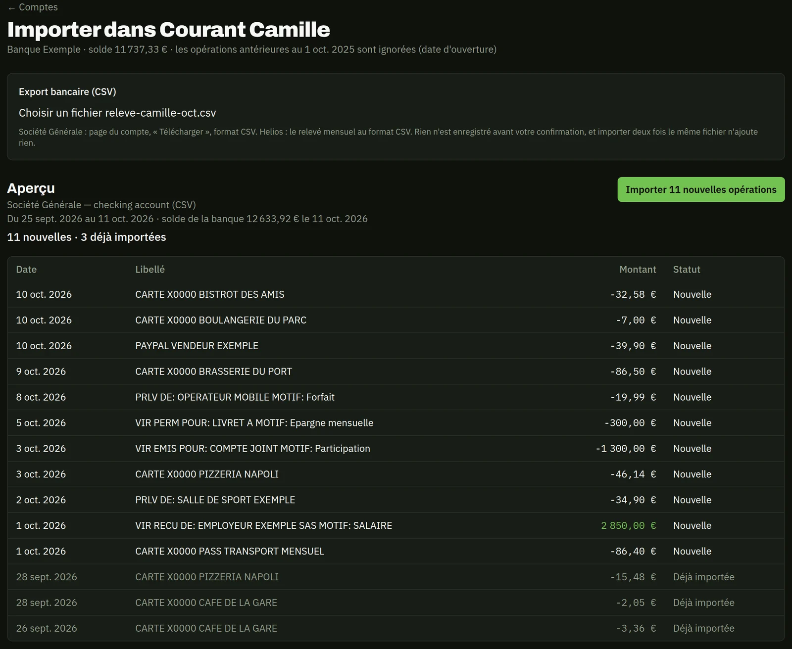
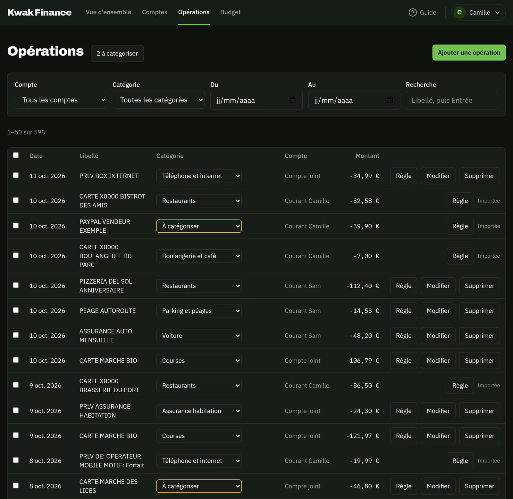
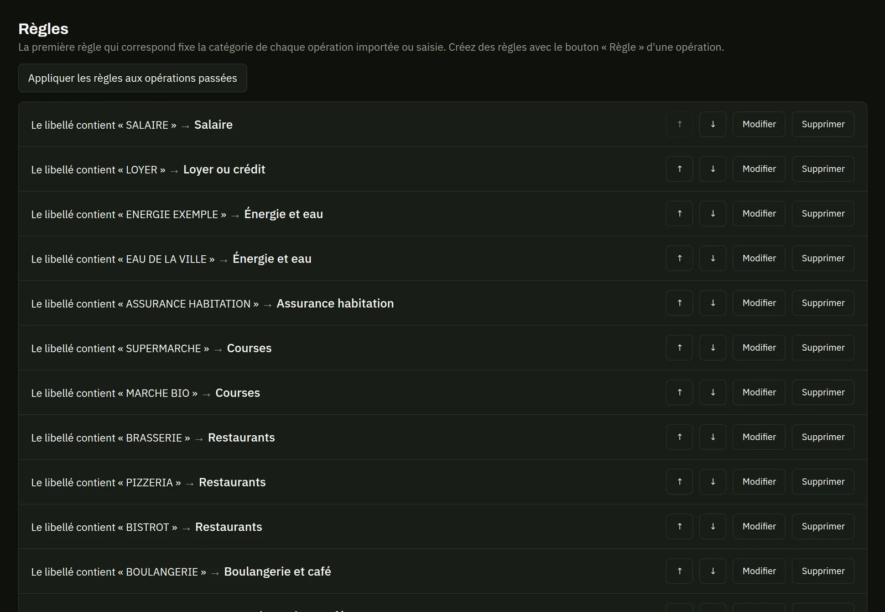
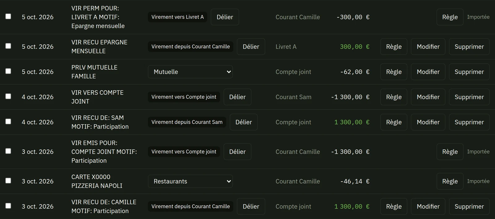
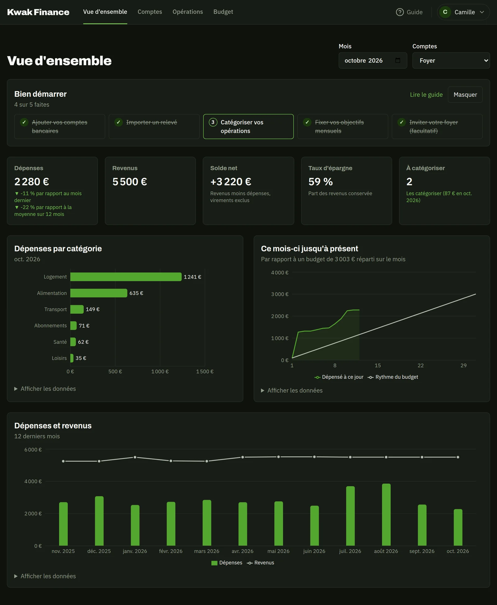
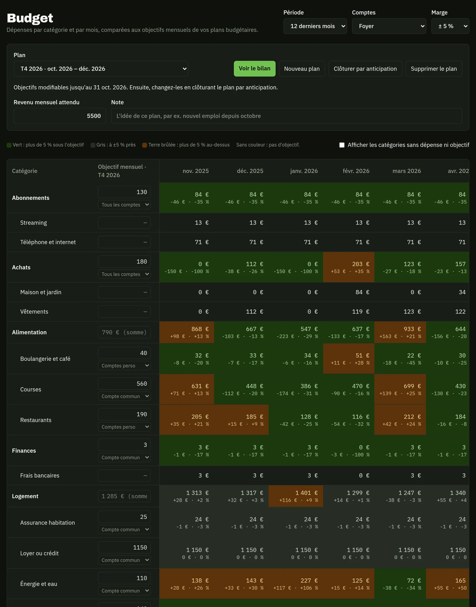
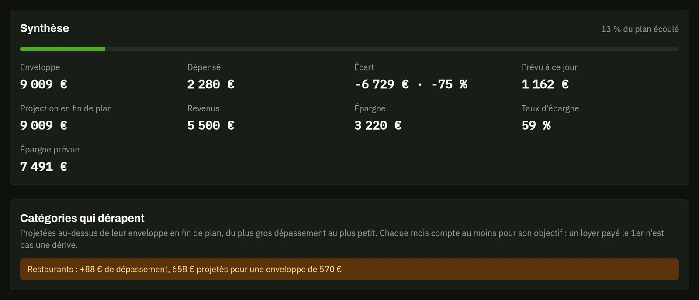
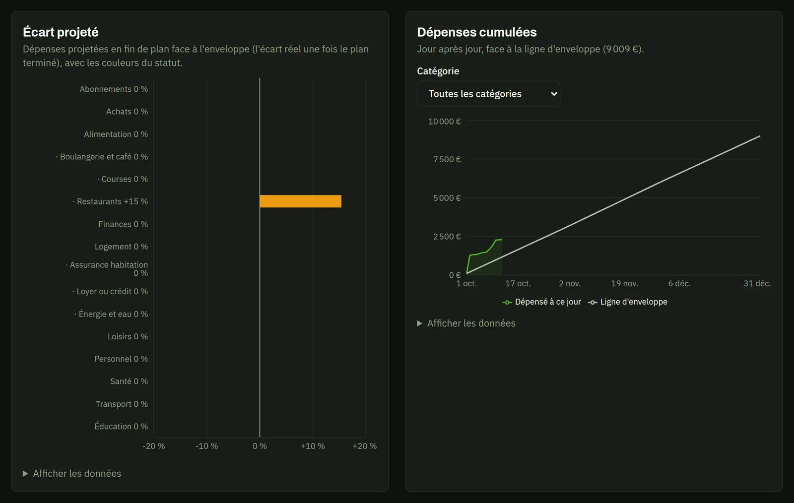
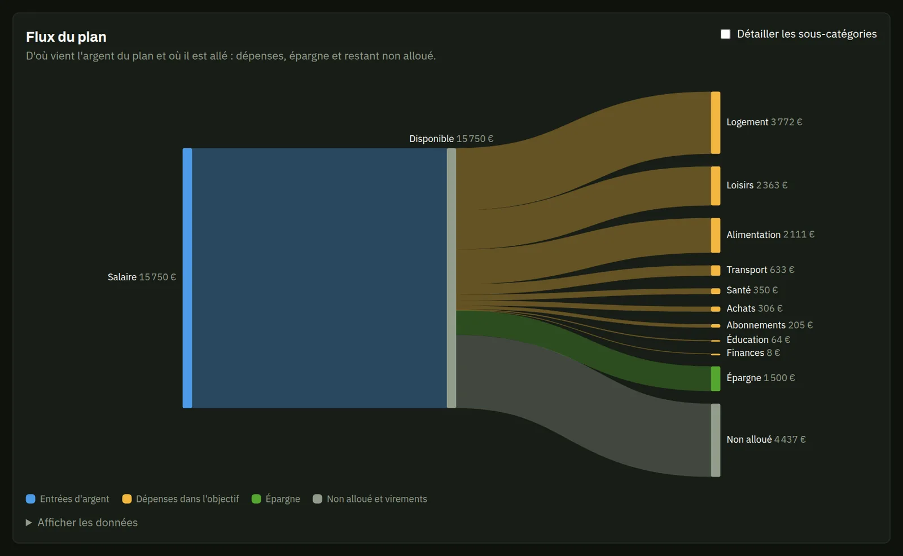
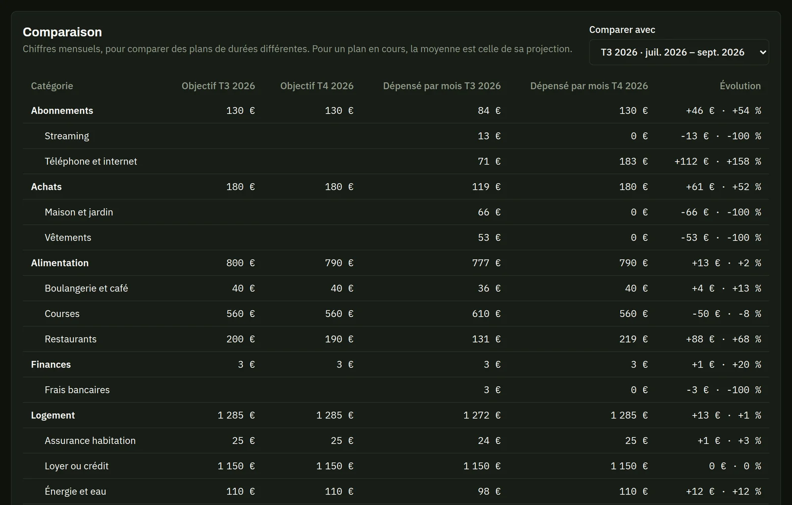


Savoir où part l'argent du foyer, mois après mois, et ce que vaut son patrimoine, sans confier
ses relevés bancaires à un service en ligne. Tout tourne sur une machine de la maison.





chacune bloquée tant que la CI n'est pas verte
dont 35 tests de propriété sur les invariants financiers
écrites, avec les alternatives rejetées





**Projet en cours.** Cette fiche décrit l'état du dépôt au 11 octobre 2026. Les chiffres
ci-dessus sont comptés dans le code, et seront mis à jour à chaque phase livrée.



**Toutes les captures montrent des données fictives.** Elles viennent d'une instance de
démonstration, alimentée par un foyer inventé (Camille et Sam, quatre comptes, un an
d'opérations générées). Aucun montant, libellé ni solde ne provient de comptes réels.


## Le problème

Les applications de budget grand public demandent presque toutes la même chose : un accès à vos
comptes bancaires, et l'hébergement de votre historique financier sur leurs serveurs. Les
tableurs, eux, ne demandent rien, mais s'abandonnent au bout de trois mois : ressaisir, recopier
et catégoriser à la main coûte trop cher.

Je voulais un outil entre les deux :

- **privé par construction** : les données restent sur une machine du foyer, sans télémétrie ni
  service tiers ;
- **alimenté sans effort** : on importe l'export CSV de la banque, et les dépenses se rangent
  seules dans leurs catégories ;
- **juste au centime** : chaque total doit pouvoir se recalculer à partir des opérations ;
- **prêt pour la data science** : prévision de trésorerie, simulation de patrimoine et
  assistant en langage naturel doivent pouvoir s'ajouter sans refaire le socle.

C'est aussi mon premier produit : un projet qui doit tenir dans la durée, pas une expérience
jetable. Il me sert donc de terrain d'application pour
[ma méthode de travail avec Claude Code](/posts/claude-code-data-science/).

## Où en est le projet




Spécifications, architecture et décisions écrites avant la première ligne de code. Dépôt,
outillage, intégration continue, pile Docker Compose, configuration de Claude Code et charte
graphique reprise de ce blog.



Authentification à double facteur, foyer et invitations, comptes, import bancaire, saisie
manuelle, catégorisation par règles, virements internes, matrice budgétaire, indicateurs de
dépenses et sauvegardes automatiques. Interface en français et en anglais.



**Livré :** plans budgétaires par trimestre, semestre ou année, avec leur bilan (projection en
fin de plan, catégories qui dérapent, flux d'argent, comparaison entre plans) ; compte commun du
foyer et vue par périmètre ; guide intégré ; second format bancaire. **Reste :** dépenses
récurrentes, partage des dépenses communes (« qui doit quoi à qui »), rapports par période.



Comptes-titres, assurance-vie, crypto-actifs, immobilier, prêts avec tableau d'amortissement,
biens d'usage amortis, cours de marché quotidiens et historique de la valeur nette.



Prévision de trésorerie, évaluée par backtest à origine glissante contre un modèle naïf, et
simulation de patrimoine par Monte-Carlo (scénarios d'allocation, projection de retraite).



Un assistant qui répond en langage naturel sur ses propres données, à partir d'un modèle de
langage local (Ollama), limité à une vue analytique en lecture seule.




## Ce qui fonctionne aujourd'hui

### Un foyer, des comptes, trois points de vue

Le propriétaire crée le foyer et invite les autres membres par un lien à usage unique ; il n'y a
pas d'inscription publique. Connexion par mot de passe (argon2id) et code TOTP obligatoire, avec
codes de secours et limitation des tentatives.

Chaque compte a une visibilité : **privé** (son titulaire seul), **partagé** (visible de tout le
foyer, mais toujours à son titulaire) ou **commun** (le compte joint qui paie le loyer et les
courses, qui n'est à personne en particulier). Toutes les vues agrégées se lisent ensuite selon
trois périmètres : le **foyer** entier, les **comptes communs**, ou **seulement les miens**.

Dans une vue restreinte, un virement qui franchit le bord du périmètre n'est pas neutre : la
participation de chacun au compte commun y apparaît comme de l'argent « reçu d'autres comptes »,
et l'épargne du compte commun reste juste. À l'échelle du foyer, les mêmes virements s'annulent.

### Importer un relevé sans rien casser

On dépose l'export CSV de la banque (deux banques prises en charge, avec trois mises en page) :
l'application affiche un **aperçu** avant d'écrire quoi que ce soit. Chaque opération reçoit une
empreinte, si bien que **réimporter le même fichier ne change rien**, et qu'un fichier qui
chevauche le précédent n'ajoute que ce qui manque. Après l'import, le solde calculé est comparé à
celui que donne la banque, et tout import peut être annulé.



### Catégoriser une fois, plus jamais

Une arborescence de catégories à deux niveaux, nommées dans la langue du foyer, et des
**règles** ordonnées (« le libellé contient … », montant, compte) appliquées à chaque import et à
chaque saisie. On catégorise une opération, un lot, ou on crée une règle à partir d'une opération
avec le bouton « Règle ». Ce que les règles n'ont pas reconnu reste signalé « à catégoriser ».





Les virements entre ses propres comptes sont détectés, proposés, puis reliés : ils sortent des
dépenses et des revenus, et chaque ligne indique l'autre compte.



### La vue d'ensemble du mois

Dépenses, revenus, solde et taux d'épargne, comparés au mois précédent et à la moyenne sur douze
mois, avec le nombre d'opérations à catégoriser. En dessous : les dépenses par catégorie, le
cumul du mois face au rythme du budget, et les dépenses et revenus des douze derniers mois. Une
liste « Bien démarrer » guide les premiers pas, et un guide intégré décrit chaque page.



### Des plans budgétaires par période

Un objectif mensuel par catégorie ne survit pas à la vie réelle : un changement de poste, une
augmentation, une nouvelle dépense fixe. Les objectifs vivent donc dans des **plans** qui
couvrent un trimestre, un semestre ou une année. Un mois moins cher compense un mois plus cher à
l'intérieur de l'enveloppe du plan, ce qui remplace le report d'excédents prévu au départ.

Un nouveau plan reprend les objectifs du précédent. Il reste modifiable jusqu'à la fin de son
premier mois ; ensuite, on le **clôture par anticipation**, avec un motif, et un plan de
remplacement couvre le reste de la période. L'ancien plan garde ses objectifs et sera jugé sur les
mois qu'il a couverts. Chaque objectif peut aussi dire qui paie : le compte commun ou les comptes
personnels.

La matrice budgétaire reste la vue centrale : une ligne par catégorie, une colonne par mois,
l'objectif du plan en tête. Chaque case donne la dépense et l'écart à l'objectif du plan qui
couvre ce mois, coloré selon qu'on est sous l'objectif, dans la marge de ±5 % ou au-dessus.



### Le bilan du plan

C'est la partie la plus récente, et celle qui ressemble le plus à mon métier. Pendant un plan, le
bilan dit où l'on en est : part du temps écoulée, dépensé, prévu à ce jour, et surtout une
**projection** en fin de plan. Les catégories projetées au-dessus de leur enveloppe sont listées
comme **dérapant**, de la plus grosse à la plus petite. Une fois le plan terminé, le même écran
donne le résultat final, l'épargne réalisée et l'épargne prévue.



La projection n'est pas une simple règle de trois. Les mois terminés comptent tels quels ; le mois
en cours et les suivants comptent au moins pour leur objectif, ou pour la moyenne des mois
terminés si elle est plus élevée. Un loyer prélevé le 1er n'est donc pas pris pour une dérive,
alors qu'une dépense au-dessus de l'objectif apparaît tout de suite. La prévision de la phase 4
pourra remplacer cette projection.

Deux graphiques suivent : l'écart projeté par catégorie, dans les couleurs de la matrice, et les
dépenses cumulées jour après jour face à la ligne d'enveloppe, au total ou pour une catégorie.



Le diagramme de flux (Sankey) montre d'où vient l'argent du plan et où il va : revenus et
virements reçus à gauche, un nœud « disponible » au centre, puis les dépenses par catégorie,
l'épargne et le reste non alloué à droite. Les deux côtés ont toujours le même total.



Enfin, une comparaison met deux plans côte à côte, en moyennes mensuelles pour que des plans de
durées différentes restent comparables.



### Des sauvegardes vérifiées

Une sauvegarde complète chaque nuit, contrôlée avant d'être conservée, avec une rotation
(7 jours, 4 semaines, 12 mois) et une procédure de restauration écrite.

## Comment c'est construit

### Une architecture simple, pensée pour la suite

Tout démarre d'un seul `docker compose up` : un proxy Caddy en TLS sur le réseau local, une API
FastAPI, une base PostgreSQL et un service de sauvegarde. L'interface React est servie depuis la
même origine que l'API, ce qui permet des sessions par cookie sans configuration CORS.

Côté Python, le code est découpé en paquets avec une règle stricte : `kwak_core` contient
**toutes les règles métier** (montants, soldes, empreintes de déduplication, règles de
catégorisation, plans, projection, flux, indicateurs) et ne dépend de rien. Il se teste sans base
de données. L'API et la future couche analytique en dépendent, jamais l'inverse : un même chiffre
n'a qu'une seule définition.

Le contrat entre l'API et l'interface est le schéma OpenAPI : le client TypeScript en est
**généré**, jamais écrit à la main. La CI échoue si quelqu'un oublie de le régénérer.

### L'argent ne supporte pas l'à-peu-près

Les montants sont des décimaux exacts (`Decimal` en Python, `NUMERIC` en base), jamais des
flottants. Et les règles qui doivent toujours être vraies sont écrites dans les spécifications
puis vérifiées par des **tests de propriété** (Hypothesis) : au lieu de quelques exemples choisis à
la main, le test génère des centaines de cas et cherche celui qui casse la règle.

| Invariant | Ce que le test vérifie |
|---|---|
| Solde | Le solde d'un compte vaut son solde d'ouverture plus ses opérations, quel que soit leur ordre |
| Import idempotent | Importer deux fois le même fichier ne change rien |
| Virements | Un virement relié s'annule entre les deux comptes et n'est jamais réutilisé |
| Matrice | La ligne total égale la somme des catégories plus le « à catégoriser » |
| Plans | Deux plans ne se chevauchent jamais, et une enveloppe vaut l'objectif mensuel fois le nombre de mois |
| Flux | Les deux côtés du diagramme de flux ont le même total |
| Format bancaire | Tout ce que la banque écrit est relu exactement |
| Visibilité | Un autre membre ne voit que les comptes partagés et communs |

Les tests d'API tournent contre un **vrai PostgreSQL** lancé dans un conteneur, jamais contre une
base simulée.

### Des décisions écrites

Chaque choix structurant fait l'objet d'une note de décision (ADR), datée, avec ses alternatives
rejetées. Une décision qui change donne une nouvelle note ; l'ancienne n'est jamais réécrite.

| Décision | Plutôt que |
|---|---|
| Auto-hébergement en Docker Compose | Un hébergement cloud : coût inutile et données financières exposées |
| FastAPI, SQLAlchemy 2, Alembic | Django : plus lourd, et l'interface d'administration ne sert pas |
| PostgreSQL, puis DuckDB pour l'analyse | SQLite seul : écritures concurrentes, pas d'extension vectorielle |
| Euro uniquement | Une comptabilité multidevise complète, trop coûteuse pour un seul besoin réel |
| Sessions serveur et TOTP obligatoire | Des jetons JWT, difficiles à révoquer |
| Modèle de langage local (Ollama) | Une API dans le cloud : les données ne doivent jamais quitter la machine |

Les écarts au plan initial sont, eux aussi, journalisés dans le `README`, au jour près.

### Développé avec un agent, sous contrôle

Le projet applique la méthode décrite dans
[mon article sur Claude Code](/posts/claude-code-data-science/), avec une règle de départ :
**ce qui doit toujours être vrai devient un hook**, pas une consigne.

- **Je suis le seul auteur des commits.** L'agent prépare le changement et propose le message ; un
  hook Git et la CI refusent tout message qui n'est pas au format Conventional Commits ou qui
  ajoute un co-auteur.
- **Les données réelles sont hors d'atteinte.** Un hook bloque toute écriture dans `data/` et la
  lecture des secrets ; les fichiers de test sont synthétiques, et reproduisent seulement la mise
  en page de la banque.
- **« Fini » veut dire « vérifié ».** Quand l'agent a modifié du code, un hook relance lint, types
  et tests, et l'empêche de conclure tant qu'ils échouent.
- **Une relecture à froid.** Un sous-agent en lecture seule relit chaque diff avant la pull
  request : justesse, invariants, tests, un seul sujet par changement.
- **Une PR par sujet.** Chaque changement passe par une branche courte et une pull request, qui
  n'est fusionnée qu'une fois tous les contrôles au vert (lint, typage strict, tests, construction
  des images Docker).
- **La spécification d'abord.** Les plans budgétaires ont commencé par une PR de documentation
  seule, qui fixait les règles (périodes, clôture anticipée, projection) avant le code.

## Ce qui a coincé

- **Le format bancaire réel.** Les spécifications prévoyaient des profils d'import configurables
  par l'utilisateur. Les banques exportent en fait des mises en page bien différentes, parfois
  deux pour la même banque selon le type de compte. J'ai préféré coder un format par mise en page,
  chacun testé sur un fichier synthétique qui en copie la structure exacte. Un profil générique
  viendra pour les autres banques.
- **Une projection trop naïve.** La première projection des plans était linéaire : dépensé
  divisé par la part du temps écoulée. Le 3 du mois, un loyer déjà prélevé apparaissait donc comme
  une dérive énorme. Elle part désormais de la dépense attendue de chaque mois restant.
- **Le compte commun.** Tant que tout était « privé » ou « partagé », un virement vers le compte
  joint n'avait pas de sens dans une vue personnelle. Il a fallu une troisième visibilité, puis
  juger chaque périmètre sur ses propres virements et sur ses propres objectifs.
- **L'outillage qui bouge.** Le générateur du client TypeScript a besoin de l'API du compilateur
  JavaScript, que TypeScript 7 n'expose plus : il tourne à part, avec TypeScript 6.
- **Ce qui ne survit pas au disque.** Une sauvegarde sur le même disque ne protège pas d'une panne
  du disque. La copie hors machine reste manuelle, et c'est une question ouverte.

## La suite

La phase 2 se termine avec les dépenses récurrentes, le partage des dépenses communes et les
rapports par période. La phase 3 ajoutera le patrimoine. Mais c'est la phase 4 qui m'intéresse le
plus : une prévision de trésorerie traitée comme un vrai problème de séries temporelles, avec un
protocole écrit d'avance, un backtest sans fuite du futur et un modèle naïf à battre avant tout le
reste. Elle aura d'ailleurs un premier client tout trouvé : la projection du bilan de plan. Cette
fiche sera mise à jour à chaque phase livrée.

## Essayer

```bash
git clone https://github.com/gwils28/kwak-finance
cd kwak-finance
make setup        # dépendances et hooks Git
make check        # tout ce que lance la CI
make up           # la pile complète sur https://localhost:8443
```

Les étapes de création du compte propriétaire et de la clé de chiffrement sont dans le `README`,
et l'application elle-même propose, en bas de chaque page, un guide pour la lancer, l'arrêter et
la mettre à jour.
