
Savoir où part l'argent du foyer, mois après mois, ce que vaut son patrimoine et quand ses projets
seront financés, sans confier ses comptes à un service en ligne. Tout tourne sur une machine de la
maison.





chacune bloquée tant que la CI n'est pas verte
dont 49 tests de propriété sur les invariants financiers
écrites, avec les alternatives rejetées





**Projet en cours.** Cette fiche décrit l'état du dépôt au 24 octobre 2026. Les chiffres
ci-dessus sont comptés dans le code, et seront mis à jour à chaque phase livrée. Il y a moins de
tests qu'au 15 octobre : la refonte des dépenses a supprimé l'import bancaire et tout ce qui en
dépendait, tests compris.



**Toutes les captures montrent des données fictives.** Elles viennent d'une instance de
démonstration, alimentée par un foyer inventé (Camille et Sam, dix mois de dépenses, deux ans de
patrimoine, neuf objectifs). Aucun montant, libellé ni solde ne provient de comptes réels.


## Le problème

Les applications de budget grand public demandent presque toutes la même chose : un accès à vos
comptes bancaires, et l'hébergement de votre historique financier sur leurs serveurs. Les
tableurs, eux, ne demandent rien, mais s'abandonnent au bout de trois mois : la saisie y est lente
et les totaux se cassent au premier copier-coller.

Je voulais un outil entre les deux :

- **privé par construction** : les données restent sur une machine du foyer, sans télémétrie ni
  service tiers ;
- **rapide à tenir** : une séance de saisie par semaine, au clavier, sans rien à trier ensuite ;
- **juste au centime** : chaque total doit pouvoir se recalculer à partir des lignes saisies ;
- **tourné vers l'avenir** : dire si les projets du foyer seront financés à temps, et où le
  patrimoine peut aller ;
- **prêt pour la data science** : simulation, prévision et assistant en langage naturel doivent
  pouvoir s'ajouter sans refaire le socle.

C'est aussi mon premier produit : un projet qui doit tenir dans la durée, pas une expérience
jetable. Il me sert donc de terrain d'application pour
[ma méthode de travail avec Claude Code](/posts/claude-code-data-science/).

## Où en est le projet




Spécifications, architecture et décisions écrites avant la première ligne de code. Dépôt,
outillage, intégration continue, pile Docker Compose, configuration de Claude Code et charte
graphique reprise de ce blog.



Authentification à double facteur, foyer et invitations, comptes, import et rapprochement
bancaires, règles de catégorisation, virements, plans budgétaires par période avec leur bilan,
opérations récurrentes, rapports et journal d'activité. Toute la partie comptes et import a
ensuite été remplacée par la refonte v1.0.



Une matrice de patrimoine mensuelle : catégories et lignes saisies à la main, dettes, valeur
nette, et quatre graphiques (historique, répartition en sunburst et en mosaïque, contributions à
la variation).



Les objectifs rangés en pyramide (l'épargne de précaution en fondation, puis le long, le moyen et
le court terme, sous une coiffe dorée pour les envies), financés par des enveloppes prises sur les
lignes de patrimoine, avec leur suivi mensuel et un plan d'effort pour le mois.



Plus de comptes, d'import ni de virements : chaque dépense est une ligne saisie à la main, dans
une grille pensée pour le clavier. Un seul niveau de catégories, des dépenses fixes à confirmer,
des objectifs mensuels avec leur matrice et une vue annuelle. Les données des dépenses repartent
de zéro.



Livrés : l'analyse des objectifs (six vues et des points à regarder calculés par des règles) et
le moteur de projection du patrimoine par Monte-Carlo. À venir : la page de projection, la
chance d'atteindre chaque objectif, la retraite, puis la prévision de trésorerie quand les
dépenses auront assez d'historique.



Un assistant qui répond en langage naturel sur ses propres données, à partir d'un modèle de
langage local (Ollama), limité à une vue analytique en lecture seule.




### Pourquoi l'import bancaire a disparu

L'import était le point de départ du projet : déposer l'export CSV de la banque, laisser les
règles ranger les dépenses. À l'usage, je saisissais déjà mes dépenses à la main chaque semaine,
et le relevé arrivait ensuite comme une corvée : des lignes à trier de nouveau, des doublons de ce
qui était déjà saisi, un rapprochement à vérifier. La v1.0 a donc retiré les comptes, l'import,
les virements, les règles, les récurrences, le mois budgétaire et les plans, avec leurs données,
pour garder ce qui sert : une saisie rapide et un budget lisible. L'écart est consigné dans le
`README` du dépôt, comme chaque écart au plan initial.

## Ce qui fonctionne aujourd'hui

### Un foyer, trois points de vue

Le propriétaire crée le foyer et invite les autres membres par un lien à usage unique ; il n'y a
pas d'inscription publique. Connexion par mot de passe (argon2id) et code TOTP obligatoire.

Les dépenses appartiennent au foyer : chaque membre voit et modifie chaque ligne. Le patrimoine
et les objectifs, eux, ont une visibilité, ligne par ligne :

- **privé** : son titulaire seul le voit ;
- **partagé** : tout le foyer le voit, mais il reste à son titulaire ;
- **commun** : le bien du foyer, qui n'est à personne.

Le patrimoine et les objectifs se lisent ensuite à l'échelle du **foyer**, du **commun** ou de
**mes lignes**. L'application est rangée en trois espaces, **Dépenses**, **Patrimoine** et
**Objectifs** ; la vue d'ensemble, en tête, résume les trois.


### Saisir vite, au clavier

La page principale des dépenses est une **grille** : un mois, ses lignes, chaque case modifiable
sur place. Une ligne vide attend toujours en bas ; Tab passe à la case suivante, Entrée enregistre
et ouvre une nouvelle ligne à la même date. Tout se fait sans la souris.

Au-dessus, une **ligne rapide** accepte une dépense tapée dans n'importe quel ordre :
`boulangerie 12,50 hier`, `45 sncf 13/10` ou `carrefour 87.40 #foyer`.

- la date se reconnaît (« hier », un jour de la semaine, `jj/mm`) ;
- le montant est le dernier nombre, les autres restent dans le libellé ;
- `#mot` force la catégorie qui commence par ce mot ;
- le reste est le libellé, et sa catégorie vient de la **mémoire des libellés** : choisir un
  libellé déjà utilisé reprend la catégorie de sa dernière ligne.

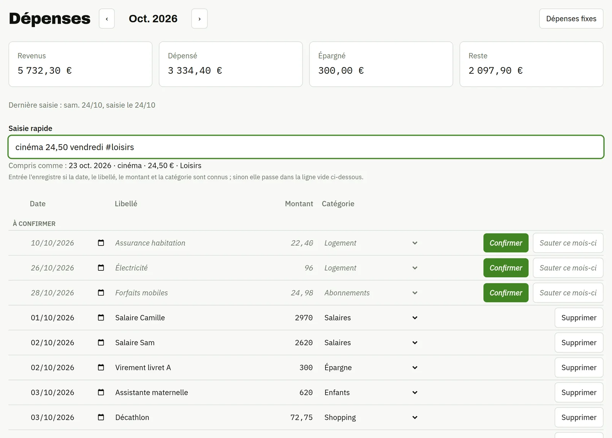

Un en-tête rappelle la dernière ligne saisie et quand, et un point la marque dans la grille, pour
reprendre là où l'on s'est arrêté.

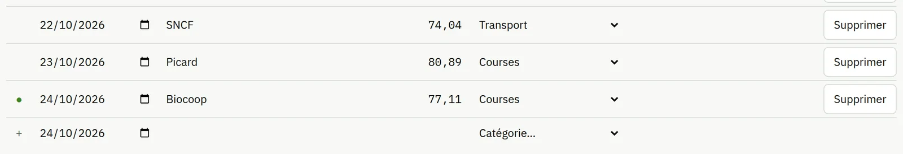

Une ligne peut aussi être **ventilée** sur plusieurs catégories : la dernière part prend le reste,
si bien que la somme tombe toujours juste.

 pour le foyer. Données fictives.")

### Des catégories à trois natures

Un seul niveau de catégories, chacune d'une nature :

- **dépense** : le loyer, les courses, les loisirs ;
- **épargne** : l'argent mis de côté, qui n'est jamais une dépense mais réduit le reste du mois ;
- **revenu** : salaires, aides, remboursements.

Le revenu d'un mois est la somme de ses lignes de revenu, et le reste vaut revenus moins dépenses
moins épargne. Les catégories **ponctuelles** (loyer, abonnements), payées en une fois, ne sont
jamais jugées sur le rythme du mois.

### Les dépenses fixes

Loyer, assistante maternelle, abonnements, assurances : une **dépense fixe** décrit une ligne qui
revient chaque mois, trimestre ou année. Chaque échéance due apparaît grisée en haut de la grille
du mois. Entrée la confirme et crée la ligne, modifiable avant ; on peut aussi la sauter pour le
mois. Rien n'est jamais créé tout seul.

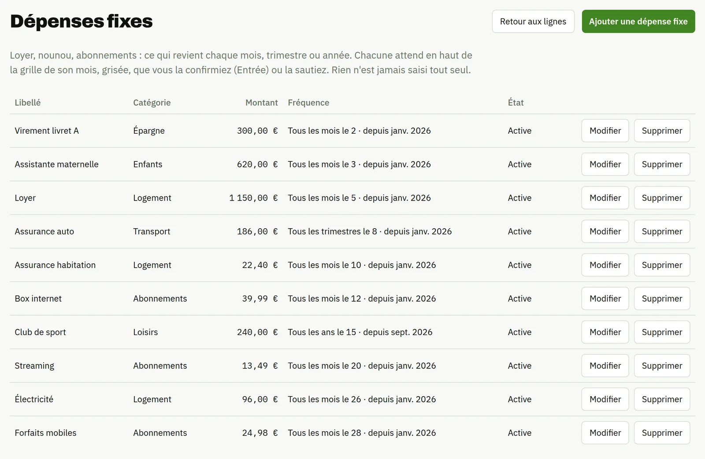

La vue d'ensemble liste ce qui reste à confirmer et le **reste projeté** en fin de mois.

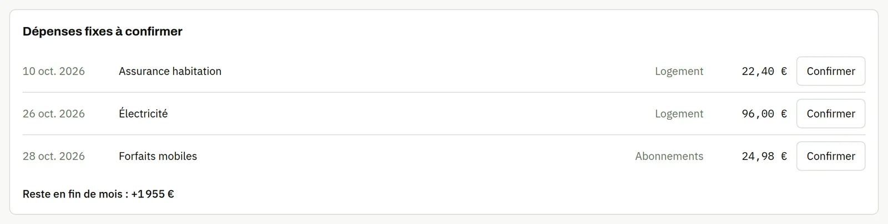

### Des objectifs mensuels

Chaque catégorie de dépense peut recevoir un **objectif mensuel**, fixé à partir d'un mois et
gardé jusqu'à ce qu'on le change ; les mois passés gardent les leurs. Une catégorie d'épargne
reçoit un minimum à atteindre.

- **le mois en cours**, sur la vue d'ensemble : une barre par catégorie, triée par part
  consommée, avec un trait qui marque la part du mois écoulée, si bien qu'une dépense en avance
  sur le calendrier se voit avant de dépasser ;
- **la matrice** : une ligne par catégorie, une colonne par mois, chaque case colorée selon
  l'écart à l'objectif (vert en dessous, gris à ±5 %, terre brûlée au-dessus) ;
- **l'année** : les objectifs cumulés à date et sur l'année entière, l'écart, et combien de mois
  ont été au-dessus, dans ou sous l'objectif.


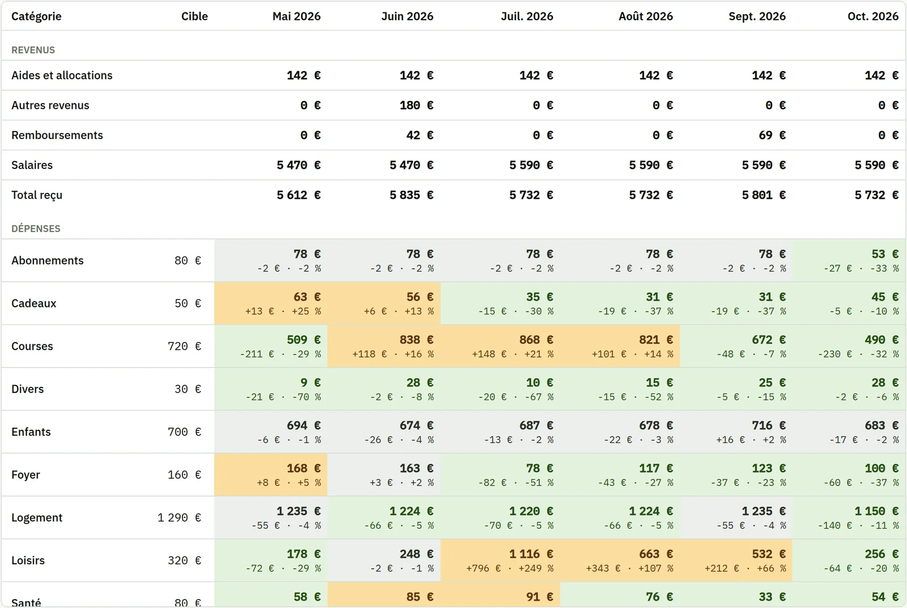

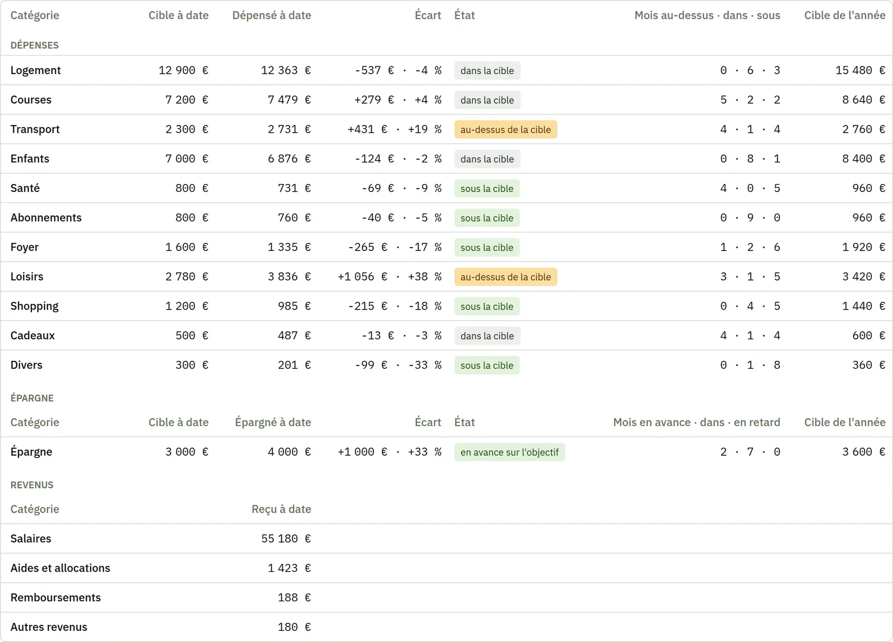

### Des rapports sur n'importe quelle période

Un mois, un trimestre, une année ou toute période jusqu'à dix ans, comparée à la **précédente de
même longueur**. Une période en cours s'arrête au mois courant : « cette année » se compare aux
mêmes mois de l'an dernier, pas à une année entière.


Le rapport donne aussi un graphique mensuel empilé par catégorie, les dépenses cumulées jour après
jour, et les **flux d'argent** de la période : les revenus à gauche ; dépenses, épargne et reste non
alloué à droite, les deux côtés toujours au même total.

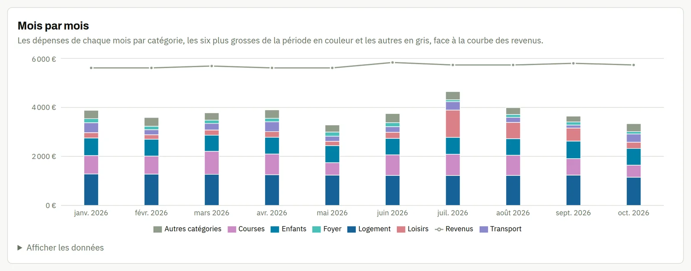

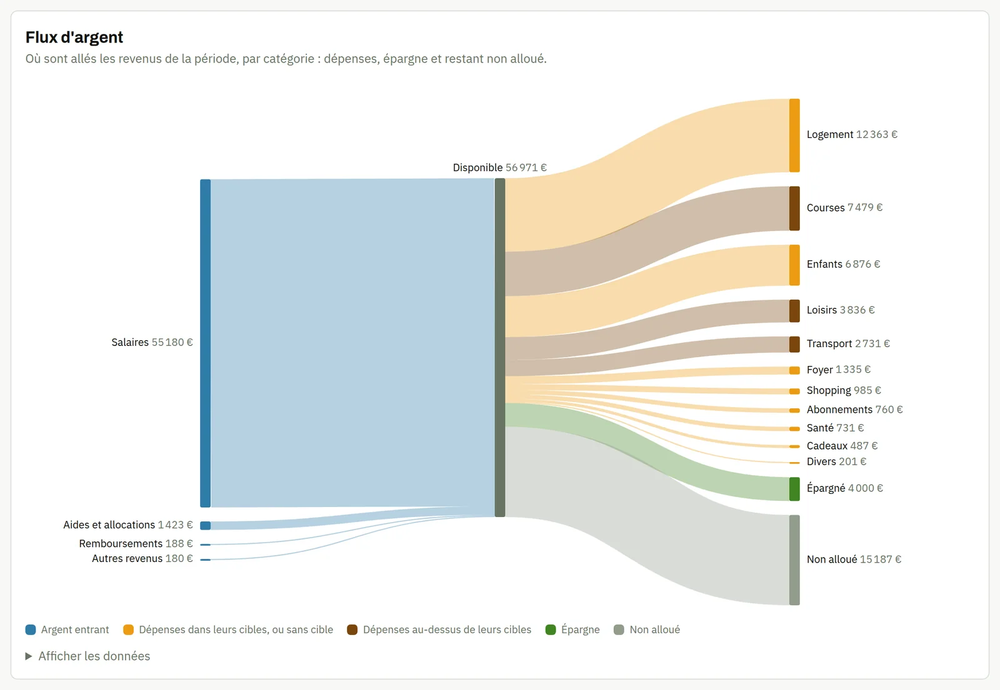

### Le patrimoine, mois par mois

Le patrimoine se suit comme dans un tableur : une ligne par placement, rangée dans une catégorie,
une colonne par mois, et une valeur saisie à la main une fois par mois.


- un mois sans saisie reprend la valeur précédente, affichée comme reportée ;
- « Mettre à jour ce mois-ci » liste toutes les lignes avec leur dernière valeur, pour tout
  saisir d'un coup ;
- chaque ligne a un titulaire et une visibilité ;
- un livret réglementé (livret A, LDDS, LEP, PEL, livret jeune) connaît son plafond.

Une page *Analyse* donne quatre graphiques, chaque catégorie dans sa couleur. Comme dix teintes
ne peuvent pas toutes rester distinctes pour tous les daltonismes, chaque graphique garde aussi
ses libellés et son tableau de données.


### Les objectifs, en pyramide

Un **objectif** est une somme à réunir pour une date : une épargne de précaution, un voyage, un
apport immobilier. Ils sont rangés en pyramide, dessinée en pierre :

- en **fondation**, une colonne romaine : l'épargne de précaution, à remplir en premier.
  L'application propose son montant, six mois de dépenses fixes par défaut ;
- trois **étages**, donnés par l'échéance et jamais choisis : le long terme (au-delà de cinq ans)
  à la base, le moyen terme au milieu, le court terme (douze mois au plus) au sommet. Un objectif
  monte d'étage tout seul à mesure que son échéance approche ;
- une **coiffe dorée** pour les envies (des gants de boxe, une platine, une belle bouteille de
  rhum), sans échéance, **verrouillée** tant que l'essentiel n'est pas en ordre : précaution
  remplie et au moins trois quarts des objectifs en avance.

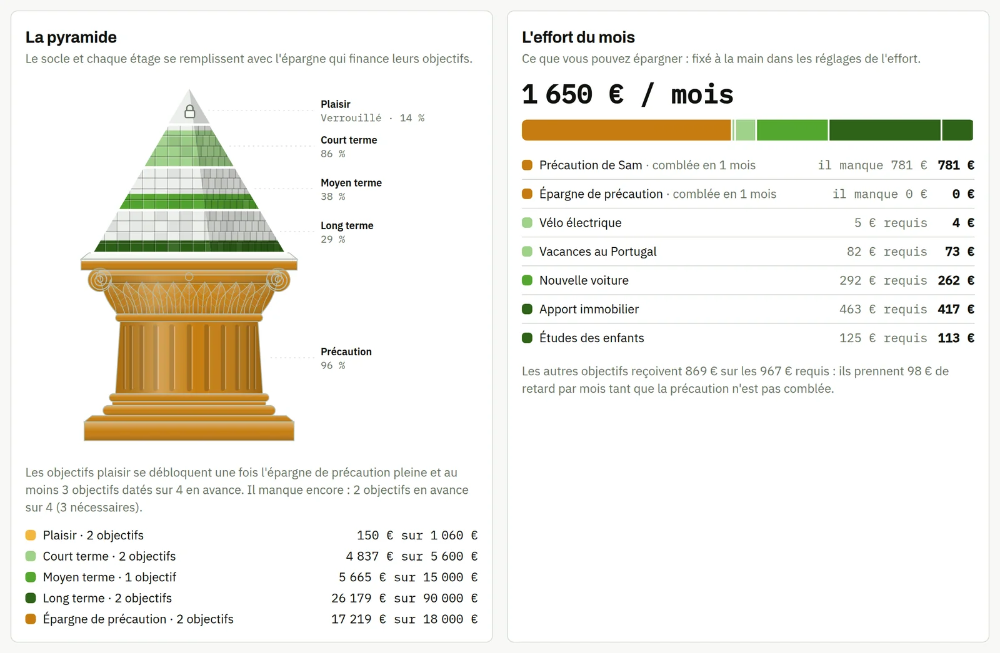

Un objectif ne demande aucune saisie de plus : il est financé par des **enveloppes**, la part
d'une ligne de patrimoine mise de côté pour lui. Quand la ligne monte, chaque objectif reçoit sa
part de la hausse ; quand elle baisse, la baisse sort d'abord de la partie libre, et les objectifs
ne perdent qu'une fois la ligne descendue sous ce qu'ils détiennent, les envies en premier et la
précaution en dernier.


flowchart LR
    L["Ligne de patrimoine<br/>Assurance-vie fonds euros"] -->|50 % des hausses| A["Enveloppe<br/>Vacances au Portugal"]
    L -->|30 % des hausses| B["Enveloppe<br/>Nouvelle voiture"]
    L -->|20 % des hausses| C["Enveloppe<br/>Apport immobilier"]
    L -.->|baisses d'abord| F["Partie libre"]


Chaque objectif a son statut (atteint, en avance, dans les temps, en retard), comparé à une
trajectoire droite du départ à la cible, et ses estimations : l'effort mensuel nécessaire,
l'effort réel des six derniers mois, la date estimée à ce rythme. Le **plan d'effort** du mois
répartit la capacité d'épargne du foyer : la précaution d'abord, dans la limite d'une part
réglable, puis les autres objectifs selon leur effort nécessaire, puis les envies déverrouillées.
C'est une recommandation : rien n'est déplacé.

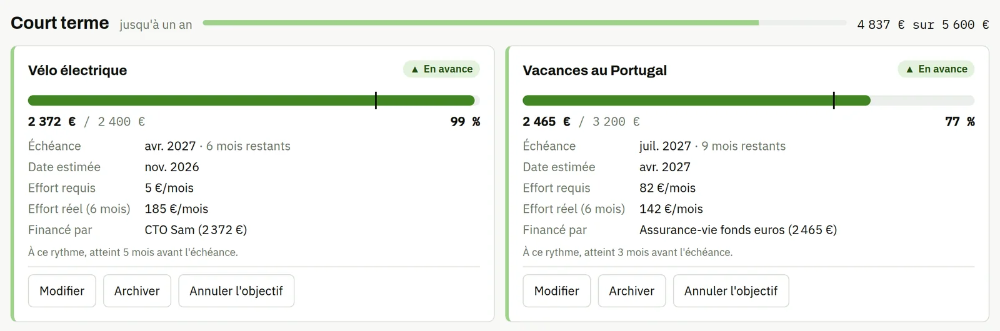

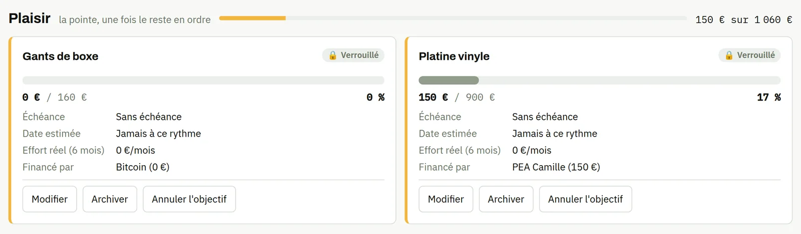

Chaque objectif a aussi sa page : ses estimations, sa trajectoire, ses enveloppes ligne par ligne
et son suivi mois par mois.

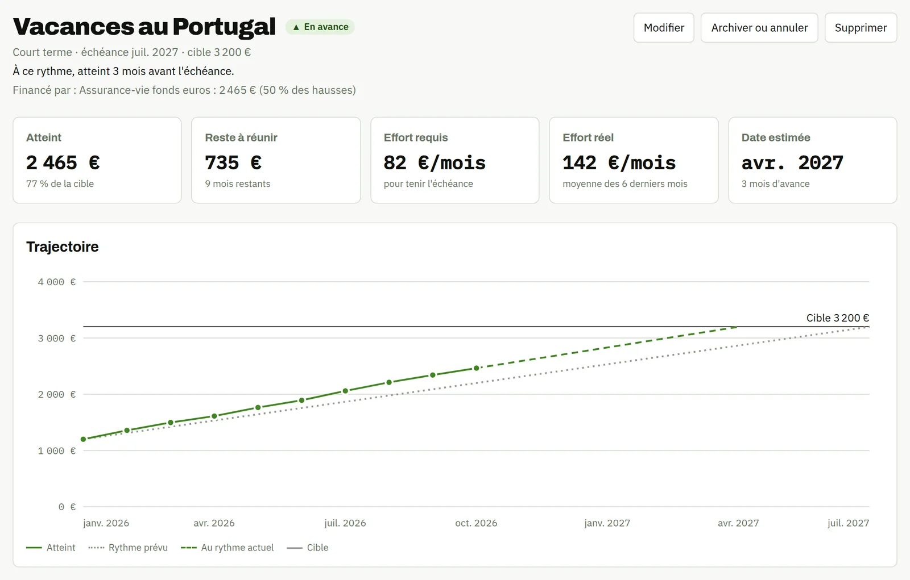

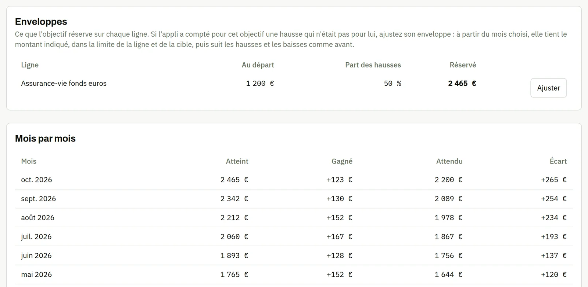

### L'analyse des objectifs

Un onglet *Analyse* regarde les objectifs **ensemble**, à un mois de référence : le dernier mois
où toutes les lignes qui les financent ont une valeur saisie, pour qu'un mois pas encore saisi ne
passe jamais pour un mois sans gain.

- **l'effort nécessaire face à la capacité** sur les deux ans à venir, les mois sur-engagés
  grisés ;
- **une frise** : chaque objectif de son départ à son échéance, avec sa date estimée au rythme
  réel et au rythme du plan ;
- **horizon et risque** : chaque objectif placé selon les mois qui restent et la volatilité de ses
  enveloppes, avec des zones à surveiller (court et volatil, long et rongé par l'inflation) et la
  perte dans un cas sur dix ;
- **où est l'argent** : un diagramme de flux des catégories aux lignes, puis aux enveloppes et à la
  partie libre ;
- **le statut mois par mois** de chaque objectif.

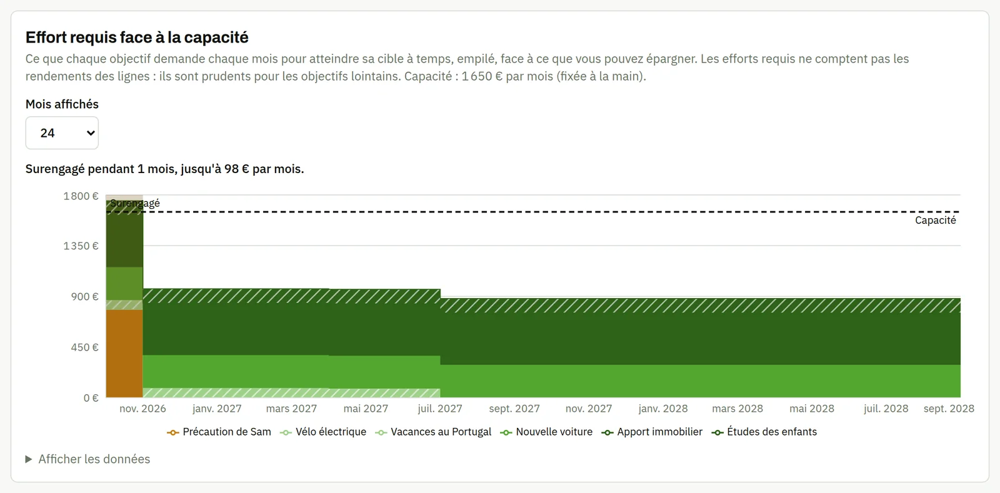

 et au rythme du plan (◇). Données fictives.")

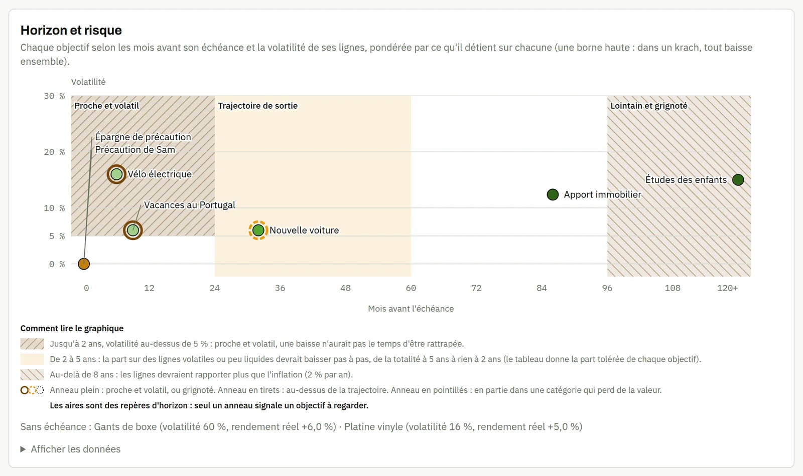

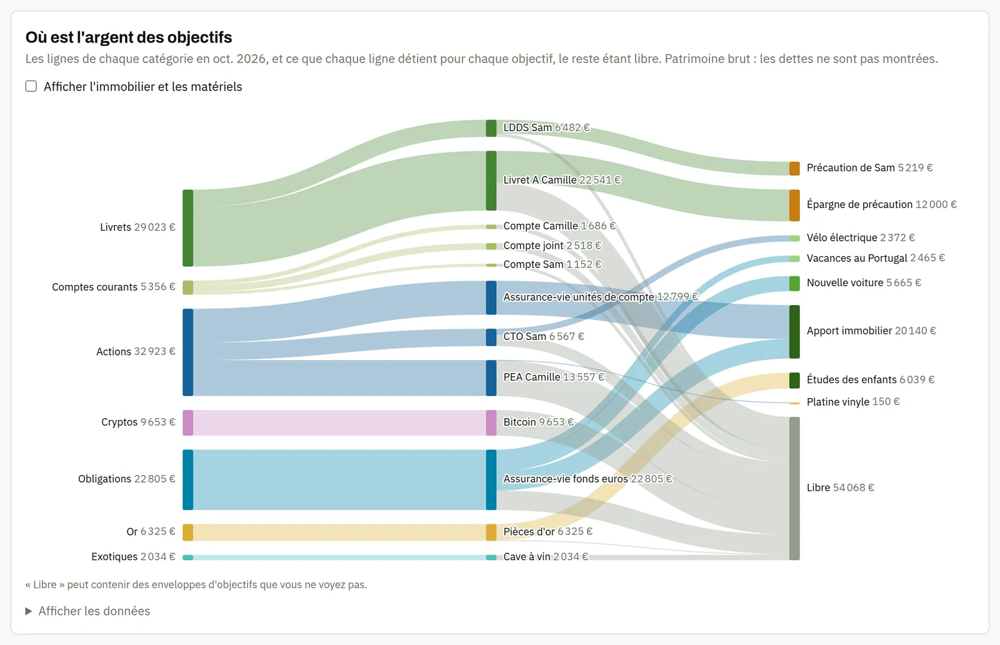

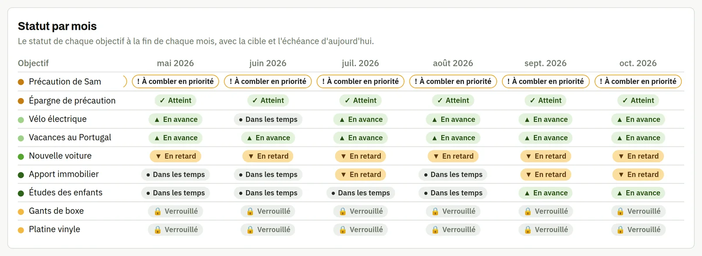

Au-dessus, des **points à regarder**, calculés par une quinzaine de règles fixes : un objectif en
retard depuis trois mois, une précaution trop mince ou placée sur des lignes volatiles, un livret
proche de son plafond, de l'argent qui dort sur un compte courant, des objectifs qui demandent
plus que la capacité (avec le report d'échéance qui suffirait). Chaque point donne les faits, les
chiffres, pourquoi c'est important et des options ; jamais une consigne d'achat ou de vente, ni un
produit nommé. Trois au plus s'affichent, et chaque membre peut en reporter ou en écarter un.

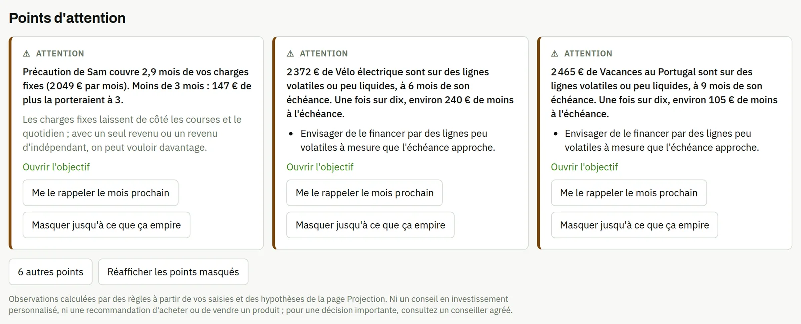

### Des sauvegardes vérifiées, des actions tracées

Une sauvegarde complète chaque nuit, contrôlée avant d'être conservée, avec une rotation
(7 jours, 4 semaines, 12 mois) et une procédure de restauration écrite.

Un **journal d'activité** garde les actions sensibles, écrites dans la même transaction que
l'action elle-même : connexions, invitations, suppressions. Le propriétaire voit tout le foyer, un
membre ses propres entrées.

, invitation envoyée puis annulée, réglages, suppression d'une ligne. Données fictives.")

## Comment c'est construit

### Une architecture simple, pensée pour la suite

Tout démarre d'un seul `docker compose up` : un proxy Caddy en TLS sur le réseau local, une API
FastAPI, une base PostgreSQL et un service de sauvegarde. L'interface React est servie depuis la
même origine que l'API, ce qui permet des sessions par cookie sans configuration CORS.


flowchart LR
    N["Navigateur<br/>réseau local"] -->|HTTPS| C["Caddy<br/>TLS + interface React"]
    C -->|/api| A["API FastAPI<br/>kwak_api"]
    A --> K["kwak_core<br/>toutes les règles métier"]
    A -.->|page à venir| M["kwak_analytics<br/>Monte-Carlo, NumPy"]
    M --> K
    A --> P[("PostgreSQL")]
    S["Sauvegarde nocturne<br/>pg_dump vérifié"] --> P


Côté Python, le code est découpé en paquets avec une règle stricte : `kwak_core` contient
**toutes les règles métier** (montants, ligne rapide, ventilation, objectifs mensuels, dépenses
fixes, rapports, patrimoine, enveloppes et plan d'effort, règles de l'analyse) et ne dépend de
rien. Il se teste sans base de données. L'API et la couche analytique `kwak_analytics` en
dépendent, jamais l'inverse : un même chiffre n'a qu'une seule définition.

Le contrat entre l'API et l'interface est le schéma OpenAPI : le client TypeScript en est
**généré**, jamais écrit à la main. La CI échoue si quelqu'un oublie de le régénérer.

### L'argent ne supporte pas l'à-peu-près

Les montants sont des décimaux exacts (`Decimal` en Python, `NUMERIC` en base), jamais des
flottants. Et les règles qui doivent toujours être vraies sont écrites dans les spécifications
puis vérifiées par des **tests de propriété** (Hypothesis) : au lieu de quelques exemples choisis à
la main, le test génère des centaines de cas et cherche celui qui casse la règle.

| Invariant | Ce que le test vérifie |
|---|---|
| Ligne rapide | Chaque mot tapé finit dans exactement un champ : date, montant, catégorie ou libellé |
| Ventilation | Les parts d'une ligne ventilée font exactement son montant, chacune positive |
| Épargne | L'épargne n'est jamais une dépense, et le reste du mois est la somme de ses lignes |
| Objectifs mensuels | Un seul objectif en vigueur par catégorie et par mois, et l'objectif annuel est la somme des mois |
| Dépenses fixes | Une ligne honore au plus une échéance, et le reste projeté déduit exactement celles qui restent |
| Cohérence | Un rapport, la matrice, l'année et le mois en cours donnent toujours les mêmes chiffres |
| Flux | Les deux côtés du diagramme de flux ont le même total |
| Patrimoine | La valeur nette d'un mois vaut ses actifs moins ses dettes, et le foyer est la somme exacte de ses périmètres |
| Enveloppes | Les enveloppes d'une ligne ne sont jamais négatives et ne dépassent jamais sa valeur, ni un objectif sa cible |
| Plan d'effort | Le plan ne distribue jamais plus que la capacité, et la précaution est servie la première |
| Coiffe | Une envie verrouillée ne reçoit rien, ni des hausses ni du plan |
| Analyse | Les poids d'un objectif sur ses lignes font 1, et le report proposé suffit, un mois de moins non |
| Projection | Sans volatilité, tous les chemins coïncident avec le calcul exact ; l'argent est conservé à chaque mois |

Les tests d'API tournent contre un **vrai PostgreSQL** lancé dans un conteneur, jamais contre une
base simulée.

### Une projection par Monte-Carlo

La première brique de la phase 5 est le moteur qui dira où le patrimoine peut être dans 1 à
40 ans. Le point de départ est le mois courant de la matrice ; chaque catégorie a un rendement
attendu et une volatilité, réglables, et l'épargne mensuelle du foyer s'ajoute chaque mois,
répartie entre les catégories.

- **5 000 chemins**, mois par mois : chaque catégorie croît d'un rendement log-normal tiré de son
  propre flux aléatoire, calibré pour que douze mois composent exactement la moyenne et la
  volatilité annuelles choisies ;
- **une graine fixe** : les mêmes hypothèses donnent toujours le même résultat, et deux scénarios
  partagent les mêmes tirages, si bien que leur écart ne vient que des hypothèses ;
- **les dettes** se remboursent selon leur mensualité et leur taux, et ce qu'elles libèrent
  rejoint l'épargne ;
- **une épargne négative** puise dans les comptes courants puis les livrets, jamais dans le
  logement ni les placements bloqués ; le manque devient une dette empruntée à 8 %.

C'est le seul endroit où l'argent passe en flottant, pour la vitesse : les entrées sont des
`Decimal`, les résultats y reviennent au centime. Les invariants de la projection (conservation de
l'argent, percentiles ordonnés, chemins identiques sans volatilité, moyenne simulée égale au
rendement choisi) sont testés comme le reste, et une version du moteur est figée par un test de
référence.

### Des décisions écrites

Chaque choix structurant fait l'objet d'une note de décision (ADR), datée, avec ses alternatives
rejetées. Une décision qui change donne une nouvelle note ; l'ancienne n'est jamais réécrite.

| Décision | Plutôt que |
|---|---|
| Auto-hébergement en Docker Compose | Un hébergement cloud : coût inutile et données financières exposées |
| FastAPI, SQLAlchemy 2, Alembic | Django : plus lourd, et l'interface d'administration ne sert pas |
| PostgreSQL, puis DuckDB pour l'analyse | SQLite seul : écritures concurrentes, pas d'extension vectorielle |
| Euro uniquement | Une comptabilité multidevise complète, trop coûteuse pour un seul besoin réel |
| Sessions serveur et TOTP obligatoire | Des jetons JWT, difficiles à révoquer |
| Modèle de langage local (Ollama) | Une API dans le cloud : les données ne doivent jamais quitter la machine |

Les écarts au plan initial sont, eux aussi, journalisés dans le `README`, au jour près.

## La suite

Le moteur de projection est prêt : reste à lui donner sa page, un éventail des issues possibles
(médiane, bandes 25–75 % et 10–90 %), la chance d'atteindre un montant à une date, la médiane par
catégorie et deux scénarios à comparer, avec ses limites écrites en clair. Le même moteur donnera
ensuite à chaque objectif sa **chance d'être atteint** à temps, puis une projection de retraite.

La prévision de trésorerie attend, elle, que les dépenses repartent avec assez d'historique depuis
la v1.0. Elle sera traitée comme un vrai problème de séries temporelles : protocole écrit
d'avance, backtest sans fuite du futur, et un modèle naïf à battre avant tout le reste. Cette
fiche sera mise à jour à chaque étape livrée.

## Essayer

```bash
git clone https://github.com/gwils28/kwak-finance
cd kwak-finance
make setup        # dépendances et hooks Git
make check        # tout ce que lance la CI
make up           # la pile complète sur https://localhost:8443
```

Les étapes de création du compte propriétaire et de la clé de chiffrement sont dans le `README`,
et l'application elle-même propose, en bas de chaque page, un guide pour la lancer, l'arrêter et
la mettre à jour.
