
Savoir où part l'argent du foyer, mois après mois, ce que vaut son patrimoine, quand ses projets
seront financés et de quoi il vivra à la retraite, sans confier ses comptes à un service en ligne.
Tout tourne sur une machine de la maison.





chacune bloquée tant que la CI n'est pas verte
dont 70 tests de propriété sur les invariants financiers
écrites, avec les alternatives rejetées





**Projet en cours.** Cette fiche décrit l'état du dépôt au 25 novembre 2026. Les chiffres
ci-dessus sont comptés dans le code. Depuis la version précédente de cette fiche (17 novembre),
17 pull requests ont livré la page du document d'audit, qui clôt la phase 6 et la feuille de route,
puis une passe d'ergonomie : une barre d'onglets par espace, une navigation propre au téléphone,
des pages vides qui guident, une aide sur chaque page et des libellés plus clairs.



**Toutes les captures montrent des données fictives.** Elles viennent du foyer de démonstration
intégré à l'application, la « Famille Martin » : Camille, Alex et leur fille Léa, trois ans
d'historique inventé. J'y ai ajouté deux objectifs professionnels, que la démo ne contient pas.
Seule la capture du journal d'activité vient d'une autre instance de démonstration. Aucun montant,
libellé ni solde ne provient de comptes réels.


## Le problème

Les applications de budget grand public demandent presque toutes la même chose : un accès à vos
comptes bancaires, et l'hébergement de votre historique financier sur leurs serveurs. Les
tableurs, eux, ne demandent rien, mais s'abandonnent au bout de trois mois : la saisie y est lente
et les totaux se cassent au premier copier-coller.

Je voulais un outil entre les deux :

- **privé par construction** : les données restent sur une machine du foyer, sans télémétrie ni
  service tiers ;
- **rapide à tenir** : une séance de saisie par semaine, au clavier, sans rien à trier ensuite ;
- **juste au centime** : chaque total doit pouvoir se recalculer à partir des lignes saisies ;
- **tourné vers l'avenir** : dire si les projets du foyer seront financés à temps, où le
  patrimoine peut aller, et à quoi ressemblera l'année qui vient ;
- **honnête sur l'incertitude** : chaque estimation donne sa fourchette et ses limites, jamais un
  chiffre seul présenté comme une certitude.

## Où en est le projet




Spécifications, architecture et décisions écrites avant la première ligne de code. Dépôt,
outillage, intégration continue, pile Docker Compose, configuration de Claude Code et charte
graphique reprise de ce blog.



Authentification à double facteur, foyer et invitations, comptes, import et rapprochement
bancaires, règles de catégorisation, virements, plans budgétaires par période avec leur bilan,
opérations récurrentes, rapports et journal d'activité. Toute la partie comptes et import a
ensuite été remplacée par la refonte v1.0.



Une matrice de patrimoine mensuelle : catégories et lignes saisies à la main, dettes, valeur
nette, et des graphiques (historique, répartition, contributions à la variation).



Les objectifs rangés en pyramide (l'épargne de précaution en fondation, puis le long, le moyen et
le court terme, sous une coiffe dorée pour les envies), financés par des enveloppes prises sur les
lignes de patrimoine, avec leur suivi mensuel et un plan d'effort pour le mois. Depuis : plusieurs
épargnes de précaution par foyer, et des objectifs professionnels.



Plus de comptes, d'import ni de virements : chaque dépense est une ligne saisie à la main, dans
une grille pensée pour le clavier. Un seul niveau de catégories, des dépenses fixes à confirmer,
des cibles mensuelles avec leur matrice et une vue annuelle. Les données des dépenses repartent
de zéro.



L'analyse des objectifs (six vues, la chance d'atteindre chaque objectif et des points à regarder
calculés par des règles), la projection du patrimoine par Monte-Carlo, la retraite sur le même
moteur, et la prévision de trésorerie des douze prochains mois, choisie par back-test parmi des
modèles statistiques, LightGBM et, en option, deux modèles de fondation. Un foyer de démonstration
permet de tout essayer avant d'avoir de l'historique.



Un document construit à la demande pour un banquier, un conseiller en gestion de patrimoine, un
comptable ou notaire, ou un assistant conversationnel, imprimé en PDF ou copié en Markdown. Il
remplace l'assistant en langage naturel prévu au départ.



Un audit de l'interface a ouvert 24 tickets, dont 22 sont traités en 16 pull requests : la
navigation, le téléphone, les pages vides, les chargements, les libellés et le vocabulaire. Deux
restent ouverts, dont une vue d'ensemble plus légère.




## Ce qui fonctionne aujourd'hui

### Un foyer, trois points de vue

Le propriétaire crée le foyer et invite les autres membres par un lien à usage unique ; il n'y a
pas d'inscription publique. Connexion par mot de passe (argon2id) et code TOTP obligatoire.

Les dépenses appartiennent au foyer : chaque membre voit et modifie chaque ligne. Le patrimoine
et les objectifs, eux, ont une visibilité, ligne par ligne :

- **privé** : son titulaire seul le voit ;
- **partagé** : tout le foyer le voit, mais il reste à son titulaire ;
- **commun** : le bien du foyer, qui n'est à personne.

Le patrimoine et les objectifs se lisent ensuite à l'échelle du **foyer**, du **commun** ou de
**mes lignes**. L'application est rangée en trois espaces, **Dépenses** (lignes, budget, rapports,
prévision), **Patrimoine** (suivi mensuel, analyse, projection, retraite, audit) et **Objectifs**
(pyramide, analyse) ; chaque espace a sa barre d'onglets, et la vue d'ensemble, en tête, résume
les trois. Chaque titre de page porte un « ? » qui ouvre le guide intégré à la bonne section, et
une page encore vide dit ce qui y apparaîtra et comment commencer.

Sur un téléphone, une barre en bas de l'écran mène aux trois espaces, et chaque ligne de dépense
devient une carte qui se modifie sur place, comme sur ordinateur.

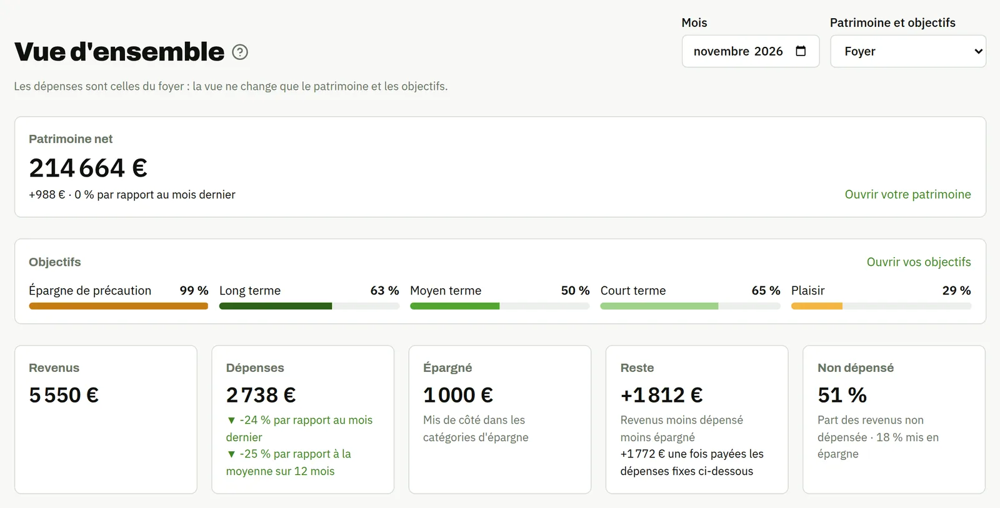

### Un foyer de démonstration

Un outil de prévision ne montre rien tant qu'il n'a pas d'historique. Le menu du compte ouvre donc
un **foyer de démonstration** : un couple et son enfant, trois ans de dépenses, de patrimoine,
d'objectifs et de retraite inventés, plausibles pour un foyer français, générés de façon
déterministe (la même graine et le même jour donnent la même démo). Il est partagé par les
membres du foyer et se réinitialise d'un clic. Un invariant testé garantit que la démo et le vrai
foyer ne se croisent jamais : aucune réponse donnée dans la démo ne lit ni n'écrit une ligne du
vrai foyer.


### Saisir vite, au clavier

La page principale des dépenses est une **grille** : un mois, ses lignes, chaque case modifiable
sur place. Une ligne vide attend toujours en bas ; Tab passe à la case suivante, Entrée enregistre
et ouvre une nouvelle ligne à la même date. Tout se fait sans la souris.

Au-dessus, une **ligne rapide** accepte une dépense tapée dans n'importe quel ordre :
`boulangerie 12,50 hier`, `45 sncf 13/10` ou `carrefour 87.40 #foyer`.

- la date se reconnaît (« hier », un jour de la semaine, `jj/mm`) ;
- le montant est le dernier nombre, les autres restent dans le libellé ;
- `#mot` force la catégorie qui commence par ce mot ;
- le reste est le libellé, et sa catégorie vient de la **mémoire des libellés** : choisir un
  libellé déjà utilisé reprend la catégorie de sa dernière ligne.

Sous la ligne rapide, un aperçu dit ce qui a été compris avant la validation. Une ligne ajoutée
s'annonce avec un bouton *Annuler* ; les montants se lisent comme de l'argent, les revenus en vert
précédés d'un « + ».

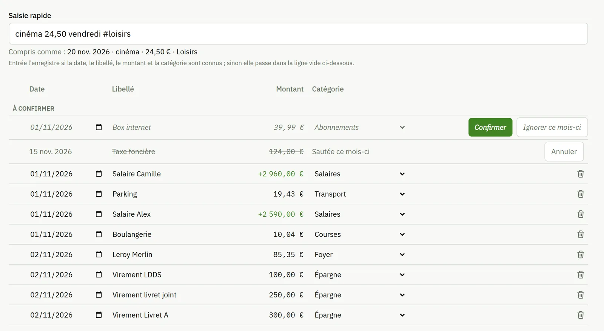

Un en-tête rappelle la dernière ligne saisie et quand, et un point la marque dans la grille, pour
reprendre là où l'on s'est arrêté.

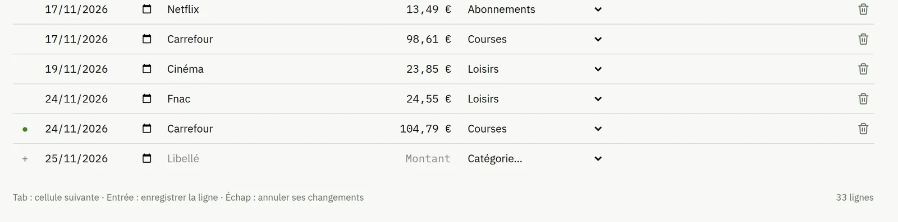

Une ligne peut aussi être **ventilée** sur plusieurs catégories : la dernière part prend le reste,
si bien que la somme tombe toujours juste.

 pour le foyer. Données fictives.")

### Des catégories à trois natures

Un seul niveau de catégories, chacune d'une nature :

- **dépense** : le logement, les courses, les loisirs ;
- **épargne** : l'argent mis de côté, qui n'est jamais une dépense mais réduit le reste du mois ;
- **revenu** : salaires, aides, remboursements.

Le revenu d'un mois est la somme de ses lignes de revenu, et le reste vaut revenus moins dépenses
moins épargne. Les catégories **payées en une fois** dans le mois (logement, abonnements) ne sont
jamais jugées sur son rythme.

### Les dépenses fixes

Prêt immobilier, assistante maternelle, abonnements, assurances : une **dépense fixe** décrit une
ligne qui revient chaque mois, trimestre ou année. Chaque échéance due apparaît grisée en haut de
la grille du mois. Entrée la confirme et crée la ligne, modifiable avant ; on peut aussi la sauter
pour le mois. Rien n'est jamais créé tout seul.

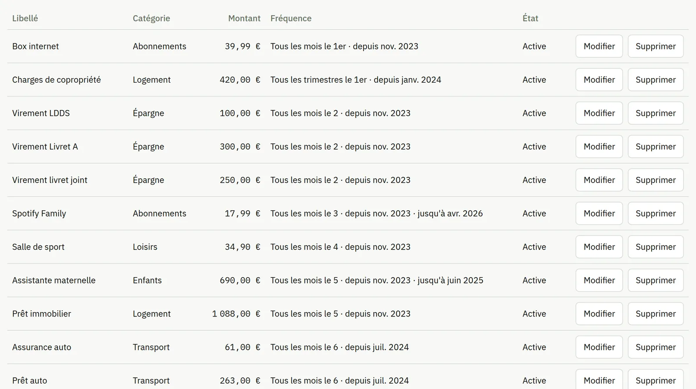

La vue d'ensemble liste ce qui reste à confirmer, et sa tuile *Reste* donne le **reste projeté**,
une fois ces dépenses payées.

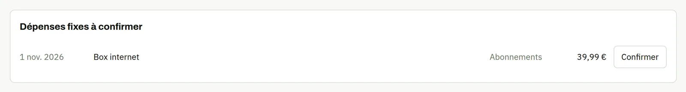

### Des cibles mensuelles

Chaque catégorie de dépense peut recevoir une **cible mensuelle**, fixée à partir d'un mois et
gardée jusqu'à ce qu'on la change ; les mois passés gardent les leurs. Une catégorie d'épargne
reçoit un minimum à atteindre. (Dans l'interface française, « cible » désigne le budget et
« objectif » seulement une somme à réunir : les deux mots se mélangeaient.)

- **le mois en cours**, sur la vue d'ensemble : seules les catégories à surveiller s'affichent,
  et *Voir tout* les déplie toutes, triées par part consommée, avec un trait qui marque la part
  du mois écoulée, si bien qu'une dépense en avance sur le calendrier se voit avant de dépasser ;
- **la matrice** : une ligne par catégorie, une colonne par mois, chaque case colorée selon
  l'écart à la cible (vert en dessous, gris à ±5 %, terre brûlée au-dessus) ; elle s'ouvre sur
  le mois en cours ;
- **l'année** : les cibles cumulées à date et sur l'année entière, l'écart, et combien de mois
  ont été au-dessus, dans ou sous la cible.

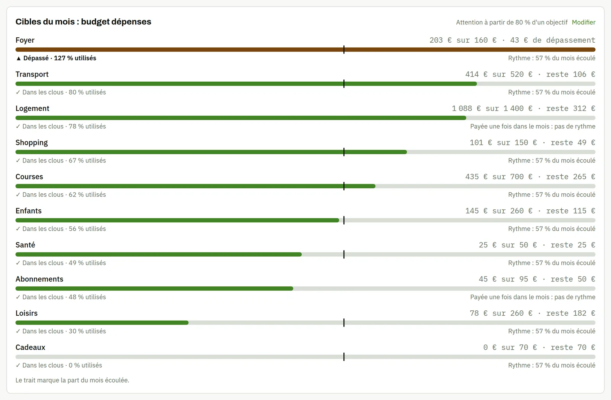

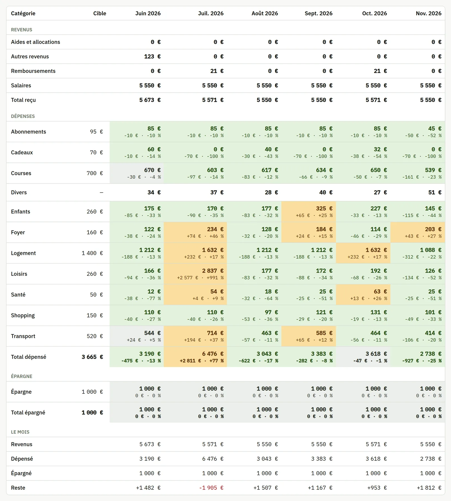

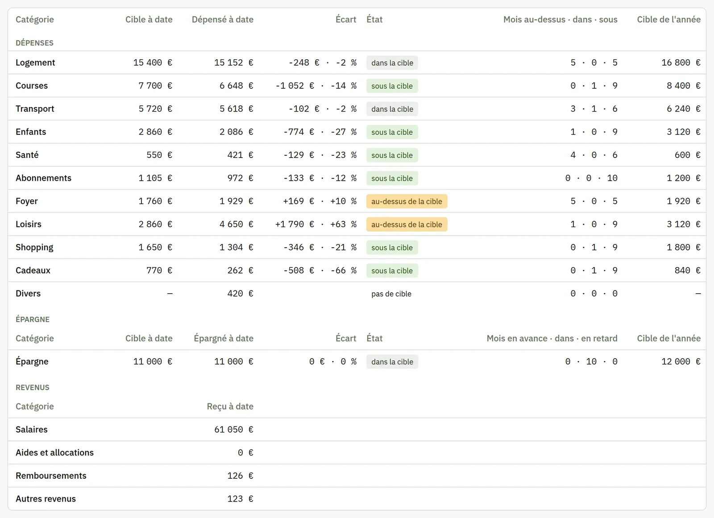

### Des rapports sur n'importe quelle période

Un mois, un trimestre, une année ou toute période jusqu'à dix ans, comparée à la **précédente de
même longueur**. Une période en cours s'arrête au mois courant : « cette année » se compare aux
mêmes mois de l'an dernier, pas à une année entière.

Le rapport s'ouvre sur les **flux d'argent** de la période : les revenus à gauche ; dépenses,
épargne et reste non alloué à droite, les deux côtés toujours au même total.

 et le non alloué (10 683 €) à droite. Données fictives.")

Viennent ensuite les totaux, le détail par catégorie, un classement des dépenses et un graphique
mensuel empilé par catégorie.

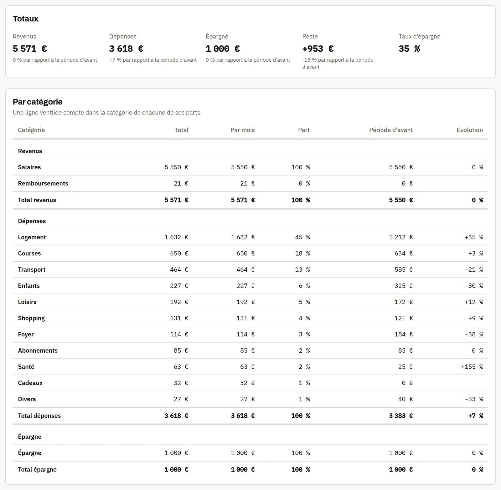

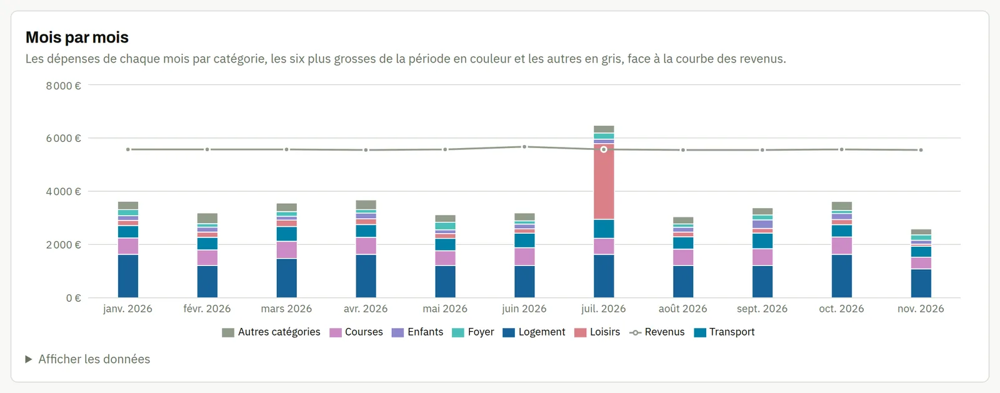

### Le patrimoine, mois par mois

Le patrimoine se suit comme dans un tableur : une ligne par placement, rangée dans une catégorie,
une colonne par mois, et une valeur saisie à la main une fois par mois.

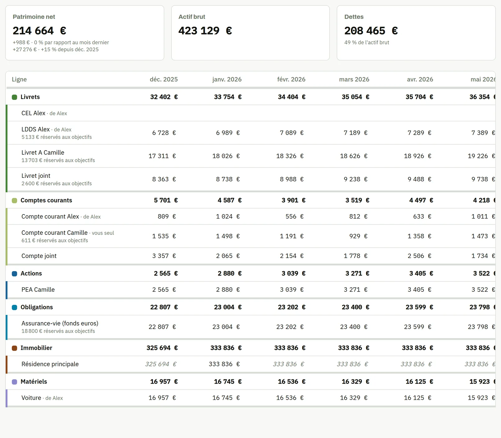

- un mois sans saisie reprend la valeur précédente, affichée comme reportée ;
- « Mettre à jour ce mois-ci » liste toutes les lignes avec leur dernière valeur, marque celles
  déjà mises à jour, et n'enregistre que celles que l'on touche ;
- chaque ligne a un titulaire et une visibilité ;
- un livret réglementé (livret A, LDDS, LEP, PEL, livret jeune) connaît son plafond, et une ligne
  d'actif peut porter son enveloppe fiscale (PEA, assurance-vie…).

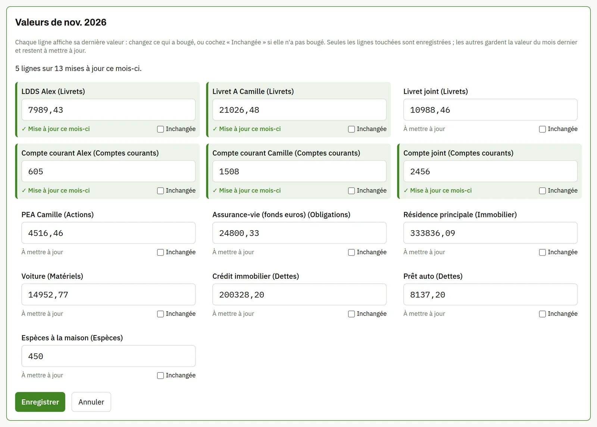

Une page *Analyse* donne trois graphiques, chaque catégorie dans sa couleur. Comme dix teintes
ne peuvent pas toutes rester distinctes pour tous les daltonismes, chaque graphique garde aussi
ses libellés et son tableau de données. Des cases à cocher sortent une catégorie de l'analyse :
sans la résidence principale ni la voiture, on voit enfin comment se répartit l'épargne.

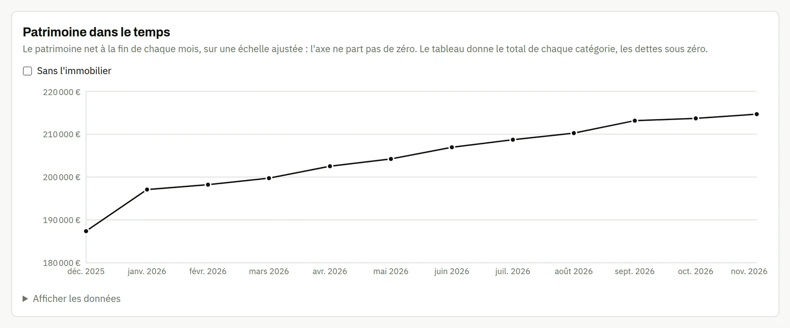

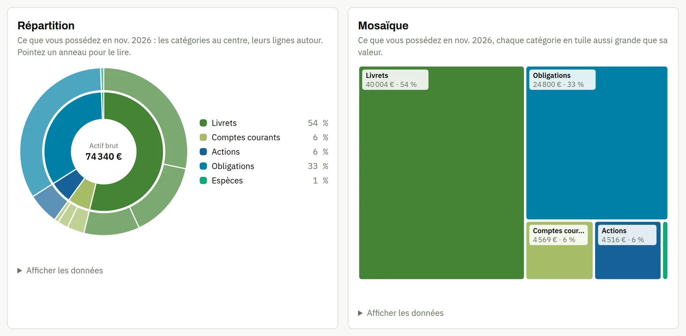

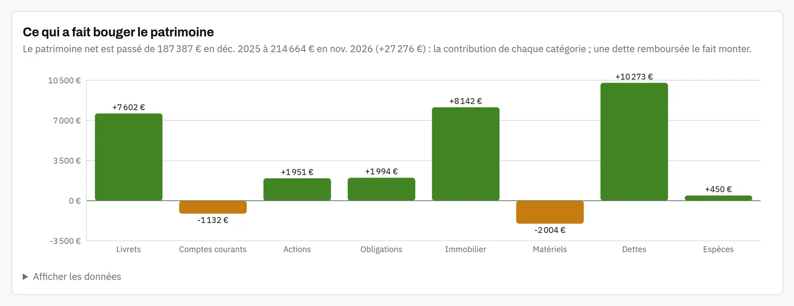

### Les objectifs, en pyramide

Un **objectif** est une somme à réunir pour une date : une épargne de précaution, un voyage, un
apport immobilier. Ils sont rangés en pyramide, dessinée en pierre :

- en **fondation**, une colonne romaine : l'épargne de précaution. Le foyer peut en avoir
  plusieurs (une par membre, une commune, une tirelire d'espèces), chacune à combler en priorité
  ou non. L'application propose son montant, six mois de dépenses fixes par défaut ;
- trois **étages**, donnés par l'échéance et jamais choisis : le long terme (au-delà de cinq ans)
  à la base, le moyen terme au milieu, le court terme (douze mois au plus) au sommet. Un objectif
  monte d'étage tout seul à mesure que son échéance approche ;
- une **coiffe dorée** pour les envies (des gants de boxe, une platine, une belle bouteille de
  rhum), sans échéance, **verrouillée** tant que l'essentiel n'est pas en ordre : précaution
  remplie et au moins trois quarts des objectifs en avance.

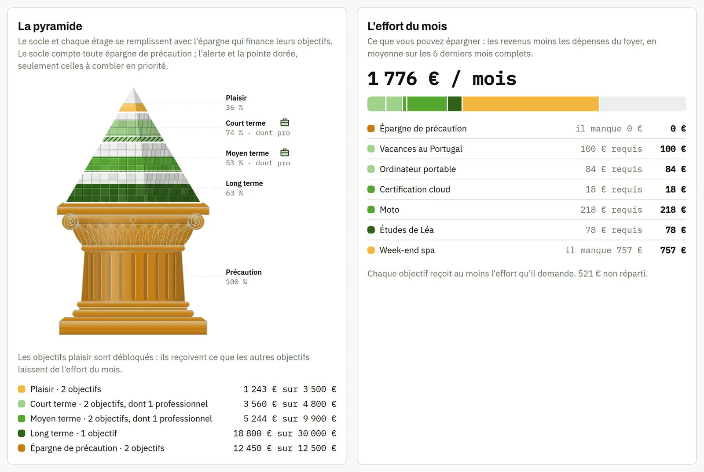

Un objectif ne demande aucune saisie de plus : il est financé par des **enveloppes**, la part
d'une ligne de patrimoine mise de côté pour lui. Quand la ligne monte, chaque objectif reçoit sa
part de la hausse ; quand elle baisse, la baisse sort d'abord de la partie libre, et les objectifs
ne perdent qu'une fois la ligne descendue sous ce qu'ils détiennent, les envies en premier et la
précaution en dernier.


flowchart LR
    L["Ligne de patrimoine<br/>Livret A"] -->|60 % des hausses| A["Enveloppe<br/>Épargne de précaution"]
    L -->|20 % des hausses| B["Enveloppe<br/>Ordinateur portable"]
    L -->|20 % des hausses| C["Enveloppe<br/>Week-end spa"]
    L -.->|baisses d'abord| F["Partie libre"]


Chaque objectif a son statut (atteint, en avance, dans les temps, en retard), comparé à une
trajectoire droite du départ à la cible, et ses estimations : l'effort mensuel nécessaire,
l'effort réel des six derniers mois, la date estimée à ce rythme. Le **plan d'effort** du mois
répartit la capacité d'épargne du foyer : la précaution d'abord, dans la limite d'une part
réglable, puis les autres objectifs selon leur effort nécessaire, puis les envies déverrouillées.
C'est une recommandation : rien n'est déplacé.

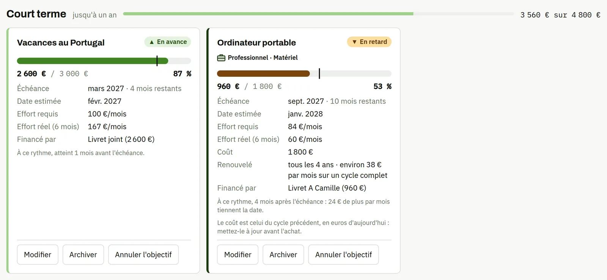

Un **objectif professionnel** sert le travail : un équipement, une formation, la création d'une
entreprise, une reconversion, un déménagement. Il reste à son étage, hachuré, avec son type. Le
formulaire demande son coût et ce que d'autres paient (le CPF, l'employeur, France Travail, un prêt
d'honneur), et la cible est ce qu'il reste au foyer à réunir. Un équipement peut se renouveler
tous les N ans : une fois l'achat fait, le cycle suivant repart tout seul.

Le formulaire d'un nouvel objectif commence par un seul choix, son type : précaution, projet,
plaisir ou professionnel. Un projet peut être *permanent*, gardé en vue une fois atteint.

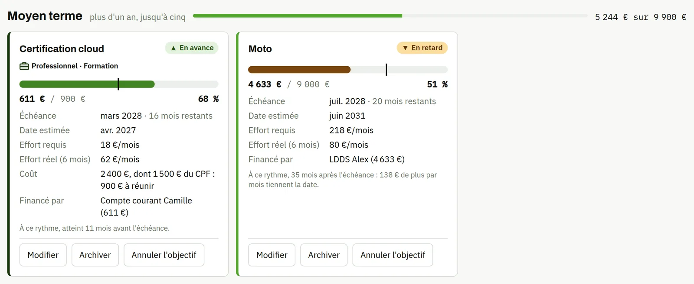

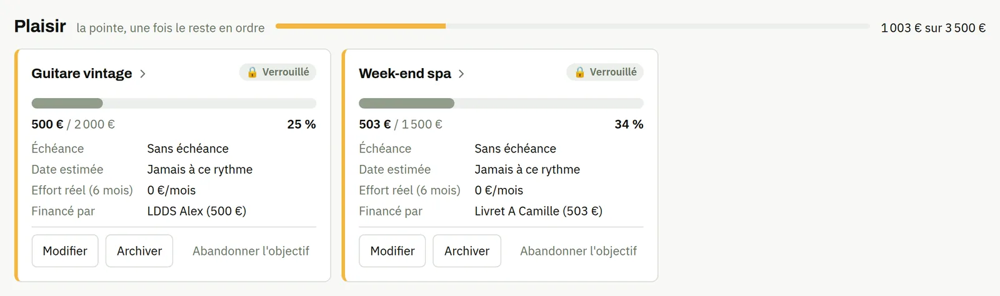

Chaque objectif a aussi sa page : ses estimations, sa trajectoire, ses enveloppes ligne par ligne
et son suivi mois par mois.

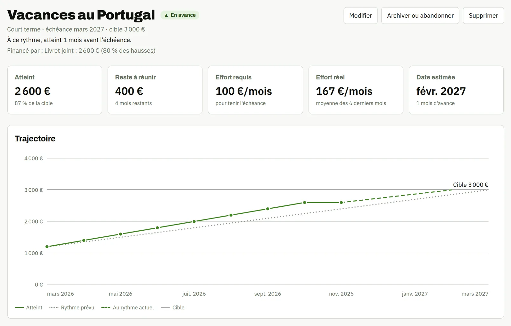

, puis chaque mois : atteint, gagné, attendu et écart. Données fictives.")

### L'analyse des objectifs

Un onglet *Analyse* regarde les objectifs **ensemble**, à un mois de référence : le dernier mois
où toutes les lignes qui les financent ont une valeur saisie, pour qu'un mois pas encore saisi ne
passe jamais pour un mois sans gain.

- **l'effort nécessaire face à la capacité** sur les deux ans à venir, les mois sur-engagés
  grisés ;
- **une frise** : chaque objectif de son départ à son échéance, avec sa date estimée au rythme
  réel et au rythme du plan ;
- **horizon et risque** : chaque objectif placé selon les mois qui restent et la volatilité de ses
  enveloppes, avec des zones à surveiller (court et volatil, long et rongé par l'inflation) ;
- **la chance d'atteindre chaque objectif** à temps, simulée par le moteur de projection sur ses
  propres lignes, à l'effort du plan et à l'effort requis ;
- **où est l'argent** : un diagramme de flux des catégories aux lignes, puis aux enveloppes et à la
  partie libre ;
- **le statut mois par mois** de chaque objectif.

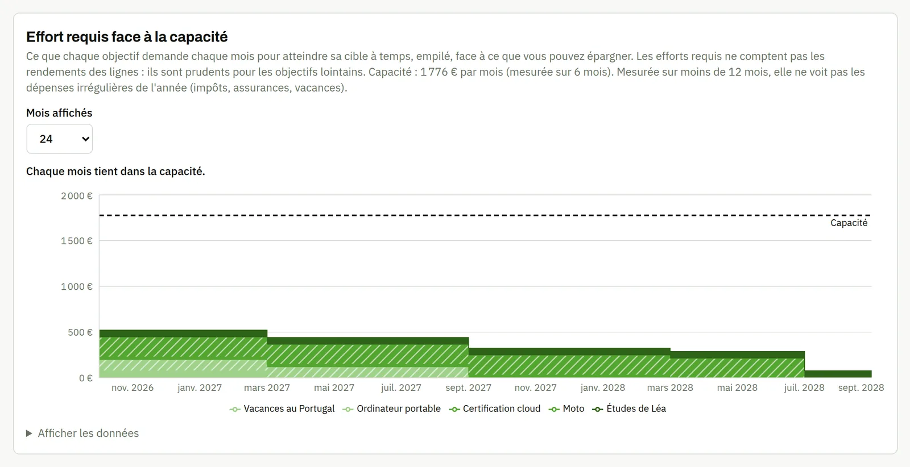

 et au rythme du plan (◇). La moto n'arrivera qu'après son échéance au rythme actuel. Données fictives.")

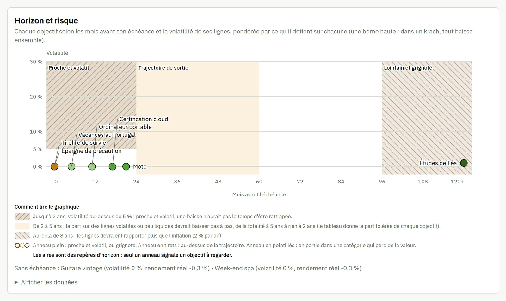

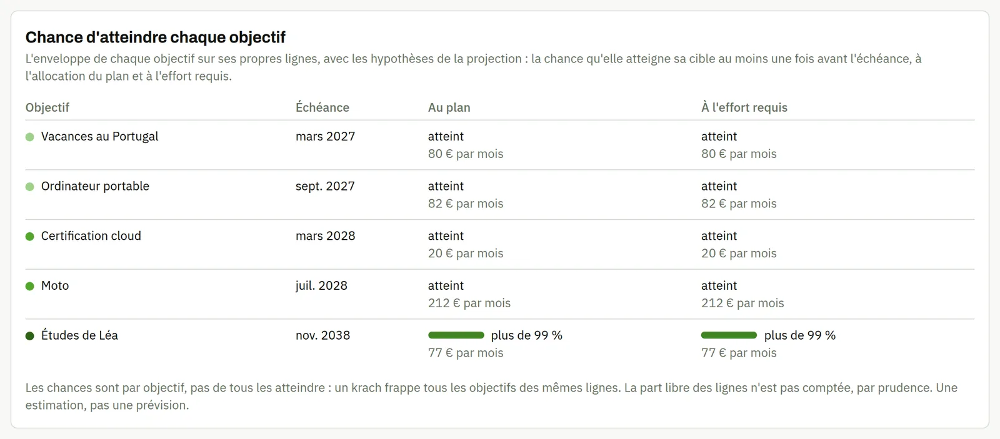

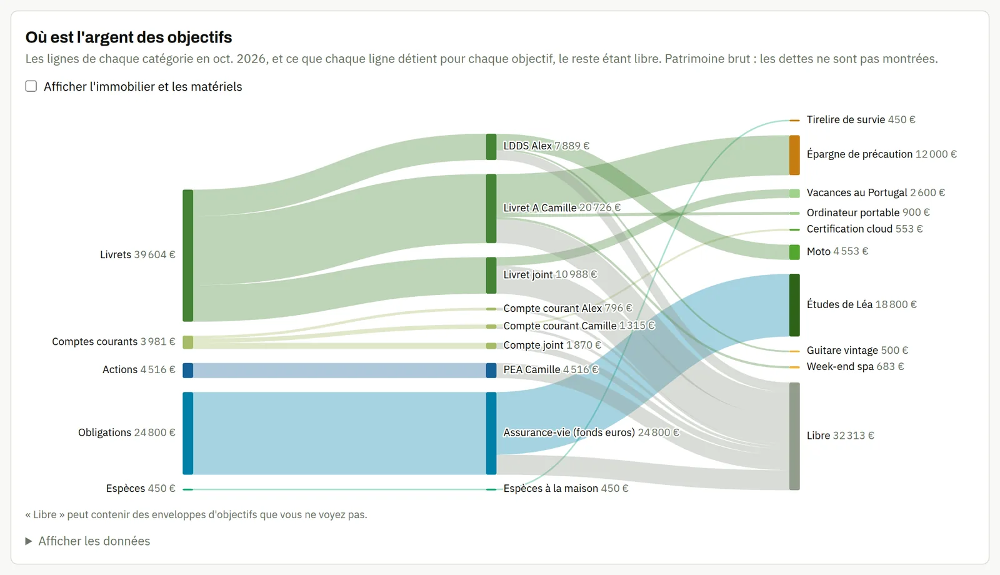

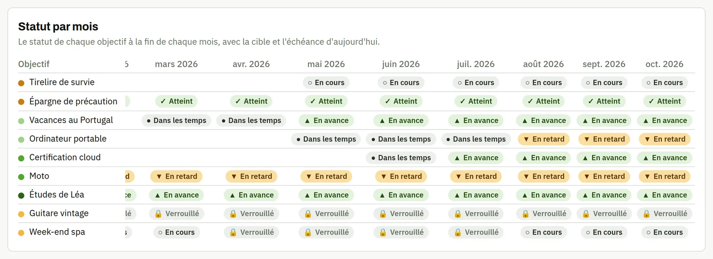

Au-dessus, des **points à regarder**, calculés par une quinzaine de règles fixes : un objectif en
retard depuis trois mois, une précaution trop mince ou placée sur des lignes volatiles, un livret
proche de son plafond, de l'argent qui dort sur un compte courant, des objectifs qui demandent
plus que la capacité (avec le report d'échéance qui suffirait), une dette plus chère que ce que
rapportent les placements, des mensualités au-delà de 35 % des revenus. Chaque point donne les
faits, les chiffres, pourquoi c'est important et des options ; jamais une consigne d'achat ou de
vente, ni un produit nommé. Trois au plus s'affichent, et chaque membre peut en reporter ou en
écarter un. Un objectif en retard depuis trois mois est toujours un avertissement, quelle que
soit son échéance.

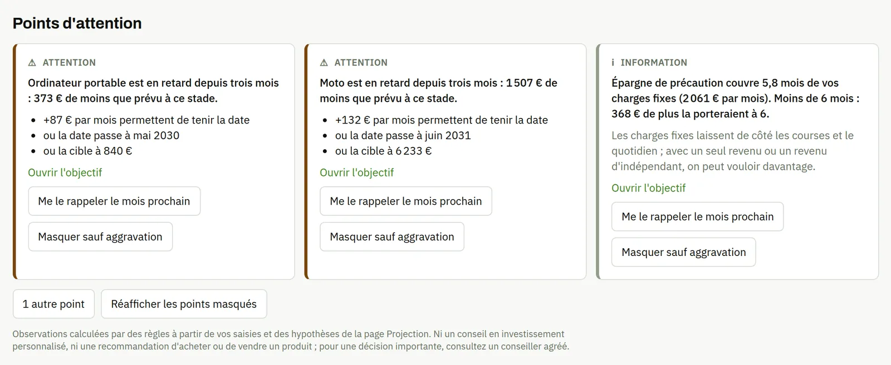

### La projection du patrimoine

L'onglet *Projection* répond à une question : où le patrimoine peut-il être dans 1 à 40 ans ? C'est
un **simulateur** : on règle à gauche, la réponse se recalcule à droite pendant que l'on tape.

- **l'épargne mensuelle**, au choix du foyer : *déclarée* (des versements par catégorie, que l'on
  peut indexer sur l'inflation) ou *mesurée* (la capacité d'épargne réelle des derniers mois) ;
  l'historique ne sert que si on le choisit, pour qu'un mois exceptionnel ne fausse pas tout ;
- **la réponse** : le patrimoine net médian à l'horizon, la fourchette où tombent huit résultats
  sur dix, et le revenu mensuel que les placements liquides pourraient verser à un taux de retrait
  donné ;
- **d'où vient l'argent** : le patrimoine d'aujourd'hui, les versements, le capital remboursé des
  prêts et les plus-values, qui s'additionnent exactement à la médiane ;
- **atteindre un montant** : la chance d'avoir au moins tant à telle date, et quand la moitié puis
  neuf dixièmes des résultats l'atteignent ;
- **et si…** : deux variantes (épargne, rendement, volatilité, inflation), le temps de la visite.

, un patrimoine net médian de 930 900 € dans 20 ans, en euros d'aujourd'hui, décomposé en ce qu'il est aujourd'hui, les versements, les prêts remboursés et les plus-values. Données fictives.")

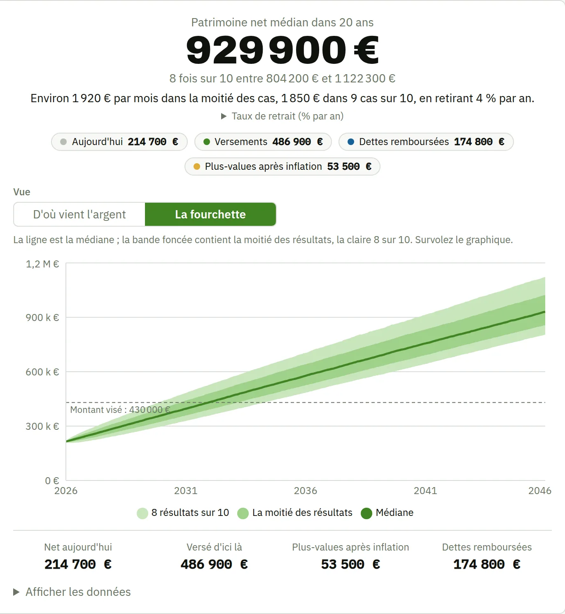

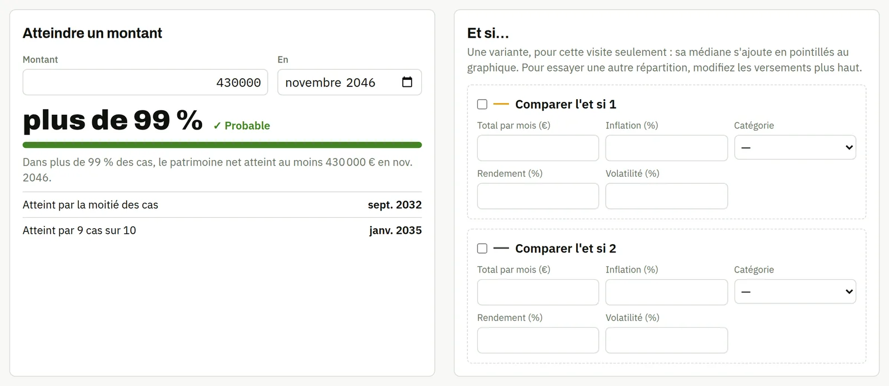

Chaque page dit ses limites en clair : une estimation à partir d'hypothèses, ni une prévision ni un
conseil ; une bande à 10–90 % laisse un résultat sur cinq dehors, et la vraie dispersion est plus
large que celle du modèle.

### La retraite

L'onglet *Retraite*, dans l'espace Patrimoine, tourne sur le même moteur : quel niveau de vie le foyer pourra-t-il garder une
fois retraité ? Chaque membre saisit son mois de naissance, quand il arrête de travailler, le
revenu qui s'arrête alors, et la pension estimée sur info-retraite.fr ; l'application ne calcule
aucun droit. Le foyer règle ses dépenses de retraite (80 % des dépenses d'aujourd'hui hors prêts,
par défaut), l'indexation des pensions et l'horizon.

La page donne d'abord la réponse : les pensions plus le **retrait soutenable**, le plus grand
montant mensuel que le patrimoine liquide peut verser jusqu'à l'horizon sans s'épuiser dans neuf
résultats sur dix, face aux dépenses ; puis la chance que le patrimoine tienne, et l'âge auquel il
s'épuiserait sinon.

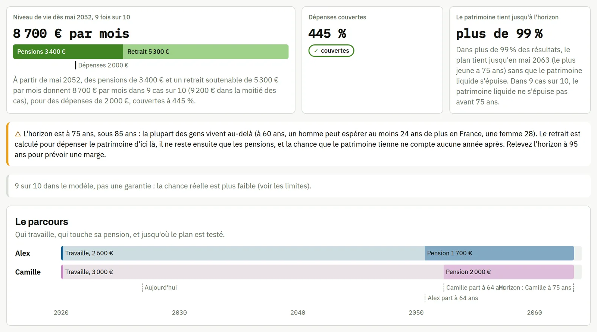

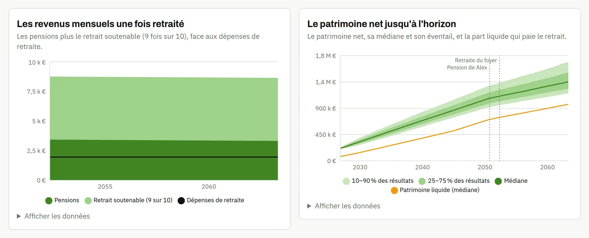

### La prévision de trésorerie

L'onglet *Prévision*, dans l'espace Dépenses, montre les douze prochains mois : revenus, dépenses,
épargne et reste, par catégorie, avec une fourchette, face aux cibles du budget. Les dépenses fixes à venir sont
connues ; le reste est prévu à partir de l'historique du foyer, par la méthode qui s'est le moins
trompée sur les mois déjà saisis (voir [plus bas](#une-prévision-choisie-par-back-test)). Le
calcul prend quelques secondes : la page le dit, et garde la dernière prévision à l'écran pendant
qu'elle se recalcule.

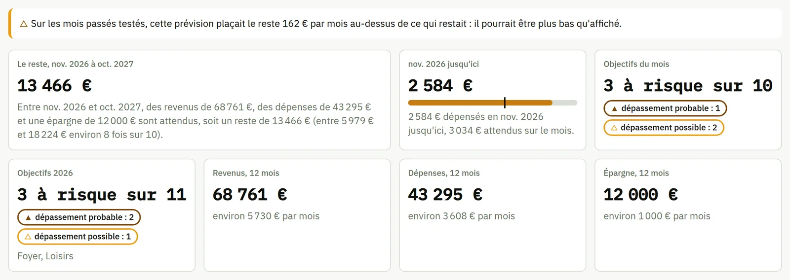

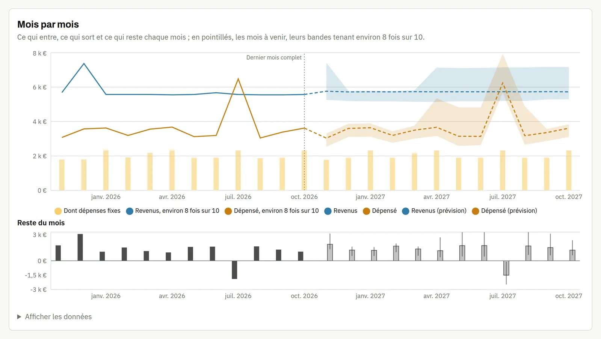

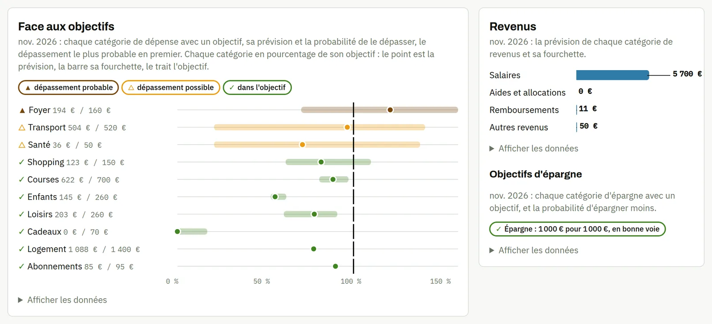

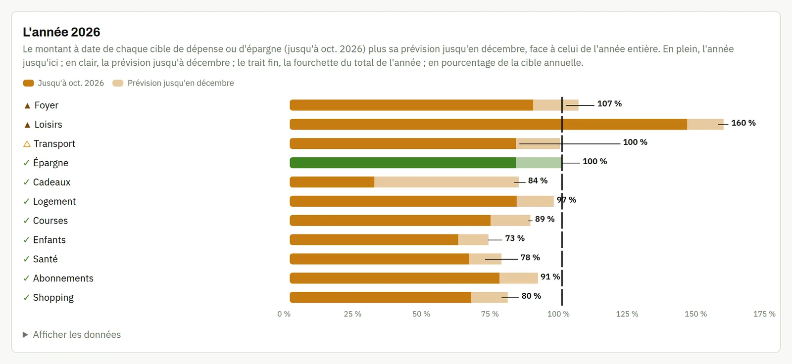

Repliée en bas, la **fiabilité** : pour chaque catégorie, la méthode retenue et ce qu'elle gagne
sur la moyenne des six derniers mois, son biais, puis le back-test des totaux.

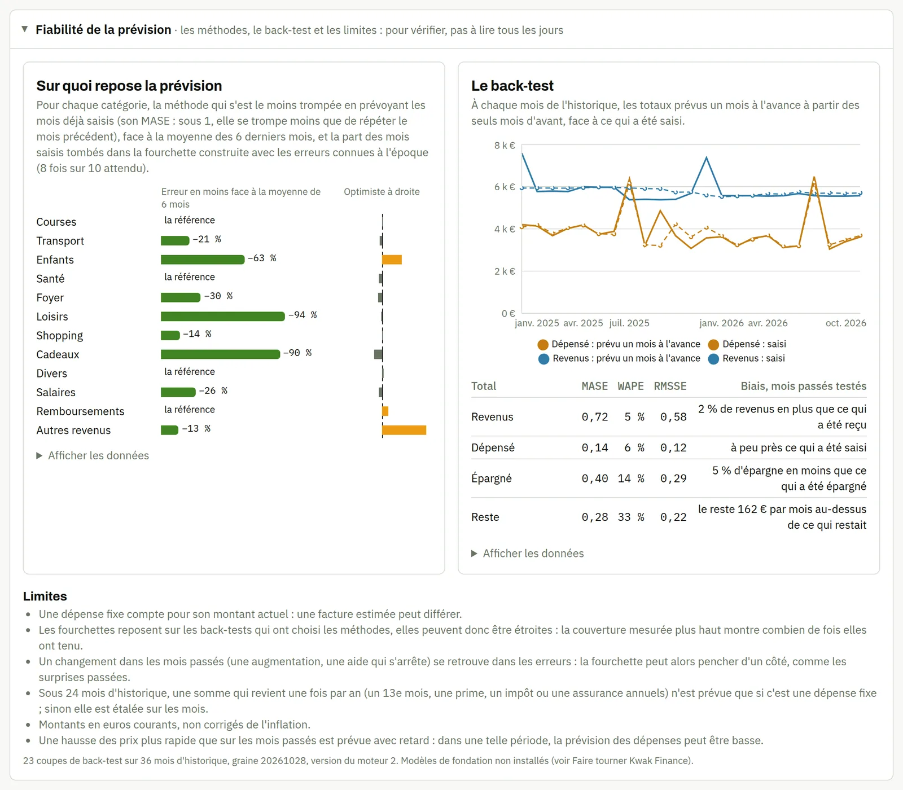

### Le document d'audit

Le dernier onglet du patrimoine, *Audit*, construit un document qui résume les finances du foyer
pour **un lecteur** : un banquier (une demande de prêt immobilier), un conseiller en gestion de
patrimoine, un comptable ou un notaire, ou un assistant conversationnel à qui l'on demande un
audit. Un formulaire règle le lecteur, le périmètre, la période, la langue et la confidentialité
(membres nommés ou *Membre A*, lignes nommées ou par catégorie, montants exacts ou arrondis) ; le
document se reconstruit en dessous à chaque changement, tel qu'il sera imprimé.

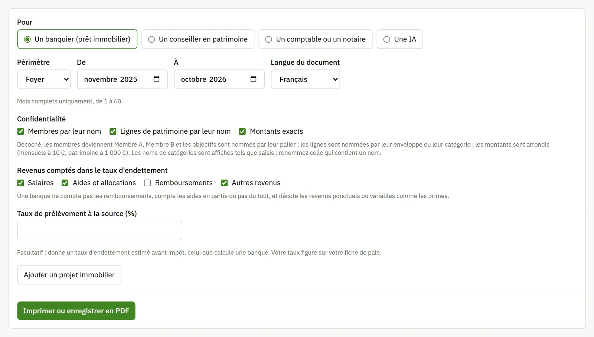

Chaque lecteur a ses sections :

- **le banquier** : les revenus mois par mois, pour montrer leur régularité, les dépenses fixes,
  les crédits en cours, le taux d'endettement et le reste à vivre, la capacité d'épargne, le
  patrimoine disponible et, s'il le faut, un projet immobilier simulé (mensualité, endettement
  face au plafond de 35 %, apport) ;
- **le conseiller** : le patrimoine par catégorie avec sa liquidité, les livrets et leurs
  plafonds, les objectifs, la retraite et les analyses de l'application, puis tout ce que
  l'application ne sait pas (profil de risque, tranche d'imposition, régime matrimonial…) ;
- **le comptable ou le notaire** : un inventaire par titulaire, tel que classé dans
  l'application, qui rappelle que ce classement n'est pas la propriété juridique ;
- **l'assistant conversationnel** : tout cela en Markdown structuré, anonymisé par défaut, ouvert
  par une consigne qui lui demande d'abord ce qui lui manque, puis de séparer ce qu'il observe de
  ce qu'il suggère, sans nommer de produit.

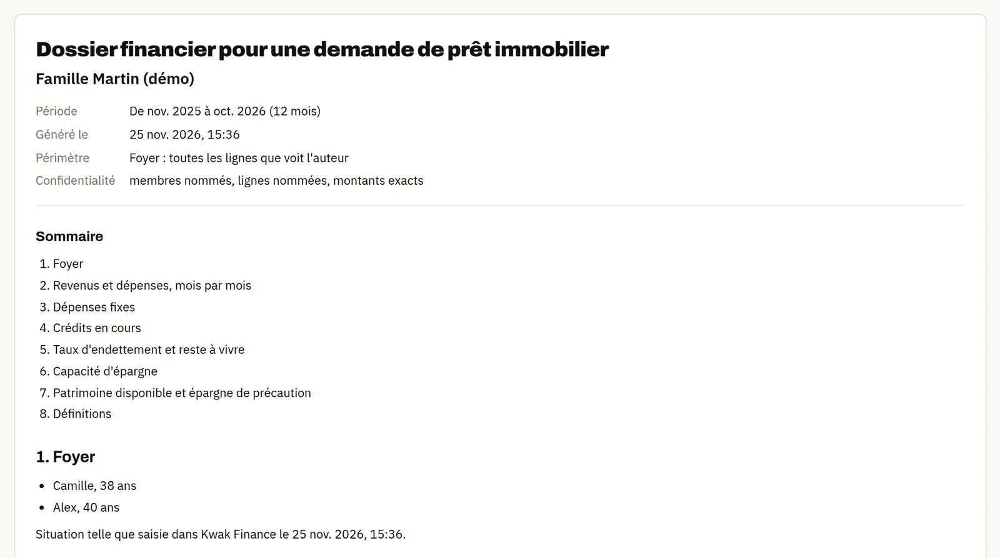

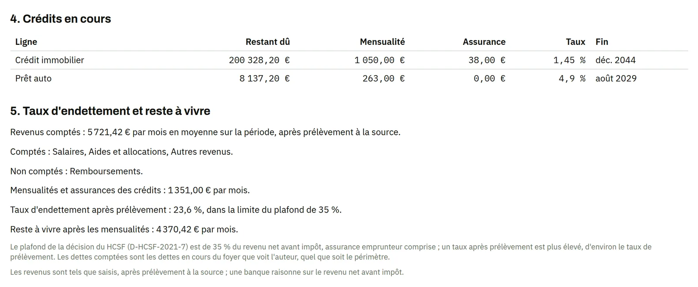

Rien n'est stocké : le document est refait à partir des données du jour. Il s'imprime en PDF ou,
pour l'assistant, se copie ou se télécharge en Markdown ; chaque impression ou copie laisse une
trace dans le journal d'activité, sans aucun chiffre. Il se termine toujours par des définitions
et par la même phrase : des chiffres saisis par le foyer, non certifiés, qui ne sont pas un
conseil financier.

### Des sauvegardes vérifiées, des actions tracées

Une sauvegarde complète chaque nuit, contrôlée avant d'être conservée, avec une rotation
(7 jours, 4 semaines, 12 mois) et une procédure de restauration écrite.

Un **journal d'activité** garde les actions sensibles, écrites dans la même transaction que
l'action elle-même : connexions, invitations, suppressions. Le propriétaire voit tout le foyer, un
membre ses propres entrées.

, invitation envoyée puis annulée, réglages, suppression d'une ligne. Données fictives.")

## Comment c'est construit

### Une architecture simple, pensée pour la suite

Tout démarre d'un seul `docker compose up` : un proxy Caddy en TLS sur le réseau local, une API
FastAPI, une base PostgreSQL et un service de sauvegarde. L'interface React est servie depuis la
même origine que l'API, ce qui permet des sessions par cookie sans configuration CORS.


flowchart LR
    N["Navigateur<br/>réseau local"] -->|HTTPS| C["Caddy<br/>TLS + interface React"]
    C -->|/api| A["API FastAPI<br/>kwak_api"]
    A --> K["kwak_core<br/>toutes les règles métier"]
    A --> M["kwak_analytics<br/>Monte-Carlo, prévision"]
    M --> K
    A --> P[("PostgreSQL")]
    S["Sauvegarde nocturne<br/>pg_dump vérifié"] --> P


Côté Python, le code est découpé en paquets avec une règle stricte : `kwak_core` contient
**toutes les règles métier** (montants, ligne rapide, ventilation, cibles mensuelles, dépenses
fixes, rapports, patrimoine, enveloppes et plan d'effort, règles de l'analyse, séries et choix des
modèles de prévision) et ne dépend de rien. Il se teste sans base de données. L'API et la couche
analytique `kwak_analytics` (les simulations et l'ajustement des modèles) en dépendent, jamais
l'inverse : un même chiffre n'a qu'une seule définition.

Le contrat entre l'API et l'interface est le schéma OpenAPI : le client TypeScript en est
**généré**, jamais écrit à la main. La CI échoue si quelqu'un oublie de le régénérer.

Les pages d'analyse ont d'abord été écrites en Dash, servies dans un cadre. Elles sont passées en
React : chaque page appelle un point d'API en lecture seule, qui lance son moteur et renvoie des
chiffres en JSON ; les mots, les formats et les graphiques (Recharts) appartiennent à la page, dans
les deux langues. Dash a été retiré.

### L'argent ne supporte pas l'à-peu-près

Les montants sont des décimaux exacts (`Decimal` en Python, `NUMERIC` en base), jamais des
flottants. Et les règles qui doivent toujours être vraies sont écrites dans les spécifications,
46 à ce jour, puis vérifiées par des **tests de propriété** (Hypothesis) : au lieu de quelques
exemples choisis à la main, le test génère des centaines de cas et cherche celui qui casse la
règle.

| Invariant | Ce que le test vérifie |
|---|---|
| Ligne rapide | Chaque mot tapé finit dans exactement un champ : date, montant, catégorie ou libellé |
| Ventilation | Les parts d'une ligne ventilée font exactement son montant, chacune positive |
| Épargne | L'épargne n'est jamais une dépense, et le reste du mois est la somme de ses lignes |
| Cibles mensuelles | Une seule cible en vigueur par catégorie et par mois, et la cible annuelle est la somme des mois |
| Dépenses fixes | Une ligne honore au plus une échéance, et le reste projeté déduit exactement celles qui restent |
| Cohérence | Un rapport, la matrice, l'année et le mois en cours donnent toujours les mêmes chiffres |
| Flux | Les deux côtés du diagramme de flux ont le même total |
| Patrimoine | La valeur nette d'un mois vaut ses actifs moins ses dettes, et le foyer est la somme exacte de ses périmètres |
| Enveloppes | Les enveloppes d'une ligne ne sont jamais négatives et ne dépassent jamais sa valeur, ni un objectif sa cible |
| Plan d'effort | Le plan ne distribue jamais plus que la capacité, et la précaution est servie la première |
| Objectifs professionnels | Un objectif professionnel se comporte exactement comme l'objectif standard de même cible, et un équipement à renouveler a exactement un cycle suivant |
| Projection | Sans volatilité, tous les chemins coïncident avec le calcul exact ; l'argent est conservé à chaque mois de chaque chemin |
| Retraite | Jusqu'au premier départ, la simulation est exactement la projection ; le retrait soutenable ne baisse jamais quand une pension monte |
| Prévision | Aucune prévision ne lit une ligne postérieure à son origine ; un modèle trop optimiste sur le back-test n'est jamais retenu |
| Démo | Aucune réponse donnée dans la démo ne lit ni n'écrit une ligne du vrai foyer |
| Document d'audit | Jamais la ligne privée d'un autre membre ; anonymisé, aucun nom ni courriel n'apparaît, la consigne comprise |

Les tests d'API tournent contre un **vrai PostgreSQL** lancé dans un conteneur, un par processus
de test, jamais contre une base simulée.

### Une projection par Monte-Carlo

Le même moteur sert la projection, la chance d'atteindre chaque objectif et la retraite. Le point
de départ est le mois courant de la matrice ; chaque catégorie a un rendement attendu et une
volatilité, réglables, et l'épargne mensuelle s'ajoute chaque mois, répartie entre les catégories.

- **5 000 chemins**, mois par mois : chaque catégorie croît d'un rendement log-normal tiré de son
  propre flux aléatoire, calibré pour que douze mois composent exactement la moyenne et la
  volatilité annuelles choisies ;
- **une graine fixe** : les mêmes hypothèses donnent toujours le même résultat, et deux scénarios
  partagent les mêmes tirages, si bien que leur écart ne vient que des hypothèses ;
- **les dettes** se remboursent selon leur mensualité et leur taux, et ce qu'elles libèrent
  rejoint l'épargne ;
- **une épargne négative** puise dans les comptes courants puis les livrets, jamais dans le
  logement ni les placements bloqués ; le manque devient une dette empruntée à 8 %.

Pour la retraite, le **retrait soutenable** est cherché chemin par chemin, par dichotomie, sur les
mêmes tirages : c'est le plus grand multiple de 100 € qui laisse au plus un chemin sur dix à court
d'argent avant l'horizon ; à 100 € de plus, plus d'un chemin sur dix échouerait.

C'est le seul endroit où l'argent passe en flottant, pour la vitesse : les entrées sont des
`Decimal`, les résultats y reviennent au centime.

### Une prévision choisie par back-test

La prévision de trésorerie est traitée comme un problème de séries temporelles, avec un protocole
écrit d'avance :

- **une série par catégorie**, découpée en une part connue (les échéances des dépenses fixes) et
  une part variable, la seule que les modèles apprennent ; une ligne n'est jamais comptée deux fois ;
- **des candidats du plus simple au plus riche** : la moyenne des six derniers mois (la référence),
  d'autres moyennes, le naïf saisonnier, le lissage exponentiel, ETS, Theta, ARIMA, ADIDA pour les
  séries intermittentes (`statsforecast`), un LightGBM global sur toutes les catégories
  (`mlforecast`) et, en option, deux modèles de fondation, Chronos-2 et TimesFM 2.5 ;
- **un back-test sans fuite du futur** : l'historique est coupé à chaque mois, chaque candidat
  n'apprend que sur les mois d'avant et prévoit les douze suivants ; l'erreur se mesure en MASE,
  avec WAPE et RMSSE à côté ;
- **un modèle ne remplace la référence que s'il fait nettement mieux** : au moins 10 % de MASE en
  moins sur les mêmes coupes ;
- **pas d'optimisme** : un candidat qui sous-estime les dépenses ou surestime les revenus de plus
  de 5 % sur le back-test, et plus que la référence, n'est jamais retenu ;
- **des fourchettes conformes** : la bande à 80 % vient des propres erreurs du back-test au même
  nombre de mois d'avance, sans hypothèse de loi, et sa couverture mesurée est affichée.

Sans douze mois complets d'historique, il n'y a pas de prévision. Les modèles de fondation sont
facultatifs : ils ajoutent environ 2,5 Go à l'image, leurs poids sont téléchargés à la construction
à une révision figée et vérifiés par somme de contrôle, puis lus hors ligne. Rien n'est téléchargé
ni envoyé quand une prévision tourne. L'étude qui a fixé ces choix vit dans un dossier de notebooks
à part, sur des foyers synthétiques uniquement : elle a notamment montré que les deux modèles de
fondation étaient les plus précis sur ces foyers, et que la marge de 10 % suffisait comme garde-fou.

### Des décisions écrites

Chaque choix structurant fait l'objet d'une note de décision (ADR), datée, avec ses alternatives
rejetées. Une décision qui change donne une nouvelle note ; l'ancienne n'est jamais réécrite.

| Décision | Plutôt que |
|---|---|
| Auto-hébergement en Docker Compose | Un hébergement cloud : coût inutile et données financières exposées |
| FastAPI, SQLAlchemy 2, Alembic | Django : plus lourd, et l'interface d'administration ne sert pas |
| PostgreSQL, puis DuckDB pour l'analyse | SQLite seul : écritures concurrentes, pas d'extension vectorielle |
| Euro uniquement | Une comptabilité multidevise complète, trop coûteuse pour un seul besoin réel |
| Sessions serveur et TOTP obligatoire | Des jetons JWT, difficiles à révoquer |
| Modèle de langage local (Ollama) | Une API dans le cloud : les données ne doivent jamais quitter la machine |

Les écarts au plan initial sont, eux aussi, journalisés, au jour près. Certains ont rendu une
décision sans objet : DuckDB n'a pas encore servi, les séries d'un foyer tenant en quelques
milliers de nombres, et l'assistant local a laissé la place au document d'audit.

## La suite

La feuille de route prévue est livrée. Vient maintenant l'usage réel, qui dira ce qui manque :
la prévision ne s'appliquera à mes propres données qu'une fois douze mois complets saisis depuis
la v1.0, soit à l'automne 2027. Cette fiche sera mise à jour à chaque étape livrée.

## Essayer

```bash
git clone https://github.com/gwils28/kwak-finance
cd kwak-finance
make setup        # dépendances et hooks Git
make check        # tout ce que lance la CI
make up           # la pile complète sur https://localhost:8443
```

Les étapes de création du compte propriétaire et de la clé de chiffrement sont dans le `README`,
et l'application elle-même propose, en bas de chaque page, un guide pour la lancer, l'arrêter et
la mettre à jour. Une fois connecté, le menu du compte ouvre le foyer de démonstration.
