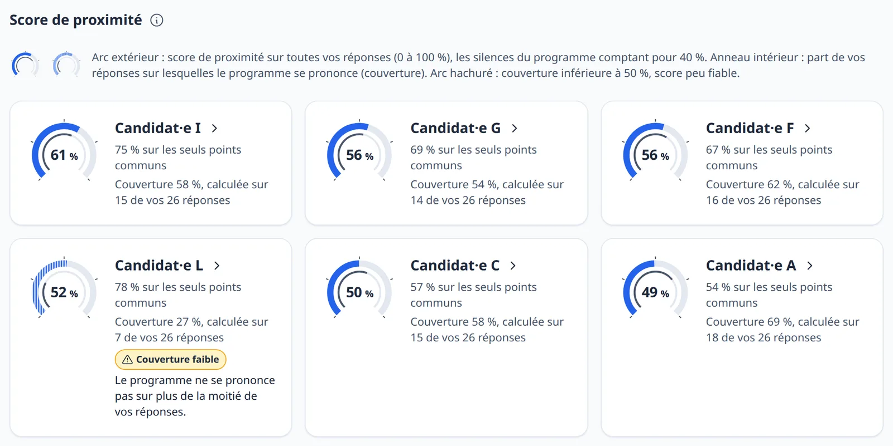
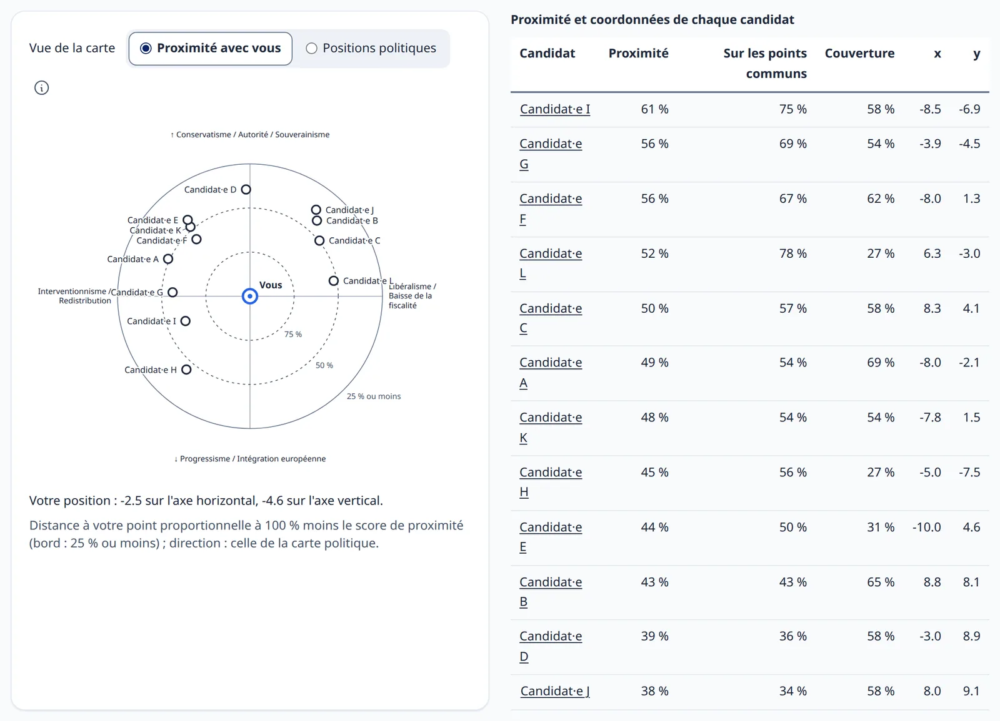
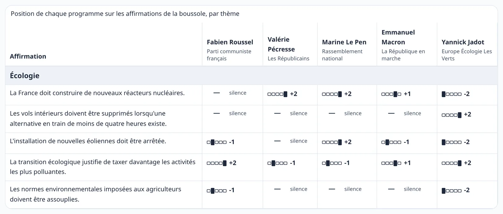
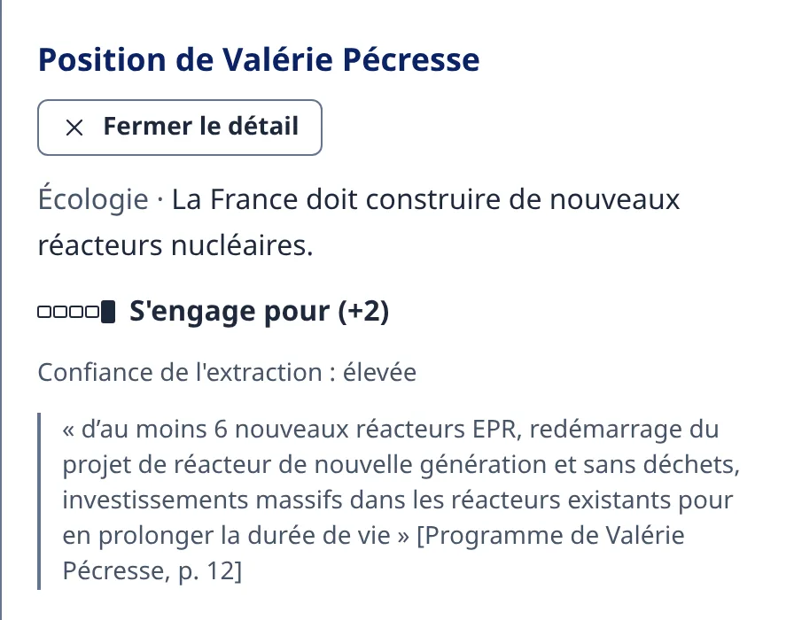
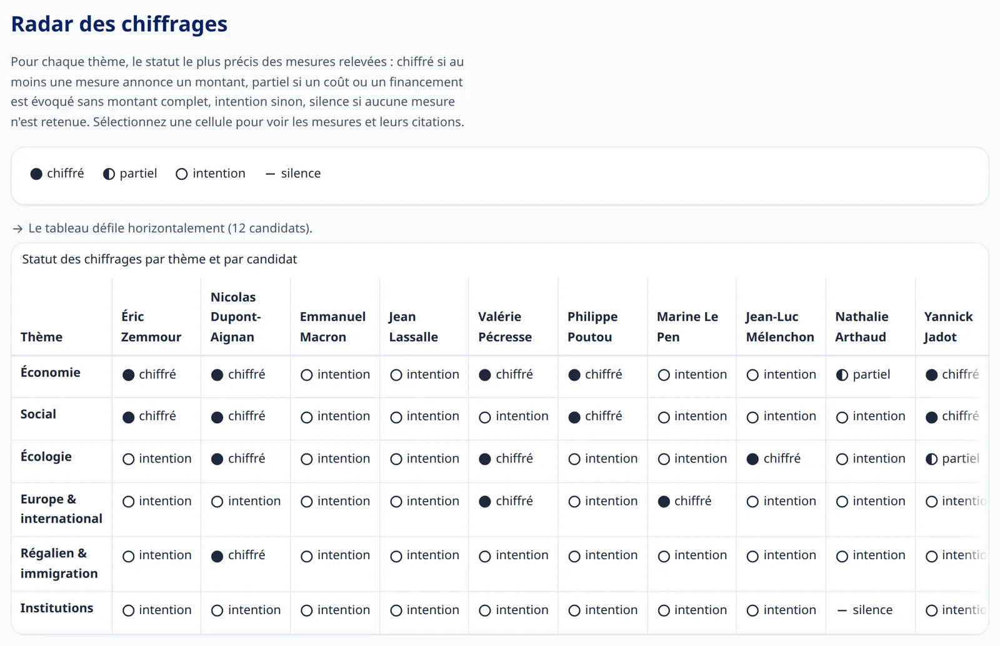


Knowing what the candidates actually propose, from their official manifestos and nothing else: you
ask your question in plain French, and the answer reports, candidate by candidate, what their
documents say, with the exact quote behind every sentence. A compass also places your answers
relative to each manifesto.





24 official documents from the 12 candidates of 2022
found word for word in their excerpt, over 60 questions
measured average cost of the fast mode (Claude Haiku)





**Work in progress.** This page describes the repository as of 28 November 2026, eleven days
after the first commit (30 merged pull requests). The engine, the search and the chat are
evaluated on the 2022 presidential election; the 2027 manifestos will be added as they are
published.



**The compass screenshots show a fictional profile** (26 answers out of 30, ecology counted
double), displayed in **blind mode**: candidates appear as randomly drawn aliases, because what
matters here is the calculation, not the name of whoever comes first. The positions, comparison
and cross-examination screenshots show the names: they only report the content of public
documents. The cross-examination answer is a real fast-mode answer, obtained on 28 November 2026.
The app only exists in French, so the screenshots show the French interface.


## The problem

Existing election compasses ask thirty or so questions and place the user on a map. Two things
usually stay hidden: **where the candidates' positions come from** (who coded them, from which
texts) and **how the score is computed**. If a manifesto says nothing about a topic, does the
candidate agree, disagree, or sit in the middle? The answer changes the ranking, and it is rarely
stated.

Meanwhile, the manifestos themselves run to dozens of pages each. Comparing what twelve
candidates propose on the retirement age means opening twenty-four PDFs.

I wanted a tool that:

- relies **only on official manifestos**, no press, no interviews;
- **quotes** its source for every position and every answer, with the page number;
- **never ranks** candidates and never recommends a vote;
- computes everything that touches the user's opinions **in their browser**: answers are never
  sent to any server;
- **measures itself**: a backtest on a past election, with published figures, rather than a
  promise of neutrality.

## Where the project stands




Specification written from an interview (architecture, data model, formulas, neutrality
safeguards), then a pnpm and uv monorepo, JSON schemas as the single source of types, fictional
demo data, continuous integration.



Proximity, projections on two axes and by principal component analysis, questionnaire, political
map, blind mode, "What if" simulator, a share link that encodes the answers after the `#` of the
address.



Download of the archived manifestos and official election statements (with their sha256
fingerprint), page-by-page extraction, chunking, indexing with two embedding models, a hybrid
search service per candidate.



Streaming chat with verified quotes, a spending cap and an in-memory cache; extraction of 360
positions and 343 measures by Claude Sonnet, side-by-side comparison and costing radar.



Search recall, quote faithfulness, false silences, effect of presentation order, synthetic
profiles, comparison with an expert survey; a reproducible report and eleven decisions drawn from
it.



Keyboard navigation, reflow at 320 px, axe audit in continuous integration, methodology and
accessibility pages, a production Docker Compose behind Caddy, a strict content security policy.



The cross-examination becomes the home page; the proximity score accounts for what manifestos
leave out; candidates lose any colour or shape; a new proximity map.




## Cross-examining the manifestos

This is the home page, and the core feature. You ask a question in French, narrow or broad; the
answer summarises, candidate by candidate, what their official documents say, with a quote number
behind each proposal. One setting limits the question to some candidates or to a theme, another
chooses between the **fast answer** (Claude Haiku) and the **detailed answer** (Claude Sonnet).


### The path of a question


flowchart LR
    Q["Question"] --> A["/api/ask<br/>rate limit, daily cap"]
    A --> R["Search service<br/>FastAPI"]
    R --> S["Meaning<br/>multilingual-e5-large, pgvector"]
    R --> L["Exact words<br/>Postgres full text"]
    S --> F["RRF fusion<br/>4 excerpts per candidate"]
    L --> F
    F --> C["Claude<br/>native citations, streaming"]
    C --> V["Verification<br/>quote within its excerpt"]
    V --> U["Displayed answer<br/>tokens replaced by names"]


The four steps (splitting, search, generation, verification) and the measurements that guided
their settings are detailed in the next section.

**Safeguards.** The content of questions is never logged: a question can reveal a political
opinion, sensitive data under the GDPR. Logs keep only the time, tokens, latency and status code.
A rate limit per IP address (in-memory counter), a **daily spending cap** and an in-memory-only
cache (500 answers, 24 hours, emptied on every reindexing) keep costs in check.

## Under the hood: from PDF to verified quote



An assistant of this kind is a **RAG** (retrieval-augmented generation): the language model does
not answer from memory, it writes from excerpts that a search engine handed it. The quality of
the answer therefore depends first on three upstream steps: how the documents are split, how
meaning is represented, and how the search is done. A wrong answer often comes from an excerpt
that was never found.

Every choice in this pipeline has its own **[marimo](https://marimo.io) notebook** in the
repository (`notebooks/m2-*.py`). They all follow the same outline: question, alternatives
considered, formalisation, experiment, results and limits, decision. They are plain Python files,
run by continuous integration. Since CI has neither the database, nor the model weights, nor the
PDFs, they read small versioned *fixtures* produced from the real data. The measurements were
made twice: first on a **smoke-test set** of 15 hand-annotated questions, then on the **full set
of 60 questions** used for the backtest. The results below come from them.

### 1. Splitting: excerpts that follow the sections

An excerpt is the unit that gets retrieved, sent to the model and quoted. Three ways of splitting
were compared:

| Option | For | Against |
|---|---|---|
| Fixed windows of N tokens | simple | cuts through sentences and sections |
| One page per excerpt | the quoted page is obvious | very uneven sizes (covers, dense pages) |
| **Headings and sentences grouped between 300 and 600 tokens** (chosen) | follows sections, bounded sizes | more code, overlap to handle |

The text is split into units (headings, sentences), grouped up to 600 tokens, with an overlap of
at most 50 tokens when the cut is forced by size. Each excerpt keeps its candidate, document,
pages, section title, archive address and the PDF's sha256 fingerprint. The notebook checks
**invariants** with assertions, so any deviation fails CI: no excerpt above 600 tokens, at most one
short excerpt per document (the last one), no missing metadata, and every page that contains text
covered by at least one excerpt.


type: 'bar',
data: {
  labels: ['< 300', '300-349', '350-399', '400-449', '450-499', '500-549', '550-600'],
  datasets: [
    { label: 'Excerpts', data: [13, 46, 48, 42, 55, 83, 507],
      backgroundColor: css(modeSombre ? '--color-primary-400' : '--color-primary-600'),
      borderColor: css(modeSombre ? '--color-primary-300' : '--color-primary-700') }
  ]
},
options: {
  plugins: {
    legend: { display: false },
    title: { display: true, text: 'Size of the 794 excerpts (tokens)' },
    subtitle: { display: true, text: 'Median 568 tokens: grouping nearly always fills the excerpt' }
  },
  scales: { y: { title: { display: true, text: 'Number of excerpts' } } }
}


The edge cases found come mostly from the PDFs themselves. 78 excerpts span three pages or more
(sparsely filled pages): the quote then gives a page range. 13 excerpts contain a doubled word,
almost all from a single candidate whose embossed headings are read twice. They were left as is:
fixing them would alter the official text being quoted, for a small measured effect on search.

Volume varies a lot between candidates: **from 21 to 252 excerpts**. This reflects the length of
the published manifestos, not a pipeline choice. It is why search runs **candidate by
candidate**: across the whole corpus, the longest manifesto would take most of the top results.

### 2. Representing meaning: two embedding models compared

Search by meaning turns every excerpt and every question into a vector of 1,024 numbers (an
*embedding*), so that two texts about the same thing have close vectors, even with no word in
common. Closeness is measured by the cosine of the angle between the two vectors.

API models (OpenAI, Voyage…) were ruled out from the start: a question can reveal a political
opinion, and it would have been sent to a third party. That left two multilingual models that run
locally:

| | bge-m3 | multilingual-e5-large |
|---|---|---|
| Context read | 8,192 tokens | 512 tokens |
| Specifics | no excerpt truncated | mandatory `query:` and `passage:` prefixes |
| Observed similarities (nuclear question) | 0.23 to 0.58 | 0.73 to 0.85 |

Two findings from notebook `m2-02`. First, **574 of the 794 excerpts exceed 512 tokens**: e5 only
reads their beginning. Second, its similarities are packed into a narrow, high range; what matters
for ranking is the gap between relevant and other excerpts, relative to the spread, and it is
comparable for both models. An absolute similarity threshold would therefore mean nothing shared
by the two models. The service uses none: every candidate always gets its four excerpts, and it
is up to the language model to say that none addresses the question.

On the smoke-test set (13 questions with expected excerpts), the gap between the two models was
inconclusive: the confidence interval touched zero, and bge-m3 stayed the default. On the 60
questions, e5 wins despite truncation: **+0.071 points of recall@4** for meaning-only search, with
a 95% paired bootstrap interval of [+0.033; +0.110], and +0.046 [+0.021; +0.074] once fused with
exact words. It became the default model.

### 3. Searching by meaning and by words, then fusing

Meaning alone misses rare, exact terms: acronyms (RIC, SMIC, NATO), names of schemes. Exact words
alone depend on the question's vocabulary. So both are done, for each candidate, and the two
rankings are merged with **Reciprocal Rank Fusion** (RRF). For an excerpt \(d\), with \(r_s(d)\)
its rank in the meaning list and \(r_\ell(d)\) its rank in the exact-word list (the term drops out
if the excerpt is not in that list):

$$\text{RRF}(d) = \frac{1}{60 + r_s(d)} + \frac{1}{60 + r_\ell(d)}$$

Fusion only looks at ranks. It never has to compare a cosine with a full-text score, two
quantities on different scales that a weighted combination would have to calibrate for each
model. The constant 60 flattens the gaps: an excerpt ranked first by meaning and absent from the
exact-word list gets \(1/61 \approx 0.0164\); an excerpt ranked third in both lists gets
\(2/63 \approx 0.0317\) and moves ahead. Being ranked well by both methods counts for more than
being first in one.

A case from the 60-question set: "What do the candidates propose on the citizens' initiative
referendum?", for a candidate with a single excerpt that really deals with it. By meaning, that
excerpt only comes sixth, outside the four kept. By exact words, it is first, because
"référendum" appears in only 4% of the corpus's excerpts. Fusion ranks it second:

| Rank after fusion | Rank by meaning | Rank by exact words | RRF score | Addresses the question |
|---|---|---|---|---|
| 1 | 3 | 2 | 1/63 + 1/62 = 0.03200 | no |
| 2 | 6 | 1 | 1/66 + 1/61 = 0.03155 | **yes** |
| 3 | 2 | 5 | 1/62 + 1/65 = 0.03151 | no |
| 4 | 4 | 4 | 2/64 = 0.03125 | no |

Across the 463 question and candidate pairs that have expected excerpts, fusion brings a relevant
excerpt into the four kept for **31 pairs** where meaning alone had none, and pushes one out for 16
pairs. The balance is positive, but fusion is not free.

**The lexeme that drowned everything.** The first version of exact-word search took every word of
the question, joined by OR. Notebook `m2-03` showed what Postgres made of it, with the French
configuration, for "Quel âge de départ à la retraite proposent les candidats ?" (what retirement
age do the candidates propose?):

| Lexeme | Share of excerpts containing it |
|---|---|
| `le` (from "les", the) | **99.4%** |
| `retrait` | 16.2% |
| `âge` | 8.9% |
| `départ` | 8.1% |
| `quel` | 6.9% |
| `candidat` | 5.3% |
| `proposent` | 1.1% |

"le" is in Postgres's French stop-word list, but "les" is not, and is then reduced to the stem
`le`. With an OR query, almost every excerpt matched, and ranking favoured those where "les"
comes up often. Exact-word search became close to random, and fusion **degraded** meaning instead
of complementing it. The fix ignores lexemes present in more than half of the election's excerpts
(`MAX_DF = 0.5`), counted in SQL at query time: it covers any ubiquitous word, not just this one,
without reindexing. Other stemming limits show up along the way: "proposent" (propose) is not
reduced, and so passes for a rare word.


type: 'line',
data: {
  labels: ['1', '2', '3', '4', '5', '6'],
  datasets: [
    { label: 'RRF fusion (served)', data: [66.3, 79.3, 85.7, 89.2, 90.5, 92.2], borderWidth: 3,
      borderColor: css(modeSombre ? '--color-primary-400' : '--color-primary-600'),
      backgroundColor: css(modeSombre ? '--color-primary-400' : '--color-primary-600') },
    { label: 'Meaning only', data: [59.4, 74.5, 81.2, 86.0, 87.9, 89.8],
      borderColor: css(modeSombre ? '--color-secondary-400' : '--color-secondary-500'),
      backgroundColor: css(modeSombre ? '--color-secondary-400' : '--color-secondary-500') },
    { label: 'Exact words (fixed)', data: [53.1, 69.5, 76.0, 80.1, 84.0, 86.2],
      borderColor: css(modeSombre ? '--color-neutral-300' : '--color-neutral-600'),
      backgroundColor: css(modeSombre ? '--color-neutral-300' : '--color-neutral-600') },
    { label: 'Fusion before the fix', data: [45.6, 61.3, 68.7, 74.5, 79.0, 82.5], borderDash: [6, 4],
      borderColor: css(modeSombre ? '--color-primary-200' : '--color-primary-300'),
      backgroundColor: css(modeSombre ? '--color-primary-200' : '--color-primary-300') },
    { label: 'Exact words before the fix', data: [22.9, 33.0, 42.1, 46.7, 52.1, 55.9], borderDash: [6, 4],
      borderColor: css(modeSombre ? '--color-neutral-500' : '--color-neutral-400'),
      backgroundColor: css(modeSombre ? '--color-neutral-500' : '--color-neutral-400') }
  ]
},
options: {
  plugins: {
    title: { display: true, text: 'Share of question and candidate pairs with at least one relevant excerpt in the top k' },
    subtitle: { display: true, text: '60 questions, 463 pairs, multilingual-e5-large. The service keeps k = 4.' }
  },
  scales: {
    x: { title: { display: true, text: 'k (excerpts kept per candidate)' } },
    y: { min: 0, max: 100, title: { display: true, text: '%' } }
  }
}


On the 60-question set, the fix raises the recall@4 of exact-word search from 0.282 to 0.598, and
that of fusion from 0.517 to 0.719. Before the fix, fusion did worse than meaning alone (0.636).
The notebook records one limit: relevant excerpts were found by reading the corpus from keywords,
which favours exact-word search and probably overstates the gain. The diagnosis itself (`le` in
99% of excerpts) does not depend on the annotation.

### 4. Generating under constraints, then verifying

Each candidate's four excerpts are sent to Claude as documents, with the API's **native
citations** enabled: each citation points to a specific document and passage, instead of a
reference the model would write freely. The system prompt, versioned in the repository, requires:

- using only the excerpts, no outside knowledge;
- one quote per sentence that reports a proposal;
- covering each candidate in the imposed order, **drawn at random for every question**, with
  comparable space (two to four sentences);
- writing exactly "Aucune proposition recensée dans le programme officiel sur ce point" (no
  proposal found in the official manifesto on this point) when a candidate does not address it,
  without commenting on what the excerpts do not say;
- never assessing, comparing or ranking, and declining to say whom to vote for.

The model never sees the names: each excerpt is titled `{{c3}} · programme · p. 6`, and it writes
these tokens in its answer. The browser replaces them with the name, or with the blind-mode alias.
One answer serves both modes, and blind mode does not depend on an instruction the model might
forget.

On receipt, each quote is searched for in the excerpt it points to, ignoring whitespace, and that
excerpt must belong to the candidate of the current section; otherwise it is shown as
"unverified". A list of phrasings that would rank a candidate ("best", "more credible"…) is also
detected and flagged.

**Does a silence come from the manifesto or from the search?** Notebook `m2-04` analysed two real
answers to "What do the candidates propose on nuclear power?", one in fast mode and one in
detailed mode, recorded before the full-text fix. In each, four candidates are declared silent,
always with the imposed sentence word for word, and no name or party appears in the text. But
checked against the annotations, **only one of these silences is real**. The other three candidates
do talk about nuclear power, and for each of them **none of the four excerpts served was
relevant**. The model had followed the instruction; the error came from the search. After the
fix, two of those three candidates get a relevant excerpt.

That diagnosis shaped the backtest: false silences are measured separately there, and compared
with the search's hit@4. They remain the first measured defect (around 8%, see below), and it is
the search that has to improve to reduce them, not the prompt.

## The election compass

The cross-examination answers a specific question; the compass gives an overall picture. At
calculation time it calls no language model: everything happens in the browser, from the
candidates' positions, whose origin is described below.

### A compass of 30 statements

The compass presents **30 statements**, five per theme (economy, social, ecology, Europe and
international affairs, law and order and immigration, institutions). Each one is about a measure a
manifesto can settle ("The legal retirement age should be brought back to 60"), and their
direction alternates to limit acquiescence bias. Answers range over five levels, from "strongly
disagree" to "strongly agree", or "no opinion"; each theme can count once, twice or three times.


Nothing entered ever leaves the browser. The calculation engine is a TypeScript package with no
dependency and no network access, and a test checks this on every change. To come back later or
share one's answers, a link encodes them after the `#` of the address, a part browsers never send
to the server.

### The proximity score

The score starts from a simple distance. For each statement on which the user **and** the
manifesto take a position, we measure the gap between the two (from -2 to +2, so a gap of 0 to
4), weighted by the theme's weight:

```
proximity = 100 × (1 − Σ w·|u − c| / Σ w·4)
```

where `u` is the user's answer, `c` the manifesto's position and `w` the theme's weight. Identical
answers give 100%, opposite answers give 0%.

This first formula has a flaw, which the backtest brought out. It only counts **common ground**: a
manifesto that takes a position on 7 statements out of 30 has a proximity computed on 7 answers,
and can show 78% because it agrees with you on the few topics it covers. On synthetic profiles,
the two least detailed manifestos stayed on top even with a lot of noise in the answers.

The **adjusted score**, the one shown on the dial and used to order the results, therefore
covers **all** of the user's answers:

```
adjusted = (W_common × proximity + W_silent × 40 + 5 × 50) / (W_common + W_silent + 5)
```

- each common statement counts for the proximity computed above;
- each statement on which the manifesto **is silent** counts for **40%**, slightly below neutral;
- **five dummy statements at 50%** smooth the score when the user has answered little.

Two examples from the methodology page (weights of 1): 75% on 5 common statements with 21
silences gives (5×75 + 21×40 + 250) / 31 = **47**; 66% on 14 common statements with 12 silences
gives (14×66 + 12×40 + 250) / 31 = **53**. The second manifesto moves ahead even though its raw
proximity is lower: it took a position on twice as many of your answers.



Under each score, the proximity on common ground only and the **coverage** ("computed on 15 of
your 26 answers") remain visible, with a warning below 50%. The 40 and the 5 are settings, not
objective values: counting a silence below neutral slightly penalises short manifestos. The
methodology page says so plainly.

### Two maps

The **proximity map**, the default view, puts the user at the centre. Each candidate sits at a
distance proportional to 100% minus their adjusted score (the edge of the circle means 25% or
less), in the direction they have relative to you on the political map. Distances thus reflect
scores. A keyboard-accessible table repeats the same figures.



The **political positions map** places manifestos on two axes: economy (redistribution versus
lower taxes) and society and sovereignty (progressivism and European integration versus authority
and sovereigntism). Each statement is attached to an axis, with a direction and a weight, and the
same formula is used for the user and for the candidates:

```
X = 10 × Σ w·direction·v / Σ w·2        (from -10 to +10)
```

The candidates' coordinates are thus **computed from their positions, never entered by hand**. A
second mode replaces these chosen axes with the first two components of a principal component
analysis of the positions, with the share of explained variance and the statements that
contribute most.

 are indicative only: the score is computed from the answers, not from the map. All candidates share the same neutral dot, with no colour or shape.")

### A manifesto in detail, and blind mode

Clicking a candidate opens the detailed comparison: statements where you agree (gap of 0 or 1),
moderate gaps, disagreements (gap of 3 or 4) and the manifesto's silences, each with the quote
that grounds the position.


**Blind mode** replaces names and parties with aliases everywhere: results, maps, comparison and
chat answers. It is for reading manifestos without the label effect. Outside the compass results,
the order of candidates is **drawn at random on every visit**, and no candidate ever has a colour
of their own. Finally, the "What if…" simulator lets you change an answer or a weight from the
results page and watch every score move.

### The positions, and where they come from

The Positions tab shows the full table: for each statement and each candidate, the position
retained, from "commits against" (-2) to "commits for" (+2), or silence. A cell opens the quoted
passage, with its page.





These 360 positions (12 candidates × 30 statements) are proposed by a model, Claude Sonnet,
through a procedure designed to limit what it can project:

1. for each candidate and statement pair, the search keeps the **6 manifesto excerpts** closest to
   the statement;
2. the model receives them **without the candidate's name or the document title**, with
   instructions to use no outside knowledge and to answer "silence" whenever it would have to
   guess;
3. it returns a value from -2 to +2 (or silence), a confidence level and **at least one exact
   quote**;
4. each quote is **searched for word for word** in its excerpt: a position whose quote is not found
   is discarded.

Of the 360 positions, 157 are silences: a manifesto does not take a stand on every statement.
Human review was planned position by position. **For 2022, the 360 positions and 343 measures
were approved in bulk**, without individual review, and every decision carries that note: what is
displayed is the model's proposal, filtered by the automatic checks. It is the first limitation
listed in the methodology.

### The comparison and the costing radar

The comparison puts two or three manifestos side by side, theme by theme: their flagship measures,
the announced cost when there is one, then the statements on which they are opposed (gap of 3 or
4). An amount is kept only if it appears in the costing quote.

, partial, or a stated intention only.")

The radar summarises, for each theme and each candidate, the most precise status of their
measures: costed, partial, intention or silence. It is a grid of pictograms rather than a polar
chart: each status has a pictogram **and** a label, so the information is not carried by shape or
colour alone.



## How it is evaluated

Before plugging in 2027, everything was measured on the **2022 presidential election**: 12
candidates, a set of **60 annotated questions** (including "trap" questions on topics a candidate
does not address), a report generated by a command and versioned.

### Search

| Model | Meaning only | Exact words only | RRF fusion |
|---|---|---|---|
| bge-m3 | 0.565 | 0.598 | 0.673 |
| multilingual-e5-large | 0.636 | 0.598 | **0.719** |

*Recall@4: share of the expected relevant excerpts (at most 4 per candidate) found among the 4
retained, averaged over questions.*

Fusion beats each method alone with both models, and e5 beats bge-m3 (gaps and intervals in the
previous section). For 89% of
question and candidate pairs, at least one relevant excerpt is retrieved.

### The chat

| Measure | Fast (Haiku) | Detailed (Sonnet) |
|---|---|---|
| Quotes found in their excerpt | 99.4% | 99.6% |
| Correct silences (candidate not addressing the topic) | 96.8% | 96.0% |
| False silences (candidate addressing it, declared silent) | 7.3% | 8.9% |
| Declines to steer the vote | 100% | 100% |
| Unsupported claims according to a judge model | 2.3% | 2.1% |
| Cost for the 60 questions | $0.43 | $7.72 |

The judge is a second model that sees only the quoted passages and says, claim by claim, whether
it is supported. Of 12 "unsupported" claims drawn at random and checked by hand against the
corpus, **none was made up**: eight were remarks about absence ("the document does not
mention…") instead of the silence sentence, four were accurate but not quoted. Prompt v2 therefore
forbids such remarks and requires one quote per sentence; unsupported claims went from 2.3% to
1.3%.

For equivalent faithfulness, the fast mode costs about eighteen times less: Haiku remains the
default model. The first measured weakness is **false silences**, around 8%: they mostly come from
search (the right excerpt is not in the top 4). Moving to 6 excerpts per candidate reduces them
slightly (6.5%) but costs 40% more and pushes unsupported claims back up: the gain is not
established on one run, so k = 4 stayed.

### Neutrality and positions

- **Order effect**: the same question asked with the candidates' order drawn several times.
  Sections at the end of the list are slightly shorter (rank correlation of -0.12, brought down to
  -0.06 by prompt v2). Drawing the order for every question spreads this effect across candidates.
- **Synthetic profiles**: 200 respondents per candidate, modelled on their positions with noise.
  The original candidate comes first in 96.5% of cases (91.8% with heavy noise). It is an
  optimistic test, since the profiles derive from the very positions they discriminate between; it
  is the one that revealed the advantage of sparse manifestos, and led to the adjusted score.
- **External references**: the order of candidates on the two axes matches the Chapel Hill Expert
  Survey's expert ratings of their parties, with a rank correlation of 0.83 to 0.90 depending on
  the axis and the wave. On 8 candidates only: it points to a consistent ordering, not to the
  accuracy of each position.

The whole backtest cost **$11.39** in model calls.

## How it is built

- **A single source for types**: the data (statements, positions, measures, excerpts, chat
  requests) is described by JSON schemas, from which TypeScript types and Pydantic models are
  generated. The front end only loads positions with an approved or corrected status, a filter
  applied twice: when the files are generated and when they are loaded.
- **Two implementations of the score, one behaviour**: the browser's TypeScript engine and a Python
  reference share a fixture of computed cases, checked in continuous integration. The engine was
  written test-first, with property tests (symmetry, bounds, invariance when all weights are
  multiplied). The repository has 509 automated tests, 260 in Python and 249 in TypeScript.
- **Notebooks that justify the choices**: every design decision (proximity formula, projection,
  embeddings, RRF fusion, neutrality prompt, position extraction) has its marimo notebook in the
  repository, with the figures that settled it.
- **One service per role**: Next.js (interface and chat route), a FastAPI service that loads the
  embedding model and runs the search, PostgreSQL with pgvector. The same Docker Compose runs
  locally and in production, behind Caddy for TLS, with a strict nonce-based content security
  policy.
- **Accessibility**: targeting RGAA 4.1 and WCAG 2.1 AA, axe audit in the end-to-end tests, full
  keyboard navigation, reflow at 320 px, a published accessibility statement.
- **Open**: code under AGPL-3.0, so a modified hosted instance must publish its code; derived data
  under CC BY-SA 4.0. Prompts, approved positions, evaluation reports and implementation notes are
  in the repository.


**Known limitations.** The 2022 positions were approved in bulk, without individual review. About
8% of candidates who address a topic are declared silent by the chat. One candidate's manifesto
is only available in its short version. The 30 statements, the two axes and the adjusted score's
settings are editorial choices: other choices would give other results. The question set was
annotated with the help of agents, and the manual coding sheet for the positions has yet to be
filled in.


## What I take from it

- **Computing the score is a choice as much as a formula.** Proximity on common ground alone is
  mathematically clean, and yet it produced a misleading ranking. It took synthetic profiles to see
  it, and two iterations to reach a formula that counts silences, with its settings shown rather
  than hidden.
- **A language's stop words can break a hybrid search.** A single stem present everywhere was
  enough to make exact-word search worse than meaning alone. The filter is one line of SQL; finding
  it took a smoke-test set and a recall measurement.
- **What can be checked mechanically gets checked.** Native citations, searching every quote in
  its excerpt, names replaced by tokens: these checks do not depend on the model's good will, and
  they are what produce the 99% in the table.
- **An automatic judge is a starting point.** The "unsupported" claims flagged by the judge were
  not fabrications but remarks about absence; only checking a sample by hand showed it, and it
  steered the prompt fix.
