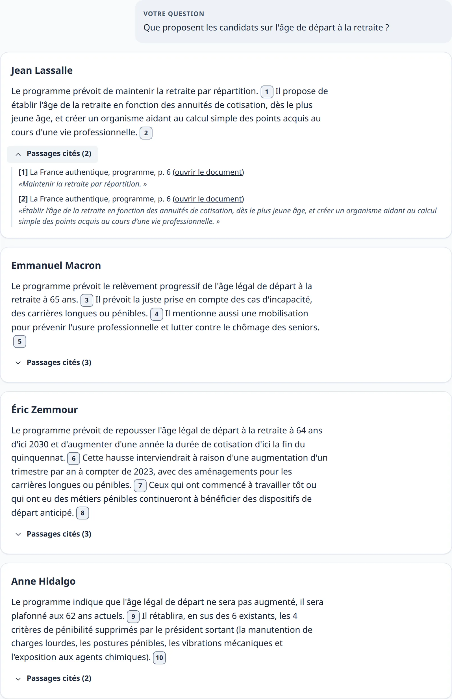
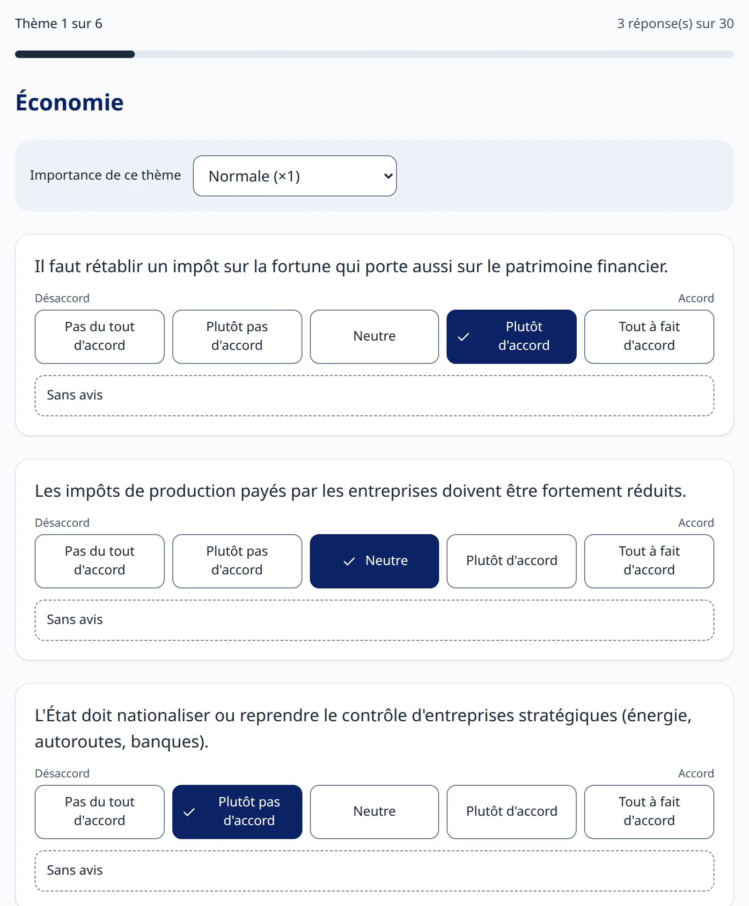
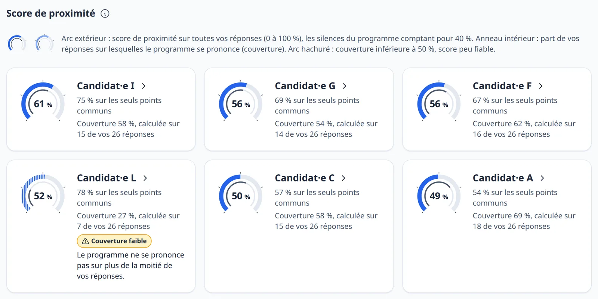
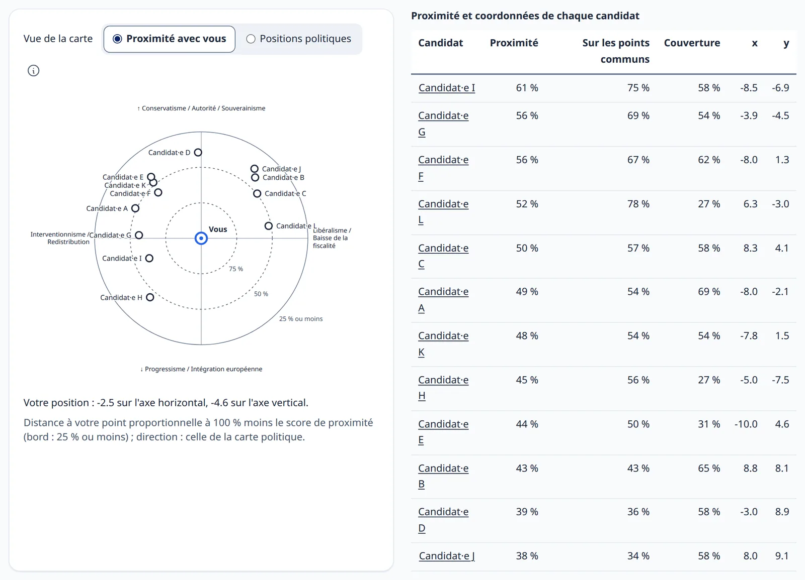
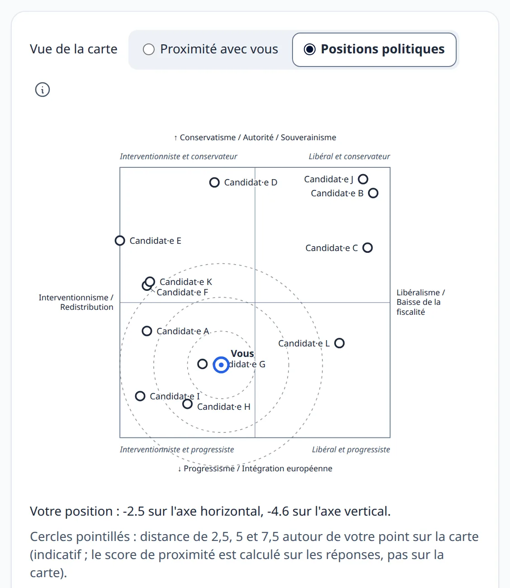
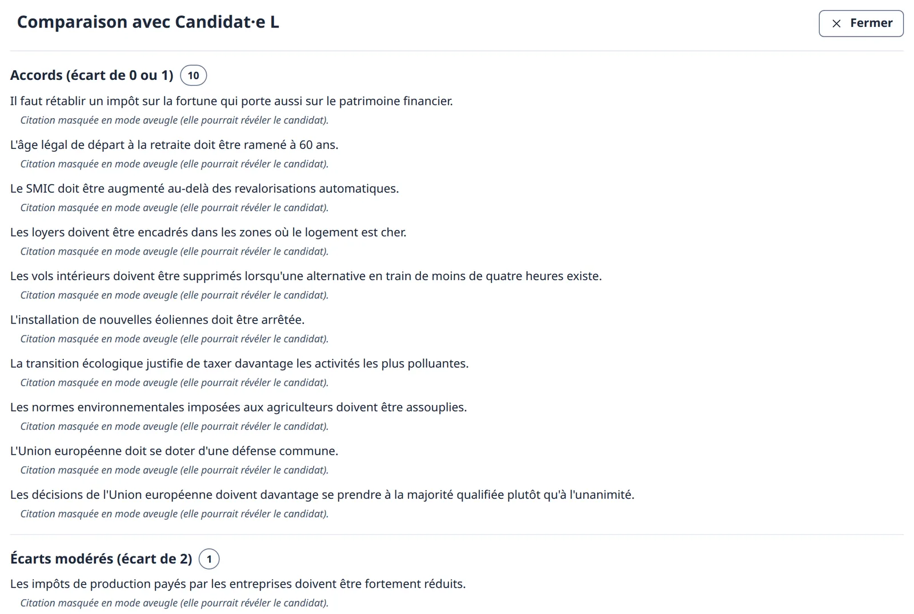
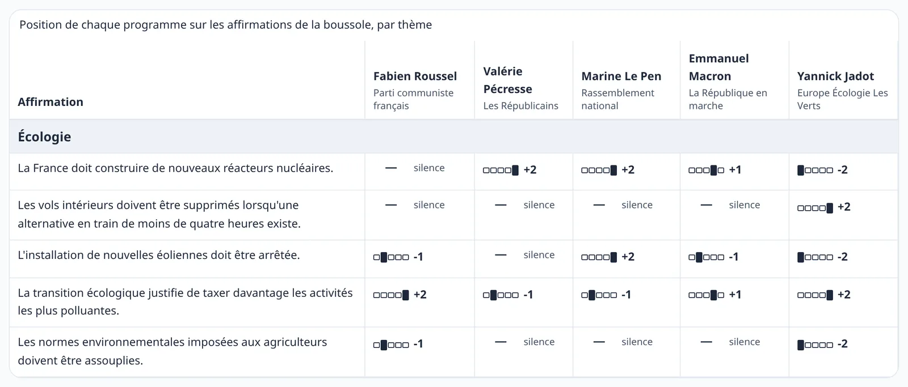
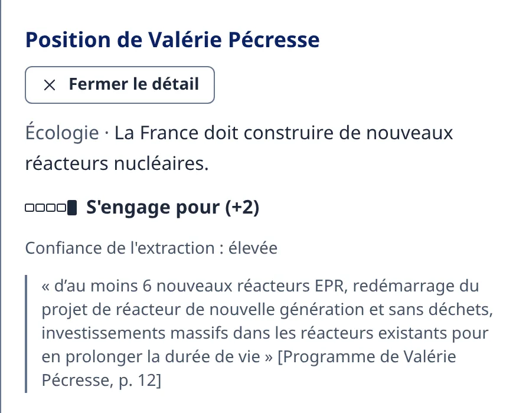
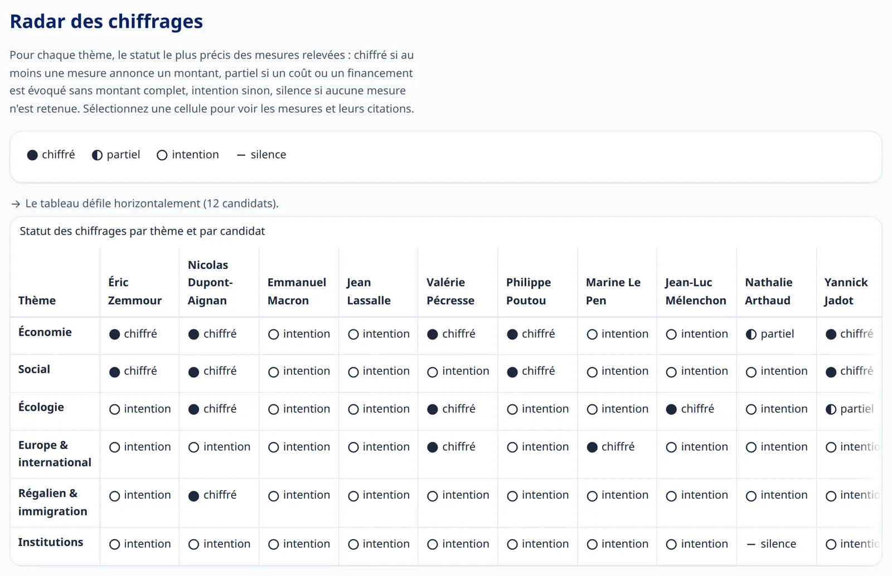


Savoir ce que proposent vraiment les candidats, à partir de leurs programmes officiels et de rien
d'autre : on pose sa question en français, et la réponse rapporte, candidat par candidat, ce que
disent leurs documents, avec la citation exacte derrière chaque phrase. Une boussole situe en plus
vos réponses par rapport à chaque programme.





24 documents officiels des 12 candidats de 2022
retrouvées mot pour mot dans leur extrait, sur 60 questions
coût moyen mesuré du mode rapide (Claude Haiku)





**Projet en cours.** Cette fiche décrit l'état du dépôt au 28 novembre 2026, onze jours après le
premier commit (30 pull requests fusionnées). Le moteur, la recherche et le chat sont évalués sur
la présidentielle 2022 ; les programmes de 2027 seront branchés au fil de leur publication.



**Les captures de la boussole montrent un profil fictif** (26 réponses sur 30, l'écologie comptée
double), affiché en **mode aveugle** : les candidats y sont des alias tirés au sort, parce que ce
qui compte ici est le calcul, pas le nom de celui qui arrive en tête. Les captures des positions,
du comparateur et de l'interrogatoire montrent les noms : elles ne font que rapporter le contenu
de documents publics. La réponse de l'interrogatoire est une vraie réponse du mode rapide, obtenue
le 28 novembre 2026.


## Le problème

Les boussoles électorales existantes posent une trentaine de questions et placent l'utilisateur
sur une carte. Deux choses y restent en général invisibles : **d'où viennent les positions des
candidats** (qui les a codées, à partir de quels textes) et **comment le score est calculé**. Un
candidat dont le programme ne parle pas d'un sujet est-il d'accord, en désaccord, neutre ? La
réponse change le classement, et elle est rarement dite.

À côté, les programmes eux-mêmes font des dizaines de pages chacun. Comparer ce que douze
candidats proposent sur l'âge de départ à la retraite demande d'ouvrir vingt-quatre PDF.

Je voulais un outil qui :

- ne s'appuie **que sur les programmes officiels**, sans presse ni interview ;
- **cite** sa source pour chaque position et chaque réponse, avec la page ;
- **ne classe jamais** les candidats et ne recommande aucun vote ;
- calcule tout ce qui touche à l'opinion de l'utilisateur **dans son navigateur** : ses réponses
  ne partent sur aucun serveur ;
- **se mesure** : un backtest sur une élection passée, avec des chiffres publiés, plutôt qu'une
  promesse de neutralité.

## Où en est le projet




Spécification écrite à partir d'une interview (architecture, modèle de données, formules,
garde-fous de neutralité), puis monorepo pnpm et uv, schémas JSON comme source unique des types,
données de démonstration fictives, intégration continue.



Proximité, projections sur deux axes et par analyse en composantes principales, questionnaire,
échiquier, mode aveugle, simulateur « Et si », lien de partage qui encode les réponses après le
`#` de l'adresse.



Téléchargement des programmes et professions de foi archivés (avec leur empreinte sha256),
extraction page par page, découpage, indexation avec deux modèles d'embedding, service de
recherche hybride par candidat.



Chat en streaming avec citations vérifiées, plafond de dépense et cache en mémoire ; extraction
des 360 positions et 343 mesures par Claude Sonnet, comparateur et radar des chiffrages.



Rappel de la recherche, fidélité des citations, faux silences, effet de l'ordre de présentation,
profils synthétiques, comparaison avec un panel d'experts ; un rapport reproductible et onze
décisions qui en découlent.



Navigation clavier, lecture à 320 px, audit axe en intégration continue, pages méthodologie et
accessibilité, Docker Compose de production derrière Caddy, politique de sécurité du contenu
stricte.



L'interrogatoire devient la page d'accueil ; le score de proximité tient compte des silences des
programmes ; les candidats perdent toute couleur et toute forme ; nouvelle carte de proximité.




## L'interrogatoire des programmes

C'est la page d'accueil, et la fonction centrale. On pose une question en français, précise ou
large ; la réponse résume, candidat par candidat, ce que disent leurs documents officiels, avec
un numéro de citation derrière chaque proposition. Un réglage limite la question à certains
candidats ou à un thème, un autre choisit entre la **réponse rapide** (Claude Haiku) et la
**réponse détaillée** (Claude Sonnet).



### Le parcours d'une question


flowchart LR
    Q["Question"] --> A["/api/ask<br/>limite de débit, plafond du jour"]
    A --> R["Service de recherche<br/>FastAPI"]
    R --> S["Sens des mots<br/>multilingual-e5-large, pgvector"]
    R --> L["Mots exacts<br/>plein texte Postgres"]
    S --> F["Fusion RRF<br/>4 extraits par candidat"]
    L --> F
    F --> C["Claude<br/>citations natives, streaming"]
    C --> V["Vérification<br/>citation dans son extrait"]
    V --> U["Réponse affichée<br/>jetons remplacés par les noms"]


Les quatre étapes (découpage, recherche, génération, vérification) et les mesures qui ont
guidé leurs réglages sont détaillées dans la section suivante.

**Garde-fous.** Le contenu des questions n'est jamais journalisé : une question peut révéler une
opinion politique, donnée sensible au sens du RGPD. Les journaux ne gardent que l'heure, les
tokens, la latence et le code retour. Une limite de débit par adresse IP (compteur en mémoire),
un **plafond de dépense quotidien** et un cache en mémoire seulement (500 réponses, 24 heures, vidé
à chaque réindexation) tiennent le coût.

## Sous le capot : du PDF à la citation vérifiée



Un assistant de ce type est un **RAG** (*retrieval-augmented generation*) : le modèle de langage
ne répond pas de mémoire, il rédige à partir d'extraits qu'un moteur de recherche lui a fournis.
La qualité de la réponse dépend donc d'abord de trois étapes en amont : le découpage des
documents, la représentation du sens et la recherche. Une réponse fausse vient souvent d'un
extrait qui n'a pas été retrouvé.

Chaque choix de cette chaîne a son **notebook [marimo](https://marimo.io)** dans le dépôt
(`notebooks/m2-*.py`). Ils suivent tous le même plan : question, alternatives envisagées,
formalisation, expérience, résultats et limites, décision. Ce sont des fichiers Python ordinaires,
exécutés par l'intégration continue. Comme la CI n'a ni la base, ni les poids des modèles, ni les
PDF, ils lisent de petites *fixtures* versionnées produites depuis les vraies données. Les mesures
ont été faites deux fois : d'abord sur un **jeu de fumée** de 15 questions annotées à la main,
puis sur le **jeu complet de 60 questions** du backtest. Les résultats ci-dessous en viennent.

### 1. Découper : des extraits qui respectent les sections

Un extrait est l'unité que l'on retrouve, que l'on envoie au modèle et que l'on cite. Trois
façons de découper ont été comparées :

| Option | Pour | Contre |
|---|---|---|
| Fenêtres fixes de N tokens | simple | coupe au milieu des phrases et des sections |
| Une page par extrait | la page citée est évidente | tailles très inégales (couvertures, pages denses) |
| **Titres et phrases regroupés entre 300 et 600 tokens** (retenu) | respecte les sections, tailles bornées | plus de code, chevauchement à gérer |

Le texte est découpé en unités (titres, phrases), regroupées jusqu'à 600 tokens, avec un
chevauchement de 50 tokens au plus quand la coupure est due à la taille. Chaque extrait garde son
candidat, son document, ses pages, son titre de section, l'adresse d'archive et l'empreinte sha256
du PDF. Le notebook vérifie des **invariants** par des assertions, si bien qu'un écart fait échouer
la CI : aucun extrait au-delà de 600 tokens, au plus un extrait court par document (le dernier),
aucune métadonnée manquante, et toute page qui contient du texte couverte par au moins un extrait.


type: 'bar',
data: {
  labels: ['< 300', '300-349', '350-399', '400-449', '450-499', '500-549', '550-600'],
  datasets: [
    { label: 'Extraits', data: [13, 46, 48, 42, 55, 83, 507],
      backgroundColor: css(modeSombre ? '--color-primary-400' : '--color-primary-600'),
      borderColor: css(modeSombre ? '--color-primary-300' : '--color-primary-700') }
  ]
},
options: {
  plugins: {
    legend: { display: false },
    title: { display: true, text: 'Taille des 794 extraits (tokens)' },
    subtitle: { display: true, text: 'Médiane 568 tokens : le regroupement remplit presque toujours l\'extrait' }
  },
  scales: { y: { title: { display: true, text: 'Nombre d\'extraits' } } }
}


Les cas limites relevés sont surtout dus aux PDF eux-mêmes. 78 extraits couvrent trois pages ou
plus (pages peu remplies) : la citation donne alors une plage de pages. 13 extraits contiennent un
mot doublé, presque tous chez un seul candidat dont les titres en relief sont lus deux fois. Ils
n'ont pas été corrigés : la correction modifierait le texte officiel cité, pour un effet mesuré
faible sur la recherche.

Le volume varie beaucoup d'un candidat à l'autre : **de 21 à 252 extraits**. Cela reflète la
longueur des programmes publiés, pas un choix du pipeline. C'est la raison pour laquelle la
recherche se fait **candidat par candidat** : sur l'ensemble du corpus, le programme le plus long
occuperait l'essentiel des premiers résultats.

### 2. Représenter le sens : deux modèles d'embedding comparés

La recherche par le sens transforme chaque extrait et chaque question en un vecteur de 1 024
nombres (un *embedding*), de sorte que deux textes qui parlent de la même chose aient des vecteurs
proches, même sans mot commun. La proximité se mesure par le cosinus de l'angle entre les deux
vecteurs.

Les modèles d'API (OpenAI, Voyage…) ont été écartés d'emblée : une question peut révéler une
opinion politique, et elle aurait été envoyée à un tiers. Restaient deux modèles multilingues qui
tournent en local :

| | bge-m3 | multilingual-e5-large |
|---|---|---|
| Contexte lu | 8 192 tokens | 512 tokens |
| Particularité | aucun extrait tronqué | préfixes `query:` et `passage:` obligatoires |
| Similarités observées (question nucléaire) | 0,23 à 0,58 | 0,73 à 0,85 |

Deux constats du notebook `m2-02`. D'abord, **574 des 794 extraits dépassent 512 tokens** : e5 n'en
lit que le début. Ensuite, ses similarités sont tassées dans une plage étroite et haute ; ce qui
compte pour le classement est l'écart entre extraits pertinents et autres, rapporté à l'étendue,
et il est comparable entre les deux modèles. Un seuil de similarité absolu n'aurait donc aucun
sens commun aux deux modèles. Le service n'en utilise pas : chaque candidat reçoit toujours ses
quatre extraits, et c'est au modèle de langage de dire qu'aucun ne traite la question.

Sur le jeu de fumée (13 questions avec des extraits attendus), l'écart entre les deux modèles
n'était pas concluant : l'intervalle de confiance touchait zéro, et bge-m3 est resté le modèle par
défaut. Sur les 60 questions, e5 l'emporte malgré la troncature : **+0,071 point de rappel@4** en
recherche par le sens seule, intervalle bootstrap apparié à 95 % de [+0,033 ; +0,110], et +0,046
[+0,021 ; +0,074] une fois fusionné avec les mots exacts. Il est devenu le modèle par défaut.

### 3. Chercher par le sens et par les mots, puis fusionner

Le sens seul rate les termes rares et exacts : sigles (RIC, SMIC, OTAN), noms de dispositifs. Les
mots exacts seuls dépendent du vocabulaire de la question. On fait donc les deux, pour chaque
candidat, puis on fusionne les deux classements par **Reciprocal Rank Fusion** (RRF). Pour un
extrait \(d\), avec \(r_s(d)\) son rang dans la liste par le sens et \(r_\ell(d)\) son rang dans la
liste par les mots exacts (le terme disparaît si l'extrait n'y figure pas) :

$$\text{RRF}(d) = \frac{1}{60 + r_s(d)} + \frac{1}{60 + r_\ell(d)}$$

La fusion ne regarde que les rangs. Elle n'a pas besoin de comparer un cosinus à un score de
plein texte, deux grandeurs d'échelles différentes qu'une combinaison pondérée obligerait à
calibrer pour chaque modèle. La constante 60 aplatit les écarts : un extrait premier par le sens
et absent des mots exacts obtient \(1/61 \approx 0{,}0164\) ; un extrait troisième dans les deux
listes obtient \(2/63 \approx 0{,}0317\) et passe devant. Être bien classé par les deux méthodes
compte plus qu'être premier dans une seule.

Un cas tiré du jeu de 60 questions : « Que proposent les candidats sur le référendum d'initiative
citoyenne ? », pour un candidat dont un seul extrait traite vraiment du sujet. Par le sens, cet
extrait n'arrive que sixième, hors des quatre retenus. Par les mots exacts, il est premier, parce
que « référendum » n'apparaît que dans 4 % des extraits du corpus. La fusion le place deuxième :

| Rang après fusion | Rang par le sens | Rang par les mots exacts | Score RRF | Traite la question |
|---|---|---|---|---|
| 1 | 3 | 2 | 1/63 + 1/62 = 0,03200 | non |
| 2 | 6 | 1 | 1/66 + 1/61 = 0,03155 | **oui** |
| 3 | 2 | 5 | 1/62 + 1/65 = 0,03151 | non |
| 4 | 4 | 4 | 2/64 = 0,03125 | non |

Sur les 463 couples question et candidat qui ont des extraits attendus, la fusion fait entrer un
extrait pertinent dans les quatre retenus pour **31 couples** où le sens seul n'en avait aucun,
et en fait sortir un pour 16 couples. Le solde est positif, mais la fusion n'est pas gratuite.

**Le lexème qui noyait tout.** La première version de la recherche par mots exacts prenait tous
les mots de la question, reliés par OU. Le notebook `m2-03` a montré ce que Postgres en faisait,
en configuration française, pour « Quel âge de départ à la retraite proposent les candidats ? » :

| Lexème | Part des extraits qui le contiennent |
|---|---|
| `le` (de « les ») | **99,4 %** |
| `retrait` | 16,2 % |
| `âge` | 8,9 % |
| `départ` | 8,1 % |
| `quel` | 6,9 % |
| `candidat` | 5,3 % |
| `proposent` | 1,1 % |

« le » figure dans la liste des mots vides de Postgres, mais pas « les », qui est ensuite
réduit à la racine `le`. Avec une requête en OU, presque tous les extraits correspondaient, et le classement
favorisait ceux où « les » revient souvent. La recherche par mots exacts devenait presque
aléatoire, et la fusion **dégradait** le sens au lieu de le compléter. Le correctif ignore les
lexèmes présents dans plus de la moitié des extraits de l'élection (`MAX_DF = 0,5`), comptés en
SQL au moment de la requête : il couvre tout mot omniprésent, pas seulement celui-ci, sans
réindexation. On voit au passage d'autres limites de la racinisation : « proposent » n'est pas
réduit, et passe donc pour un mot rare.


type: 'line',
data: {
  labels: ['1', '2', '3', '4', '5', '6'],
  datasets: [
    { label: 'Fusion RRF (servie)', data: [66.3, 79.3, 85.7, 89.2, 90.5, 92.2], borderWidth: 3,
      borderColor: css(modeSombre ? '--color-primary-400' : '--color-primary-600'),
      backgroundColor: css(modeSombre ? '--color-primary-400' : '--color-primary-600') },
    { label: 'Sens seul', data: [59.4, 74.5, 81.2, 86.0, 87.9, 89.8],
      borderColor: css(modeSombre ? '--color-secondary-400' : '--color-secondary-500'),
      backgroundColor: css(modeSombre ? '--color-secondary-400' : '--color-secondary-500') },
    { label: 'Mots exacts (corrigés)', data: [53.1, 69.5, 76.0, 80.1, 84.0, 86.2],
      borderColor: css(modeSombre ? '--color-neutral-300' : '--color-neutral-600'),
      backgroundColor: css(modeSombre ? '--color-neutral-300' : '--color-neutral-600') },
    { label: 'Fusion avant correctif', data: [45.6, 61.3, 68.7, 74.5, 79.0, 82.5], borderDash: [6, 4],
      borderColor: css(modeSombre ? '--color-primary-200' : '--color-primary-300'),
      backgroundColor: css(modeSombre ? '--color-primary-200' : '--color-primary-300') },
    { label: 'Mots exacts avant correctif', data: [22.9, 33.0, 42.1, 46.7, 52.1, 55.9], borderDash: [6, 4],
      borderColor: css(modeSombre ? '--color-neutral-500' : '--color-neutral-400'),
      backgroundColor: css(modeSombre ? '--color-neutral-500' : '--color-neutral-400') }
  ]
},
options: {
  plugins: {
    title: { display: true, text: 'Part des couples question et candidat avec au moins un extrait pertinent dans les k premiers' },
    subtitle: { display: true, text: '60 questions, 463 couples, multilingual-e5-large. Le service retient k = 4.' }
  },
  scales: {
    x: { title: { display: true, text: 'k (extraits retenus par candidat)' } },
    y: { min: 0, max: 100, title: { display: true, text: '%' } }
  }
}


Sur le jeu de 60 questions, le correctif fait passer le rappel@4 de la recherche par mots exacts
de 0,282 à 0,598, et celui de la fusion de 0,517 à 0,719. Avant correctif, la fusion faisait moins
bien que le sens seul (0,636). Une limite est notée dans le notebook : les extraits pertinents ont
été repérés en lisant le corpus à partir de mots-clés, ce qui avantage la recherche par mots
exacts et surestime sans doute le gain. Le diagnostic, lui (`le` dans 99 % des extraits), ne
dépend pas de l'annotation.

### 4. Générer sous contrainte, puis vérifier

Les quatre extraits de chaque candidat sont envoyés à Claude sous forme de documents, avec les
**citations natives** de l'API activées : chaque citation renvoie à un document et à un passage
précis, au lieu d'une référence que le modèle écrirait librement. Le prompt système, versionné
dans le dépôt, impose :

- de n'utiliser que les extraits, aucune connaissance extérieure ;
- une citation par phrase qui rapporte une proposition ;
- de traiter chaque candidat dans l'ordre imposé, **tiré au sort à chaque question**, avec une
  place comparable (deux à quatre phrases) ;
- d'écrire exactement « Aucune proposition recensée dans le programme officiel sur ce point »
  quand un candidat n'en parle pas, sans commenter ce que les extraits ne disent pas ;
- de ne jamais évaluer, comparer ou classer, et de refuser de dire pour qui voter.

Le modèle ne voit jamais les noms : chaque extrait est titré `{{c3}} · programme · p. 6`, et il
écrit ces jetons dans sa réponse. Le navigateur les remplace par le nom ou par l'alias du mode
aveugle. Une même réponse sert aux deux modes, et le mode aveugle ne dépend pas d'une consigne que
le modèle pourrait oublier.

À la réception, chaque citation est recherchée dans l'extrait auquel elle renvoie, à espaces
près, et cet extrait doit appartenir au candidat de la section en cours ; sinon elle s'affiche
« non vérifiée ». Une liste de formulations qui classeraient un candidat (« meilleur », « plus
crédible »…) est aussi repérée et signalée.

**Un silence vient-il du programme ou de la recherche ?** Le notebook `m2-04` a analysé deux
réponses réelles à « Que proposent les candidats sur le nucléaire ? », l'une du mode rapide,
l'autre du mode détaillé, enregistrées avant le correctif du plein texte. Dans chacune, quatre
candidats sont déclarés silencieux, toujours avec la phrase imposée mot pour mot, et aucun nom ni
parti n'apparaît dans le texte. Mais, confrontés aux annotations, **un seul de ces silences est
réel**. Les trois autres candidats parlent du nucléaire, et pour chacun **aucun des quatre extraits
servis n'était pertinent**. Le modèle avait donc appliqué la consigne ; l'erreur venait de la
recherche. Après le correctif, deux de ces trois candidats reçoivent un extrait pertinent.

Ce diagnostic a orienté le backtest : les faux silences y sont mesurés à part, et rapprochés du
succès@4 de la recherche. Ils restent le premier défaut mesuré (autour de 8 %, voir plus bas), et
c'est la recherche qu'il faut améliorer pour les réduire, pas le prompt.

## La boussole électorale

L'interrogatoire répond à une question précise ; la boussole donne une vue d'ensemble. Au moment du
calcul, elle ne fait appel à aucun modèle de langage : tout se passe dans le navigateur, à partir
des positions des candidats, dont l'origine est décrite plus bas.

### Une boussole de 30 affirmations

La boussole présente **30 affirmations**, cinq par thème (économie, social, écologie, Europe et
international, régalien et immigration, institutions). Chacune porte sur une mesure qu'un
programme peut trancher (« L'âge légal de départ à la retraite doit être ramené à 60 ans »), et
leur sens est alterné pour limiter le biais d'acquiescement. On répond sur cinq niveaux, de « pas
du tout d'accord » à « tout à fait d'accord », ou « sans avis » ; chaque thème peut compter
simple, double ou triple.



Rien de ce qui est saisi ne quitte le navigateur. Le moteur de calcul est un paquet TypeScript
sans aucune dépendance ni accès réseau, et un test le vérifie à chaque modification. Pour
reprendre plus tard ou partager ses réponses, un lien les encode après le `#` de l'adresse, partie
qu'un navigateur n'envoie jamais au serveur.

### Le score de proximité

Le score part d'une distance simple. Pour chaque affirmation où l'utilisateur **et** le programme
se prononcent, on mesure l'écart entre les deux positions (de -2 à +2, donc un écart de 0 à 4),
pondéré par le poids du thème :

```
proximité = 100 × (1 − Σ w·|u − c| / Σ w·4)
```

où `u` est la réponse de l'utilisateur, `c` la position du programme et `w` le poids du thème.
Deux réponses identiques donnent 100 %, deux réponses opposées donnent 0 %.

Cette première formule a un défaut, que le backtest a fait apparaître. Elle ne compte que les
**points communs** : un programme qui ne se prononce que sur 7 affirmations sur 30 a une proximité
calculée sur 7 réponses, et peut afficher 78 % parce qu'il est d'accord avec vous sur les rares
sujets qu'il aborde. Sur des profils synthétiques, les deux programmes les moins renseignés
restaient en tête même avec beaucoup de bruit dans les réponses.

Le **score ajusté**, celui du cadran et de l'ordre des résultats, porte donc sur **toutes** les
réponses de l'utilisateur :

```
ajusté = (W_communs × proximité + W_silences × 40 + 5 × 50) / (W_communs + W_silences + 5)
```

- chaque affirmation commune compte pour la proximité calculée ci-dessus ;
- chaque affirmation sur laquelle le programme **se tait** compte pour **40 %**, un peu sous le
  neutre ;
- **cinq affirmations fictives à 50 %** lissent le score quand l'utilisateur a peu répondu.

Deux exemples de la page méthodologie (poids de 1) : 75 % sur 5 affirmations communes avec 21
silences donnent (5×75 + 21×40 + 250) / 31 = **47** ; 66 % sur 14 affirmations communes avec 12
silences donnent (14×66 + 12×40 + 250) / 31 = **53**. Le second programme passe devant, alors que
sa proximité brute est plus faible : il s'est prononcé sur deux fois plus de vos réponses.



Sous chaque score restent affichées la proximité sur les seuls points communs et la
**couverture** (« calculée sur 15 de vos 26 réponses »), avec un avertissement en dessous de 50 %.
Le 40 et le 5 sont des réglages, pas des valeurs objectives : compter un silence sous le neutre
défavorise un peu les programmes courts. La page méthodologie le dit tel quel.

### Deux cartes

La **carte de proximité**, vue par défaut, place l'utilisateur au centre. Chaque candidat y est à
une distance proportionnelle à 100 % moins son score ajusté (le bord du cercle vaut 25 % ou
moins), dans la direction qu'il a par rapport à vous sur la carte politique. Les distances
traduisent donc les scores. Un tableau accessible au clavier reprend les mêmes chiffres.



La **carte des positions politiques** place les programmes sur deux axes : économie
(redistribution contre baisse de la fiscalité) et société et souveraineté (progressisme et
intégration européenne contre autorité et souverainisme). Chaque affirmation est rattachée à un
axe, avec un sens et un poids, et la même formule sert pour l'utilisateur et pour les candidats :

```
X = 10 × Σ w·sens·v / Σ w·2        (de -10 à +10)
```

Les coordonnées des candidats sont donc **calculées à partir de leurs positions, jamais saisies à
la main**. Un second mode remplace ces axes choisis par les deux premières composantes d'une
analyse en composantes principales des positions, avec la part de variance expliquée et les
affirmations qui y contribuent le plus.



### Le détail d'un programme, et le mode aveugle

Un clic sur un candidat ouvre la comparaison détaillée : les affirmations où vous êtes d'accord
(écart de 0 ou 1), les écarts modérés, les désaccords (écart de 3 ou 4) et les silences du
programme, chacune avec la citation qui fonde la position.



Le **mode aveugle** remplace noms et partis par des alias, partout : résultats, cartes,
comparateur et réponses du chat. Il sert à lire les programmes sans l'effet d'étiquette. Hors des
résultats de la boussole, l'ordre des candidats est **tiré au sort à chaque visite**, et un
candidat n'a jamais de couleur propre. Le simulateur « Et si… » permet enfin de changer une
réponse ou un poids depuis les résultats et de voir chaque score bouger.

### Les positions, et d'où elles viennent

L'onglet Positions montre le tableau complet : pour chaque affirmation et chaque candidat, la
position retenue, de « s'engage contre » (-2) à « s'engage pour » (+2), ou le silence. Une cellule
ouvre le passage cité, avec sa page.





Ces 360 positions (12 candidats × 30 affirmations) sont proposées par un modèle, Claude Sonnet,
selon une procédure conçue pour limiter ce qu'il peut projeter :

1. pour chaque couple candidat et affirmation, la recherche retient les **6 extraits du programme**
   les plus proches de l'affirmation ;
2. le modèle les reçoit **sans le nom du candidat ni le titre du document**, avec la consigne de
   n'utiliser aucune connaissance extérieure et de répondre « silence » dès qu'il devrait deviner ;
3. il rend une valeur de -2 à +2 (ou silence), une confiance et **au moins une citation exacte** ;
4. chaque citation est **recherchée mot pour mot** dans son extrait : une position sans citation
   retrouvée est écartée.

Sur 360 positions, 157 sont des silences : un programme ne se prononce pas sur toutes les
affirmations. La revue humaine était prévue position par position. **Pour 2022, les 360 positions
et 343 mesures ont été validées en bloc**, sans relecture individuelle, et chaque décision porte
cette mention : ce qui s'affiche est la proposition du modèle, filtrée par les vérifications
automatiques. C'est la première limite listée dans la méthodologie.

### Le comparateur et le radar des chiffrages

Le comparateur met deux ou trois programmes face à face, thème par thème : leurs mesures phares,
le chiffrage annoncé quand il existe, puis les affirmations sur lesquelles ils s'opposent (écart
de 3 ou 4). Un montant n'est retenu que s'il figure dans la citation du chiffrage.

, partielle ou simple intention.")

Le radar résume, pour chaque thème et chaque candidat, le statut le plus précis de ses mesures :
chiffré, partiel, intention ou silence. C'est une grille de pictogrammes plutôt qu'un graphique
polaire : chaque statut a un pictogramme **et** un libellé, pour que l'information ne passe pas
par la seule forme ou la seule couleur.



## Comment c'est évalué

Avant de brancher 2027, tout a été mesuré sur la **présidentielle 2022** : 12 candidats, un jeu de
**60 questions annotées** (dont des questions « piège » sur des sujets qu'un candidat n'aborde
pas), un rapport généré par une commande et versionné.

### La recherche

| Modèle | Sens seul | Mots exacts seuls | Fusion RRF |
|---|---|---|---|
| bge-m3 | 0,565 | 0,598 | 0,673 |
| multilingual-e5-large | 0,636 | 0,598 | **0,719** |

*Rappel@4 : part des extraits pertinents attendus (au plus 4 par candidat) qui figurent parmi les
4 retenus, moyenne sur les questions.*

La fusion fait mieux que chaque méthode seule avec les deux modèles, et e5 devance bge-m3 (écarts
et intervalles dans la section précédente). Pour 89 % des couples question et candidat, au moins
un extrait pertinent est retenu.

### Le chat

| Mesure | Rapide (Haiku) | Détaillé (Sonnet) |
|---|---|---|
| Citations retrouvées dans leur extrait | 99,4 % | 99,6 % |
| Silences corrects (candidat qui n'aborde pas le sujet) | 96,8 % | 96,0 % |
| Faux silences (candidat qui l'aborde, déclaré silencieux) | 7,3 % | 8,9 % |
| Refus d'orienter le vote | 100 % | 100 % |
| Affirmations non appuyées selon un modèle juge | 2,3 % | 2,1 % |
| Coût pour les 60 questions | 0,43 $ | 7,72 $ |

Le juge est un second modèle qui ne voit que les passages cités et dit, affirmation par
affirmation, si elle est appuyée. Sur 12 affirmations « non appuyées » tirées au sort et
vérifiées à la main dans le corpus, **aucune n'était inventée** : huit étaient des remarques
d'absence (« le document ne mentionne pas… ») au lieu de la phrase de silence, quatre étaient
exactes mais non citées. Le prompt v2 interdit donc ces remarques et exige une citation par
phrase ; les affirmations non appuyées sont passées de 2,3 % à 1,3 %.

À fidélité équivalente, le mode rapide coûte environ dix-huit fois moins : Haiku reste le modèle
par défaut. Le premier défaut mesuré est celui des **faux silences**, autour de 8 % : il vient
surtout de la recherche (le bon extrait n'est pas dans les 4 premiers). Passer à 6 extraits par
candidat les réduit un peu (6,5 %) mais coûte 40 % de plus et remonte les affirmations non
appuyées : le gain n'est pas établi sur une série, k = 4 est resté.

### La neutralité et les positions

- **Effet de l'ordre** : la même question posée avec l'ordre des candidats tiré plusieurs fois.
  Les sections de fin de liste sont un peu plus courtes (corrélation de rang de -0,12, ramenée à
  -0,06 par le prompt v2). Le tirage à chaque question répartit cet effet entre les candidats.
- **Profils synthétiques** : 200 répondants par candidat, calqués sur ses positions avec du bruit.
  Le candidat d'origine arrive en tête dans 96,5 % des cas (91,8 % avec un bruit fort). C'est un
  test optimiste, puisque les profils dérivent des positions mêmes qu'ils départagent ; c'est lui
  qui a fait apparaître l'avantage des programmes peu renseignés, et le score ajusté.
- **Références externes** : l'ordre des candidats sur les deux axes concorde avec le jugement des
  experts de la Chapel Hill Expert Survey sur leurs partis, avec une corrélation de rang de 0,83 à
  0,90 selon l'axe et la vague. Sur 8 candidats seulement : cela indique un ordre cohérent, pas
  l'exactitude de chaque position.

L'ensemble du backtest a coûté **11,39 $** en appels aux modèles.

## Comment c'est construit

- **Une seule source pour les types** : les données (affirmations, positions, mesures, extraits,
  requêtes du chat) sont décrites par des schémas JSON, d'où sont générés les types TypeScript et
  les modèles Pydantic. Le front ne charge que les positions au statut validé ou corrigé, filtre
  appliqué deux fois : à la génération des fichiers et au chargement.
- **Deux implémentations du score, un seul comportement** : le moteur TypeScript du navigateur et
  une référence Python partagent une fixture de cas calculés, vérifiée par l'intégration continue.
  Le moteur a été écrit test d'abord, avec des tests de propriétés (symétrie, bornes, invariance
  quand on multiplie tous les poids). Le dépôt compte 509 tests automatisés, 260 en Python et 249
  en TypeScript.
- **Des notebooks qui justifient les choix** : chaque décision de conception (formule de
  proximité, projection, embeddings, fusion RRF, prompt de neutralité, extraction des positions)
  a son notebook marimo dans le dépôt, avec les chiffres qui l'ont tranchée.
- **Un service par rôle** : Next.js (interface et route du chat), un service FastAPI qui charge
  le modèle d'embedding et fait la recherche, PostgreSQL avec pgvector. Le même Docker Compose
  sert en local et en production, derrière Caddy pour le TLS, avec une politique de sécurité du
  contenu stricte à nonce.
- **Accessibilité** : visée RGAA 4.1 et WCAG 2.1 AA, audit axe dans les tests de bout en bout,
  navigation clavier complète, lecture à 320 px, déclaration d'accessibilité publiée.
- **Ouvert** : code sous AGPL-3.0, pour qu'une instance modifiée doive publier son code ; données
  dérivées sous CC BY-SA 4.0. Prompts, positions validées, rapports d'évaluation et notes
  d'implémentation sont dans le dépôt.


**Limites connues.** Les positions 2022 ont été validées en bloc, sans relecture individuelle.
Environ 8 % des candidats qui traitent un sujet sont déclarés silencieux par le chat. Le programme
d'un candidat n'est disponible qu'en version abrégée. Les 30 affirmations, les deux axes et les
réglages du score ajusté sont des choix éditoriaux : d'autres choix donneraient d'autres
résultats. Le jeu de questions a été annoté à l'aide d'agents, et la feuille de codage manuel des
positions reste à remplir.


## Ce que j'en retiens

- **Le calcul du score est un choix autant qu'une formule.** La proximité sur les seuls points
  communs est mathématiquement propre et donnait pourtant un classement trompeur. Il a fallu des
  profils synthétiques pour le voir, et deux itérations pour une formule qui compte les silences,
  avec des réglages affichés plutôt que cachés.
- **Les mots vides d'une langue peuvent casser une recherche hybride.** Un seul lexème présent
  partout suffisait à rendre la recherche par mots exacts pire que le sens seul. Le filtre tient
  en une ligne de SQL ; le trouver a demandé un jeu de fumée et une mesure du rappel.
- **Ce qu'on peut vérifier mécaniquement, on le vérifie.** Citations natives, recherche de chaque
  citation dans son extrait, noms remplacés par des jetons : ces contrôles ne dépendent pas de la
  bonne volonté du modèle, et ce sont eux qui donnent les 99 % du tableau.
- **Un juge automatique est un point de départ.** Les affirmations « non appuyées » relevées par le
  juge n'étaient pas des inventions mais des remarques d'absence ; seule la vérification à la main
  d'un échantillon l'a montré, et a orienté la correction du prompt.
