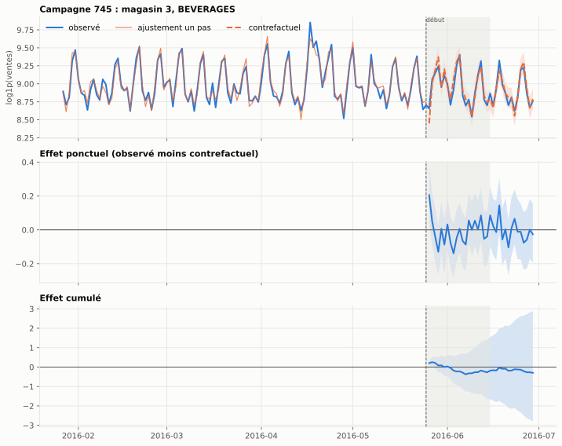
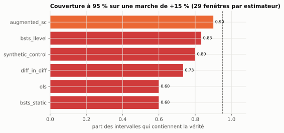
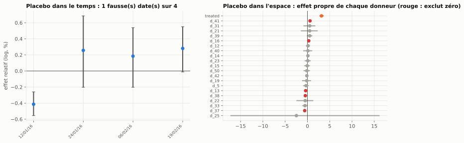
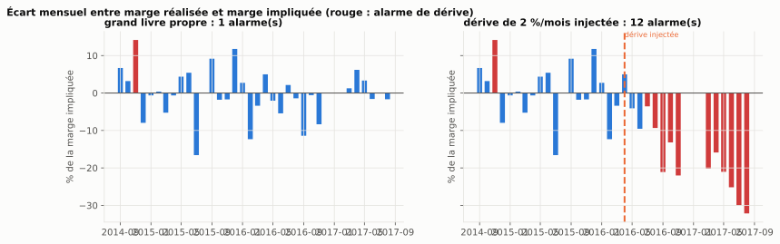
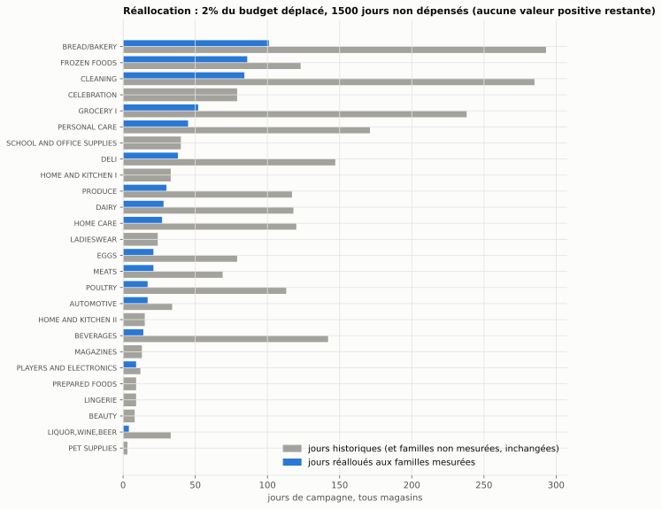


Passer du contrefactuel validé sur panels synthétiques à un cas client : des promotions qui n'ont
pas de date de début, un pool de contrôle qui cannibalise, des zéros qui ne sont pas des ventes
nulles, et une direction qui veut savoir quelle part de son budget promo ne sert à rien.





1 592 campagnes sur 67 458 sauts de `onpromotion`, par une règle fixée avant les résultats
niveau local BSTS sur les vraies séries ; 0,5 à 0,7 pour OLS, contrôle synthétique et DiD
sur la borne basse des intervalles, presque aucune campagne ne vaut ses jours




Ce dépôt applique l'article
[L'impact causal en séries temporelles : le contrefactuel et ses placebos]()
à un cahier des charges client. Le package `causal_ts` de la veille (contrefactuel, placebos,
isolation, baselines) est réutilisé en dépendance épinglée ; tout ce qui est propre aux
promotions est nouveau. Le dépôt, ses notebooks et ses figures sont en français.

## L'objectif

NovaRetail est une chaîne d'épicerie fictive qui multiplie les promotions sans connaître leur
incrémentalité. Le soupçon de la direction : une large part des ventes « en promo » auraient eu
lieu de toute façon, avec en prime du *pull-forward* (le creux après la promotion) et de la
cannibalisation entre familles. Le cahier des charges demandait un contrefactuel par campagne,
un uplift avec intervalle, une courbe d'élasticité par famille, un backtesting par placebos, une
stack orchestrée et un monitoring.

Les données sont celles de la compétition Kaggle
[Store Sales](https://www.kaggle.com/competitions/store-sales-time-series-forecasting)
(Corporación Favorita, Équateur) : 54 magasins, 33 familles, 1 684 jours, un compte
d'articles en promotion par jour et par famille, le prix du pétrole, les fériés, et le séisme
du 16 avril 2016 comme choc exogène.

Ce que je voulais apprendre tenait en trois questions :

- ce que devient un design validé sur panels propres quand le traitement n'est pas défini, que
  les zéros ont plusieurs sens et que les contrôles se cannibalisent ;
- comment noter un estimateur sur de vraies séries, sans vérité connue, autrement qu'en
  regardant la largeur de ses intervalles ;
- ce qu'un pipeline et un monitoring peuvent surveiller d'une quantité que personne n'observe
  jamais, un contrefactuel.

## La démarche

Le travail suit six blocs, un dossier chacun, avec un README de résultats par bloc. Le code vit
dans un package (`src/novaretail`), un CLI `nr` enchaîne les étapes et écrit ses résumés dans
`data/results/*.json`, et les sept notebooks appellent le package sans logique propre. Le cahier
des charges et les décisions de cadrage sont dans `plan.md`, et le protocole (seuils de
crédibilité, modèle de référence, vérité plantée) y a été fixé avant le premier résultat. La
méthode de travail est celle de
[Claude Code en data science : ce qui change dans ma méthode]().



Un panel dense, cinq sortes de zéros structurels (magasin pas ouvert, famille jamais vendue,
fermeture, famille pas encore référencée, longue série de zéros) mis à `NaN` plutôt qu'imputés,
un calendrier avec fériés transférés, paie et gradient du pétrole, et un monde synthétique
« façon Favorita » à contrefactuel connu pour développer toute la chaîne avant les fichiers
Kaggle.


Le traitement est construit : une campagne est un saut de `onpromotion` au-dessus de sa médiane
glissante, pendant au moins trois jours, précédé de 120 jours calmes. Le pool de contrôle est
un registre de règles (arêtes de substitution déclarées, pas de promotion dans la fenêtre, pas
de même ville), jamais un choix par l'ajustement. Puis isolation des donneurs par placebo dans
l'espace.


Contrefactuel à niveau local de `causal_ts` par campagne, effets en unités lus trajectoire par
trajectoire et scindés pendant, après et net ; contrôle synthétique, contrôle synthétique
augmenté, DiD et OLS sur la même interface ; Double ML pour la réponse à l'intensité ; le séisme
comme banc d'essai.


Vérité plantée dans les vraies séries : effets de 0, 5, 15 et 30 %, formes marche, rampe et
impulsion, avec ou sans *pull-forward* et cannibalisation. Chaque estimateur est noté par sa
couverture, ses faux positifs à effet nul et sa puissance, pas par sa largeur.


Assets Dagster en local (panel, campagnes, estimations, backtest, monitoring, calendrier),
MLflow en registre d'estimations et de leurs vérifications, manifeste sha256 des fichiers bruts
à la place de DVC. Pas de Docker, pas de cloud.


Quatre signaux (ajustement de pré-période, placebo roulant, isolation, stabilité donneur-cible),
une réconciliation de marge sur grand livre simulé, et une réallocation du calendrier à budget
constant sur la borne basse des intervalles.



## Ce que les fichiers ont corrigé au cahier des charges

Le cahier des charges décrivait un autre jeu de données et une autre question que ceux que les
fichiers permettent. Chaque écart a été tranché sur les données, puis consigné.

| Le cahier des charges dit | Ce que les données disent |
|---|---|
| « Favorita n'inclut pas les zéros, décider de les reconstruire » | Le fichier est dense (une ligne par magasin, famille et jour, sauf les 25 décembre). Le travail est l'inverse : trier des zéros présents. 31 % des lignes sont à zéro, et 80 % de ces zéros sont structurels. |
| « Courbe d'élasticité-prix par famille » | Aucun prix dans Favorita ; `onpromotion` compte des articles. Le livrable devient une réponse à l'intensité promotionnelle par Double ML, nommée ainsi. |
| « Traitement : `onpromotion` > 0 » | La plupart des familles sont promues en permanence à bas niveau. Une campagne est un saut au-dessus du fond, et la part des jours promus mesurables par ce design est le premier résultat. |
| « Familles non promues du même magasin comme contrôles » | C'est le cas que la veille avait montré biaisé (+26 % avec un donneur cannibalisé, placebo dans le temps vert). Le pool est un registre, puis une isolation. |
| « Intervalle crédible » | Intervalles de prévision fréquentistes, notés par leur couverture mesurée sur vérité plantée dans le panel réel. |
| « Séisme : choc exogène parfait » | Banc d'essai de la méthode, pas une promotion. Les donneurs ont eux-mêmes vendu plus ; l'effet est une borne basse. |
| « Uplift prédit contre marge réalisée » | Pas de marge dans Favorita. La réconciliation est démontrée sur un grand livre simulé avec une dérive injectée. |

## Les résultats

Tous les chiffres viennent de `data/results/*.json`, produits par le CLI sur les fichiers Kaggle.

### Combien de promotions sont mesurables

Sur 67 458 sauts de `onpromotion`, la règle de détection en garde 1 592. Le reste est trop
court (le bruit d'un compte d'articles), tombe dans une pré-période déjà occupée par une autre
campagne, ou chevauche un zéro structurel. Les campagnes gardées durent 3 à 20 jours (déciles),
6 en médiane. Sur un échantillon stratifié de 301 campagnes estimées, 170 passent le protocole
de crédibilité (R² de pré-période, couverture un pas en avant, Ljung-Box, placebo dans le temps,
isolation des donneurs), 114 échouent et 17 n'ont pas assez de donneurs.


### Ce que vaut une campagne

Sur les 170 campagnes crédibles, le lift médian pendant la campagne est de +1,2 %, avec des
déciles à −8 % et +13 %. 7 % des campagnes ont une borne basse positive pendant la campagne,
5 % sur le net (campagne plus 14 jours) ; 1 à 2 % ont une borne haute négative. La somme nette
sur les 170 campagnes vaut −0,6 % du contrefactuel. Le *pull-forward* n'est pas mesurable à ce
niveau : la part médiane des unités reprises après la campagne est −14 %, un léger surplus
plutôt qu'un creux, avec des intervalles qui contiennent zéro presque partout.



### Ce que vaut le design

C'est la partie qui compte. Sur des fenêtres calmes de vraies séries, avec le vrai registre de
donneurs, un effet connu est écrit dans la série, et chaque estimateur est noté sur l'effet
cumulé.



| Estimateur | Couverture à 95 % (marche 15 %) | Faux positifs à effet nul | Puissance à +5 % / +15 % |
|---|---|---|---|
| BSTS niveau local | 0,83 | 17 % | 20 % / 40 % |
| Contrôle synthétique augmenté | 0,90 | 38 % | 43 % / 23 % |
| OLS et BSTS statique | 0,60 | 41 % | 37 % / 60 % |
| Contrôle synthétique | 0,80 | 41 % | 47 % / 27 % |
| Différence de différences | 0,73 | 34 % | 20 % / 30 % |

Trois lectures :

- **Personne n'atteint 95 % sur les vraies séries.** La veille mesurait 0,92 à 0,94 pour le
  niveau local sur panels synthétiques ; ici 0,83 à 0,90 selon la spécification. Les
  estimateurs à erreurs iid sont à 0,5 à 0,7 et se déclenchent sur du vide quatre fois sur dix.
- **Le taux de faux positifs de 17 % est la référence des placebos.** Avec huit fausses dates,
  on attend 1,4 déclenchement sur du vide ; le seuil du protocole (au plus 2 sur 8) rejette donc
  un quart des campagnes par construction, et c'est voulu.
- **La puissance est faible.** Un lift de 5 % sur sept jours est détecté deux fois sur dix, à
  peine au-dessus du taux de faux positifs ; 15 %, quatre fois sur dix. Ce design ne sait pas
  mesurer une petite promotion sur une seule série magasin-famille.

 à 30 %. Les estimateurs iid détectent plus parce qu'ils se déclenchent plus, y compris sur rien.")

### Le séisme, banc d'essai

Les magasins des provinces frappées (Manabí, Esmeraldas) contre vingt magasins de provinces
éloignées : +39 % en unités sur huit semaines [+32 % ; +46 %], soit 572 000 unités, et un effet
qui croît de +10 % la première semaine à +45 à +55 % jusqu'à la huitième. Le placebo dans
l'espace montre que 5 donneurs sur 20 ont un effet propre qui exclut zéro : les achats d'aide
d'urgence ont fait vendre tout le pays. L'effet sur les provinces frappées est donc une borne
basse, et l'interférence est visible parce qu'on sait où regarder.



### La réponse à l'intensité, et pourquoi elle ne sert pas au calendrier

Le Double ML donne un θ pooled de 0,15 à 0,59 selon ce que les nuisances contiennent (retards,
mois, tendance), avec des erreurs standard minuscules. Holdout 0,36 contre 0,34 à
l'entraînement, DoubleML 0,38 en contre-vérification, dose-réponse monotone par paliers. La
concordance avec les lifts des 170 campagnes mesurées est nulle (corrélation 0,02).
L'instabilité est le résultat : la date d'une promotion n'est pas « comme aléatoire » sachant
des contrôles de calendrier, et le DML ne répare pas cela. Le θ de PRODUCE (5) vient d'un
`onpromotion` qui vaut environ 200 un jour par semaine et 0 ou 1 les autres jours : un régime
d'enregistrement, pas une réponse.

### Monitoring et calendrier

Le placebo roulant sur des fenêtres jamais traitées dépasse 10 % de faux positifs sur deux tiers
de la période : le design est en alerte permanente, et c'est l'information juste. Avec 17 % de
faux positifs par donneur et douze donneurs, l'isolation en retire deux par bruit sur 114
campagnes ; les coefficients donneur par donneur changent de signe 223 fois entre deux
campagnes d'une même cible. Les signaux 3 et 4 ne sont lisibles qu'une fois le signal 2 revenu
sous 10 %.



Le calendrier réalloue les jours de campagne par magasin, à budget constant, vers les familles
dont la valeur par jour est la plus élevée sur la borne basse. Sur 2 327 jours et 53 magasins,
48 jours bougent (2 %) et 1 500 ne sont pas dépensés (64 %) : aucune famille mesurée du magasin
n'a de valeur positive sur la borne basse. Dix familles sur 33 n'ont jamais de campagne
mesurable.



## Ce qui a coincé

- **Le traitement était le problème, pas l'estimateur.** `onpromotion` est un compte avec un
  fond permanent, un pic hebdomadaire sur PRODUCE et des régimes d'enregistrement qui changent
  en 2016. La moitié du temps du projet est allée à décider ce qu'est un zéro et ce qu'est une
  campagne. Le choix entre BSTS et contrôle synthétique, lui, se tranche par la couverture.
- **Le cahier des charges décrivait un autre fichier.** La version 2017 du jeu Favorita omet les
  ventes nulles ; la version 2021 est dense. Trois sortes de zéros structurels de plus que prévu
  sont apparues au chargement : 595 des 1 729 séries magasin-famille commencent plus de 30 jours
  après l'ouverture du magasin, PRODUCE a des trimestres entiers à zéro en 2014 et 2015, et les
  séries de zéros longues ne sont pas de l'intermittence.
- **Les trajectoires simulées divergent parfois.** Sur l'échelle `log1p`, une trajectoire qui
  s'emballe pèse des millions d'unités une fois retransformée. Les trajectoires divergentes sont
  retirées, comptées et contrôlées ; une campagne qui en a plus de 5 % n'est pas crédible par
  protocole.
- **Les vraies séries coûtent dix points de couverture.** Zéros, valeurs extrêmes, changements
  de régime : la différence entre un panel propre et un fichier. Les RMSE de certains
  estimateurs viennent de quelques fenêtres où un donneur saute et où un modèle sans niveau
  stochastique extrapole ce saut.
- **Taille des études.** 30 fenêtres par cellule du backtesting, soit ±0,1 sur chaque couverture ;
  300 campagnes estimées sur 1 592 (13 minutes), un seul tirage de la stratification. Les
  ordres de grandeur sont stables d'une exécution à l'autre, la deuxième décimale ne l'est pas.

## Ce que j'en retiens

- Le soupçon de la direction tient, mais la preuve est faible : la somme nette des 170
  campagnes crédibles est nulle à −0,6 %, et le même design ne détecte qu'une fois sur cinq un
  lift de 5 % planté dans ces séries. « Pas d'effet mesurable » et « pas d'effet » sont deux
  phrases différentes.
- Un contrefactuel est une prévision, et son contenu causal tient au design : quelles campagnes,
  quels donneurs, quels placebos. Ce design se note sur vérité connue avant de produire un
  chiffre, et la note sur de vraies séries est plus basse que sur des panels synthétiques.
- Le pool de contrôle se déclare, il ne s'ajuste pas : le meilleur ajustement est souvent le
  substitut le plus proche.
- Les θ du DML ne sont pas des élasticités, et leur sensibilité à la spécification dit que
  l'hypothèse d'identification ne tient pas sur ce panel. Ils sont rapportés pour cela.
- Ce que la méthode ne voit pas, rien ici ne peut le voir : une relation donneurs-cible qui
  casse à la date de campagne. Seuls un rapprochement avec une marge réalisée ou un holdout réel
  tranchent. La recommandation à NovaRetail est de mesurer moins de campagnes et d'en ancrer
  quelques-unes par l'expérimentation, avec des magasins témoins tirés au sort.

## Reproduire

```bash
git clone https://github.com/gwils28/novaretail-promo-incrementality
cd novaretail-promo-incrementality
make install                      # uv sync (Python 3.13), causal_ts en dépendance git épinglée
make test-fast                    # tests unitaires sur le monde synthétique
# déposer store-sales-time-series-forecasting.zip (Kaggle) dans data/raw/, puis :
uv run nr ingest && uv run nr campaigns
uv run nr estimate --param-draws 40          # registre, contrefactuel, placebos, isolation, verdict
uv run nr backtest --n 30                    # vérité plantée, scores par estimateur (2 min)
uv run nr quake && uv run nr dml             # séisme (15 s), réponse à l'intensité (3 min)
uv run nr monitor && uv run nr calendar      # signaux, réconciliation simulée, réallocation
make notebooks                               # ré-exécute les sept notebooks (10 min)
```

Sans fichiers Kaggle, `uv run nr ingest --source synthetic` exécute la même chaîne sur le monde
synthétique. Données : Corporación Favorita, compétition Kaggle *Store Sales - Time Series
Forecasting*.
