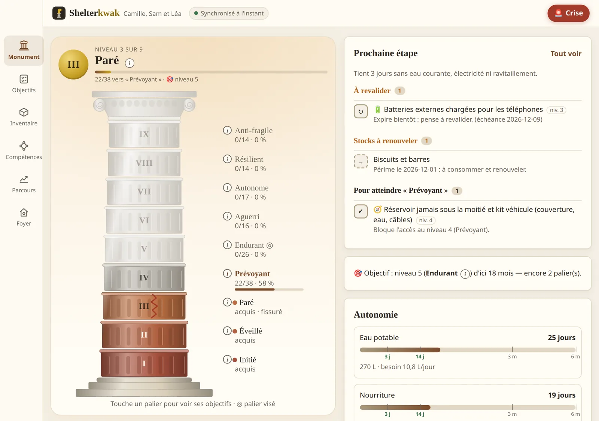
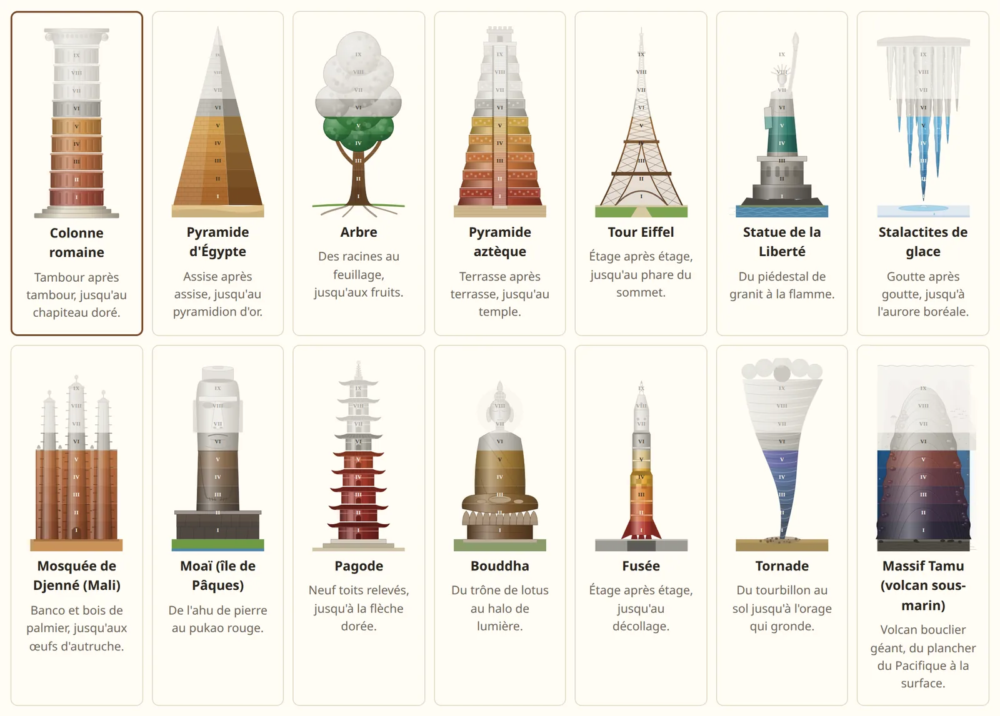
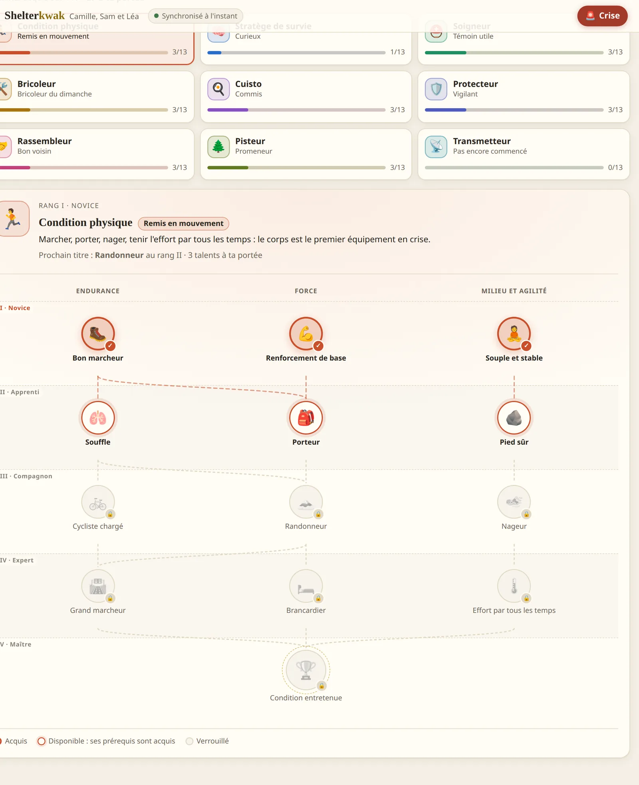
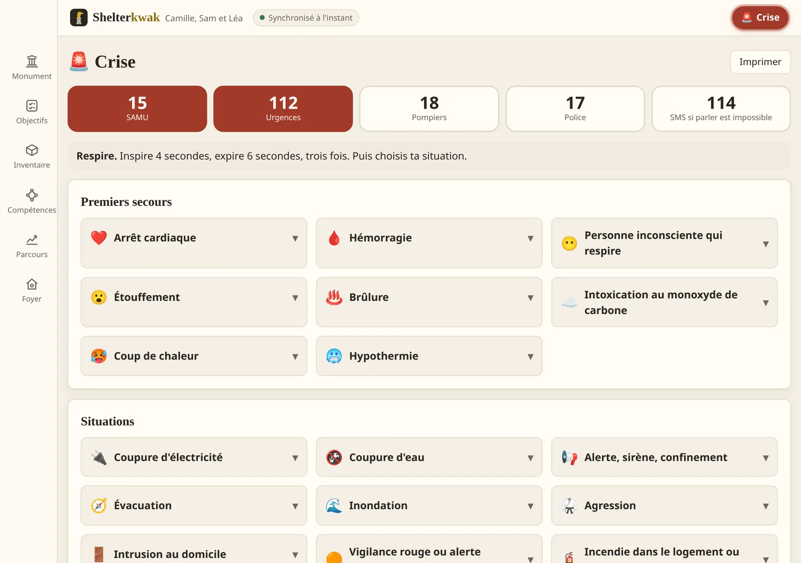
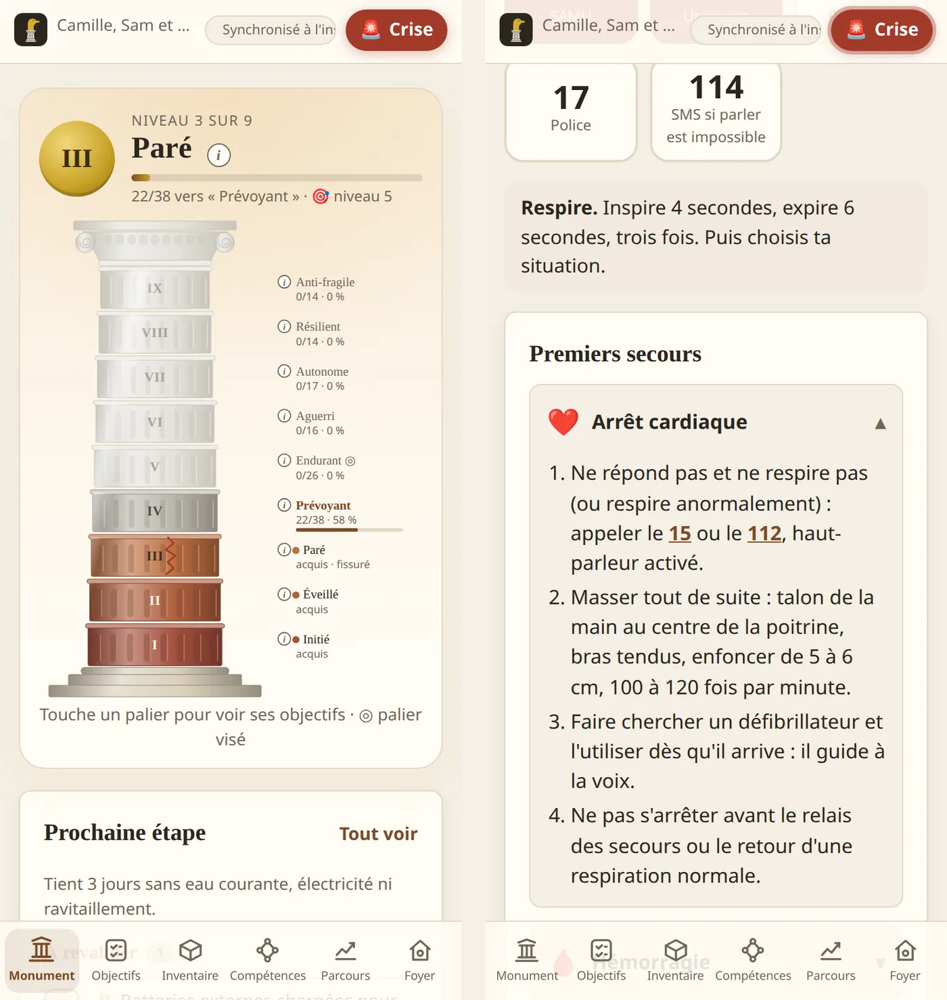


Knowing where the household stands in the face of a water cut, a storm or an evacuation: what is
ready, what is missing, what has expired. The app runs on the phone, without a network, and syncs
with a PC at home.





across 14 areas and 9 tiers, written in YAML
Python and TypeScript, kept identical by shared test cases
57 on the server, 41 in the app





**Work in progress.** This page describes the repository as of 9 November 2026, one week after
the first commit (9 merged pull requests). The figures are counted in the catalogue and the
tests, and will be updated as the project moves on.



**Every screenshot shows a fictional household** (Camille, Sam, their daughter Léa and Moka the
cat), entered on a demo instance. The app only exists in French, so the screenshots show its
French interface.


## The problem

Official preparedness guides (government, Red Cross) say what to do: a water supply, a first-aid
kit, a go-bag, contacts on paper. They do not say **where my household stands**, or what has
stopped being true since: the bottles that expire, the power bank never recharged, the first-aid
course from three years ago, the baby who has arrived in the meantime.

I wanted a tool that:

- **measures** preparedness with checkable criteria ("14 days of water for this household"),
  not with a feeling;
- **regresses** when reality changes: an expired supply no longer counts, a skill not practised
  expires;
- **fits the household**: a 6th-floor flat does not have the same priorities as an isolated
  house, nor does a household with a child or a hard-to-refill prescription;
- **works without a network**, since the day the network is down is precisely the day it is
  needed;
- **keeps the data at home**: the household's members, their health conditions and where their
  equipment is stored have no business on a third-party server.

## Where the project stands




A specification written from an interview, then a YAML catalogue (levels, areas, goals, needs,
questionnaire), a level engine in pure Python, a FastAPI API and a React interface with the
column drawn in SVG.



An installable app (PWA), an operation log in the browser, sync with the PC's server over
Tailscale. The Python engine remains the reference; its TypeScript copy replays the same test
cases.



At each council, three agents review the app and the catalogue, each from a different angle, then
debate; I approve the plan before it is implemented. They brought the Crisis screen, the 30-day
grace period, the Morale, Self-defence and Cybersecurity areas, physical fitness, and corrected
content that was wrong or dangerous.



The inventory becomes a deck of cards with five grades each and a quantified overview; skills
become nine talent trees.




## What the app does

### A monument with nine tiers

The household's level is a monument with nine tiers, a Roman column by default. Each tier stands
for a resilience horizon:

| Level | Name | What the household can withstand |
|---|---|---|
| 1 | Initiate | A few hours of outage: 24 h of water and food, a light, the emergency numbers |
| 2 | Aware | Knows its risks, has its papers, its contacts and a basic plan |
| 3 | Ready | 3 days without running water, electricity or resupply |
| 4 | Provident | 14 days confined or cut off from the grid |
| 5 | Enduring | 3 months of partial disruption, an emergency savings fund |
| 6 | Seasoned | 6 months of supplies, practical skills kept up |
| 7 | Self-reliant | Produces part of its own water, food and energy |
| 8 | Resilient | Part of a mutual-aid community, passes on what it knows |
| 9 | Antifragile | Everything is tested for real, each crisis improves the plan |

The tiers are **blocking**: level 4 is reached only once every required goal of levels 1 to 4 is
validated, in every area. A household far ahead on water but with no evacuation plan stays at the
tier of its weakest link, and the home screen says which one.



Level 9 cannot be bought: it requires **testing** the household (7 days without mains water,
72 hours with the main breaker off, a real evacuation in under 15 minutes, a surprise drill with
one's group), and almost all its criteria must be redone every year.

The monument is chosen from fourteen: a pyramid, a tree, the Eiffel Tower, the Great Mosque of
Djenné, a moai, a rocket, an undersea volcano… Changing monument changes nothing about the level.



### A level that can drop

The level is not kept for good. It goes down when:

- **a supply expires**: an expired item immediately stops counting towards self-sufficiency;
- **a validation expires**: a skill to practise, a piece of equipment to test, a drill to repeat
  each have a period of validity;
- **a seasonal deadline passes**: firewood stored before November, the chimney swept before
  October;
- **the household changes**: one more member raises the needs and can make new goals apply.

So that a single forgotten power bank does not bring down several tiers at once, an expired
validation first enters a 30-day **grace period**: the drum cracks but stays up. Expired supplies
get no grace period. That compromise came out of the first council: a supply that is not renewed
does not exist, but a sudden drop makes people give up on the tool.

, then climbs back up when she leaves.")

### 279 goals that fit the household

The goals are spread over 14 areas: water, food, energy, health, shelter, safety, communication,
mobility, skills, finances, community, morale, self-defence and cybersecurity. Each has a level,
an explanation ("why it matters") and a kind: an action ticked by hand, a skill to revalidate, or
a supply computed from the inventory.

A goal only shows up for the households it concerns:

- **where they live**: a flat does not need a campfire or fuel stored in the cellar, but must know
  how to use a camping stove without poisoning itself;
- **the members**: child, baby, senior, pet;
- **health conditions**: twelve in total, from glasses to a prescription that is dispensed in
  limited amounts. For glasses: a spare pair and a copy of the prescription at level 2, a pair in
  the go-bag at level 3, two spare pairs and a repair kit at level 5;
- **declared risks**: flooding, cold, heatwave, industrial hazard.

Physical tests (walking 15 km with a pack, being able to swim) have an **adapted variant** for
households with a member who has reduced mobility: the requirement is about the household's
capability, not about each person's fitness.

 and its date.")

At sign-up, an adaptive questionnaire of 26 questions describes the household, where it lives now
and where it plans to live ("a house in the countryside in two years"), what is already in place
and the target level. The app infers a starting level from it. Goals specific to the planned home
are offered separately, in a "Prepare for what's next" section.

### An inventory measured in days of self-sufficiency

The inventory answers one question: **how many days can the household hold out**? Each item has a
quantity, an expiry date and a storage place; self-sufficiency is the sum of unexpired items
divided by the household's daily need, computed member by member (4 L of water per adult, 2.5 L
per child, 0.3 L for a cat; 2,200 kcal per adult).

Equipment takes the form of **99 cards** in ten categories, each with five grades (rustic, common,
confirmed, epic, legendary). A card's grade depends on its quality, its options, the quantity, the
minimum contents (for a first-aid kit or a bag) or, for a supply, the days of self-sufficiency. A
card shows which goals it serves, but **owning an item validates nothing**: it has to be
confirmed.


, and the card lists the goals it serves, validated or still to do.")

The overview sums up the inventory: the weakest link, self-sufficiency per category against the
3-day, 14-day, 3-month and 6-month marks, and a **twelve-month projection** showing when
self-sufficiency drops as items expire, assuming nothing is consumed or bought.

. In the projection, water drops to zero in August 2027, when the packs expire.")

### Nine skill trees

Skills are grouped into nine specialities (physical fitness, healer, handyman, cook, protector,
gatherer…), each a talent tree with five ranks and three branches. A talent can be ticked once its
prerequisites are acquired, with what proves it (a certificate, a test), a date and a note. As
with items, ticking a talent validates no goal.



### A screen for the day itself

The red "Crise" button stays visible on every page. It opens a screen designed for someone under
stress, which works offline and can be printed:

- call buttons (15, 112, 18, 17, and 114 by text message, the French emergency numbers) and a
  breathing reminder;
- folded reflex sheets: **first aid** (cardiac arrest, bleeding, carbon monoxide, heatstroke…) then
  **situations** (water cut, flood, evacuation, intrusion…), filtered by the household's risks and
  members;
- the household's own sheets: contacts, meeting points, who does what, medical sheets;
- where the equipment is, from the inventory, and the drinking-water supply.



### On the phone, without a network

The app installs on Android like a native app. The engine, the catalogue and the data live on the
phone: in airplane mode, everything works. The PC's server is used to install it, to sync the
phone and the computer, and as a backup. It is reachable over Tailscale, in HTTPS, at home or
away, with nothing exposed to the Internet.



## How it is built

### An operation log rather than a state

Nothing is stored as is: every change is an immutable **operation** (validate a goal, add an
item, change the household), timestamped and identified. The household's state, its level and
its whole history are rebuilt by replaying the log in order.


flowchart LR
    T["Phone<br/>PWA + IndexedDB"] -->|operations| S["PC server<br/>FastAPI + SQLite"]
    P["PC browser<br/>PWA + IndexedDB"] -->|operations| S
    S -->|other devices' operations| T
    S -->|other devices' operations| P
    T --> M1["TypeScript engine<br/>replays the log"]
    S -.->|read only| M2["Python engine<br/>the reference"]


That choice settles three problems at once:

- **sync**: each device sends the operations the server does not know and receives the others'.
  Two changes to the same thing are settled by timestamp: the last one written wins;
- **history**: the level curve is not recorded but recomputed, including on the dates when a
  supply expires or a grace period ends, the only moments the level changes without any action;
- **rule changes**: when a council moves a goal to another tier, the level is recomputed over the
  whole log, with no data migration. The one constraint: a goal's identifier is never renamed,
  since it is stored.

The server computes nothing for the app: it keeps the shared copy of the log and serves the
files. A JSON backup of the log can be exported from the Household tab.

### Two engines, one behaviour

To work offline, the level engine has to run on the phone, so in TypeScript. But the Python
engine is easier to test and to review. Both exist, and Python is the reference: a script
generates test cases from it (households, logs, dates), which the front-end tests replay to check
that the TypeScript engine gives exactly the same result. A test fails if the cases were not
regenerated after a catalogue change.

### Content outside the code

Goals, daily needs, the questionnaire, item cards, talents and Crisis sheets live in YAML files,
not in the code. Adding a goal means adding an entry:

```yaml
  - id: eau.exemple
    level: 4                 # tier
    kind: check              # check | skill | stock
    required: true           # false: bonus, does not block the tier
    contexts: [periurbain, rural]
    revalidate_days: 365     # expires and lowers the level
    title: …
    why: …
```

The catalogue is validated at start-up (references, levels, the order of an item's grades), and a
test checks that every type of home keeps at least one required goal per tier, so that no
household reaches the top through empty tiers.

### A catalogue reviewed in council

The catalogue is the most delicate part: a misplaced criterion discourages, wrong content can be
dangerous. I had it reviewed by a **council of three AI agents**, each with an angle: the Tracker
(self-reliance in rural settings), the Tactician (urban crisis and logistics) and the Sentinel
(health, vulnerable people, psychology). Each analyses alone, without knowing the others' views;
the main agent checks their findings in the code, leads the debate and writes a summary that I
approve or not. Each council has its dated report in the repository.

A few corrections that came out of it:

| Finding | Decision |
|---|---|
| A campfire required in a flat | Fire and fuel kept for suburban and rural homes, a safe stove in town |
| Physical tests blocked a household with a member of reduced mobility for good | An adapted variant, the requirement stays for the others |
| Level 3 had 27 required criteria, several unrelated to "holding out 72 h" | Cut to 19, the rest moved to level 4 |
| A PSC1 first-aid course required at level 3, to be booked weeks ahead | "Gestes qui sauvent" (2 h, free) at level 3, PSC1 at level 4 |
| Supplies estimated at sign-up never expired | They expire after six months unless confirmed |
| Silver tablets given to purify water, an FFP2 mask against smoke | Chlorine or chlorine dioxide for water; FFP2 stops particles, not CO or gases |


**Known limitation**: these reviews are done by AI agents, not by first-aiders, doctors or
lawyers. The first-aid sheets repeat publicly taught gestures and point to the official courses
(Gestes qui sauvent, PSC1), but the catalogue has not been validated by a professional. The app
helps get organised; it replaces neither training nor the authorities' instructions.


## What's next

The 9 November council is being implemented: showing the weapon, alcohol and tobacco cards only to
households that declare them (they still show for everyone), removing duplicate cards that offer
the same goal twice, and correcting some content. The next leads are revalidation reminders, a
structured medical sheet per member, and a trial on a small home server. The end-to-end scenario
(phone and PC, airplane mode, sync) is in the repository; it still has to run in continuous
integration.

## Try it

```bash
git clone https://github.com/gwils28/Shelterkwak
cd Shelterkwak
make install   # Python (uv) and Node dependencies
make check     # lint, tests, engine parity, build
make run       # the app on http://127.0.0.1:8000
```

Installing on an Android phone, with Tailscale, is described in `docs/telephone.md` (in French).
