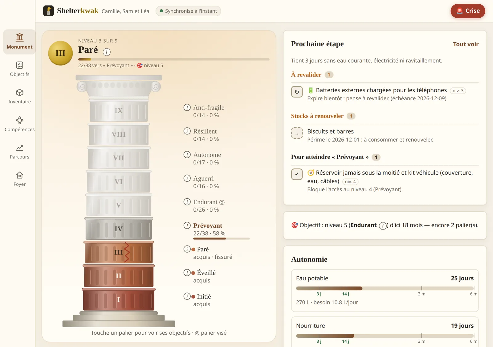
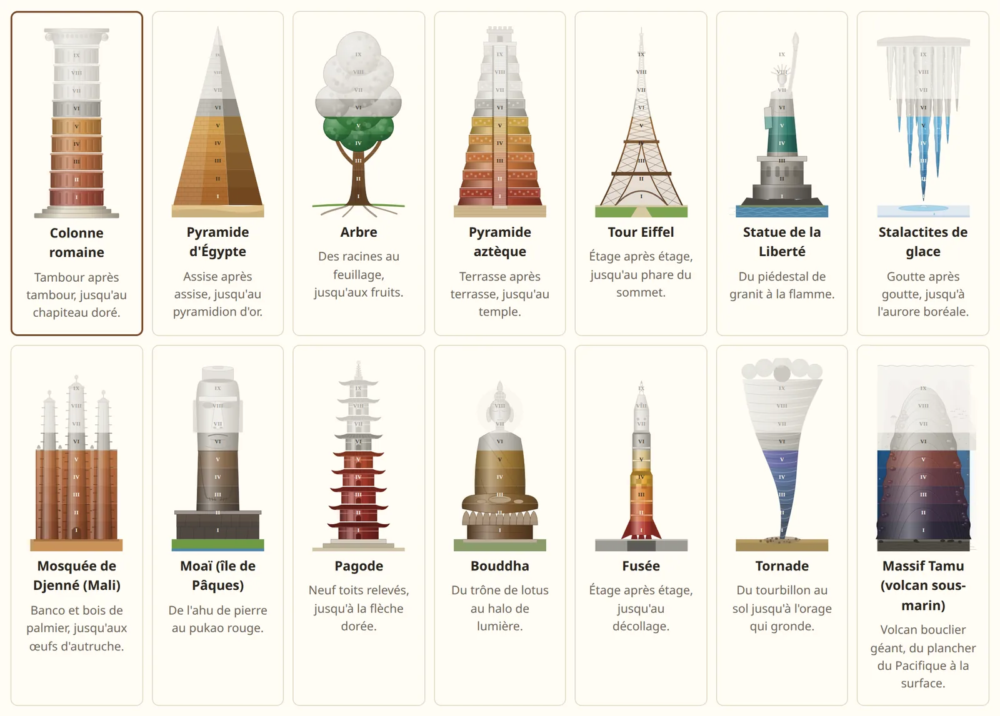
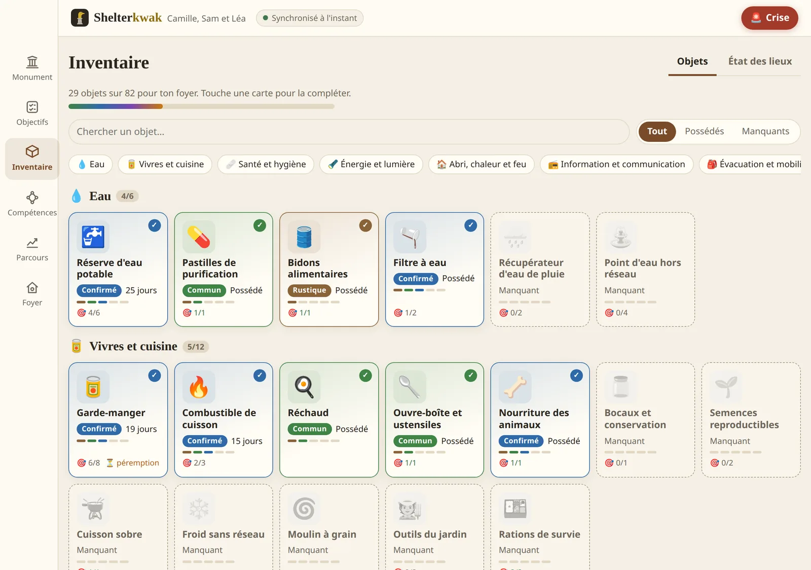
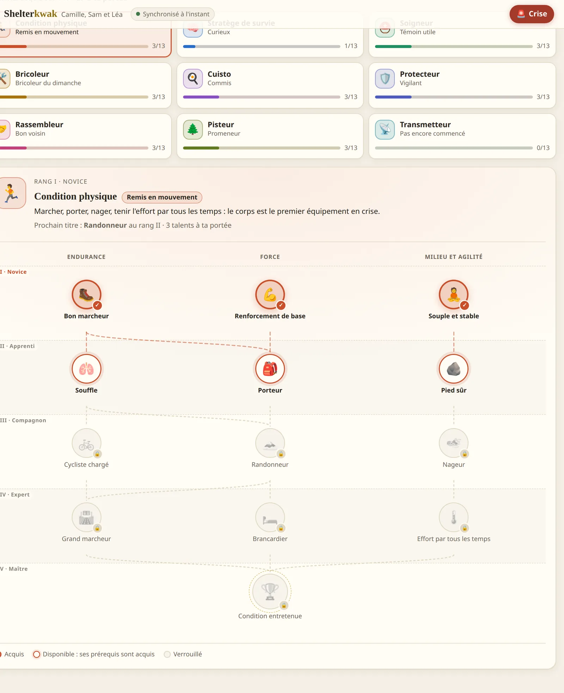
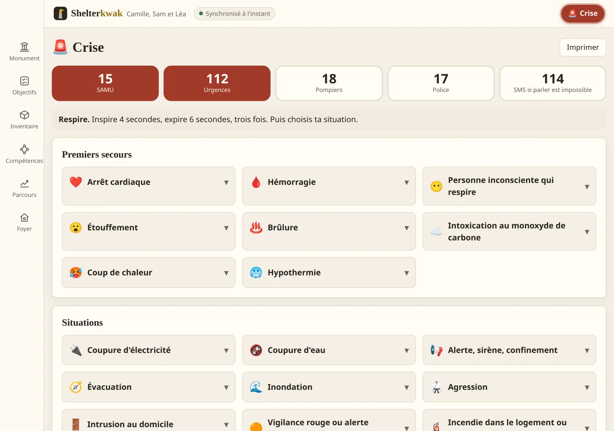
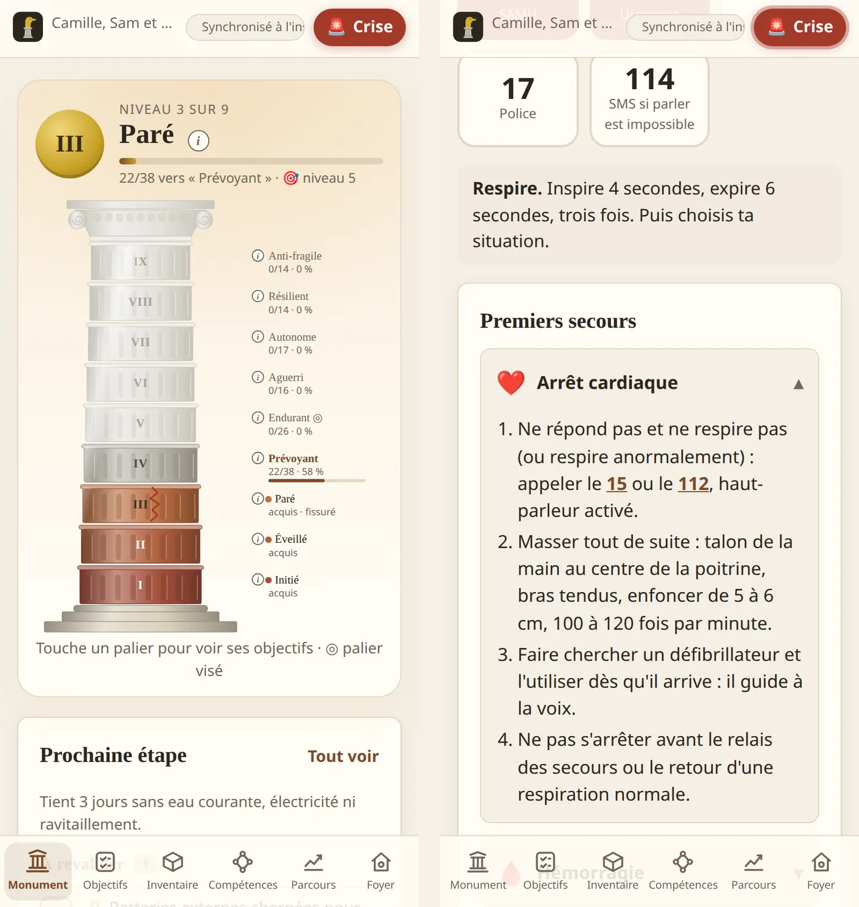


Savoir où en est le foyer face à une coupure d'eau, une tempête ou une évacuation : ce qui est
prêt, ce qui manque, ce qui a périmé. L'application tourne sur le téléphone, sans réseau, et se
synchronise avec un PC de la maison.





sur 14 axes et 9 paliers, décrits en YAML
Python et TypeScript, tenus identiques par des cas de test partagés
57 côté serveur, 41 côté application





**Projet en cours.** Cette fiche décrit l'état du dépôt au 9 novembre 2026, une semaine après le
premier commit (9 pull requests fusionnées). Les chiffres sont comptés dans le catalogue et les
tests, et seront mis à jour avec le projet.



**Toutes les captures montrent un foyer fictif** (Camille, Sam, leur fille Léa et le chat Moka),
saisi sur une instance de démonstration. L'application n'existe qu'en français : les captures
sont celles de l'interface réelle.


## Le problème

Les guides officiels de préparation (gouvernement, Croix-Rouge) disent quoi faire : un stock
d'eau, une trousse, un sac d'évacuation, des contacts sur papier. Ils ne disent pas **où en est
mon foyer**, ni ce qui a cessé d'être vrai depuis : les bouteilles qui périment, la batterie
jamais rechargée, la formation aux premiers secours d'il y a trois ans, le bébé arrivé entre-temps.

Je voulais un outil qui :

- **mesure** la préparation par des critères vérifiables (« 14 jours d'eau pour ce foyer »),
  pas par un sentiment ;
- **régresse** quand la réalité change : un stock périmé ne compte plus, une compétence non
  pratiquée expire ;
- **s'adapte au foyer** : un appartement au 6e étage n'a pas les mêmes priorités qu'une maison
  isolée, un foyer avec un enfant ou un traitement à délivrance limitée non plus ;
- **marche sans réseau**, puisque c'est précisément le jour où le réseau manque qu'on en a
  besoin ;
- **garde les données à la maison** : la composition du foyer, ses fragilités de santé et
  l'emplacement de son matériel n'ont rien à faire sur un serveur tiers.

## Où en est le projet




Spécification écrite à partir d'une interview, puis catalogue YAML (niveaux,
axes, objectifs, besoins, questionnaire), moteur de niveaux en Python pur, API FastAPI et
interface React avec la colonne en SVG.



Application installable (PWA), journal d'opérations dans le navigateur, synchronisation avec le
serveur du PC par Tailscale. Le moteur Python reste la référence ; sa copie TypeScript rejoue
les mêmes cas de test.



À chaque conseil, trois agents relisent l'application et le catalogue, chacun sous un angle
différent, puis débattent ; je valide le plan avant sa mise en œuvre. Ils ont apporté l'écran
Crise, le sursis de 30 jours, les axes Moral, Défense et Cybersécurité, la condition physique,
et corrigé des contenus faux ou dangereux.



L'inventaire devient un jeu de cartes à cinq niveaux avec un état des lieux chiffré ; les
compétences deviennent neuf arbres de talents.




## Ce que fait l'application

### Un monument de neuf paliers

Le niveau du foyer est un monument de neuf paliers, une colonne romaine par défaut. Chaque palier
correspond à un horizon de résilience :

| Niveau | Nom | Ce que le foyer tient |
|---|---|---|
| 1 | Initié | Quelques heures de coupure : 24 h d'eau et de vivres, une lumière, les numéros d'urgence |
| 2 | Éveillé | Connaît ses risques, a ses papiers, ses contacts et un plan de base |
| 3 | Paré | 3 jours sans eau courante, électricité ni ravitaillement |
| 4 | Prévoyant | 14 jours confiné ou coupé du réseau |
| 5 | Endurant | 3 mois de rupture partielle, une épargne de précaution |
| 6 | Aguerri | 6 mois de réserves, des compétences pratiques entretenues |
| 7 | Autonome | Produit une partie de son eau, de sa nourriture et de son énergie |
| 8 | Résilient | Intégré à une communauté d'entraide, transmet ce qu'il sait |
| 9 | Anti-fragile | Tout est éprouvé en conditions réelles, chaque crise améliore le plan |

Les paliers sont **bloquants** : le niveau 4 n'est atteint que si tous les objectifs requis des
niveaux 1 à 4 sont validés, sur tous les axes. Un foyer très avancé sur l'eau mais sans plan
d'évacuation reste donc au palier de son maillon faible, et l'accueil dit lequel.



Le niveau 9 ne s'achète pas : il demande d'**éprouver** le foyer (7 jours sans eau du réseau,
72 heures disjoncteur coupé, une évacuation réelle en moins de 15 minutes, un exercice inopiné
avec son groupe), et presque tous ses critères sont à refaire chaque année.

Le monument se choisit parmi quatorze : pyramide, arbre, tour Eiffel, Grande Mosquée de Djenné,
moaï, fusée, volcan sous-marin… Changer de monument ne change rien au niveau.



### Un niveau qui peut baisser

Le niveau ne se garde pas une fois pour toutes. Il redescend quand :

- **un stock périme** : un article périmé cesse aussitôt de compter dans l'autonomie ;
- **une validation expire** : une compétence à pratiquer, un équipement à tester, un exercice à
  refaire ont une durée de validité ;
- **une échéance saisonnière passe** : le bois rentré avant novembre, le ramonage avant octobre ;
- **le foyer change** : un membre de plus augmente les besoins et peut rendre applicables de
  nouveaux objectifs.

Pour éviter qu'une seule batterie oubliée fasse tomber plusieurs paliers d'un coup, une validation
expirée entre d'abord en **sursis** de 30 jours : le tambour se fissure mais reste debout. Les
stocks périmés, eux, n'ont pas de sursis. Ce compromis est sorti du premier conseil : un stock
non renouvelé n'existe pas, mais une chute brutale fait abandonner l'outil.

, puis remonte quand elle repart.")

### 279 objectifs adaptés au foyer

Les objectifs sont répartis sur 14 axes : eau, alimentation, énergie, santé, abri, sécurité,
communication, mobilité, compétences, finances, communauté, moral, défense personnelle et
cybersécurité. Chacun a un niveau, une explication (« pourquoi c'est important ») et une nature :
une action cochée à la main, une compétence à revalider, ou un stock calculé depuis l'inventaire.

Un objectif ne s'affiche qu'aux foyers qu'il concerne :

- **le lieu de vie** : un appartement n'a pas à faire de feu de camp ni à stocker du carburant à
  la cave, mais doit savoir utiliser un réchaud sans s'intoxiquer ;
- **les membres** : enfant, bébé, senior, animal ;
- **les particularités de santé** : douze au total, des lunettes au traitement à délivrance
  limitée. Pour les lunettes, une paire de secours et une ordonnance copiée au niveau 2, une paire
  dans le sac d'évacuation au niveau 3, deux paires et un kit de réparation au niveau 5 ;
- **les risques déclarés** : inondation, froid, canicule, risque industriel.

Les épreuves physiques (marcher 15 km avec un sac, savoir nager) ont une **variante adaptée**
pour les foyers dont un membre a une mobilité réduite : l'exigence porte sur la capacité du
foyer, pas sur la forme de chacun.

 et sa date.")

À l'inscription, un questionnaire adaptatif de 26 questions décrit le foyer, son lieu de vie
actuel et visé (« une maison à la campagne dans deux ans »), ce qui est déjà en place et le
niveau visé. L'application en déduit un niveau de départ. Les objectifs propres au lieu visé sont
proposés à part, dans une section « Préparer la suite ».

### Un inventaire en jours d'autonomie

L'inventaire répond à une question : **combien de jours tient le foyer** ? Chaque article a une
quantité, une date de péremption et un emplacement ; l'autonomie est la somme des articles non
périmés divisée par le besoin journalier du foyer, calculé membre par membre (4 L d'eau par
adulte, 2,5 L par enfant, 0,3 L pour un chat ; 2 200 kcal par adulte).

Le matériel prend la forme de **99 cartes** réparties en dix catégories, chacune avec cinq niveaux
(rustique, commun, confirmé, épique, légendaire). Le niveau d'une carte dépend de sa qualité, de
ses options, de la quantité, du contenu minimal (pour une trousse ou un sac) ou, pour une réserve,
des jours d'autonomie. Une carte indique les objectifs qu'elle sert, mais **posséder un objet ne
valide rien** : il faut le confirmer.



, et la fiche liste les objectifs qu'elle sert, validés ou à faire.")

L'état des lieux résume l'inventaire : le maillon faible, l'autonomie par catégorie face aux
repères de 3 jours, 14 jours, 3 mois et 6 mois, et une **projection sur douze mois** qui montre
quand l'autonomie chute au fil des péremptions, sans rien consommer ni racheter.

. Dans la projection, l'eau tombe à zéro en août 2027, quand les packs périment.")

### Neuf arbres de compétences

Les compétences sont rangées en neuf spécialités (condition physique, soigneur, bricoleur,
cuisinier, protecteur, rassembleur…), chacune un arbre de talents en cinq rangs et trois
branches. Un talent se coche quand ses prérequis sont acquis, avec ce qui le prouve (un
diplôme, une épreuve), une date et une note. Comme pour les objets, cocher un talent ne valide
aucun objectif.



### Un écran pour le jour J

Le bouton rouge « Crise » reste visible sur chaque page. Il ouvre un écran pensé pour une
personne sous stress, qui fonctionne hors ligne et s'imprime :

- les boutons d'appel (15, 112, 18, 17, et le 114 par SMS) et un rappel de respiration ;
- les fiches réflexes, repliées : **premiers secours** (arrêt cardiaque, hémorragie, monoxyde de
  carbone, coup de chaleur…) puis **situations** (coupure d'eau, inondation, évacuation,
  intrusion…), filtrées selon les risques et les membres du foyer ;
- les fiches du foyer : contacts, points de rendez-vous, qui fait quoi, fiches médicales ;
- où est le matériel, d'après l'inventaire, et les réserves en eau de boisson seule.



### Sur le téléphone, sans réseau

L'application s'installe sur Android comme une application. Le moteur, le catalogue et les
données vivent sur le téléphone : en mode avion, tout fonctionne. Le serveur du PC sert à
l'installer, à synchroniser le téléphone et l'ordinateur, et de sauvegarde. Il est joignable par
Tailscale, en HTTPS, à la maison comme dehors, sans rien exposer sur Internet.



## Comment c'est construit

### Un journal d'opérations plutôt qu'un état

Rien n'est stocké tel quel : chaque modification est une **opération** immuable (valider un
objectif, ajouter un article, changer le foyer), horodatée et identifiée. L'état du foyer,
son niveau et tout son historique se reconstruisent en rejouant le journal dans l'ordre.


flowchart LR
    T["Téléphone<br/>PWA + IndexedDB"] -->|opérations| S["Serveur du PC<br/>FastAPI + SQLite"]
    P["Navigateur du PC<br/>PWA + IndexedDB"] -->|opérations| S
    S -->|opérations des autres appareils| T
    S -->|opérations des autres appareils| P
    T --> M1["Moteur TypeScript<br/>rejoue le journal"]
    S -.->|lecture seule| M2["Moteur Python<br/>la référence"]


Ce choix règle trois problèmes d'un coup :

- **la synchronisation** : chaque appareil envoie les opérations que le serveur ne connaît pas
  et reçoit celles des autres. Deux modifications de la même chose se départagent par
  l'horodatage : la dernière écrite gagne ;
- **l'historique** : la courbe du niveau n'est pas enregistrée mais recalculée, y compris aux
  dates où un stock périme ou un sursis se termine, les seuls moments où le niveau change sans
  action ;
- **les changements de règles** : quand un conseil déplace un objectif d'un palier, le niveau
  se recalcule sur tout le journal, sans migration de données. Seule contrainte : un identifiant
  d'objectif ne se renomme jamais, puisqu'il est stocké.

Le serveur ne calcule rien pour l'application : il garde la copie partagée du journal et sert
les fichiers. Une sauvegarde JSON du journal s'exporte depuis l'onglet Foyer.

### Deux moteurs, un seul comportement

Pour fonctionner hors ligne, le moteur de niveaux doit tourner dans le téléphone, donc en
TypeScript. Mais le moteur Python est plus simple à tester et à faire relire. Les deux existent,
et le Python fait foi : un script génère depuis lui des cas de test (foyers, journaux, dates),
que les tests du front rejouent pour vérifier que le moteur TypeScript donne exactement le même
résultat. Un test échoue si les cas n'ont pas été régénérés après un changement du catalogue.

### Le contenu hors du code

Les objectifs, les besoins journaliers, le questionnaire, les cartes d'objets, les talents et les
fiches Crise vivent dans des fichiers YAML, pas dans le code. Ajouter un objectif, c'est ajouter
une entrée :

```yaml
  - id: eau.exemple
    level: 4                 # palier
    kind: check              # check | skill | stock
    required: true           # false : bonus, ne bloque pas le palier
    contexts: [periurbain, rural]
    revalidate_days: 365     # expire et fait baisser le niveau
    title: …
    why: …
```

Le catalogue est validé au démarrage (références, niveaux, ordre des niveaux d'un objet), et un
test vérifie que chaque lieu de vie garde au moins un objectif requis par palier, pour qu'aucun
foyer n'atteigne le sommet sur des paliers vides.

### Un catalogue relu en conseil

Le catalogue est la partie la plus délicate : un critère mal placé décourage, un contenu faux
peut être dangereux. Je l'ai fait relire par un **conseil de trois agents IA**, chacun avec un
angle : le Pisteur (autonomie en milieu rural), le Tacticien (crise urbaine et logistique) et la
Sentinelle (santé, publics vulnérables, psychologie). Chacun analyse seul, sans connaître l'avis
des autres ; l'agent principal vérifie leurs constats dans le code, mène le débat et rédige une
synthèse que je valide ou non. Chaque conseil a son compte rendu daté dans le dépôt.

Quelques corrections qui en sont sorties :

| Constat | Décision |
|---|---|
| Un feu de camp exigé en appartement | Feu et carburant réservés au périurbain et au rural, réchaud sûr en ville |
| Les épreuves physiques bloquaient à vie un foyer avec un membre à mobilité réduite | Une variante adaptée, l'exigence reste pour les autres |
| Le niveau 3 comptait 27 critères requis, dont plusieurs sans rapport avec « tenir 72 h » | Allégé à 19, le reste déplacé au niveau 4 |
| Une formation PSC1 exigée au niveau 3, à réserver des semaines à l'avance | « Gestes qui sauvent » (2 h, gratuit) au niveau 3, PSC1 au niveau 4 |
| Les stocks estimés à l'inscription ne périmaient jamais | Ils périment au bout de six mois s'ils ne sont pas confirmés |
| Des pastilles à l'argent données pour purifier l'eau, un masque FFP2 contre les fumées | Chlore ou dioxyde de chlore pour l'eau ; le FFP2 arrête les particules, ni le CO ni les gaz |


**Limite connue** : ces relectures sont faites par des agents IA, pas par des secouristes, des
médecins ou des juristes. Les fiches de premiers secours reprennent des gestes publics et
renvoient vers les formations officielles (Gestes qui sauvent, PSC1), mais le catalogue n'a pas
été validé par un professionnel. L'application aide à s'organiser ; elle ne remplace ni une
formation ni les consignes des autorités.


## La suite

Le conseil du 9 novembre est en cours de mise en œuvre : n'afficher les cartes d'armes, d'alcool
et de tabac qu'aux foyers qui les déclarent (elles s'affichent encore à tous), retirer les
doublons entre cartes qui proposent deux fois le même objectif, et corriger quelques contenus. Les
pistes suivantes sont des rappels de revalidation, une fiche médicale structurée par membre, et
un essai sur un petit serveur domestique. Le scénario de bout en bout (téléphone et PC, mode
avion, synchronisation) existe dans le dépôt ; il reste à le faire tourner en intégration
continue.

## Essayer

```bash
git clone https://github.com/gwils28/Shelterkwak
cd Shelterkwak
make install   # dépendances Python (uv) et Node
make check     # lint, tests, parité des moteurs, build
make run       # l'application sur http://127.0.0.1:8000
```

L'installation sur un téléphone Android, avec Tailscale, est décrite dans `docs/telephone.md`.
