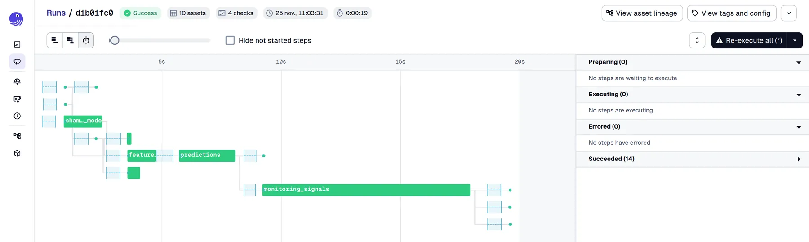
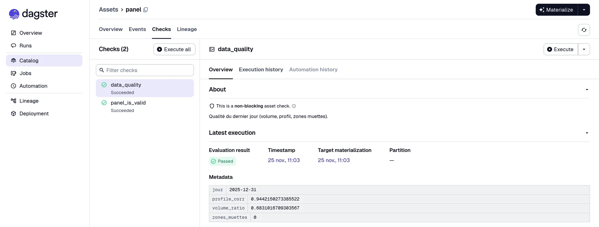
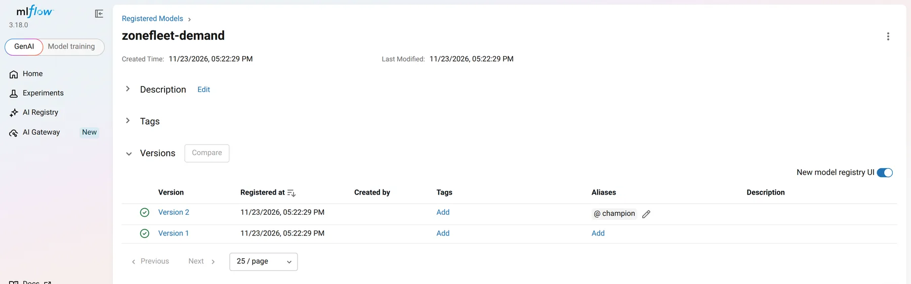
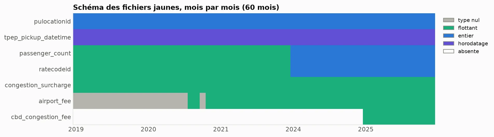
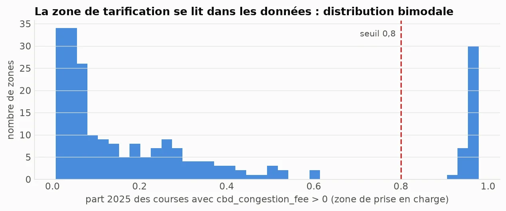
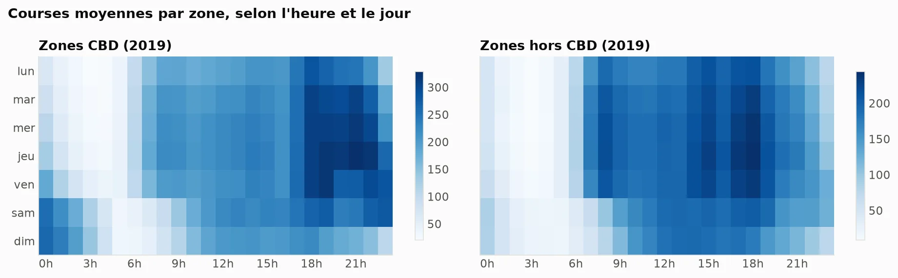
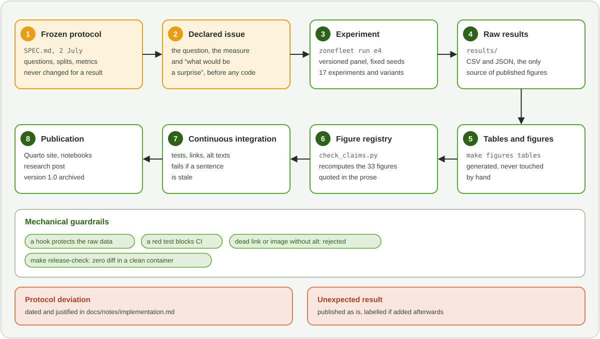
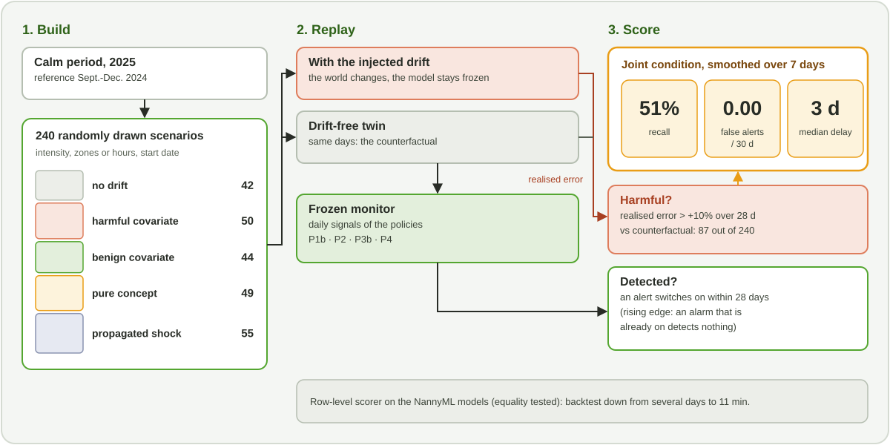
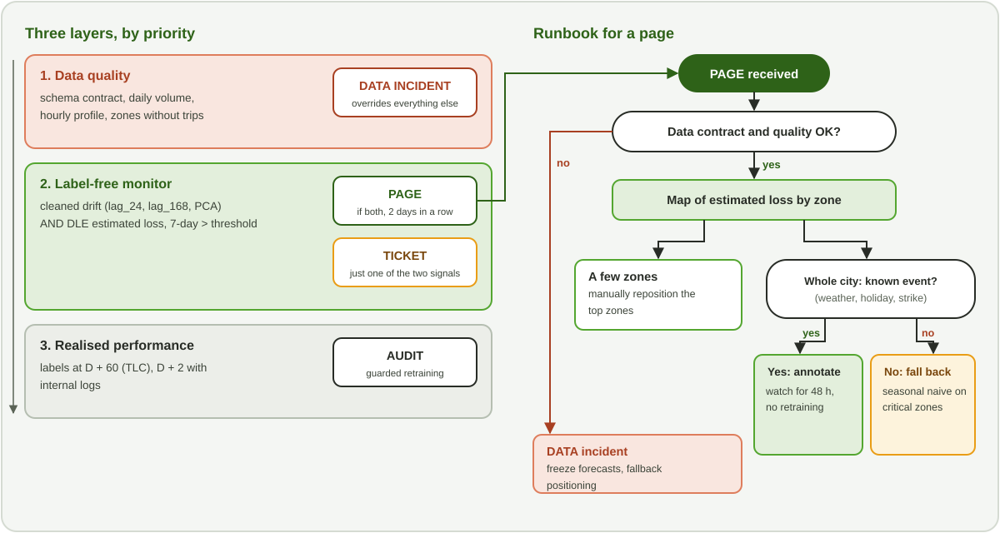


Knowing when a forecasting model is unwell when the ground truth only arrives two months later. Not
by reading documentation: by building the whole chain, from raw data to the on-call rota, then
putting it to the test.





the COVID shock caught in 9 days, against 62 when waiting for labels
for the joint condition, over 240 scenarios and three calm periods
quoted in the prose and recomputed by CI on every change




This repository is the lab behind the post
[MLOps: monitoring a forecasting model in production]().
The post tells what the experiments showed; this page shows how the work is built, what runs behind
it, and how to reproduce it.

## The goal

The setting is an invented client, **ZoneFleet**, a mobility operator that forecasts, the day
before, hourly ride demand in 60 New York zones. The data is real: taxi trips published by the Taxi
& Limousine Commission (TLC), with two breaks, COVID in 2020 and the 2025 congestion charge. The TLC
publishes two months late: between a forecast and its ground truth lies a **blind window** of about
61 days.

I wanted to learn three things:

- measure a model's health **during** that window, with performance estimated without labels
  (NannyML DLE) and input drift;
- know **where that measurement lies**, by confronting it with real and constructed drifts;
- build a credible **operations chain**: orchestration, model registry, quality checks, alert rules
  and runbook.

## The architecture

The chain runs on one machine, without a server. Dagster orchestrates monitoring as an **asset
graph**: each node is a versionable piece of data (the panel, the forecasts, the signals), not a
task, and Dagster knows what must be recomputed when a source changes.

. Four quality checks are attached to the assets; the champion model comes from the MLflow registry, which promotes a challenger when it beats the model in place.")

Three choices shape the code:

- **Decisions are pure functions.** Alert severity and the retraining recommendation are tested
  without the orchestrator; Dagster only calls them.
- **The registry carries traceability.** A model is only registered with its training period, its
  reference metrics and the panel's fingerprint. The `champion` alias is the only thing the
  forecasting service reads, and a challenger is only promoted if it does 5% better on a window
  **after** its training.
- **A CLI for everything else.** `zonefleet run e4` runs an experiment, `zonefleet alert` evaluates
  the alert rules, `zonefleet list` lists the 17 experiments and variants.

### Behind the scenes: Dagster

The screenshots come from a local run of the repository, on the versioned panel.

, ten assets, from the data contract log to the morning report.")

A full run materialises the ten assets and evaluates the four checks in about twenty seconds. The
timeline shows where the time goes: computing the monitoring signals (drift, estimated loss,
realised loss) takes most of the run.



Each quality check keeps its metadata. The one on the last day compares volume and hourly profile
with the same previous weekdays, and counts the zones without trips. It is deliberately
non-blocking: it flags, and the alert rule decides on the incident.



### Behind the scenes: MLflow

The registry is a local SQLite file: to go to production, only the URI changes. It holds one version
per experiment, the model trained in 2019 (COVID) and the 2024 one (congestion charge), which here
carries the `champion` alias.



Each version points to its run, which keeps everything needed to reproduce or challenge it: the
LightGBM hyperparameters, the training period, the reference metrics, the panel's fingerprint, the
experiment and the originating commit.

, hyperparameters, panel fingerprint, split and git commit of the registration script.")

## The data

The sources: 120 monthly TLC Parquet files (3.6 GB, one row per ride), the table of 263 zones,
Open-Meteo hourly weather and the US calendar.

Each file first goes through a versioned **data contract**: required columns (blocking), known and
dated breaks (`cbd_congestion_fee` accepted only after 5 January 2025), and everything else logged
as an unknown break. Only the schema is read: the 120 files are checked in under a second.



Rides are then aggregated with duckdb into a **zone × hour panel**: 60 frozen zones (the busiest in
2019, 93% of rides), explicit zeros, daylight-saving hours repaired. Result: 2.6 million rows,
10 MB, versioned in the repository, so no raw data is needed to rerun the experiments.

Membership of the charged zone (the CBD) is read from the data, and the hourly profiles show two
different cities:





## The approach

The protocol was frozen before any code, in `SPEC.md`, and has not moved. Each extension is declared
in an issue before it runs, with the question, the measurement and "what would be a surprise". No
figure is typed by hand: everything starts from `results/`.



The experiments, in the order they were run:

| Experiment | Question | What it gave |
|---|---|---|
| E0 | Which model to monitor? | global LightGBM with three quantiles, 24 to 27% better than the seasonal naive |
| E1 | What does the monitor see during COVID? | detection in 9 days without labels, size underestimated by a factor of 2.7 |
| E2 | And after the congestion charge? | a drift without impact: 177 alert days out of 177 for drift alone |
| E3 | Where does the label-free estimate lie? | it tracks covariate shift (0.85 to 0.99), not concept drift (0.00) |
| E4 | How good is the monitor as a detector? | 51% recall, 0 false alerts, 3-day delay for the joint condition |
| E5 | Retrain as soon as the alert fires? | no: the reflex does worse than doing nothing over 2020 |
| E6 | Where to look after an alert? | estimated loss by zone ranks the affected zones (rank 0.74) |
| E7 | Compare each day with its season? | useful for temperature, harmful for lags |
| E8 | What if the data lies? | quality checks catch 4 bugs on day one, the monitor does not |
| E9, E10 | Does perfect weather bias things? Alert by area? | no (0.08%); 55% recall by zone group |

### Testing the monitor itself

A monitor is a classifier: it has a recall, a false alert rate and a delay. E4 measures them on 240
randomly drawn scenarios, each compared with its drift-free twin.



The first version took several days of computation. A **row-level scorer** reusing NannyML's
internal models (equality of results is tested) brought it down to eleven minutes, which made the
sensitivity variants and the extra calm periods possible.

## From alert to action

The decision combines three layers, in order of priority, and a page triggers a short runbook:



```text
PAGE    if  (psi_lag24 > 0.25 OR psi_lag168 > 0.25 OR pca_alert)
         AND dle_mae_log_smoothed_7d > reference_threshold(k = 1)
         for 2 consecutive days
TICKET  if  cleaned drift alone for 7 days, or estimated loss alone for 2 days
DATA INCIDENT  if a quality check fails        -> overrides everything else
```

Every day, a **morning report** sums up the severity, the signals, the zones with the highest
estimated loss and the retraining recommendation.

## What got in the way

A method is also judged by what it catches. These mistakes were found along the way, fixed, and
documented in `docs/notes/implementation.md`:

| Problem | How it was found | Fix |
|---|---|---|
| Season inputs extrapolated outside training | abnormally high reference error | removed, MAE 29.5 → 22.7 |
| Daily PSI on a 7-day rolling mean | 73% of days on alert with no shift | artefact documented |
| 100% recall for an alarm always on | inconsistent delay | detection on the "rising edge" |
| E3 measured as before / after | non-zero effect without drift | comparison with a counterfactual |
| Morning report reading labels "from the future" | rereading an example | label clock |
| 53 images without alt text, failed render hidden in CI | check of the rendered site | CI that really fails |

Two other points took me time:

- **Daylight saving.** In local time, 2 am does not exist in spring and 1 am happens twice in
  autumn. A missing or doubled hour raises no error, it silently skews the lags; the panel repairs
  it explicitly.
- **A real break looks like a bug.** The report for 23 March 2020 classes the day as a "data
  incident": volume is 7% of the median of the previous Mondays, exactly like a truncated file. The
  quality layer is right about the symptom; only a human knows a state of emergency has just been
  declared.

## What I take away

- A monitor is backtested like a model before being plugged into an on-call rota: without a
  backtest, I would have seen neither the fake 100% recall nor the critical role of persistence.
- Thinking in assets rather than tasks makes the chain readable: you see what depends on what, and
  quality checks attach naturally to the data they protect.
- A registry is only useful if it carries what is needed to challenge a model: period, reference
  metrics, data fingerprint, commit.
- The data quality layer comes before the model monitor: a data bug produces the symptoms of a
  drift, and a retraining would learn from it.
- Freezing the protocol and having CI check the figures costs little at the start and avoids
  rewriting history at the end.

## Reproduce

```bash
git clone https://github.com/gwils28/zonefleet-observability && cd zonefleet-observability
uv sync --all-extras
make check            # lint, type checking, more than 160 tests
make e0 e1 e2 e3      # a few minutes, on the versioned panel
make e4 e5            # about 20 minutes
make registry         # registers the frozen models in the local MLflow registry
make dagster          # Dagster UI on http://localhost:3000
make release-check    # every figure and table regenerated, no difference
```

Without local Python: `docker build -t zonefleet .` then `docker run --rm zonefleet make check`. The
[project site](https://gwils28.github.io/zonefleet-observability/) (in French) details each
experiment, with three notebooks, the runbook and the logbook.

Data: **NYC Taxi & Limousine Commission**, Trip Record Data; weather from **Open-Meteo**.
