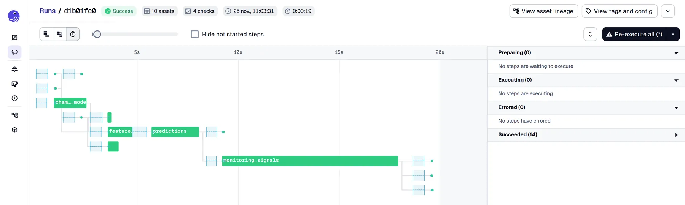
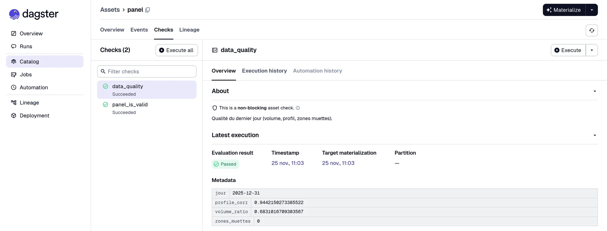
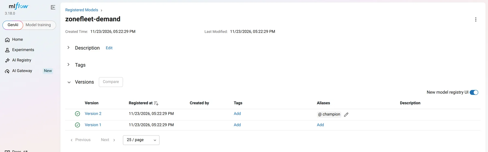
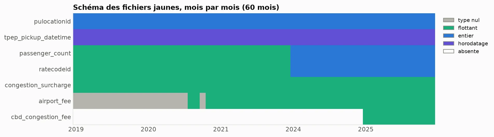
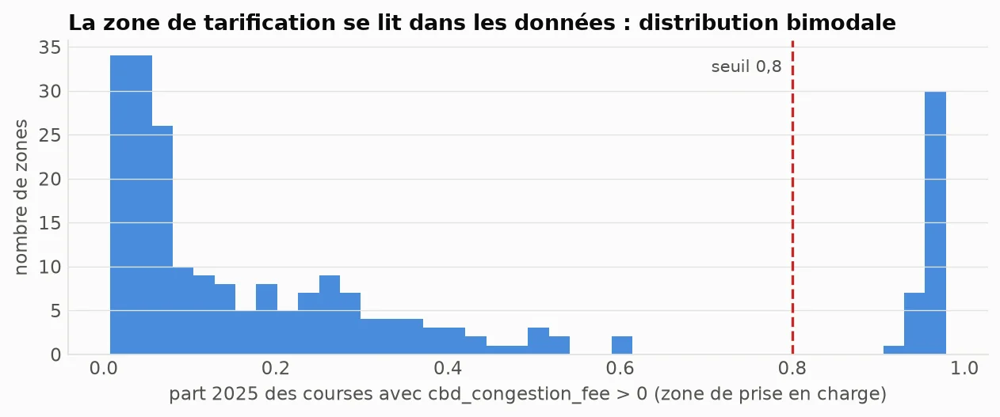
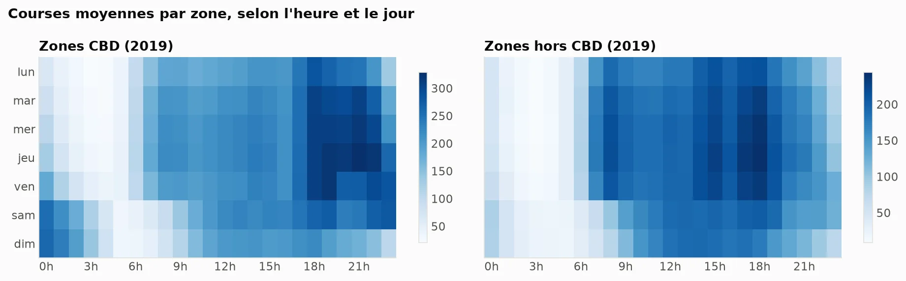
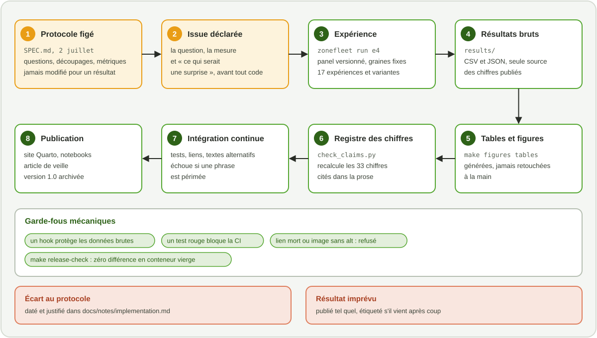
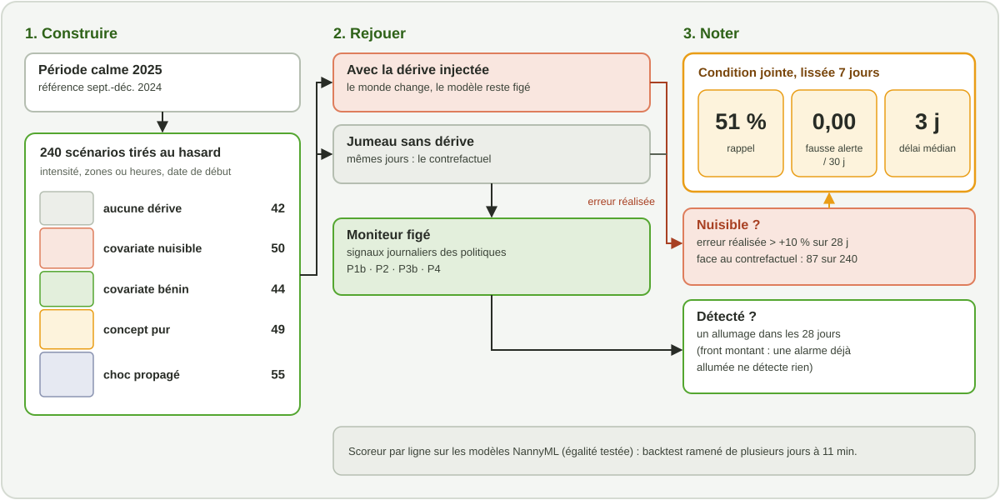
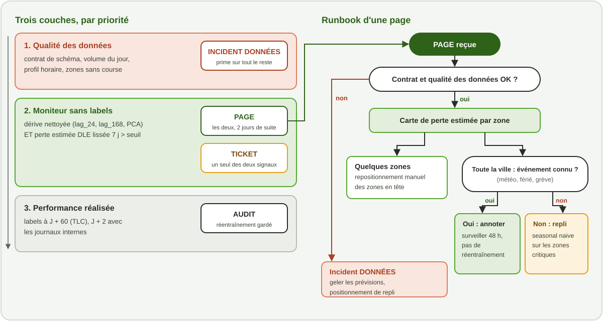


Savoir quand un modèle de prévision va mal alors que la vérité terrain n'arrive que deux mois plus
tard. Pas en lisant une documentation : en construisant la chaîne complète, de la donnée brute à
l'astreinte, puis en la mettant à l'épreuve.





le choc du COVID repéré en 9 jours, contre 62 en attendant les labels
pour la condition jointe, sur 240 scénarios et trois périodes calmes
cités dans la prose et recalculés par la CI à chaque modification




Ce dépôt est le laboratoire de l'article
[MLOps : surveiller un modèle de prévision en production]().
L'article raconte ce que les expériences ont montré ; cette fiche montre comment le travail est
construit, ce qui tourne derrière, et comment le reproduire.

## L'objectif

Le cadre est un client inventé, **ZoneFleet**, un opérateur de mobilité qui prévoit la veille la
demande horaire de courses dans 60 zones de New York. Les données sont réelles : les courses de
taxis publiées par la Taxi & Limousine Commission (TLC), avec deux ruptures, le COVID en 2020 et la
taxe de congestion de 2025. La TLC publie avec deux mois de retard : entre une prévision et sa
vérité terrain s'ouvre une **fenêtre aveugle** d'environ 61 jours.

Je voulais apprendre trois choses :

- mesurer la santé d'un modèle **pendant** cette fenêtre, avec la performance estimée sans labels
  (NannyML DLE) et la dérive des entrées ;
- savoir **où cette mesure ment**, en la confrontant à des dérives réelles et construites ;
- monter une **chaîne d'exploitation** crédible : orchestration, registre de modèles, contrôles
  qualité, règles d'alerte et runbook.

## L'architecture

La chaîne tient sur un poste, sans serveur. Dagster orchestre le monitoring comme un **graphe
d'assets** : chaque nœud est une donnée versionnable (le panel, les prévisions, les signaux), pas
une tâche, et Dagster sait ce qui doit être recalculé quand une source change.

. Quatre contrôles qualité sont attachés aux assets ; le modèle champion vient du registre MLflow, qui promeut un challenger quand il bat le modèle en place.")

Trois choix structurent le code :

- **Les décisions sont des fonctions pures.** La sévérité d'alerte et la recommandation de
  réentraînement sont testées sans orchestrateur ; Dagster ne fait que les appeler.
- **Le registre porte la traçabilité.** Un modèle n'est enregistré qu'avec sa période
  d'entraînement, ses métriques de référence et l'empreinte du panel. L'alias `champion` est la
  seule chose que le service de prévision lit, et un challenger n'est promu que s'il fait mieux de
  5 % sur une fenêtre **postérieure** à son entraînement.
- **Une CLI pour tout le reste.** `zonefleet run e4` lance une expérience, `zonefleet alert` évalue
  les règles d'alerte, `zonefleet list` liste les 17 expériences et variantes.

### L'envers du décor : Dagster

Les captures viennent d'une exécution locale du dépôt, sur le panel versionné.

, dix assets, du journal du contrat de données jusqu'au rapport du matin.")

Une exécution complète matérialise les dix assets et évalue les quatre contrôles en une vingtaine de
secondes. La frise montre où passe le temps : le calcul des signaux de monitoring (dérive, perte
estimée, perte réalisée) occupe l'essentiel de l'exécution.



Chaque contrôle qualité garde ses métadonnées. Celui du dernier jour compare le volume et le profil
horaire aux mêmes jours de semaine précédents, et compte les zones sans course. Il est volontairement
non bloquant : il signale, et c'est la règle d'alerte qui décide de l'incident.



### L'envers du décor : MLflow

Le registre est un fichier SQLite local : pour passer en production, seule l'URI change. Il contient
une version par expérience, le modèle entraîné en 2019 (COVID) et celui de 2024 (taxe de
congestion), qui porte ici l'alias `champion`.



Chaque version renvoie à son run, qui garde tout ce qu'il faut pour la reproduire ou la contester :
les hyperparamètres de LightGBM, la période d'entraînement, les métriques de référence, l'empreinte
du panel, l'expérience et le commit d'origine.

, hyperparamètres, empreinte du panel, découpage et commit git du script d'enregistrement.")

## Les données

Les sources : 120 fichiers Parquet mensuels de la TLC (3,6 Go, une ligne par course), la table des
263 zones, la météo horaire Open-Meteo et le calendrier américain.

Chaque fichier passe d'abord par un **contrat de données** versionné : colonnes requises
(bloquantes), ruptures connues et datées (`cbd_congestion_fee` acceptée seulement après le
5 janvier 2025), et tout le reste journalisé comme rupture inconnue. Seul le schéma est lu : les
120 fichiers sont contrôlés en moins d'une seconde.



Les courses sont ensuite agrégées avec duckdb en un **panel zone × heure** : 60 zones figées (les
plus actives en 2019, 93 % des courses), zéros explicites, heures du changement d'heure réparées.
Résultat : 2,6 millions de lignes, 10 Mo, versionnées dans le dépôt, si bien qu'aucune donnée brute
n'est nécessaire pour relancer les expériences.

L'appartenance à la zone taxée (le CBD) se lit dans les données, et les profils horaires montrent
deux villes différentes :





## La démarche

Le protocole a été figé avant tout code, dans `SPEC.md`, et n'a pas bougé. Chaque extension est
déclarée dans une issue avant d'être exécutée, avec la question, la mesure et « ce qui serait une
surprise ». Aucun chiffre n'est tapé à la main : tout part de `results/`.



Les expériences, dans l'ordre où elles ont été menées :

| Expérience | Question | Ce qu'elle a donné |
|---|---|---|
| E0 | Quel modèle surveiller ? | LightGBM global à trois quantiles, 24 à 27 % de mieux que le naïf saisonnier |
| E1 | Que voit le moniteur pendant le COVID ? | détection en 9 jours sans labels, ampleur sous-estimée d'un facteur 2,7 |
| E2 | Et après la taxe de congestion ? | une dérive sans impact : 177 jours d'alerte sur 177 pour la dérive seule |
| E3 | Où l'estimation sans labels ment-elle ? | elle suit le covariate shift (0,85 à 0,99), pas le concept drift (0,00) |
| E4 | Que vaut le moniteur comme détecteur ? | 51 % de rappel, 0 fausse alerte, 3 jours de délai pour la condition jointe |
| E5 | Faut-il réentraîner dès l'alerte ? | non : le réflexe fait pire que l'inaction sur l'année 2020 |
| E6 | Où regarder après une alerte ? | la perte estimée par zone classe les zones touchées (rang 0,74) |
| E7 | Comparer chaque jour à sa saison ? | utile pour la température, nuisible pour les lags |
| E8 | Et si les données mentent ? | des contrôles qualité voient 4 bugs le premier jour, le moniteur non |
| E9, E10 | La météo parfaite biaise-t-elle ? Alerter par quartier ? | non (0,08 %) ; 55 % de rappel par groupe de zones |

### Tester le moniteur lui-même

Un moniteur est un classifieur : il a un rappel, un taux de fausses alertes et un délai. E4 les
mesure sur 240 scénarios tirés au hasard, chacun comparé à son jumeau sans dérive.



La première version prenait plusieurs jours de calcul. Un **scoreur par ligne** qui réutilise les
modèles internes de NannyML (l'égalité des résultats est testée) l'a ramenée à onze minutes, ce qui
a rendu possibles les variantes de sensibilité et les périodes calmes supplémentaires.

## De l'alerte à l'action

La décision combine trois couches, par ordre de priorité, et une page déclenche un runbook court :



```text
PAGE    si  (psi_lag24 > 0,25 OU psi_lag168 > 0,25 OU pca_alert)
         ET dle_mae_log_lisse_7j > seuil_reference(k = 1)
         pendant 2 jours consécutifs
TICKET  si  dérive nettoyée seule 7 jours, ou perte estimée seule 2 jours
INCIDENT DONNÉES  si un contrôle de qualité échoue   -> prime sur tout le reste
```

Chaque jour, un **rapport du matin** résume la sévérité, les signaux, les zones en tête de perte
estimée et la recommandation de réentraînement.

## Ce qui a coincé

Une méthode se juge aussi à ce qu'elle rattrape. Ces erreurs ont été trouvées en cours de route,
corrigées, et documentées dans `docs/notes/implementation.md` :

| Problème | Comment il a été trouvé | Correction |
|---|---|---|
| Entrées de saison extrapolées hors de l'entraînement | erreur de référence anormalement haute | retrait, MAE 29,5 → 22,7 |
| PSI journalier sur une moyenne glissante de 7 jours | 73 % de jours en alerte sans déplacement | artefact documenté |
| Rappel de 100 % pour une alarme toujours allumée | délai incohérent | détection par « front montant » |
| E3 mesurée en avant / après | effet non nul sans dérive | comparaison à un contrefactuel |
| Rapport du matin lisant des labels « du futur » | relecture d'un exemple | horloge des labels |
| 53 images sans texte alternatif, rendu en échec masqué en CI | contrôle du site rendu | CI qui échoue vraiment |

Deux autres points m'ont pris du temps :

- **Le changement d'heure.** En heure locale, 2 h n'existe pas au printemps et 1 h existe deux fois
  à l'automne. Une heure manquante ou doublée ne lève aucune erreur, elle fausse les lags en
  silence ; le panel la répare explicitement.
- **Une rupture réelle ressemble à un bug.** Le rapport du 23 mars 2020 classe la journée en
  « incident données » : le volume vaut 7 % de la médiane des lundis précédents, exactement comme un
  fichier tronqué. La couche qualité a raison sur le symptôme ; seul un humain sait qu'un état
  d'urgence vient d'être déclaré.

## Ce que j'en retiens

- Un moniteur se backteste comme un modèle avant d'être branché sur une astreinte : sans backtest,
  je n'aurais vu ni le faux rappel de 100 % ni le rôle critique de la persistance.
- Penser en assets plutôt qu'en tâches rend la chaîne lisible : on voit ce qui dépend de quoi, et
  les contrôles qualité s'attachent naturellement aux données qu'ils protègent.
- Le registre n'est utile que s'il porte de quoi contester un modèle : période, métriques de
  référence, empreinte des données, commit.
- La couche qualité des données passe avant le moniteur de modèle : un bug de données produit les
  symptômes d'une dérive, et un réentraînement apprendrait dessus.
- Figer le protocole et faire vérifier les chiffres par la CI coûte peu au départ et évite de
  réécrire l'histoire à la fin.

## Reproduire

```bash
git clone https://github.com/gwils28/zonefleet-observability && cd zonefleet-observability
uv sync --all-extras
make check            # lint, typage, plus de 160 tests
make e0 e1 e2 e3      # quelques minutes, sur le panel versionné
make e4 e5            # environ 20 minutes
make registry         # enregistre les modèles figés dans le registre MLflow local
make dagster          # interface Dagster sur http://localhost:3000
make release-check    # toutes les figures et tables régénérées, sans différence
```

Sans Python local : `docker build -t zonefleet .` puis `docker run --rm zonefleet make check`. Le
[site du projet](https://gwils28.github.io/zonefleet-observability/) détaille chaque expérience,
avec trois notebooks, le runbook et le journal de bord.

Données : **NYC Taxi & Limousine Commission**, Trip Record Data ; météo **Open-Meteo**.
